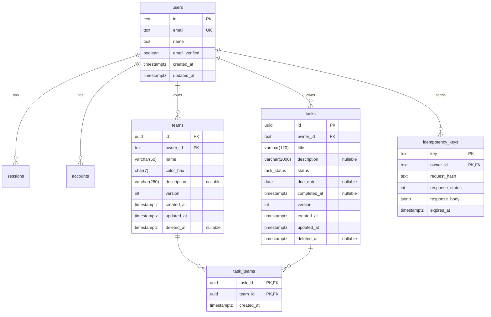

# Teams & Tasks

A small fullstack system for managing **teams** and **tasks**: a NestJS REST API (PostgreSQL, Better Auth) and an Expo mobile app, in one pnpm/Turborepo monorepo. Built spec-first as a senior-level hiring test. Tasks can belong to zero or more teams; every user sees only their own data.

> **Status.** The backend is implemented and verified end to end: `docker compose up --build` migrates, seeds and serves the API, Swagger UI and the request collection pass against a fresh stack in CI. The mobile app, the generated API client, the SigNoz profile and the k6 scripts are not in the repository yet; the sections below mark them ⚠️ and describe the target behavior ([ADR-0018](docs/architecture/adr/0018-docker-compose-one-command-run.md), [runbook](docs/operations/runbook.md)).

**Contents:** [Architectural decisions](#architectural-decisions) · [Data model](#data-model) · [How to run](#how-to-run) · [API contract summary](#api-contract-summary) · [Request examples](#request-examples) · [Production notes](#what-id-do-differently-in-production) · [Project structure](#project-structure) · [Testing](#testing) · [Contributing](#contributing) · [Troubleshooting](#troubleshooting)

Full documentation map: [docs/README.md](docs/README.md).

## Architectural decisions

Every significant decision is an [ADR](docs/architecture/adr/README.md) with the alternatives that were rejected. The principles behind them are in the [constitution](docs/constitution.md); the big picture is in the [architecture overview](docs/architecture/overview.md).

| Area             | Decision                                                                    | Why (short)                                                                                            | ADR                                                                             |
| ---------------- | --------------------------------------------------------------------------- | ------------------------------------------------------------------------------------------------------ | ------------------------------------------------------------------------------- |
| Repository       | pnpm workspaces + Turborepo monorepo                                        | Atomic cross-cutting changes (DTO → client → screen) in one PR; fast, affected-only CI                 | [0001](docs/architecture/adr/0001-monorepo-pnpm-turborepo.md)                   |
| API architecture | NestJS with Clean Architecture, DDD and CQRS                                | Business rules unit-testable in milliseconds; Nest conventions and official packages first             | [0002](docs/architecture/adr/0002-nestjs-clean-architecture-ddd-cqrs.md)        |
| Database         | PostgreSQL                                                                  | Referential integrity for the N:M relationship; partial unique indexes, functional indexes, enums      | [0003](docs/architecture/adr/0003-postgresql.md)                                |
| Persistence      | Prisma, SQL migrations, deterministic seed                                  | End-to-end type safety; reviewable migrations applied non-interactively in Docker and CI               | [0004](docs/architecture/adr/0004-prisma-migrations-and-seeding.md)             |
| API style        | REST + OpenAPI with response/error envelopes                                | Easy to exercise with cURL/Bruno; one contract that Swagger UI and orval understand                    | [0005](docs/architecture/adr/0005-rest-openapi-and-response-envelope.md)        |
| Pagination       | Offset pagination                                                           | The brief expects total/pagination metadata; simple to call by hand                                    | [0006](docs/architecture/adr/0006-offset-pagination.md)                         |
| Authentication   | Better Auth                                                                 | Self-hosted on our PostgreSQL; secure defaults without hand-written crypto glue                        | [0007](docs/architecture/adr/0007-better-auth.md)                               |
| Contract         | class-validator DTOs → OpenAPI → generated orval client                     | Single source of truth, idiomatic in Nest; typed React Query hooks and zod schemas                     | [0008](docs/architecture/adr/0008-class-validator-dtos-and-generated-client.md) |
| Mobile platform  | Expo (managed, Expo Go) + Expo Router                                       | No native toolchain for evaluators: scan a QR code                                                     | [0009](docs/architecture/adr/0009-expo-and-expo-router.md)                      |
| State management | React Query (server state) + Zustand/immer (local state)                    | Every piece of state has exactly one home; caching, retries and optimistic updates without custom code | [0010](docs/architecture/adr/0010-react-query-and-zustand-immer.md)             |
| Styling          | NativeWind v4 with `@apply` semantic classes                                | No styled-components (brief); works in Expo Go without native modules                                  | [0011](docs/architecture/adr/0011-nativewind-with-apply.md)                     |
| Offline          | Persisted cache, optimistic updates, queued mutations                       | Readable offline after restart; offline mutations replay in order                                      | [0012](docs/architecture/adr/0012-offline-first-and-optimistic-updates.md)      |
| Observability    | OpenTelemetry + SigNoz                                                      | Vendor-neutral instrumentation; automatic HTTP and Prisma spans                                        | [0013](docs/architecture/adr/0013-opentelemetry-and-signoz.md)                  |
| Testing          | Test pyramid, Testcontainers for PostgreSQL, mutation testing on the domain | Fast feedback, with realism where SQL and migrations matter                                            | [0014](docs/architecture/adr/0014-testing-strategy.md)                          |
| Concurrency      | Optimistic locking with `version` + ETag/`If-Match`                         | Prevents lost updates without long-lived locks                                                         | [0015](docs/architecture/adr/0015-optimistic-concurrency.md)                    |
| Deletion         | Soft delete                                                                 | Recoverability and auditability; correct uniqueness with deleted rows                                  | [0016](docs/architecture/adr/0016-soft-delete.md)                               |
| Delivery         | Conventional Commits, atomic PRs                                            | Reviewable units; history that explains why and can be bisected                                        | [0017](docs/architecture/adr/0017-conventional-commits-and-atomic-prs.md)       |
| Local run        | Docker Compose one-command run                                              | One command, deterministic startup order (database → migrate → seed → API)                             | [0018](docs/architecture/adr/0018-docker-compose-one-command-run.md)            |
| Retries          | Idempotency keys on `POST`                                                  | Exactly-once effect under client retries and offline replays                                           | [0019](docs/architecture/adr/0019-idempotency-keys.md)                          |

Entity modeling (aggregates, value objects, bounded contexts): [domain model](docs/architecture/domain-model.md).

## Data model

PostgreSQL 17, managed by Prisma. A user owns teams and tasks; a task belongs to zero or more teams through an explicit join table (`task_teams`) so the relationship can carry its own columns and be indexed on purpose. Teams and tasks are soft-deleted and carry a `version` used for optimistic concurrency. Details, indexes and the reasoning behind them: [data model](docs/architecture/data-model.md).



`sessions`, `accounts` and `verifications` are the Better Auth tables ([ADR-0007](docs/architecture/adr/0007-better-auth.md)).

**Migrations and seed.** The schema lives in `apps/api/prisma/schema.prisma`; SQL migrations in `apps/api/prisma/migrations/` (identity tables, teams, tasks and `task_teams` so far) are applied non-interactively by `prisma migrate deploy` — by the one-shot `migrate` service of `docker compose up` and by the Testcontainers harness in the tests — so a fresh machine reaches the same schema. Indexes and checks Prisma cannot express (partial unique `(owner_id, lower(name))`, trigram search, status/completion consistency) are raw SQL in those migrations. `idempotency_keys` is part of the model above but its migration arrives with T-002-05; the deterministic demo seed (one user, 3 teams, 10 tasks with fixed ids) is T-007-07 ([data model](docs/architecture/data-model.md), [ADR-0004](docs/architecture/adr/0004-prisma-migrations-and-seeding.md)).

## How to run

> The backend path below is verified. The `mobile` and `observability` profiles (⚠️) are not implemented yet.

### Backend (Docker)

Requirements: **Docker with Compose v2**. Nothing else is needed for the API.

```bash
git clone <repository-url> && cd hitss
docker compose up --build
```

This starts PostgreSQL, waits until it is healthy, runs the one-shot `migrate` service (Prisma migrations; the API starts only if it succeeded) and seeds the demo data (deterministic and idempotent; `SEED_ON_START=false` skips it) and starts the API on port 3000. The first build takes a few minutes; later starts are fast. The API container builds its database URL from the `POSTGRES_*` settings (set `DATABASE_URL` to override it). No `.env` is required; to override settings copy `.env.example` to `.env` (for example `API_PORT=3100` when port 3000 is taken).

| What         | Where                                     |
| ------------ | ----------------------------------------- |
| API base URL | http://localhost:3000/api/v1              |
| Swagger UI   | http://localhost:3000/docs                |
| OpenAPI JSON | http://localhost:3000/docs/openapi.json   |
| Health       | http://localhost:3000/api/v1/health/ready |
| Demo account | `demo@teams-tasks.dev` / `Demo@1234`      |

The seed is deterministic and idempotent: the demo account owns 3 teams and 10 tasks covering every status, tasks in several teams, a task without a team and an overdue task.

### Mobile app (Expo Go)

⚠️ Target behavior, not yet implemented.

1. Install **Expo Go** on your phone.
2. Start the optional `mobile` service: `docker compose --profile mobile up mobile` (or `make mobile`) and scan the QR code.
3. A physical device cannot reach your computer through `localhost`. Point the app at your computer's LAN IP (same Wi-Fi network):

   ```bash
   EXPO_PUBLIC_API_URL=http://192.168.1.20:3000 docker compose --profile mobile up mobile
   ```

   Emulators: Android → `http://10.0.2.2:3000`, iOS simulator → `http://localhost:3000`. Troubleshooting: [runbook](docs/operations/runbook.md#expo-device-cant-reach-the-api).

### Observability (optional, SigNoz)

⚠️ Target behavior, not yet implemented. Needs about 4 GB of free RAM.

```bash
docker compose --profile observability up -d --build --wait   # or: make observability
# UI: http://localhost:8080
```

Telemetry is optional: without a collector the API starts and serves normally and drops what it cannot export, `OTEL_SDK_DISABLED=true` turns it off, and logs are JSON on stdout only (no OTLP log pipeline). How to find a trace and which dashboards and alerts exist: [observability](docs/operations/observability.md).

### Make aliases and scripts

`make` is optional; every alias echoes the plain command it runs, so the same works without it. `make` with no target lists them.

| Goal                                                                            | Alias              | Plain command                         |
| ------------------------------------------------------------------------------- | ------------------ | ------------------------------------- |
| Build and start everything, wait ready                                          | `make up`          | `docker compose up -d --build --wait` |
| Stop (keeps the database volume)                                                | `make down`        | `docker compose down`                 |
| Follow the API logs                                                             | `make logs`        | `docker compose logs -f api`          |
| Drop the data and start from scratch                                            | `make reset`       | `docker compose down -v` then `up`    |
| Re-apply the demo data                                                          | `make seed`        | `docker compose exec api …` (echoed)  |
| Unit tests on the host                                                          | `make test`        | `pnpm test`                           |
| Every suite (needs Docker)                                                      | `make test-all`    | `pnpm test:all`                       |
| Unit tests in a throwaway container                                             | `make test-docker` | echoed by make                        |
| Fresh-stack smoke test (stop the dev stack first: it needs ports 3000 and 5432) | `make smoke`       | `tools/ci/compose-smoke.sh`           |

Root scripts for the host toolchain (Node ≥ 24, pnpm 10): `pnpm start` / `pnpm stop` (compose up and down), `pnpm build`, `pnpm lint`, `pnpm typecheck`, `pnpm test`, `pnpm test:all`, `pnpm format`. More commands and failure handling: [runbook](docs/operations/runbook.md).

### Other operations

Stop, reset, logs, re-seed and common failures: [runbook](docs/operations/runbook.md).

## API contract summary

Base URL `http://localhost:3000`; business routes under `/api/v1`, authentication under `/api/auth` (Better Auth, its native format). Full contract: [API contracts](docs/architecture/api-contracts.md) and Swagger UI at `/docs` (served while `DOCS_ENABLED`: on by default locally, always off in production).

| Topic       | Rule                                                                                                                                                                                                                                                |
| ----------- | --------------------------------------------------------------------------------------------------------------------------------------------------------------------------------------------------------------------------------------------------- |
| Auth        | Sign up or in at `/api/auth/sign-up/email` · `/sign-in/email`; send `Authorization: Bearer <token>` (mobile) or the session cookie (web). Every `/api/v1/*` route needs one, except the health probes                                               |
| Success     | `{ "data": <resource or array>, "meta"?: { total, limit, offset, hasNextPage } }`                                                                                                                                                                   |
| Errors      | `{ "error": { "code": "VALIDATION_FAILED", "message": "…", "details"?: […], "traceId": "…" } }`: 400, 401, 403, 404, 409, 412, 415, 422, 429, 500                                                                                                   |
| Concurrency | `ETag: W/"<version>"` on every single-resource response (lists and `204` carry none). `If-Match` is honored on `PUT`/`DELETE /teams/:id` (stale → `412`); for tasks it is **not read yet** (T-003-17, deferred), so task writes are last-write-wins |
| Retries     | **Planned** (T-002-05, deferred): `POST` accepts `Idempotency-Key` and replays the first response for the same key and body                                                                                                                         |
| Limits      | Per client address before authentication and per user after (`429 RATE_LIMITED` + `Retry-After`); `/api/auth/*` bodies over 16 kB → `413`                                                                                                           |
| Correlation | Every response has `X-Request-Id`; error envelopes carry the `traceId` of the request's trace                                                                                                                                                       |

Implemented: teams (list, create, get, replace, delete), tasks (list with filters, search and sort; create, get, replace, change status, delete), `GET /api/v1/health/live` and `/ready`, and the four `/api/auth` routes (sign-up, sign-in, sign-out, get-session). Remaining contract items are tracked in specs [002](docs/specs/002-teams/tasks.md) and [003](docs/specs/003-tasks/tasks.md).

## Request examples

The API is enveloped and versioned under `/api/v1`; auth endpoints live under `/api/auth`. Full reference (headers, error codes, pagination, sorting): [API contracts](docs/architecture/api-contracts.md). Interactive docs: Swagger UI at `/docs`.

```bash
API=http://localhost:3000

# Sign in as the seeded demo user and keep the token
TOKEN=$(curl -si -X POST $API/api/auth/sign-in/email \
  -H 'Content-Type: application/json' \
  -d '{"email":"demo@teams-tasks.dev","password":"Demo@1234"}' \
  | grep -i '^set-auth-token:' | cut -d' ' -f2 | tr -d '\r')

# List teams
curl -s "$API/api/v1/teams?limit=10" -H "Authorization: Bearer $TOKEN"

# Create a team (an Idempotency-Key header that makes retries safe is planned, T-002-05)
curl -s -X POST $API/api/v1/teams -H "Authorization: Bearer $TOKEN" \
  -H 'Content-Type: application/json' \
  -d '{"name":"Platform","colorHex":"#0EA5E9","description":"Infra & tooling"}'

# Update (replace) a team; If-Match carries the ETag you read, a stale tag answers 412
curl -s -X PUT $API/api/v1/teams/<teamId> -H "Authorization: Bearer $TOKEN" \
  -H 'Content-Type: application/json' -H 'If-Match: W/"1"' \
  -d '{"name":"Platform","colorHex":"#10B981","description":"Renamed"}'

# Delete a team (tasks keep existing, only the link goes away)
curl -s -X DELETE $API/api/v1/teams/<teamId> -H "Authorization: Bearer $TOKEN" -o /dev/null -w '%{http_code}\n'

# Pending or in-progress tasks of a team, matching "login", by due date
curl -s "$API/api/v1/tasks?teamId=<teamId>&status=PENDING,IN_PROGRESS&search=login&sort=dueDate&limit=20&offset=0" \
  -H "Authorization: Bearer $TOKEN"

# Create a task in two teams
curl -s -X POST $API/api/v1/tasks -H "Authorization: Bearer $TOKEN" \
  -H 'Content-Type: application/json' \
  -d '{"title":"Write release notes","dueDate":"2026-11-05","teamIds":["<teamA>","<teamB>"]}'

# Quick action: mark as done (task If-Match is accepted but not checked yet, T-003-17)
curl -s -X PATCH $API/api/v1/tasks/<taskId>/status -H "Authorization: Bearer $TOKEN" \
  -H 'Content-Type: application/json' -H 'If-Match: W/"3"' \
  -d '{"status":"DONE"}'

# Delete a task
curl -s -X DELETE $API/api/v1/tasks/<taskId> -H "Authorization: Bearer $TOKEN" -o /dev/null -w '%{http_code}\n'
```

Ready-made requests that cover the same calls:

- **Bruno:** the collection in [`tools/bruno/teams-tasks`](tools/bruno/teams-tasks) (health, auth, teams, tasks). Open the folder in [Bruno](https://www.usebruno.com/), pick the `local` environment, set the `demoPassword` secret to the demo password above and run `Sign in (demo user)` once: its script saves the token and every other request is authorized. The requests that create data delete what they created, and sign-out runs last. Headless: `cd tools/bruno/teams-tasks && npx @usebruno/cli@4.2.1 run --env local --env-var demoPassword=<demo password>`.
- **`.http` files:** [`tools/http`](tools/http) (`health`, `auth`, `teams`, `tasks`) for the VS Code REST Client or the JetBrains HTTP Client; each file signs in by itself and runs top to bottom.

CI runs the Bruno collection against a freshly seeded stack on every pull request and fails when a Bruno request has no `.http` twin.

## What I'd do differently in production

The project stops deliberately where the cost only pays off with real traffic or a real deployment target. Summary — each item has a "today → in production → why / when" table in [production readiness](docs/operations/production-readiness.md):

| Topic              | Today                                                                           | In production                                                                                                                                        |
| ------------------ | ------------------------------------------------------------------------------- | ---------------------------------------------------------------------------------------------------------------------------------------------------- |
| Cache              | `ETag` on single resources; React Query cache on the device                     | `If-None-Match` → `304`, `Cache-Control: private, no-cache`, Redis read-through cache with event-driven invalidation for hot lists                   |
| Logs and telemetry | JSON logs to stdout, redacted (no OTLP logs); local SigNoz profile planned      | Managed backend, retention policy, tail sampling, audit log, mobile crash reporting, alerts as code                                                  |
| Scalability        | One stateless API container; offset pagination; in-memory rate limiter          | Horizontal scaling, Redis-backed throttling, PgBouncer, read replicas, cursor pagination, transactional outbox                                       |
| Security           | Owner scoping, validation, throttler, `helmet`, env secrets with local defaults | Secrets manager, TLS/HSTS, WAF, email verification + MFA, SCA/SAST and container scanning, least-privilege DB roles, Swagger disabled or behind auth |

Also covered there: reliability, CD pipeline, data lifecycle, multi-tenancy. Security analysis: [threat model](docs/security/threat-model.md).

## Project structure

```text
apps/
  api/              NestJS 11 REST API (Clean Architecture, CQRS, Prisma, Better Auth)
  mobile/           Expo app — ⚠️ not created yet
packages/
  api-client/       orval-generated client from the API's OpenAPI — ⚠️ not created yet
  tsconfig/         shared strict tsconfig bases
docs/               constitution, product, specs, architecture, ADRs, quality, security, operations
tools/              bruno/ + http/ (request collections), ci/ (CI scripts and checks); k6/ — ⚠️ not created yet
```

Full target layout of the API and the mobile app: [architecture overview §6](docs/architecture/overview.md#6-folder-structure).

## Testing

Requires Node ≥ 24, pnpm 10 and a running Docker daemon for the Testcontainers suites. CI runs all of these; the fast ones are enough while developing.

```bash
pnpm install
pnpm lint && pnpm typecheck && pnpm test      # fast gates; `pnpm test` = unit tests only, no Docker
pnpm test:integration                         # real PostgreSQL via Testcontainers (needs Docker)
pnpm test:e2e                                 # supertest against the full Nest app (needs Docker)
pnpm arch                                     # dependency-cruiser layer rules
pnpm test:tools && pnpm traceability:check    # CI scripts, and AC ↔ test traceability
```

Every MUST acceptance criterion of a finished task is named by at least one automated test, by the AC id leading the test title; CI enforces it ([traceability matrix](docs/quality/traceability-matrix.md)). Strategy, pyramid proportions, mutation testing and test data: [test strategy](docs/quality/test-strategy.md) · [ADR-0014](docs/architecture/adr/0014-testing-strategy.md).

## Contributing

The project follows **Spec-Driven Development**: no code without an approved task in `docs/specs/<id>-<feature>/tasks.md`. Order per feature: `spec.md` → `*.feature` → `plan.md` → `tasks.md` → test-first implementation → review → atomic PR. See [specs](docs/specs/README.md) and the [definition of done](docs/quality/definition-of-done.md).

- **Commits:** [Conventional Commits](https://www.conventionalcommits.org/), validated by commitlint. Scopes: `api`, `mobile`, `api-client`, `docs`, `adr`, `spec`, `ci`, `infra`, `deps`, `agents`.
- **PRs:** one task = one PR, linked to its spec task and ADRs ([ADR-0017](docs/architecture/adr/0017-conventional-commits-and-atomic-prs.md)).
- **Traceability:** test titles start with the AC id they prove (`it('AC-02.1.3 rejects …')`). CI fails when a PR removes the last test of an AC (compared with the base branch), on a MUST AC without scenario or task, and on a stale [traceability matrix](docs/quality/traceability-matrix.md); run `pnpm traceability` after changing specs, scenarios or task `Covers:` lines. A PR that completes a spec task also sets that task's `- **Status:** done` line in `tasks.md`; from then on every MUST AC the task covers needs a test (CI fails otherwise unless a waiver with a reason is recorded in `tools/ci/traceability-waivers.json`). Which ACs have automated tests is shown in the CI job summary, not committed.
- **Before pushing:** `pnpm lint && pnpm typecheck && pnpm test` (the husky hooks run commitlint and lint-staged on every commit; run `pnpm install` once per clone or worktree so they are installed). Secrets live only in a git-ignored `.env`; CI runs gitleaks.
- **Branch protection (recommended for `main`, applied by the repository owner):** require a pull request with one approval, dismiss stale approvals, require the `ci-success` status and an up-to-date branch, require conversation resolution, linear history (rebase merge only), and block force pushes and deletion. Details: [plan 007](docs/specs/007-ci-and-dx/plan.md#conventions--branch-protection).
- **Principles:** the [constitution](docs/constitution.md) is non-negotiable; decisions that change it need an ADR.

## Troubleshooting

Port 3000 in use (`API_PORT=3100 make up`), the API waiting for the database, 401 and 429 answers, a phone that cannot reach the API, slow builds, and how to reset or clean up everything are covered in the [runbook](docs/operations/runbook.md#common-failures). `make reset` gives a clean database; `docker compose logs api` shows why a service is unhealthy.
