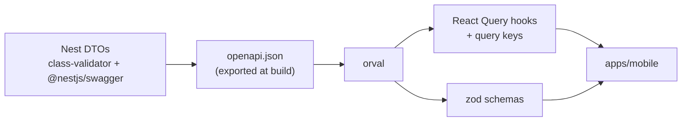

# ADR-0008 — class-validator DTOs as contract source + orval client

- **Status:** Accepted
- **Date:** 2026-10-20
- **Deciders:** software-architect, nestjs-specialist, react-native-expo-specialist

## Context

The API contract must have **one** source of truth (constitution §IV.1). The app must never hand-write API types, and server-side validation rules (lengths, formats, enums) should be reusable on the client for form validation (react-hook-form + zod, required by the brief). Any contract change must be visible in review and break CI if the client is stale.

## Decision drivers

- Single source of truth, idiomatic in NestJS.
- Generated client with React Query hooks (brief: React Query for server state) and zod schemas.
- Validation rules expressed once and enforced at the API boundary.
- Drift detection in CI.
- Team preference for Nest-native tooling.

## Considered options

### 1. class-validator/class-transformer DTOs + `@nestjs/swagger` → OpenAPI → orval (chosen)

- **+** The Nest-native way: `ValidationPipe` + decorated DTO classes, documented by `@nestjs/swagger` (CLI plugin infers most `@ApiProperty` metadata).
- **+** orval generates typed React Query hooks (`useListTasks`, `useChangeTaskStatus`), query-key helpers and zod schemas from the same OpenAPI document.
- **+** Neutral contract (OpenAPI) also feeds Swagger UI and Bruno.
- **−** Validation is declared with decorators and must be mirrored in Swagger metadata (the CLI plugin + `class-validator` integration covers lengths, patterns, enums).
- **−** Codegen step; generated code must be kept in sync (solved by CI drift check).

### 2. zod on the backend (`nestjs-zod`) shared with the app

- **+** One zod schema reused verbatim on both sides; no codegen for types.
- **−** Departs from Nest's documented validation path; the team explicitly preferred class-validator. OpenAPI generation from zod adds a second adapter layer.

### 3. ts-rest / tRPC contract package

- **+** Compile-time end-to-end types.
- **−** Contract lives in TypeScript instead of an open standard; cURL users and Swagger UI become second-class; replaces Nest controllers' idioms.

### 4. Hand-written client types and fetch functions

- **−** Duplicates the contract; drift is guaranteed over time; forbidden by the constitution.

## Decision outcome

- **API:** request and response DTOs live in `presentation/dto/`. A script (`pnpm --filter @hitss/api openapi:export`) boots the Nest app in a no-listen mode and writes `apps/api/openapi.json` (committed).
- **Client package** `packages/api-client` (committed output, `generated/` folder):
  - orval target 1: `client: "react-query"`, `httpClient: "fetch"`, `mode: "tags-split"`, with a **custom mutator** `src/mutator.ts` that:
    - prefixes the configured `baseUrl`;
    - adds auth headers from an injected provider (`configureApiClient({ baseUrl, getAuthHeaders })`), plus `Idempotency-Key` for POST and `If-Match` when a version is supplied;
    - parses the envelope: returns the typed `{ data, meta? }` body on success, throws a typed `ApiError { status, code, message, details, traceId }` on error envelopes;
  - orval target 2: `client: "zod"` for request bodies, used by forms (`TaskCreateBody` → extended with UI messages in `features/tasks/schemas`).
- **CI drift check:** CI regenerates `openapi.json` and the client and fails on `git diff --exit-code` — a DTO change without a regenerated client cannot merge.
- **Rule:** the app imports API types and hooks only from `@hitss/api-client` (lint rule M4).

## Consequences

**Positive**

- Changing a DTO updates server validation, docs, hooks and form schemas in one PR.
- The mobile app cannot call an endpoint that does not exist or send a field the server rejects (type error).
- Contract changes are reviewable as an `openapi.json` diff.

**Negative**

- Generated code in the repo inflates diffs; marked as `linguist-generated` in `.gitattributes` so GitHub collapses it.
- Client-side zod messages are generic; feature schemas extend them for UX copy and i18n.

**Neutral**

- If the team later moves to zod on the server, only the left side of the pipeline changes; the client pipeline stays.

## Links

- [ADR-0005 — REST + OpenAPI](0005-rest-openapi-and-response-envelope.md) · [ADR-0010 — React Query](0010-react-query-and-zustand-immer.md)
- orval: https://orval.dev · NestJS validation: https://docs.nestjs.com/techniques/validation
