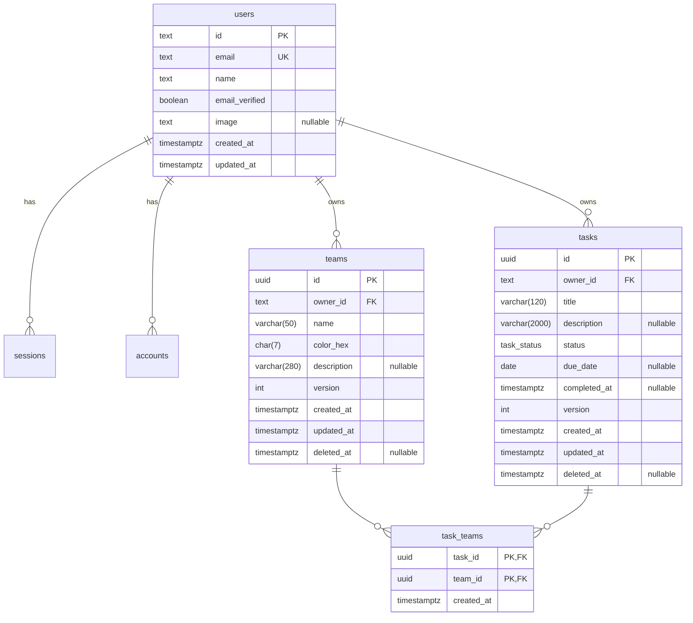

# Data Model

PostgreSQL 17, managed by Prisma (schema in `apps/api/prisma/schema.prisma`). Decisions: [ADR-0003](adr/0003-postgresql.md), [ADR-0004](adr/0004-prisma-migrations-and-seeding.md), [ADR-0015](adr/archive/0015-optimistic-concurrency.md), [ADR-0016](adr/archive/0016-soft-delete.md).

## Entity-relationship diagram



`idempotency_keys` (key, owner, request hash, stored response, expiry) is **planned, not migrated**: it comes with the `Idempotency-Key` support (T-002-05 / T-003-18, COULD; [ADR-0019](adr/archive/0019-idempotency-keys.md)).

`sessions`, `accounts` and `verifications` follow the Better Auth schema (generated with the Better Auth CLI, the `auth` package: `auth generate --adapter prisma`, then mapped to snake_case) and are owned by the Identity context; other contexts only reference `users.id`. User ids are **UUIDs** (`advanced.database.generateId: 'uuid'`), but `users.id` and every `owner_id` stay `text`; the domain treats `ownerId` as an opaque string ([ADR-0007](adr/0007-better-auth.md)). With `generateId: 'uuid'` on PostgreSQL, Better Auth omits the id on insert and expects the database to generate it, so every identity id column defaults to `gen_random_uuid()::text` (Better Auth's own generator would emit `uuid` columns; `text` is kept on purpose). Identity indexes: unique `users.email`, unique `sessions.token`, unique `accounts(provider_id, account_id)`, `sessions(user_id)`, `accounts(user_id)`, `verifications(identifier)`; `sessions` and `accounts` reference `users` with `ON DELETE CASCADE`. Integrity checks (raw SQL in `create_identity_tables`): `users_email_lowercase` (`email = lower(email)`), `users_name_length` (1–100 characters), `users_email_length` (≤ 254 characters). `updated_at` defaults to the current time on every identity table.

## Relationships

| Relationship | Cardinality                                      | Implementation                                                                               |
| ------------ | ------------------------------------------------ | -------------------------------------------------------------------------------------------- |
| User → Team  | 1 : N                                            | `teams.owner_id` FK, `ON DELETE CASCADE`                                                     |
| User → Task  | 1 : N                                            | `tasks.owner_id` FK, `ON DELETE CASCADE`                                                     |
| Task ↔ Team  | N : M (a task belongs to **zero or more** teams) | Join table `task_teams` with composite PK `(task_id, team_id)`; both FKs `ON DELETE CASCADE` |

Explicit join table (instead of Prisma's implicit m-n) so it can carry `created_at`, be indexed deliberately and be queried directly for the `teamId` filter.

## Enum

```sql
CREATE TYPE task_status AS ENUM ('PENDING', 'IN_PROGRESS', 'DONE');
```

## Indexes and why

| Index                                                                                                           | Serves                                                                                                                                                           |
| --------------------------------------------------------------------------------------------------------------- | ---------------------------------------------------------------------------------------------------------------------------------------------------------------- |
| `teams_owner_id_lower_name_key`: `teams (owner_id, lower(name)) UNIQUE WHERE deleted_at IS NULL`                | Team-name uniqueness per owner, ignoring soft-deleted rows (case-insensitive), and `sort=name` (the name order is `lower(name)` alone, so this index serves it). |
| `teams_owner_id_created_at_idx`: `teams (owner_id, created_at DESC, id DESC) WHERE deleted_at IS NULL`          | Default team listing.                                                                                                                                            |
| `tasks_owner_created_idx`: `tasks (owner_id, created_at DESC, id DESC) WHERE deleted_at IS NULL`                | Default task listing (no `status` filter, default sort) and the count per owner.                                                                                 |
| `tasks_owner_status_created_idx`: `tasks (owner_id, status, created_at DESC, id DESC) WHERE deleted_at IS NULL` | Listing filtered by one status with the default sort — the hottest query (one status is an equality, so rows come out already ordered).                          |
| `tasks_owner_due_idx`: `tasks (owner_id, due_date, id) WHERE deleted_at IS NULL`                                | `sort=dueDate` ascending (`NULLS LAST` is the B-tree order). `-dueDate` keeps nulls last, so it sorts the owner's rows instead (acceptable per owner).           |
| `tasks_search_trgm_idx`: `tasks USING GIN (title gin_trgm_ops, description gin_trgm_ops)`                       | `search` with `ILIKE '%term%'` (extension `pg_trgm`); it can serve both arms as a BitmapOr. The planner may prefer an owner index for short pages.               |
| `task_teams_team_id_task_id_idx`: `task_teams (team_id, task_id)`                                               | `teamId` filter (the PK covers `task_id` lookups) and per-team task counts (one `GROUP BY` for a page of teams).                                                 |

List indexes end with `id` because every sort is tie-broken by `id` for stable offset pagination ([API contracts](api-contracts.md#tasks--apiv1tasks)). Partial indexes (`WHERE deleted_at IS NULL`) are written as raw SQL inside Prisma migrations, since Prisma schema can't express them. The trigram GIN index is the exception: Prisma introspects GIN indexes, so it is declared in `schema.prisma` (`type: Gin`, `gin_trgm_ops`) and generated, with `CREATE EXTENSION pg_trgm` at the top of `create_tasks`; otherwise every later diff would try to drop it. Task integrity checks (raw SQL in `create_tasks`): `tasks_title_len` (3–120 characters), `tasks_version_pos` (`version >= 1`), `tasks_completed_done` (`(status = 'DONE') = (completed_at IS NOT NULL)`) and `tasks_updated_after_created`. `schema-drift.int-spec.ts` fails if the migrations and `schema.prisma` ever disagree. Team integrity checks (raw SQL in `create_teams`): `teams_color_hex_format` (`color_hex ~ '^#[0-9A-F]{6}$'`, the normalized upper-case form) and `teams_version_positive` (`version >= 1`) and `teams_updated_after_created` (`updated_at >= created_at`). The index names are `teams_owner_id_lower_name_key` and `teams_owner_id_created_at_idx`; `teams.owner_id` references `users` with `ON DELETE CASCADE`.

## Soft delete

`deleted_at` on `teams` and `tasks`. Repositories always filter `deleted_at IS NULL`. Deleting a team soft-deletes the `teams` row; in the **same `prisma.$transaction`** one set-based `UPDATE` bumps `version` / `updated_at` of the owner's live tasks linked to it, and its `task_teams` rows are deleted; either everything commits or nothing does ([ADR-0020](adr/0020-simplify-architecture-for-the-hiring-test.md)). The tasks remain. There is no lock against a concurrent task write: such a write can leave a link to the just-deleted team, which every read ignores (accepted residual, ADR-0020). A soft-deleted task keeps its `task_teams` rows (history); every read ignores them. A purge job is listed as a production improvement.

## Concurrency

`version` integer starts at 1 and is incremented by the repository on every update that changes state — including the unassignment of a deleted team, which also sets `updated_at`. No-op changes do not bump it. Updates use `UPDATE ... WHERE id = $1 AND owner_id = $2 AND deleted_at IS NULL`; zero affected rows → not found. Writes are **last-write-wins**: `version` is returned in responses as data, with no `ETag` / `If-Match` precondition ([ADR-0020](adr/0020-simplify-architecture-for-the-hiring-test.md), superseding [ADR-0015](adr/archive/0015-optimistic-concurrency.md)).

## Connections, transactions and timeouts

- **Pool (pg driver, client side):** connecting gives up after **2 s** (`connectionTimeoutMillis`), a query after **5 s** (`query_timeout`). These bound how long a request, or readiness, can hang on a black-holed database. The client stops waiting; no server-side `statement_timeout` is set.
- **Startup:** the API probes the database (`SELECT 1`) for at most **10 s** and fails fast otherwise; closing the pool on a failed boot waits at most **1 s**.
- **Transactions:** single-statement writes, plus one interactive `prisma.$transaction` for a team delete, at PostgreSQL's default **`READ COMMITTED`**. No options are passed, so Prisma's defaults apply: up to **2 s** to start (`maxWait`) and **5 s** in total (`timeout`). Reads of the list page and its total share one `REPEATABLE READ` batch.

## Migrations & seeding (reproducibility)

- Migrations live in `apps/api/prisma/migrations`, created with `prisma migrate dev`, applied with `prisma migrate deploy` on container start.
- Seed (`apps/api/src/seed/run.ts`, `pnpm --filter @hitss/api db:seed`; compose runs it on start) is **deterministic and idempotent** ([ADR-0004](adr/0004-prisma-migrations-and-seeding.md)): **fixed literal fixtures** (no faker or random data); due dates of overdue/upcoming tasks are computed relative to the seeding day, so the overdue task is always overdue.
  - The demo user `demo@teams-tasks.dev` / `Demo@1234` is created **through Better Auth's server API** (so the password hash uses the library's algorithm) with an **explicit fixed id** (a UUID stored in the `text` column), only if it doesn't exist yet.
  - Teams and tasks are **upserted by fixed UUIDs**, owned by that user id: 3 teams and 10 tasks covering all statuses, multi-team tasks, a task without team and an overdue task.
- To start over, drop the database volume (`docker compose down -v`); `docker compose up` migrates and seeds again. Integration tests use a throwaway PostgreSQL via Testcontainers (one container per run, a template database per test file).
