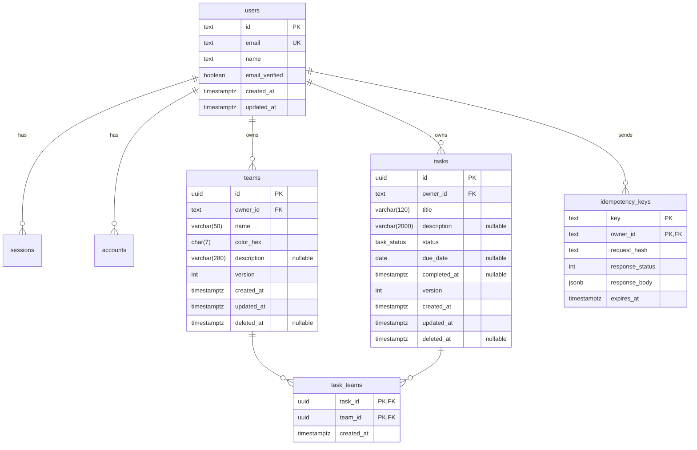

# Data Model

PostgreSQL 17, managed by Prisma (schema in `apps/api/prisma/schema.prisma`). Decisions: [ADR-0003](adr/0003-postgresql.md), [ADR-0004](adr/0004-prisma-migrations-and-seeding.md), [ADR-0015](adr/0015-optimistic-concurrency.md), [ADR-0016](adr/0016-soft-delete.md).

## Entity-relationship diagram



`sessions`, `accounts` and `verifications` follow the Better Auth schema (generated with `@better-auth/cli generate`) and are owned by the Identity context; other contexts only reference `users.id`.

## Relationships

| Relationship | Cardinality                                      | Implementation                                                                               |
| ------------ | ------------------------------------------------ | -------------------------------------------------------------------------------------------- |
| User → Team  | 1 : N                                            | `teams.owner_id` FK, `ON DELETE CASCADE`                                                     |
| User → Task  | 1 : N                                            | `tasks.owner_id` FK, `ON DELETE CASCADE`                                                     |
| Task ↔ Team  | N : M (a task belongs to **zero or more** teams) | Join table `task_teams` with composite PK `(task_id, team_id)`; both FKs `ON DELETE CASCADE` |

Explicit join table (instead of Prisma's implicit m-n) so it can carry `created_at`, be indexed deliberately and be queried directly for the `teamId` filter.

## Enum

```sql
CREATE TYPE task_status AS ENUM ('PENDING', 'IN_PROGRESS', 'DONE');
```

## Indexes and why

| Index                                                                | Serves                                                                         |
| -------------------------------------------------------------------- | ------------------------------------------------------------------------------ |
| `teams (owner_id, lower(name)) UNIQUE WHERE deleted_at IS NULL`      | Team-name uniqueness per owner, ignoring soft-deleted rows (case-insensitive). |
| `teams (owner_id, created_at DESC) WHERE deleted_at IS NULL`         | Default team listing.                                                          |
| `tasks (owner_id, status, created_at DESC) WHERE deleted_at IS NULL` | Listing filtered by status with default sort — the hottest query.              |
| `tasks (owner_id, due_date) WHERE deleted_at IS NULL`                | Sort by due date.                                                              |
| `tasks USING GIN (title gin_trgm_ops, description gin_trgm_ops)`     | `search` with `ILIKE '%term%'` (extension `pg_trgm`).                          |
| `task_teams (team_id, task_id)`                                      | `teamId` filter (the PK covers `task_id` lookups) and per-team task counts.    |

Partial indexes (`WHERE deleted_at IS NULL`) and the trigram index are written as raw SQL inside Prisma migrations, since Prisma schema can't express them.

## Soft delete

`deleted_at` on `teams` and `tasks`. Repositories always filter `deleted_at IS NULL`. Deleting a team also **removes** its `task_teams` rows in the same transaction (the tasks remain). A purge job is listed as a production improvement.

## Concurrency

`version` integer starts at 1 and is incremented on every update. Updates use `UPDATE ... WHERE id = $1 AND owner_id = $2 AND version = $3`; zero affected rows → `ConcurrencyConflict` (or not found). Exposed through `ETag` / `If-Match`.

## Migrations & seeding (reproducibility)

- Migrations live in `apps/api/prisma/migrations`, created with `prisma migrate dev`, applied with `prisma migrate deploy` on container start.
- Seed (`prisma/seed.ts`) is **deterministic and idempotent**: fixed faker seed, upserts by fixed ids. Creates the demo user `demo@teams-tasks.dev` / `Demo@1234`, 3 teams and 10 tasks covering all statuses, multi-team tasks, a task without team and an overdue task.
- `pnpm db:reset` drops, migrates and seeds; integration tests use a throwaway PostgreSQL via Testcontainers.
