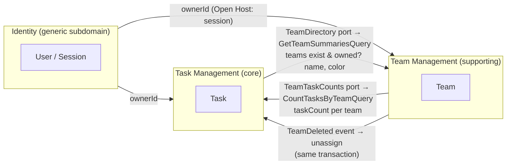
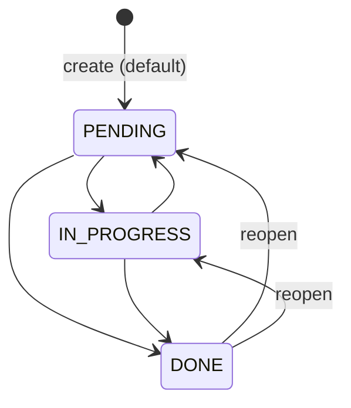

# Domain Model

## Ubiquitous language

| Term                  | Meaning                                                                                           | Code name                                      |
| --------------------- | ------------------------------------------------------------------------------------------------- | ---------------------------------------------- |
| **User**              | A person with an account. Owns teams and tasks.                                                   | `User` (Identity context)                      |
| **Owner**             | The user a team or task belongs to. Every read/write is scoped to the owner.                      | `ownerId` (opaque string id from Identity)     |
| **Team**              | A named, color-coded group used to organize tasks.                                                | `Team`                                         |
| **Team color**        | The `#RRGGBB` color identifying a team, shown as a chip on its tasks.                             | `ColorHex`                                     |
| **Task**              | A unit of work with a title, optional description, status and optional due date.                  | `Task`                                         |
| **Status**            | Lifecycle position of a task: **Pending**, **In progress**, **Done**.                             | `TaskStatus`: `PENDING`, `IN_PROGRESS`, `DONE` |
| **Assign / unassign** | Link or unlink a task and a team. A task may be assigned to zero or more teams.                   | `task.assignTo(teamIds)`                       |
| **Complete**          | Move a task to **Done**; records the completion time.                                             | `completedAt`                                  |
| **Reopen**            | Move a **Done** task back to Pending or In progress; clears completion time.                      | —                                              |
| **Overdue**           | A task not Done whose due date is before today. Derived, never stored.                            | policy `isOverdue(status, dueDate, today)`     |
| **Archive (delete)**  | Removing a team or task. Implemented as soft delete; deleted items are invisible through the API. | `deletedAt`                                    |

## Bounded contexts

| Context             | Type       | Responsibility                                         | Implementation                                                                                 |
| ------------------- | ---------- | ------------------------------------------------------ | ---------------------------------------------------------------------------------------------- |
| **Identity**        | Generic    | Sign up, sign in, sessions.                            | Better Auth (off-the-shelf), exposed to the other contexts only as an authenticated `ownerId`. |
| **Team Management** | Supporting | Team lifecycle, naming rules, colors.                  | `apps/api/src/modules/teams`                                                                   |
| **Task Management** | Core       | Task lifecycle, status, assignment to teams, querying. | `apps/api/src/modules/tasks`                                                                   |

**Context relationships**

- Task Management depends on Team Management through a **`TeamDirectory` port** (customer/supplier): "do these team ids exist and belong to this owner?" and "give me the display data (name, color) for these ids". Its adapter sends `GetTeamSummariesQuery`. Task Management never reads team tables directly.
- Team Management depends on Task Management for a team's `taskCount` through a **`TeamTaskCounts` port** (customer/supplier); its adapter sends `CountTasksByTeamQuery`. Team Management never reads task tables directly.
- All cross-context calls go through the `QueryBus`/event dispatch and the target module's public **`contracts/`** folder (query, event and result types only). Modules never import each other's providers, so there is no DI cycle ([overview §3.1](overview.md#31-modules), [ADR-0002](adr/0002-nestjs-clean-architecture-ddd-cqrs.md)).
- When a team is deleted, Team Management raises **`TeamDeleted`**; Task Management reacts by unassigning that team from the owner's tasks **synchronously, in the same DB transaction** as the soft delete (see [Domain events](#domain-events) and [ADR-0002](adr/0002-nestjs-clean-architecture-ddd-cqrs.md#teamdeleted-consistency)).

## Aggregates

### Team (aggregate root)

| Attribute                | Type               | Rules                                                                                                                                 |
| ------------------------ | ------------------ | ------------------------------------------------------------------------------------------------------------------------------------- |
| `id`                     | UUID               | Generated by the application.                                                                                                         |
| `ownerId`                | string             | Opaque user id issued by Identity (Better Auth; UUID values in a text column, but the domain does not rely on the format). Immutable. |
| `name`                   | `TeamName`         | Trimmed, 2–50 chars, **unique per owner** (case-insensitive) among non-deleted teams.                                                 |
| `color`                  | `ColorHex`         | `^#[0-9A-Fa-f]{6}$`, normalized to upper case.                                                                                        |
| `description`            | `TeamDescription?` | ≤ 280 chars, trimmed, no `\p{Cc}` except line breaks; empty → `null`.                                                                 |
| `version`                | int                | Starts at 1; incremented by **persistence** on every write that changes state (optimistic concurrency, see below).                    |
| `createdAt`, `updatedAt` | timestamp          |                                                                                                                                       |
| `deletedAt`              | timestamp?         | Soft delete marker.                                                                                                                   |

Behavior:

- `Team.create({ id, ownerId, name, color, description, now })` → version 1.
- `Team.reconstitute(props)` — rebuilds a persisted team; raises no events.
- `replace({ name, color, description, now })` — full replacement (PUT); returns `false` and changes nothing when every value is already equal. A letter-case-only rename is a change.
- `delete(now)` → raises `TeamDeleted`; deleting an already deleted team is a no-op.
- `assertVersion(expected: ExpectedVersion)` → throws `ConcurrencyConflict { currentVersion }` when `If-Match` doesn't match (or is malformed).

**Version-bump convention (both aggregates):** aggregates never touch `version`. They change state, set `updatedAt` and report whether anything changed. The repository increments `version` in the conditional update (`SET version = version + 1 WHERE … AND version = $expected`), and skips the write on a no-op ([ADR-0015](adr/0015-optimistic-concurrency.md)). After a write, handlers read the new version from the query side, never from the aggregate.

Invariant enforced outside the aggregate: name uniqueness per owner (checked by the application handler against the repository **and** guaranteed by a partial unique index).

### Task (aggregate root)

| Attribute                                        | Type         | Rules                                                               |
| ------------------------------------------------ | ------------ | ------------------------------------------------------------------- |
| `id`                                             | UUID         | Generated by the application.                                       |
| `ownerId`                                        | string       | Opaque user id issued by Identity (see Team). Immutable.            |
| `title`                                          | `TaskTitle`  | Trimmed, **3–120 chars**.                                           |
| `description`                                    | string?      | ≤ 2000 chars.                                                       |
| `status`                                         | `TaskStatus` | `PENDING` (default) · `IN_PROGRESS` · `DONE`.                       |
| `dueDate`                                        | date?        | Calendar date (no time). Past dates allowed (tasks can be overdue). |
| `completedAt`                                    | timestamp?   | Set when status becomes `DONE`, cleared when it leaves `DONE`.      |
| `teamIds`                                        | set of UUID  | 0–10 distinct ids, each an existing team of the same owner.         |
| `version`, `createdAt`, `updatedAt`, `deletedAt` |              | As in Team.                                                         |

Behavior:

- `Task.create(...)` → `TaskCreated { status }` (a task may be created directly as `DONE`, which sets `completedAt`)
- `changeStatus(status, now)` → `changed: boolean`; on a change raises `TaskStatusChanged { from, to }`. **Any status → any other status is allowed** (free transitions). Same status → no-op (no event, no write, so the version is unchanged).
- `edit({ title, description, dueDate }, now)` → `changed: boolean`
- `assignTo(teamIds, now)` → `changed: boolean` (replaces the set; same ids in any order is a no-op) — validated by the application via `TeamDirectory`.
- `unassignTeam(teamId, now)` → `changed: boolean` (reaction to `TeamDeleted`) — removes the id from `teamIds` and, if it was present, sets `updatedAt` and reports a change, so persistence bumps `version` (the task's representation changed), so a stale `PUT` with `If-Match` gets `412` ([ADR-0015](adr/0015-optimistic-concurrency.md)). No-op if the team was not assigned.
- `delete(now)` → `TaskDeleted`

Every change method sets only `updatedAt`; when it returns `true` the repository persists the task with `version + 1` under the expected-version guard ([ADR-0015](adr/0015-optimistic-concurrency.md)). `isOverdue(status, dueDate, today)` is a pure policy used by the read side, with today as the UTC date.

### Status lifecycle

Entering `DONE` sets `completedAt = now`; leaving `DONE` sets it to `null`.

## Value objects

| VO                | Validation                                                         | Notes                                                                            |
| ----------------- | ------------------------------------------------------------------ | -------------------------------------------------------------------------------- |
| `TeamName`        | trim, 2–50 chars                                                   | Equality is case-insensitive.                                                    |
| `ColorHex`        | `#RRGGBB`                                                          | Normalized upper case. (Chip text color is computed by the app, not the domain.) |
| `TeamDescription` | optional, trim, ≤ 280 code points, no `\p{Cc}` except line breaks  | Blank/empty → `null`.                                                            |
| `TaskTitle`       | trim, 3–120 chars                                                  |                                                                                  |
| `TaskDescription` | optional, trim, ≤ 2000 code points, no `\p{Cc}` except line breaks | Blank → `null`.                                                                  |
| `TaskStatus`      | enum                                                               |                                                                                  |
| `DueDate`         | ISO `YYYY-MM-DD`                                                   | `isBefore(today)` for overdue.                                                   |
| `TaskTeamIds`     | set of 0–10 distinct team ids                                      | Order-insensitive equality; > 10 → `TooManyTeams`.                               |

All length limits count **Unicode code points** after trimming (not UTF-16 units or bytes), the same as the DTO validation and the `varchar(n)` columns.

## Domain events

| Event                                     | Raised by           | Consumers                                                                             |
| ----------------------------------------- | ------------------- | ------------------------------------------------------------------------------------- |
| `TeamDeleted { teamId, ownerId }`         | `Team.delete`       | Task Management: unassign team from tasks.                                            |
| `TaskCreated { taskId, ownerId, status }` | `Task.create`       | Metrics (`tasks_created_total`; also `tasks_completed_total` when created as `DONE`). |
| `TaskStatusChanged { taskId, from, to }`  | `Task.changeStatus` | Metrics (`tasks_completed_total`), logs.                                              |
| `TaskDeleted { taskId }`                  | `Task.delete`       | Metrics (`tasks_deleted_total`).                                                      |

Two dispatch paths ([ADR-0002](adr/0002-nestjs-clean-architecture-ddd-cqrs.md#teamdeleted-consistency)):

- **In-transaction (awaited):** `TeamDeleted` is dispatched by a small awaited in-transaction publisher to its transactional subscriber (Task Management's `OnTeamDeletedHandler`) **before commit**. The Prisma interactive transaction is propagated with `@nestjs-cls/transactional`, so the soft delete and the unassignment commit or roll back together.
- **After commit:** every event (including `TeamDeleted`) is then published on the `@nestjs/cqrs` `EventBus` for non-critical side effects (metrics, logs). These handlers are not awaited and never affect the outcome of the request.

## Domain errors

Raised by the domain/application, mapped to HTTP by the presentation layer (see [API contracts](api-contracts.md#error-codes)).

| Error                                                                                                                                               | When                                                           |
| --------------------------------------------------------------------------------------------------------------------------------------------------- | -------------------------------------------------------------- |
| `InvalidTeamName`, `InvalidColorHex`, `InvalidTeamDescription`, `InvalidTaskTitle`, `InvalidTaskDescription`, `InvalidTaskStatus`, `InvalidDueDate` | VO construction fails (normally pre-empted by DTO validation). |
| `TeamNotFound`, `TaskNotFound`                                                                                                                      | Id unknown **or owned by another user**.                       |
| `TeamNameAlreadyExists`                                                                                                                             | Name collision for the owner.                                  |
| `UnknownTeams { ids }`                                                                                                                              | Task assigned to team ids that don't exist for the owner.      |
| `TooManyTeams`                                                                                                                                      | More than 10 teams on one task.                                |
| `ConcurrencyConflict`                                                                                                                               | `If-Match` version ≠ current version.                          |
