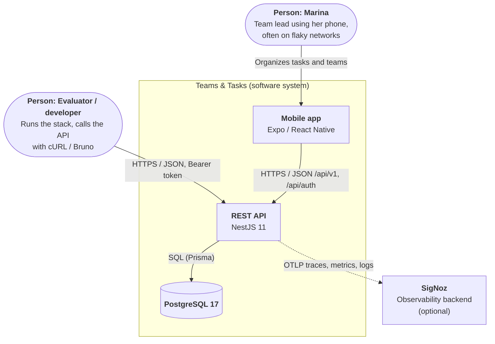
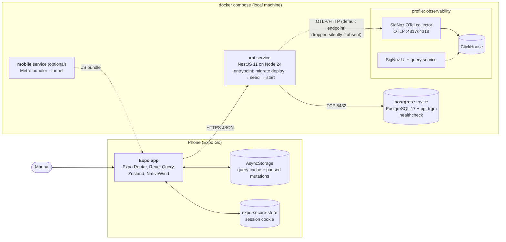
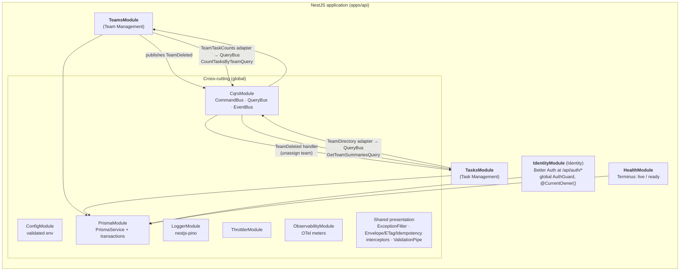
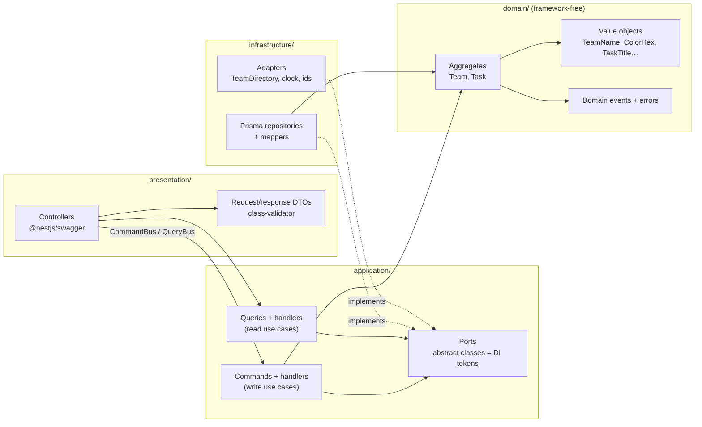
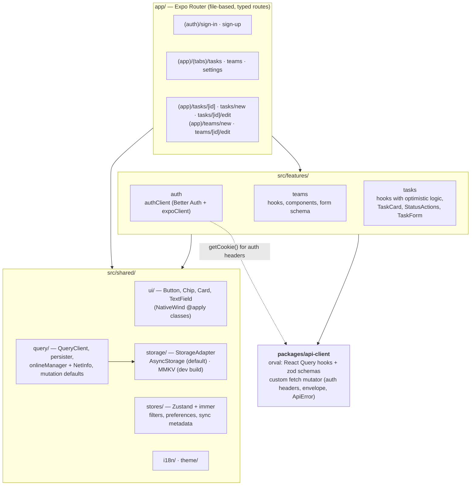
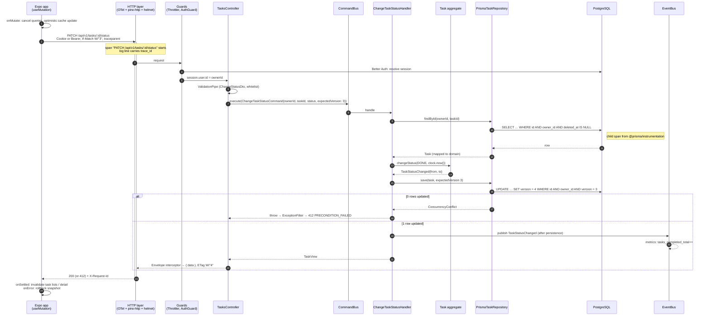

# Architecture Overview

How **Teams & Tasks** is built, from the outside in. This page uses the [C4 model](https://c4model.com/) (Context → Containers → Components) rendered as Mermaid flowcharts, then zooms into a request, the folder layout and the import rules that keep the layering honest.

Related documents: [domain model](domain-model.md) · [data model](data-model.md) · [API contracts](api-contracts.md) · [ADR index](adr/README.md) · [constitution](../constitution.md).

## 1. System context (C4 level 1)



| Element    | Responsibility                                                                                                                            |
| ---------- | ----------------------------------------------------------------------------------------------------------------------------------------- |
| Mobile app | Screens for teams and tasks, forms, offline cache and mutation queue, optimistic updates.                                                 |
| REST API   | Identity (Better Auth), Team Management, Task Management; validation, ownership, concurrency, idempotency.                                |
| PostgreSQL | Source of truth: users/sessions, teams, tasks, `task_teams`, idempotency keys.                                                            |
| SigNoz     | Receives OpenTelemetry data. **Optional**: the API runs identically when it is absent ([ADR-0013](adr/0013-opentelemetry-and-signoz.md)). |

## 2. Containers (C4 level 2)



- The `api` service waits for `postgres` with `depends_on: condition: service_healthy` and is itself healthy when `GET /api/v1/health/ready` answers ([ADR-0018](adr/0018-docker-compose-one-command-run.md)).
- The observability stack is behind a Compose **profile** because it needs ~4 GB RAM ([ADR-0013](adr/0013-opentelemetry-and-signoz.md)). The API always has an OTLP endpoint (`OTEL_EXPORTER_OTLP_ENDPOINT`, default `http://signoz-otel-collector:4318` in Compose). When the profile is off, exports are dropped silently and the API runs normally. `OTEL_SDK_DISABLED=true` turns telemetry off entirely.
- The app has no backend of its own: everything persistent on the device is a cache or a queue ([ADR-0012](adr/0012-offline-first-and-optimistic-updates.md)).

## 3. API components (C4 level 3)

### 3.1 Modules



Modules never import each other's providers. Cross-context collaboration goes through the **buses** and the target module's `contracts/` folder (query, event and result types only). This avoids a `TeamsModule ↔ TasksModule` DI cycle and keeps the dependency one-directional at the code level ([ADR-0002](adr/0002-nestjs-clean-architecture-ddd-cqrs.md)).

### 3.2 Layers inside a module



Arrows are compile-time imports. Everything points toward `domain/`. `infrastructure/` depends on `application/` (it implements the ports) and never the reverse. The `<module>.module.ts` file is the composition root that binds each port to its adapter (`{ provide: TaskRepository, useClass: PrismaTaskRepository }`).

## 4. Mobile components



- **Server state** lives only in React Query (generated hooks). **Local UI state** (filters, theme, last sync) lives in Zustand. Server data is never copied into Zustand ([ADR-0010](adr/0010-react-query-and-zustand-immer.md)).
- Route files are thin: they read params, call feature hooks and compose feature components.
- Styling uses NativeWind classes; reusable looks are `@apply` semantic classes in `global.css` ([ADR-0011](adr/0011-nativewind-with-apply.md)).

## 5. Request lifecycle — change a task's status



Writes that span aggregates (team deletion → unassign from tasks) run inside one database transaction; see [ADR-0002](adr/0002-nestjs-clean-architecture-ddd-cqrs.md#teamdeleted-consistency).

## 6. Folder structure

### 6.1 Monorepo

```text
.
├── apps/
│   ├── api/                 # NestJS 11 REST API
│   └── mobile/              # Expo app
├── packages/
│   ├── api-client/          # orval output: hooks + zod + fetch mutator (generated, committed)
│   └── tsconfig/            # shared strict tsconfig bases
├── docs/                    # constitution, product, specs, architecture, ADRs
├── tools/                   # bruno/, http/, k6/
├── docker-compose.yml       # postgres, api, mobile (optional), observability profile
├── Makefile                 # up, down, logs, seed, reset, test, observability, observability-down, mobile, smoke, load
├── turbo.json · pnpm-workspace.yaml
└── .github/workflows/ci.yml
```

### 6.2 API (`apps/api`)

```text
apps/api/
├── prisma/
│   ├── schema.prisma
│   ├── migrations/                      # prisma migrate + raw SQL for partial / trigram indexes
│   └── seed.ts                          # deterministic, idempotent
├── src/
│   ├── instrumentation.ts               # OTel NodeSDK, loaded before anything else
│   ├── main.ts                          # NestFactory.create(AppModule, { bodyParser: false }) → setupApp(app) → listen
│   ├── app.setup.ts                     # setupApp(app): the single bootstrap seam, used by main.ts and test/support/app.ts; every app-level concern (shutdown hooks, prefix, versioning, helmet, CORS…) goes here, never in main.ts
│   ├── app.module.ts
│   ├── generated/                       # Prisma client from `prisma generate` (gitignored, persistence library: infrastructure only)
│   ├── config/                          # env schema as a class-validator class, validated via ConfigModule `validate()` (fail fast) + typed config
│   │   └── telemetry.env.ts             # OTel/logging env, composed into the same ConfigModule `validate()`
│   ├── shared/
│   │   ├── domain/                      # AggregateRoot, DomainEvent, DomainError + ConcurrencyConflict, expected-version.ts (pure TS)
│   │   ├── application/                 # Clock, IdGenerator ports, Page<T>, PageRequest
│   │   ├── infrastructure/
│   │   │   ├── prisma/                  # PrismaModule, PrismaService, transaction host
│   │   │   ├── idempotency/             # PrismaIdempotencyStore
│   │   │   └── system-clock.ts · uuid-generator.ts
│   │   ├── presentation/
│   │   │   ├── filters/                 # GlobalExceptionFilter (domain error → HTTP)
│   │   │   ├── interceptors/            # envelope, etag, idempotency
│   │   │   ├── dto/                     # PaginationQueryDto, ErrorResponseDto, envelope helpers
│   │   │   └── decorators/              # @ApiEnvelopedResponse, @IfMatch()
│   │   └── observability/
│   │       ├── observability.module.ts  # ObservabilityModule (global): meter provider, logging, tracing
│   │       ├── logging/                 # nestjs-pino config, redaction, request id, trace mixin
│   │       └── tracing/                 # use-case spans around command/query handlers
│   └── modules/
│       ├── identity/                    # Identity context: betterAuth instance, IdentityModule (wraps nestjs-better-auth AuthModule), @CurrentOwner()
│       ├── health/                      # Terminus controller + Prisma indicator
│       ├── teams/
│       │   ├── contracts/               # PUBLIC: TeamDeleted, GetTeamSummariesQuery + result types
│       │   ├── domain/                  # pure TypeScript, grouped by aggregate
│       │   │   ├── team.ts              # aggregate root
│       │   │   ├── team.errors.ts       # every error of the module
│       │   │   ├── team.events.ts       # every event of the module (TeamDeleted)
│       │   │   └── value-objects/       # team-name.ts, color-hex.ts, team-description.ts
│       │   ├── application/
│       │   │   ├── commands/            # create-team/, replace-team/, delete-team/ (command + handler + spec)
│       │   │   ├── queries/             # list-teams/, get-team/, get-team-summaries/
│       │   │   └── ports/               # TeamRepository, TeamReadModel, TeamTaskCounts
│       │   ├── infrastructure/          # prisma-team.repository.ts, team.mapper.ts, team-task-counts.adapter.ts
│       │   ├── presentation/            # teams.controller.ts, dto/
│       │   └── teams.module.ts          # composition root: binds ports → adapters
│       └── tasks/
│           ├── contracts/               # PUBLIC: CountTasksByTeamQuery + result types
│           ├── domain/                  # pure TypeScript, grouped by aggregate
│           │   ├── task.ts              # aggregate root
│           │   ├── task.errors.ts       # every error of the module
│           │   ├── task.events.ts       # every event of the module
│           │   ├── overdue.policy.ts    # isOverdue(status, dueDate, today), reused by the read side
│           │   └── value-objects/       # task-title.ts, task-description.ts, task-status.ts, due-date.ts, task-team-ids.ts
│           ├── application/
│           │   ├── commands/            # create-task/, replace-task/, change-task-status/, delete-task/
│           │   ├── queries/             # list-tasks/, get-task/, count-tasks-by-team/
│           │   ├── events/              # on-team-deleted.handler.ts (unassign), record-task-metrics.handler.ts (after commit)
│           │   └── ports/               # TaskRepository, TaskReadModel, TeamDirectory, task-metrics.ts (TaskMetrics)
│           ├── infrastructure/          # prisma-task.repository.ts, task.mapper.ts, team-directory.adapter.ts, otel-task-metrics.adapter.ts
│           ├── presentation/            # tasks.controller.ts, dto/
│           └── tasks.module.ts
├── test/
│   ├── support/                         # global-setup (one PG container per run, migrated template DB), postgres.ts (useTestDatabase / createTestDatabase), app.ts (createTestApp)
│   ├── integration/                     # Testcontainers PostgreSQL: repositories, migrations, seed
│   └── e2e/                             # supertest against the full Nest app
├── stryker.config.mjs                   # mutation testing scope: src/modules/*/domain
└── .dependency-cruiser.cjs
```

Unit tests (`*.spec.ts`) sit next to the file they test.

**Module layout.** Every bounded-context module uses the same shape: `domain/` holds `<agg>.ts`, `<agg>.errors.ts` (all of the module's errors), `<agg>.events.ts` (all of its events), `value-objects/` and any pure policy; `application/commands/<use-case>/` and `application/queries/<use-case>/` (message + handler + spec), `application/ports/`; `infrastructure/prisma-<agg>.repository.ts` + `<agg>.mapper.ts` (plus adapters for cross-context ports); `presentation/<ctx>.controller.ts` + `dto/`; `contracts/` (the module's only public surface); and the `<ctx>.module.ts` composition root.

### 6.3 Mobile (`apps/mobile`)

```text
apps/mobile/
├── app/                                 # Expo Router — routes only, thin
│   ├── _layout.tsx                      # providers: PersistQueryClientProvider, theme, i18n
│   ├── (auth)/sign-in.tsx · sign-up.tsx
│   └── (app)/
│       ├── _layout.tsx                  # redirects to (auth) when no session
│       ├── (tabs)/_layout.tsx · tasks/index.tsx · teams/index.tsx · settings.tsx
│       ├── tasks/new.tsx · tasks/[id]/index.tsx · tasks/[id]/edit.tsx
│       └── teams/new.tsx · teams/[id]/edit.tsx
├── src/
│   ├── features/
│   │   ├── auth/                        # auth-client.ts, useSession, forms
│   │   ├── teams/                       # components/, hooks/, schemas/, mutations/, index.ts (public)
│   │   ├── tasks/                       # components/, hooks/, schemas/, mutations/, index.ts (public)
│   │   │                                # mutations/: register<Feature>MutationDefaults() — mutationFn, onMutate, rollback, cache transforms
│   │   └── settings/                    # SettingsScreen (theme, language, sync status, sign-out), index.ts
│   └── shared/
│       ├── ui/                          # Button, Chip, Card, TextField, EmptyState
│       ├── query/
│       │   ├── query-client.ts · keys.ts
│       │   ├── persister.ts             # React Query persister on the StorageAdapter
│       │   ├── online-manager.ts        # NetInfo → onlineManager, AppState → focusManager
│       │   ├── session-gate.ts          # pauses/clears the queue on 401 or user switch (session source injected)
│       │   ├── mutation-defaults.ts     # registry: registerMutationDefaults(defs); features supply the defs
│       │   ├── optimistic/              # generic cache-patch helpers (snapshot, patch list pages, rollback)
│       │   ├── resolve.ts               # tmp- id → server id map (ADR-0012)
│       │   └── conflicts.ts             # 412 / 404-on-delete handling for queued mutations
│       ├── storage/                     # storage-adapter.ts, async-storage.adapter.ts, mmkv.adapter.ts
│       ├── stores/                      # filters.store.ts, preferences.store.ts, sync.store.ts, toast.store.ts
│       ├── config/
│       │   └── api-client.ts            # setupApiClient({ baseUrl, getAuthHeaders, onUnauthenticated }) for @hitss/api-client
│       ├── i18n/                        # index.ts, locales/, error-messages.ts (ApiError.code → message)
│       └── theme/
├── global.css                           # @tailwind + @apply semantic classes, CSS variables
├── tailwind.config.js · babel.config.js · metro.config.js · app.config.ts
├── e2e/maestro/                         # Maestro flows
└── .dependency-cruiser.cjs
```

**Keeping `shared/` a leaf (M1).** `shared/` never imports a feature. Anything feature-specific is **injected** at the composition root, `app/_layout.tsx`, which may import both. It passes `setupApiClient` the auth headers and the `onUnauthenticated` callback from `features/auth`, gives `session-gate` its session source, and calls each feature's `register<Feature>MutationDefaults()` (from `features/<f>/mutations/`, re-exported by the feature's `index.ts`) before cache restoration (ADR-0012). Mutations import only `shared/` (registry, `optimistic/`, `resolve.ts`, `keys.ts`) and `@hitss/api-client`; a team mutation that patches cached task lists (e.g. stripping a deleted team's chip) uses the shared query keys, never `features/tasks` (M2). Storage libraries stay inside `shared/storage/` (M5); `persister.ts` and the `persist` stores use the `StorageAdapter`.

## 7. Dependency rules (enforced by dependency-cruiser in CI)

`dependency-cruiser` runs in CI (`pnpm lint:arch`) for both apps; a violation fails the build ([ADR-0002](adr/0002-nestjs-clean-architecture-ddd-cqrs.md), constitution §III.3).

### API

| #   | Rule                                      | From                         | Must not import                                                                                                                                       |
| --- | ----------------------------------------- | ---------------------------- | ----------------------------------------------------------------------------------------------------------------------------------------------------- |
| A1  | Domain is pure                            | `src/**/domain/**`           | `@nestjs/*`, `@prisma/*`, `better-auth`, `class-validator`, `class-transformer`, Node I/O, and any `application/`, `infrastructure/`, `presentation/` |
| A2  | Application knows no adapters             | `src/**/application/**`      | `infrastructure/`, `presentation/`, `@prisma/*`, `express`. May import `domain/`, `@nestjs/cqrs`, `@nestjs/common` (decorators only)                  |
| A3  | Infrastructure does not reach up          | `src/**/infrastructure/**`   | `presentation/`                                                                                                                                       |
| A4  | Presentation uses use cases, not adapters | `src/**/presentation/**`     | `infrastructure/`, `@prisma/*`                                                                                                                        |
| A5  | Contexts are isolated                     | `src/modules/<a>/**`         | `src/modules/<b>/**` except `src/modules/<b>/contracts/**`                                                                                            |
| A6  | Contracts are thin                        | `src/modules/*/contracts/**` | anything but its own `domain/<agg>.events.ts`, `shared/domain` and other `contracts/`                                                                 |
| A7  | Shared does not depend on features        | `src/shared/**`              | `src/modules/**`                                                                                                                                      |
| A8  | No cycles                                 | any                          | circular dependencies                                                                                                                                 |
| A9  | Tests stay out of prod                    | `src/**` (non-spec)          | `*.spec.ts`, `test/**`                                                                                                                                |

The only files allowed to reference both `application/` ports and `infrastructure/` adapters are `*.module.ts` composition roots.

### Mobile

| #   | Rule                       | From                                     | Must not import                                                                             |
| --- | -------------------------- | ---------------------------------------- | ------------------------------------------------------------------------------------------- |
| M1  | Shared is a leaf           | `src/shared/**`                          | `src/features/**`, `app/**`                                                                 |
| M2  | Features are isolated      | `src/features/<a>/**`                    | `src/features/<b>/**` except `src/features/<b>/index.ts`                                    |
| M3  | Routes are not imported    | anything                                 | `app/**`                                                                                    |
| M4  | Single HTTP path           | `app/**`, `src/**`                       | `fetch`/`axios` wrappers other than `@hitss/api-client` (lint rule `no-restricted-imports`) |
| M5  | Storage behind the adapter | anything outside `src/shared/storage/**` | `@react-native-async-storage/*`, `react-native-mmkv`                                        |
| M6  | No cycles                  | any                                      | circular dependencies                                                                       |

### Monorepo

- `packages/api-client` depends on nothing in `apps/*`; it is regenerated from `apps/api`'s exported OpenAPI document, and CI fails if the regenerated output differs from the committed one ([ADR-0008](adr/0008-class-validator-dtos-and-generated-client.md)).
- `apps/mobile` never imports `apps/api`.

## 8. Decision map

| Area                  | ADRs                                                                                                                                                                                                                    |
| --------------------- | ----------------------------------------------------------------------------------------------------------------------------------------------------------------------------------------------------------------------- |
| Repository & delivery | [0001](adr/0001-monorepo-pnpm-turborepo.md) · [0017](adr/0017-conventional-commits-and-atomic-prs.md) · [0018](adr/0018-docker-compose-one-command-run.md)                                                              |
| API architecture      | [0002](adr/0002-nestjs-clean-architecture-ddd-cqrs.md) · [0005](adr/0005-rest-openapi-and-response-envelope.md) · [0006](adr/0006-offset-pagination.md) · [0008](adr/0008-class-validator-dtos-and-generated-client.md) |
| Data                  | [0003](adr/0003-postgresql.md) · [0004](adr/0004-prisma-migrations-and-seeding.md) · [0015](adr/0015-optimistic-concurrency.md) · [0016](adr/0016-soft-delete.md) · [0019](adr/0019-idempotency-keys.md)                |
| Security              | [0007](adr/0007-better-auth.md)                                                                                                                                                                                         |
| Mobile                | [0009](adr/0009-expo-and-expo-router.md) · [0010](adr/0010-react-query-and-zustand-immer.md) · [0011](adr/0011-nativewind-with-apply.md) · [0012](adr/0012-offline-first-and-optimistic-updates.md)                     |
| Quality & operations  | [0013](adr/0013-opentelemetry-and-signoz.md) · [0014](adr/0014-testing-strategy.md)                                                                                                                                     |
