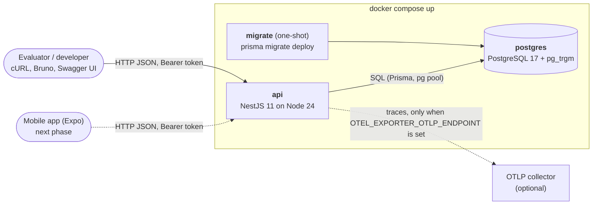
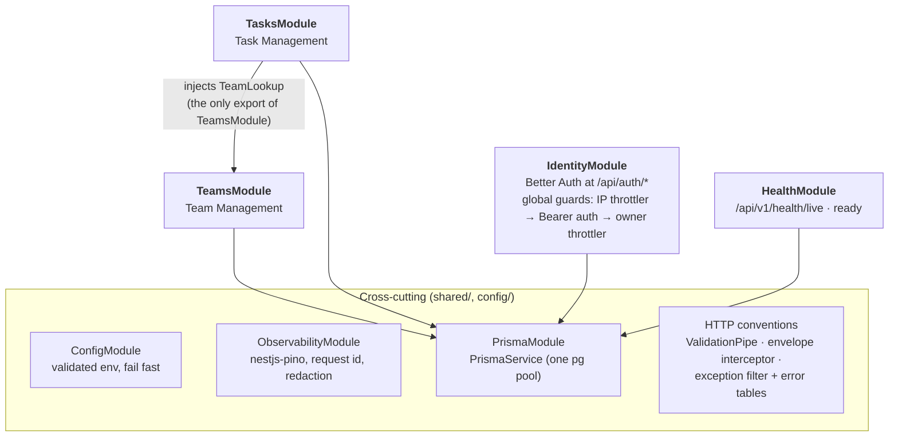
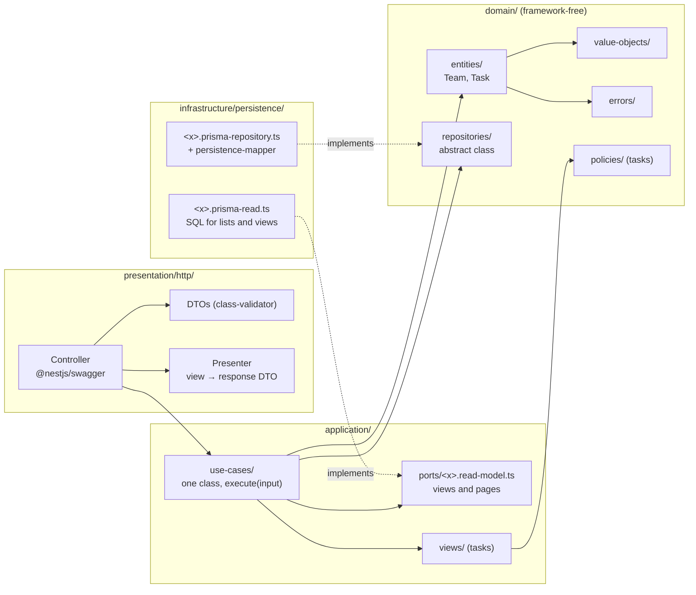
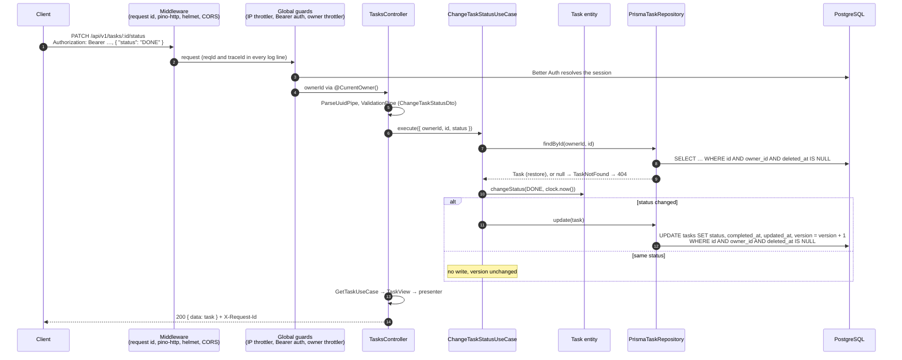

# Architecture Overview

How the **Teams & Tasks** API is built, from the outside in: the system and its containers, the modules and their layers, the domain they implement, the path of one request, and the import rules that keep the layering honest. The layout follows [ADR-0002](adr/0002-nestjs-clean-architecture-ddd-cqrs.md) as simplified by [ADR-0020](adr/0020-simplify-architecture-for-the-hiring-test.md).

Related documents: [data model](data-model.md) · [API contracts](api-contracts.md) · [ADR index](adr/README.md) · [constitution](../constitution.md).

## 1. System context and containers



- **Startup order** ([ADR-0018](adr/0018-docker-compose-one-command-run.md)): `postgres` becomes healthy → `migrate` applies the migrations and exits → `api` starts only if `migrate` succeeded, seeds the demo data (idempotent) and serves. On boot the API probes the database (`SELECT 1`, 10 s bound) and exits non-zero if it does not answer; invalid configuration also stops it at boot, naming the variable.
- **Telemetry is optional.** `instrumentation.ts` is loaded before Nest (`node --import ./dist/instrumentation.js dist/main.js`). Without `OTEL_EXPORTER_OTLP_ENDPOINT` it starts nothing; with it, OpenTelemetry auto-instrumentation exports traces over OTLP. Logs are always pino JSON on stdout with `reqId` and `traceId`. Details: [observability](../operations/observability.md).

## 2. Modules



| Module       | Responsibility                                                                                                        |
| ------------ | --------------------------------------------------------------------------------------------------------------------- |
| **Identity** | Sign up, sign in, sessions (Better Auth, generic subdomain). Gives the other modules only an authenticated `ownerId`. |
| **Teams**    | Team lifecycle, naming rules, colors, task counts. Exports `TeamLookup`.                                              |
| **Tasks**    | Task lifecycle, status, assignment to teams, filters, search, sort. The core of the product.                          |
| **Health**   | Liveness and readiness (database reachable) for Docker and orchestrators.                                             |

**Module communication.** `TeamsModule` exports a single provider, `TeamLookup` (`summaries(ownerId, ids)`, `findMissing(ownerId, ids)`): Tasks uses it to reject unknown team ids and to show team chips (name, color). Teams needs a `taskCount` per team; it is computed inside the teams read SQL with a join on `task_teams` and `tasks`, so Teams never calls Tasks and there is no module cycle. Deleting a team runs one `prisma.$transaction` in the teams repository: soft-delete the team, bump `version` / `updated_at` of the owner's live tasks linked to it (one set-based `UPDATE`), and delete its `task_teams` rows; all of it commits or none of it does. Both cross-table touches stay inside one database and one owned statement or transaction, which ADR-0020 accepts in place of buses, events and a unit of work.

## 3. Layers inside a module



Arrows are compile-time imports; everything points toward `domain/`.

- **Write side.** A use case loads an entity through the repository (an `abstract class` in `domain/repositories/`, used directly as the Nest DI token), calls a domain method and saves the entity. Entities validate in `create()` and are rebuilt from storage with `restore()`; their change methods return `false` on a no-op, and then nothing is written. The repository increments `version` in SQL. Writes are last-write-wins (ADR-0020).
- **Read side.** Lists and single views come from `application/ports/<x>.read-model.ts`: plain view types and `Page<T>`, implemented by SQL in `<x>.prisma-read.ts` (filters, trigram search, whitelisted sort with an id tie-break, total from the same snapshot). Reads never build entities, so view and page types stay out of the domain.
- **Presentation.** Controllers call use cases only, never repositories or Prisma. A write use case returns the new id (or nothing); the controller reads the result back through the get use case, so every single-resource response has the same shape. Presenters map views to response DTOs explicitly; the global envelope interceptor wraps them in `{ data, meta? }`, and the exception filter maps domain errors through each module's error table to `{ error }`.
- **Composition root.** `<x>s.module.ts` binds each port to its adapter (`{ provide: TeamRepository, useClass: PrismaTeamRepository }`) and registers the module's error table.

## 4. Domain

### Ubiquitous language

| Term                  | Meaning                                                                                     | Code                                           |
| --------------------- | ------------------------------------------------------------------------------------------- | ---------------------------------------------- |
| **Owner**             | The user a team or task belongs to. Every read and write is scoped to the owner.            | `ownerId` (opaque id from Identity)            |
| **Team**              | A named, color-coded group used to organize tasks.                                          | `Team`                                         |
| **Team color**        | The `#RRGGBB` color identifying a team, shown as a chip on its tasks.                       | `ColorHex`                                     |
| **Task**              | A unit of work with a title, optional description, status and optional due date.            | `Task`                                         |
| **Status**            | **Pending**, **In progress**, **Done**; any status may move to any other.                   | `TaskStatus`: `PENDING`, `IN_PROGRESS`, `DONE` |
| **Assign**            | Link a task to zero or more (up to 10) of the owner's teams.                                | `task.assignTo(teamIds)`                       |
| **Complete / reopen** | Entering Done records `completedAt`; leaving Done clears it.                                | `completedAt`                                  |
| **Overdue**           | Not Done and due before today (UTC). Derived, never stored.                                 | `isOverdue(status, dueDate, today)`            |
| **Delete**            | Soft delete: the item disappears from the API; a deleted team's links to tasks are removed. | `deletedAt`                                    |

### Entities and value objects

| Entity   | State                                                                                                                                                  | Behaviour                                                                                                                    |
| -------- | ------------------------------------------------------------------------------------------------------------------------------------------------------ | ---------------------------------------------------------------------------------------------------------------------------- |
| **Team** | `id`, `ownerId`, `name: TeamName`, `color: ColorHex`, `description?`, `version`, timestamps, `deletedAt?`                                              | `create()`, `restore()`, `replace()` (full `PUT`; `false` when nothing changes), `delete()`                                  |
| **Task** | `id`, `ownerId`, `title: TaskTitle`, `description?`, `status`, `dueDate?`, `completedAt?`, `teamIds: TaskTeamIds`, `version`, timestamps, `deletedAt?` | `create()`, `restore()`, `edit()`, `assignTo()`, `changeStatus()`, `delete()`; each change method returns `false` on a no-op |

| Value object      | Rule                                                                                                                         |
| ----------------- | ---------------------------------------------------------------------------------------------------------------------------- |
| `TeamName`        | Trimmed, 2–50 characters; unique per owner, case-insensitive (checked by the use case, guaranteed by a partial unique index) |
| `ColorHex`        | `#RRGGBB`, normalized to upper case                                                                                          |
| `TeamDescription` | Optional, ≤ 280 characters, no control characters except line breaks; blank → `null`                                         |
| `TaskTitle`       | Trimmed, 3–120 characters                                                                                                    |
| `TaskDescription` | Optional, ≤ 2000 characters, same character rule; blank → `null`                                                             |
| `TaskStatus`      | `PENDING` · `IN_PROGRESS` · `DONE`                                                                                           |
| `DueDate`         | Calendar date `YYYY-MM-DD`; past dates allowed                                                                               |
| `TaskTeamIds`     | 0–10 distinct ids, order-insensitive; more → `TooManyTeams`                                                                  |

Lengths count Unicode code points after trimming, the same as the DTOs and the `varchar(n)` columns. Ids are UUIDs drawn by the entity (`crypto.randomUUID()`). Use cases never set `version`: entities set `updatedAt`, the repository increments `version`.

### Errors

Each module's error table maps domain errors to HTTP ([API contracts](api-contracts.md#error-codes)): `Invalid*` value-object errors → `400` (normally caught earlier by the DTOs) · `TeamNotFound`, `TaskNotFound` (unknown, deleted **or another owner's**) → `404` · `TeamNameAlreadyExists` → `409` · `UnknownTeams { teamIds }`, `TooManyTeams` → `422`.

## 5. Request lifecycle — change a task's status



## 6. Folder structure (`apps/api/src`)

```text
main.ts · app.module.ts · app.setup.ts       # setupApp(app): the bootstrap shared by main.ts and the e2e app
instrumentation.ts                           # optional OTel auto-instrumentation, loaded before Nest
graceful-exit.ts                             # SIGTERM → close → exit 0
config/                                      # env schema (class-validator), production rules, .env loading
openapi/                                     # OpenAPI document at /docs (+ the Better Auth paths)
seed/                                        # deterministic, idempotent demo data
shared/
├── domain/                                  # DomainError, Clock, Owner
├── application/page.ts                      # Page<T>, PageRequest, Sort
├── infrastructure/                          # prisma/ (PrismaService, database probe), sql/, system-clock.ts
├── presentation/                            # envelope interceptor, exception filter + DomainErrorMappings,
│                                            # validation and UUID pipes, pagination DTO, sort, page meta,
│                                            # @CurrentOwner(), @Public(), @RawResponse(), OpenAPI helpers, CORS
└── observability/                           # pino config, request id, redaction, trace fields, probe filter
modules/
├── identity/                                # Better Auth factory, Bearer guard, throttler guards, client-IP and body-limit middleware
├── health/
├── teams/
│   ├── domain/
│   │   ├── entities/team.entity.ts
│   │   ├── value-objects/{team-name,color-hex,team-description}.vo.ts
│   │   ├── errors/team.errors.ts
│   │   └── repositories/team.repository.ts
│   ├── application/
│   │   ├── ports/team.read-model.ts         # TeamView, TeamSummary, ListTeamsCriteria
│   │   └── use-cases/{create,list,get,update,delete}-team.use-case.ts
│   ├── infrastructure/persistence/
│   │   ├── team.prisma-repository.ts        # incl. the single-transaction delete
│   │   ├── team.persistence-mapper.ts
│   │   └── team.prisma-read.ts              # lists with taskCount, summaries
│   ├── presentation/http/
│   │   ├── teams.controller.ts · team-error.mapping.ts
│   │   ├── dto/                             # create, update, list query, response
│   │   └── presenters/team.presenter.ts
│   ├── team-lookup.service.ts               # the module's only export
│   └── teams.module.ts
└── tasks/
    ├── domain/{entities,value-objects,errors,repositories}/ · policies/overdue.policy.ts
    ├── application/
    │   ├── ports/task.read-model.ts
    │   ├── use-cases/                       # create, list, get, update, change-status, delete; shared/precise-unknown-teams.ts
    │   └── views/                           # task.view.ts, task-view.assembler.ts (rows + team chips from TeamLookup)
    ├── infrastructure/persistence/          # task.prisma-repository.ts, task.persistence-mapper.ts, task.prisma-read.ts
    ├── presentation/http/                   # tasks.controller.ts, task-error.mapping.ts, dto/, presenters/, validators/
    └── tasks.module.ts                      # imports TeamsModule for TeamLookup
```

Unit tests (`*.spec.ts`) sit next to the file they test; `test/integration` (Testcontainers PostgreSQL) and `test/e2e` (supertest against the full app) live next to `src/`.

## 7. Dependency rules

`pnpm arch` runs dependency-cruiser with these rules, plus meta-tests that prove each rule fails on a violating fixture. A violation fails CI ([constitution §III](../constitution.md)).

| Rule                                 | From                      | Must not import                                                                  |
| ------------------------------------ | ------------------------- | -------------------------------------------------------------------------------- |
| `domain-is-pure`                     | `**/domain/**`            | `application/`, `infrastructure/`, `presentation/`                               |
| `domain-no-third-party`              | `**/domain/**`            | any npm package or Node core module                                              |
| `domain-no-generated-client`         | `**/domain/**`            | the generated Prisma client                                                      |
| `application-not-to-adapters`        | `**/application/**`       | `infrastructure/`, `presentation/`, `@prisma/*`, `express`, the generated client |
| `infrastructure-not-to-presentation` | `**/infrastructure/**`    | `presentation/`                                                                  |
| `persistence-not-to-use-cases`       | `**/infrastructure/**`    | `application/use-cases/`                                                         |
| `presentation-not-to-infra`          | `**/presentation/**`      | `infrastructure/`, `@prisma/*`, the generated client                             |
| `presentation-not-to-repositories`   | `**/presentation/**`      | `domain/repositories/` (controllers go through use cases)                        |
| `contexts-isolated`                  | `modules/<a>/**`          | `modules/<b>/**` except `<b>-lookup.service.ts` and `<b>s.module.ts`             |
| `shared-not-to-features`             | `shared/**`, `config/**`  | `modules/**`                                                                     |
| `auth-library-in-identity`           | `src/**` outside identity | `better-auth`, `@better-auth/*`, `@thallesp/nestjs-better-auth`                  |
| `no-circular`                        | any                       | circular dependencies                                                            |
| `no-tests-in-production`             | `src/**` (non-spec)       | `*.spec.ts`, `test/**`                                                           |

Only `*.module.ts` composition roots reference both ports and adapters.

## 8. Mobile app (next phase)

The Expo app is specified but not built yet: screens and flows in [spec 004](../specs/004-mobile-app/spec.md) and the [design spec](../design/design-spec.md), offline behaviour in [spec 005](../specs/005-offline-sync/spec.md), and the accepted platform decisions in the [ADR archive](adr/README.md#archive) (Expo + Expo Router, React Query + Zustand/immer, NativeWind with `@apply`, offline-first). It will call the API with a Bearer token kept in `expo-secure-store`, through a client generated from the OpenAPI document.
