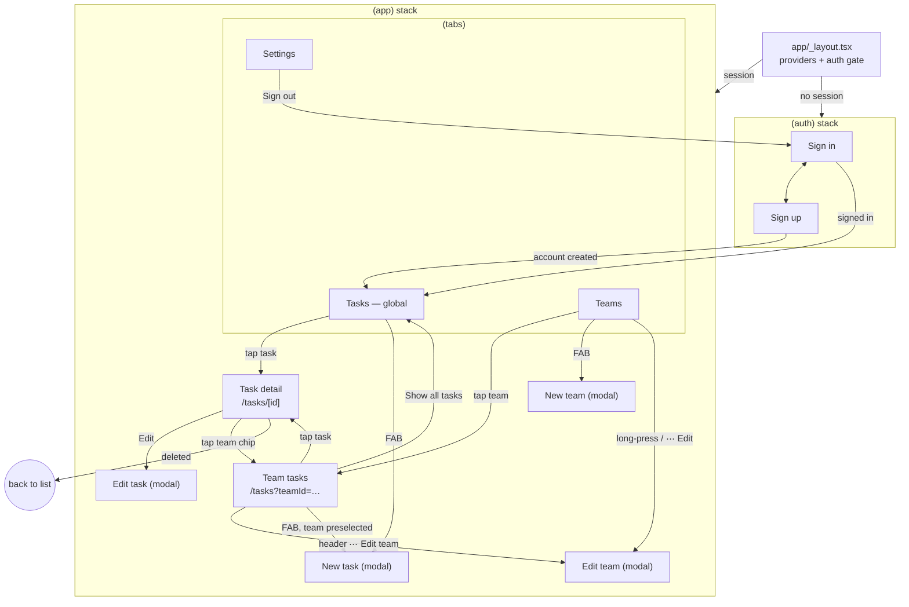

# Design Spec — Teams & Tasks (mobile)

- **Owner:** ux-ui-designer · **Status:** Draft · **Specs:** [004-mobile-app](../specs/004-mobile-app/spec.md), [005-offline-sync](../specs/005-offline-sync/spec.md)
- **Epics:** [EP-04 Mobile Experience](../product/epics/EP-04-mobile-experience.md), [EP-05 Offline & Responsiveness](../product/epics/EP-05-offline-and-responsiveness.md)
- **ADRs:** [0009](../architecture/adr/0009-expo-and-expo-router.md) · [0011](../architecture/adr/0011-nativewind-with-apply.md) · [0012](../architecture/adr/0012-offline-first-and-optimistic-updates.md)

The design lives **in this document** (text, tables, ASCII wireframes, Mermaid). There is no external design file. Every visual value used by the app must be a token defined here; anything not here is a bug in this spec, not a licence to improvise.

**Design principles (for Marina, a team lead on her phone between meetings):**

1. **Thumb first.** Primary actions sit in the bottom half of the screen (FAB, sticky form footer, quick-action bar).
2. **Status at a glance.** Status is always shown by color **and** icon **and** text — never color alone.
3. **Instant, honest feedback.** Changes appear immediately; anything not yet confirmed by the server is visibly marked "pending sync"; failures are explained and recoverable.
4. **Calm density.** One task per row, two lines max, chips truncated with a `+N` overflow.

---

## 1. Design tokens

### 1.1 Color — semantic roles

Each role has a light value and a `-dark` counterpart. Components never use raw palette names (`indigo-600`); they use roles (`primary`, `surface`). Contrast ratios are WCAG 2.1 against the role's intended background.

| Role              | Light            | Dark             | Use                                                                 | Contrast (L / D)                        |
| ----------------- | ---------------- | ---------------- | ------------------------------------------------------------------- | --------------------------------------- |
| `background`      | `#F8FAFC`        | `#0B1120`        | Screen background                                                   | —                                       |
| `surface`         | `#FFFFFF`        | `#111827`        | Cards, list rows, sheets, inputs                                    | —                                       |
| `surface-muted`   | `#F1F5F9`        | `#1F2937`        | Skeletons, segmented control track, pressed rows                    | —                                       |
| `border`          | `#E2E8F0`        | `#334155`        | Decorative dividers, card outline (dark)                            | decorative (exempt)                     |
| `border-strong`   | `#64748B`        | `#94A3B8`        | Input outline, low-contrast chip outline, focus-adjacent boundaries | 4.76 / 6.92 vs surface (≥ 3:1 non-text) |
| `text`            | `#0F172A`        | `#F1F5F9`        | Primary text                                                        | 17.9 / 16.2                             |
| `text-muted`      | `#475569`        | `#CBD5E1`        | Secondary text (descriptions, meta)                                 | 7.6 / 12.0                              |
| `text-subtle`     | `#64748B`        | `#94A3B8`        | Placeholders, captions, disabled labels                             | 4.76 / 6.9 (4.55 on `background` L)     |
| `primary`         | `#4F46E5`        | `#818CF8`        | Primary buttons, links, active tab, focus ring                      | 6.3 / 6.0 (as text on surface)          |
| `primary-pressed` | `#4338CA`        | `#6366F1`        | Pressed state of primary                                            | —                                       |
| `on-primary`      | `#FFFFFF`        | `#0B1120`        | Text/icons on `primary`                                             | 6.3 / 6.3                               |
| `danger`          | `#DC2626`        | `#F87171`        | Destructive buttons, field errors, error icons                      | 4.83 / 6.4                              |
| `danger-pressed`  | `#B91C1C`        | `#EF4444`        | Pressed destructive                                                 | —                                       |
| `on-danger`       | `#FFFFFF`        | `#0B1120`        | Text on `danger`                                                    | 4.83 / 6.8                              |
| `danger-soft`     | `#FEE2E2`        | `#450A0A`        | Error banner / inline error container background                    | —                                       |
| `success`         | `#15803D`        | `#4ADE80`        | Success toast icon, sync-complete                                   | 5.0 / 10.2                              |
| `warning`         | `#B45309`        | `#FBBF24`        | Overdue date, offline banner icon                                   | 5.0 / 10.6                              |
| `warning-soft`    | `#FEF3C7`        | `#422006`        | Offline banner background                                           | `text` on it: 16.0 / 14.0               |
| `info-soft`       | `#E0E7FF`        | `#1E1B4B`        | Pending-sync badge background                                       | —                                       |
| `on-info-soft`    | `#3730A3`        | `#C7D2FE`        | Pending-sync badge text/icon                                        | 8.0 / 11.3                              |
| `overlay`         | `#0F172A` @ 50 % | `#000000` @ 60 % | Modal / dialog scrim                                                | —                                       |
| `focus`           | `#4F46E5`        | `#A5B4FC`        | 2 px focus ring (keyboard / switch control, web)                    | ≥ 3:1                                   |

### 1.2 Color — task status

Status is rendered as a badge (`.badge-status-*`) with icon + label. Background/foreground pairs are ≥ 6:1.

| Status        | Label (en / pt-BR)         | Icon (name in icon set) | Light bg / fg         | Dark bg / fg          | Ratio L / D |
| ------------- | -------------------------- | ----------------------- | --------------------- | --------------------- | ----------- |
| `PENDING`     | Pending / Pendente         | `circle` (hollow)       | `#FEF3C7` / `#92400E` | `#422006` / `#FCD34D` | 6.4 / 10.1  |
| `IN_PROGRESS` | In progress / Em andamento | `circle-half`           | `#DBEAFE` / `#1E40AF` | `#172554` / `#93C5FD` | 7.2 / 8.2   |
| `DONE`        | Done / Concluída           | `check-circle`          | `#DCFCE7` / `#166534` | `#052E16` / `#86EFAC` | 6.5 / 10.6  |

A `DONE` task's title in lists is rendered in `text-muted` with **no** strikethrough (strikethrough harms legibility and screen readers ignore it; the badge already carries the meaning).

**Overdue** (derived from the API's `isOverdue`): due-date text in `warning` with an `alert-triangle` icon and the word "Overdue" — never color alone.

### 1.3 Team color palette (picker presets)

Team colors are user data (`#RRGGBB`); any value is valid. The team form offers these 14 presets (plus a hex text field). The "chip text" column is the result of the chip rule (§3) and is listed so QA can assert it.

| Name    | Hex       | Chip text | Text contrast | Needs border on surface? (L / D) |
| ------- | --------- | --------- | ------------- | -------------------------------- |
| Red     | `#EF4444` | black     | 5.6           | no / no                          |
| Orange  | `#F97316` | black     | 7.5           | yes / no                         |
| Amber   | `#F59E0B` | black     | 9.8           | yes / no                         |
| Yellow  | `#EAB308` | black     | 11.0          | yes / no                         |
| Lime    | `#84CC16` | black     | 10.6          | yes / no                         |
| Emerald | `#10B981` | black     | 8.3           | yes / no                         |
| Teal    | `#14B8A6` | black     | 8.4           | yes / no                         |
| Sky     | `#0EA5E9` | black     | 7.6           | yes / no                         |
| Blue    | `#3B82F6` | black     | 5.7           | no / no                          |
| Indigo  | `#6366F1` | black     | 4.7           | no / no                          |
| Violet  | `#7C3AED` | white     | 5.7           | no / no                          |
| Pink    | `#EC4899` | black     | 6.0           | no / no                          |
| Slate   | `#64748B` | white     | 4.8           | no / no                          |
| Ink     | `#1E293B` | white     | 14.6          | no / **yes**                     |

Default color for a new team: `#6366F1` (Indigo).

### 1.4 Typography

System font stack (San Francisco on iOS, Roboto on Android) — no font download, works in Expo Go, respects platform dynamic type. Sizes are in pt and scale with the OS text size (see §8).

| Token      | Size / line height | Weight | Use                                                         |
| ---------- | ------------------ | ------ | ----------------------------------------------------------- |
| `display`  | 28 / 34            | 700    | Auth screen title                                           |
| `title`    | 22 / 28            | 600    | Screen titles (large header), detail title                  |
| `headline` | 17 / 22            | 600    | List row title, card title, dialog title                    |
| `body`     | 16 / 22            | 400    | Body, input text (16 avoids iOS zoom on web)                |
| `callout`  | 15 / 20            | 400    | Descriptions, banners, toasts                               |
| `label`    | 14 / 20            | 500    | Buttons (with `body` size for primary), field labels, chips |
| `caption`  | 12 / 16            | 400    | Meta (due date, counts), helper text, badges                |

### 1.5 Spacing, size, radii, elevation, motion

- **Spacing** (4 pt grid): `0.5`=2, `1`=4, `2`=8, `3`=12, `4`=16, `5`=20, `6`=24, `8`=32, `10`=40, `12`=48. Screen gutter = 16. Gap between list rows = 8. Section gap = 24.
- **Sizes:** `touch` = 44 (min hit target), `control` = 48 (button/input height), `fab` = 56, `row-min` = 72 (task row min height), `chip` = 24 (visual; hit area padded to 44 when interactive).
- **Radii:** `sm` = 6 (chips, badges), `md` = 10 (inputs, buttons), `lg` = 14 (cards, sheets), `full` = 9999 (FAB, segmented chips, avatars).
- **Elevation:** `e0` none · `e1` card (light: shadow `#0F172A` 6 % y1 blur3; Android elevation 1; dark: no shadow, 1 px `border`) · `e2` FAB/toast (light: 12 % y4 blur12; Android elevation 4; dark: `surface-muted` + `border`) · `e3` dialog/sheet (16 % y8 blur24; Android 8).
- **Motion:** `fast` 150 ms (press, toggle), `base` 220 ms (toast, banner slide), `slow` 300 ms (sheet). Easing: standard `cubic-bezier(0.2, 0, 0, 1)`. Skeleton shimmer 1200 ms loop. All non-essential motion is disabled under Reduce Motion (§8).

### 1.6 Tailwind theme extension

`apps/mobile/tailwind.config.js` (NativeWind v4 preset, `darkMode: 'class'`). Each role is a flat color so `dark:` variants work without CSS variables.

```js
// tailwind.config.js — theme.extend (abridged keys are exhaustive for roles above)
module.exports = {
  darkMode: 'class',
  content: ['./app/**/*.{ts,tsx}', './src/**/*.{ts,tsx}'],
  presets: [require('nativewind/preset')],
  theme: {
    extend: {
      colors: {
        background: { DEFAULT: '#F8FAFC', dark: '#0B1120' },
        surface: {
          DEFAULT: '#FFFFFF',
          dark: '#111827',
          muted: '#F1F5F9',
          'muted-dark': '#1F2937',
        },
        border: {
          DEFAULT: '#E2E8F0',
          dark: '#334155',
          strong: '#64748B',
          'strong-dark': '#94A3B8',
        },
        content: {
          DEFAULT: '#0F172A',
          dark: '#F1F5F9',
          muted: '#475569',
          'muted-dark': '#CBD5E1',
          subtle: '#64748B',
          'subtle-dark': '#94A3B8',
        },
        primary: {
          DEFAULT: '#4F46E5',
          dark: '#818CF8',
          pressed: '#4338CA',
          'pressed-dark': '#6366F1',
          on: '#FFFFFF',
          'on-dark': '#0B1120',
        },
        danger: {
          DEFAULT: '#DC2626',
          dark: '#F87171',
          pressed: '#B91C1C',
          'pressed-dark': '#EF4444',
          on: '#FFFFFF',
          'on-dark': '#0B1120',
          soft: '#FEE2E2',
          'soft-dark': '#450A0A',
        },
        success: { DEFAULT: '#15803D', dark: '#4ADE80' },
        warning: {
          DEFAULT: '#B45309',
          dark: '#FBBF24',
          soft: '#FEF3C7',
          'soft-dark': '#422006',
        },
        info: {
          soft: '#E0E7FF',
          'soft-dark': '#1E1B4B',
          on: '#3730A3',
          'on-dark': '#C7D2FE',
        },
        focus: { DEFAULT: '#4F46E5', dark: '#A5B4FC' },
        status: {
          pending: {
            bg: '#FEF3C7',
            fg: '#92400E',
            'bg-dark': '#422006',
            'fg-dark': '#FCD34D',
          },
          progress: {
            bg: '#DBEAFE',
            fg: '#1E40AF',
            'bg-dark': '#172554',
            'fg-dark': '#93C5FD',
          },
          done: {
            bg: '#DCFCE7',
            fg: '#166534',
            'bg-dark': '#052E16',
            'fg-dark': '#86EFAC',
          },
        },
      },
      fontSize: {
        display: ['28px', { lineHeight: '34px', fontWeight: '700' }],
        title: ['22px', { lineHeight: '28px', fontWeight: '600' }],
        headline: ['17px', { lineHeight: '22px', fontWeight: '600' }],
        body: ['16px', { lineHeight: '22px' }],
        callout: ['15px', { lineHeight: '20px' }],
        label: ['14px', { lineHeight: '20px', fontWeight: '500' }],
        caption: ['12px', { lineHeight: '16px' }],
      },
      spacing: {
        touch: '44px',
        control: '48px',
        fab: '56px',
        'row-min': '72px',
        chip: '24px',
      },
      minHeight: { touch: '44px', control: '48px', 'row-min': '72px' },
      minWidth: { touch: '44px' },
      borderRadius: { sm: '6px', md: '10px', lg: '14px' },
    },
  },
};
```

Values needed outside className (navigation theme, status bar, `RefreshControl` tint, placeholder color, icon colors) are exported from `src/theme/tokens.ts`, generated from the **same** object, so there is a single source.

---

## 2. Semantic class catalog (`global.css`)

Components use these classes; raw utilities are allowed only for one-off layout (`flex-row`, `gap-2`, `mt-4`). Every class includes its dark variant. NativeWind v4 compiles `@apply` inside `@layer components`.

```css
@tailwind base;
@tailwind components;
@tailwind utilities;

@layer components {
  /* Layout */
  .screen {
    @apply flex-1 bg-background dark:bg-background-dark;
  }
  .screen-padded {
    @apply flex-1 bg-background dark:bg-background-dark px-4 pt-4;
  }
  .section {
    @apply gap-3 mb-6;
  }
  .section-title {
    @apply text-caption uppercase tracking-wide text-content-subtle dark:text-content-subtle-dark;
  }

  /* Text */
  .text-display {
    @apply text-display text-content dark:text-content-dark;
  }
  .text-title {
    @apply text-title text-content dark:text-content-dark;
  }
  .text-headline {
    @apply text-headline text-content dark:text-content-dark;
  }
  .text-body {
    @apply text-body text-content dark:text-content-dark;
  }
  .text-muted {
    @apply text-callout text-content-muted dark:text-content-muted-dark;
  }
  .text-meta {
    @apply text-caption text-content-subtle dark:text-content-subtle-dark;
  }
  .text-link {
    @apply text-label text-primary dark:text-primary-dark underline;
  }

  /* Surfaces */
  .card {
    @apply bg-surface dark:bg-surface-dark rounded-lg p-4 shadow-sm dark:shadow-none dark:border dark:border-border-dark;
  }
  .list-item {
    @apply bg-surface dark:bg-surface-dark rounded-lg px-4 py-3 min-h-row-min gap-1.5 active:bg-surface-muted dark:active:bg-surface-muted-dark dark:border dark:border-border-dark;
  }
  .list-item-pending {
    @apply opacity-80;
  } /* + pending-sync badge; never the only signal */
  .divider {
    @apply h-px bg-border dark:bg-border-dark;
  }

  /* Buttons (all ≥ 48 high, ≥ 44 wide) */
  .btn {
    @apply min-h-control min-w-touch flex-row items-center justify-center gap-2 rounded-md px-4;
  }
  .btn-label {
    @apply text-label;
  }
  .btn-primary {
    @apply btn bg-primary dark:bg-primary-dark active:bg-primary-pressed dark:active:bg-primary-pressed-dark;
  }
  .btn-primary-label {
    @apply btn-label text-primary-on dark:text-primary-on-dark;
  }
  .btn-secondary {
    @apply btn bg-transparent border border-border-strong dark:border-border-strong-dark active:bg-surface-muted dark:active:bg-surface-muted-dark;
  }
  .btn-secondary-label {
    @apply btn-label text-content dark:text-content-dark;
  }
  .btn-danger {
    @apply btn bg-danger dark:bg-danger-dark active:bg-danger-pressed dark:active:bg-danger-pressed-dark;
  }
  .btn-danger-label {
    @apply btn-label text-danger-on dark:text-danger-on-dark;
  }
  .btn-ghost {
    @apply btn bg-transparent active:bg-surface-muted dark:active:bg-surface-muted-dark;
  }
  .btn-ghost-label {
    @apply btn-label text-primary dark:text-primary-dark;
  }
  .btn-disabled {
    @apply opacity-50;
  }
  .icon-btn {
    @apply h-touch w-touch items-center justify-center rounded-full active:bg-surface-muted dark:active:bg-surface-muted-dark;
  }
  .fab {
    @apply absolute bottom-6 right-4 h-fab w-fab items-center justify-center rounded-full bg-primary dark:bg-primary-dark shadow-lg active:bg-primary-pressed dark:active:bg-primary-pressed-dark;
  }

  /* Forms */
  .field {
    @apply gap-1.5 mb-4;
  }
  .field-label {
    @apply text-label text-content dark:text-content-dark;
  }
  .field-help {
    @apply text-caption text-content-subtle dark:text-content-subtle-dark;
  }
  .field-error {
    @apply text-caption text-danger dark:text-danger-dark;
  }
  .input {
    @apply min-h-control rounded-md border border-border-strong dark:border-border-strong-dark bg-surface dark:bg-surface-dark px-3 text-body text-content dark:text-content-dark;
  }
  .input-focused {
    @apply border-2 border-primary dark:border-primary-dark;
  }
  .input-error {
    @apply border-2 border-danger dark:border-danger-dark;
  }
  .input-multiline {
    @apply input min-h-[112px] py-3;
  }
  .search-input {
    @apply input flex-1 pl-10 rounded-full;
  }

  /* Chips & badges */
  .chip {
    @apply h-chip flex-row items-center rounded-sm px-2 max-w-[160px];
  } /* bg/text via style (team color rule) */
  .chip-label {
    @apply text-caption font-medium;
  }
  .chip-outline {
    @apply border border-border-strong dark:border-border-strong-dark;
  } /* low-contrast team colors */
  .chip-overflow {
    @apply chip bg-surface-muted dark:bg-surface-muted-dark;
  }
  .chip-overflow-label {
    @apply chip-label text-content-muted dark:text-content-muted-dark;
  }
  .segment {
    @apply min-h-touch flex-row items-center gap-1.5 rounded-full px-3 border border-border-strong dark:border-border-strong-dark;
  }
  .segment-active {
    @apply bg-primary dark:bg-primary-dark border-primary dark:border-primary-dark;
  }
  .segment-label {
    @apply text-label text-content dark:text-content-dark;
  }
  .segment-label-active {
    @apply text-label text-primary-on dark:text-primary-on-dark;
  }
  .badge {
    @apply flex-row items-center gap-1 self-start rounded-sm px-2 py-0.5;
  }
  .badge-label {
    @apply text-caption font-medium;
  }
  .badge-status-pending {
    @apply badge bg-status-pending-bg dark:bg-status-pending-bg-dark;
  }
  .badge-status-pending-label {
    @apply badge-label text-status-pending-fg dark:text-status-pending-fg-dark;
  }
  .badge-status-in_progress {
    @apply badge bg-status-progress-bg dark:bg-status-progress-bg-dark;
  }
  .badge-status-in_progress-label {
    @apply badge-label text-status-progress-fg dark:text-status-progress-fg-dark;
  }
  .badge-status-done {
    @apply badge bg-status-done-bg dark:bg-status-done-bg-dark;
  }
  .badge-status-done-label {
    @apply badge-label text-status-done-fg dark:text-status-done-fg-dark;
  }
  .badge-pending-sync {
    @apply badge bg-info-soft dark:bg-info-soft-dark;
  }
  .badge-pending-sync-label {
    @apply badge-label text-info-on dark:text-info-on-dark;
  }

  /* Feedback */
  .banner-offline {
    @apply flex-row items-center gap-2 px-4 py-2 bg-warning-soft dark:bg-warning-soft-dark;
  }
  .banner-error {
    @apply flex-row items-center gap-2 rounded-md p-3 bg-danger-soft dark:bg-danger-soft-dark;
  }
  .toast {
    @apply mx-4 mb-4 flex-row items-center gap-3 rounded-md px-4 py-3 bg-content dark:bg-surface-muted-dark shadow-lg;
  }
  .toast-label {
    @apply flex-1 text-callout text-surface dark:text-content-dark;
  }
  .toast-action {
    @apply min-h-touch justify-center px-2 text-label text-primary-dark dark:text-primary-dark;
  }
  .empty-state {
    @apply flex-1 items-center justify-center gap-3 px-8 py-12;
  }
  .error-state {
    @apply flex-1 items-center justify-center gap-3 px-8 py-12;
  }
  .skeleton {
    @apply rounded-md bg-surface-muted dark:bg-surface-muted-dark;
  }
  .skeleton-line {
    @apply skeleton h-3;
  }
  .skeleton-row {
    @apply list-item;
  }

  /* Sheets & dialogs */
  .sheet {
    @apply bg-surface dark:bg-surface-dark rounded-t-lg px-4 pt-3 pb-8 gap-2;
  }
  .sheet-handle {
    @apply self-center h-1 w-10 rounded-full bg-border-strong dark:bg-border-strong-dark mb-2;
  }
  .sheet-option {
    @apply min-h-touch flex-row items-center gap-3 px-2 rounded-md active:bg-surface-muted dark:active:bg-surface-muted-dark;
  }
  .dialog {
    @apply mx-6 rounded-lg bg-surface dark:bg-surface-dark p-6 gap-4 shadow-xl;
  }
  .form-footer {
    @apply flex-row gap-3 px-4 pt-3 pb-6 bg-surface dark:bg-surface-dark border-t border-border dark:border-border-dark;
  }
}
```

> NativeWind note for implementers: if a nested `@apply` of a custom class (e.g. `.btn-primary { @apply btn ... }`) is not supported by the installed NativeWind version, inline the `.btn` utilities — the composition above is normative, the nesting is a convenience.

---

## 3. Team chip rule

A team chip shows the **team name** on the **team color**. Color is decorative; the name carries the meaning.

1. **Background** = `team.colorHex` (dynamic → passed via `style={{ backgroundColor }}`; never interpolated into className).
2. **Text color** = black `#000000` or white `#FFFFFF`, whichever has the higher WCAG contrast ratio with the background:
   - relative luminance `L = 0.2126·R + 0.7152·G + 0.0722·B`, each channel linearised (`c ≤ 0.03928 ? c/12.92 : ((c+0.055)/1.055)^2.4`);
   - `ratio(a,b) = (Lmax + 0.05) / (Lmin + 0.05)`;
   - choose black if `ratio(bg, black) ≥ ratio(bg, white)` (equivalently `L > ≈ 0.179`).
   - Mathematically one of the two always reaches **≥ 4.58:1**, so every chip meets AA for small text.
   - Same algorithm as the domain's `ColorHex.contrastingTextColor()`; the app implements a pure function `contrastingText(hex)` in `src/theme/contrast.ts` with table-driven tests from §1.3.
3. **Outline:** if `ratio(bg, current surface)` < **3:1** (WCAG 1.4.11 non-text contrast), add `.chip-outline` (1 px `border-strong`). Evaluated against the surface of the active theme, so the same color may need an outline in dark mode and not in light (e.g. Ink `#1E293B`) or vice versa (e.g. Yellow).
4. **Truncation:** label truncates at 160 pt with an ellipsis; the full name is in the accessibility label.
5. **Overflow:** a list row shows at most **3** chips, then `+N` (`.chip-overflow`). The detail screen shows all chips, wrapping.
6. **Accessibility:** the chip group is one element: `accessibilityLabel = "Teams: Mobile, Backend"` / `"Times: Mobile, Backend"`. Tasks without teams show no chip row (no "No team" chip in lists; detail shows "No teams" in `text-meta`).
7. **Selectable chips** (task form team picker): unselected = outline only, team color as a 10 pt dot + name in `text`; selected = filled per rules 1–3 + `check` icon. Selection is never shown by color alone (`accessibilityState={{ selected }}` + icon).

---

## 4. Screen inventory and navigation

| #   | Screen                                            | Route (Expo Router file)                                                     | Presentation          | Spec story           |
| --- | ------------------------------------------------- | ---------------------------------------------------------------------------- | --------------------- | -------------------- |
| S1  | Sign in                                           | `app/(auth)/sign-in.tsx`                                                     | stack                 | US-04.1              |
| S2  | Sign up                                           | `app/(auth)/sign-up.tsx`                                                     | stack push            | US-04.1              |
| S3  | Tasks (global)                                    | `app/(app)/(tabs)/tasks/index.tsx`                                           | tab                   | US-04.4/5            |
| S4  | Teams list                                        | `app/(app)/(tabs)/teams/index.tsx`                                           | tab                   | US-04.2              |
| S5  | Settings                                          | `app/(app)/(tabs)/settings.tsx`                                              | tab                   | US-04.10/11, US-04.1 |
| S6  | Team tasks (filtered)                             | `app/(app)/(tabs)/tasks/index.tsx` with `?teamId=<id>` (URL state, ADR-0009) | push to Tasks tab     | US-04.2/4            |
| S7  | Task detail                                       | `app/(app)/tasks/[id]/index.tsx`                                             | stack push            | US-04.6              |
| S8  | Task form — create                                | `app/(app)/tasks/new.tsx` (`?teamId=` preselects)                            | modal                 | US-04.7              |
| S9  | Task form — edit                                  | `app/(app)/tasks/[id]/edit.tsx`                                              | modal                 | US-04.7              |
| S10 | Team form — create                                | `app/(app)/teams/new.tsx`                                                    | modal                 | US-04.3              |
| S11 | Team form — edit                                  | `app/(app)/teams/[id]/edit.tsx`                                              | modal                 | US-04.3              |
| —   | Sort sheet, status sheet, confirm dialogs, toasts | in-screen components                                                         | bottom sheet / dialog | —                    |



- **Auth gate:** the root layout reads the session; while it is resolving it keeps the splash screen visible (no flash of the sign-in screen). Unauthenticated users can only reach `(auth)`; authenticated users visiting `(auth)` are redirected to Tasks. A `401` from any request signs the user out locally and returns to Sign in with the "session expired" message.
- **Team filter is URL state** ([ADR-0009](../architecture/adr/0009-expo-and-expo-router.md)): tapping a team pushes `/tasks?teamId=<id>`; the Tasks tab uses `backBehavior="history"`, so Back returns to Teams; "Show all tasks" (header action) replaces the route with `/tasks`.
- **Deep links / typed routes:** `teamstasks://tasks/<id>` opens S7; `teamstasks://tasks?teamId=<id>` opens S6 (cold start goes through the gate first).
- **Back behaviour:** modals close with "Cancel" or swipe-down; if the form is dirty, a "Discard changes?" dialog appears (§6.6).
- **Tab bar:** icons `check-square` (Tasks), `users` (Teams), `settings` (Settings), always with labels; the Tasks tab shows a small pending-sync dot when the offline queue is non-empty.

---

## 5. Wireframes

Legend: `[ Button ]` button · `( Chip )` chip/segment · `▢` skeleton · `⋯` overflow menu · `◷` pending-sync badge · `▔▔` input · `●` selected segment. All widths are a 375 pt phone; layouts are single-column and grow with dynamic type.

### Global elements (present on every authenticated screen)

```
┌────────────────────────────────────┐
│ ⚠ You're offline. Changes will     │  ← .banner-offline, under the header, only while offline
│   sync when you reconnect.         │
├────────────────────────────────────┤
│               … screen …           │
│                                    │
│ ┌────────────────────────────────┐ │
│ │ ✓ Task updated          [Undo] │ │  ← .toast, bottom, above tab bar, 4 s
│ └────────────────────────────────┘ │
├────────────────────────────────────┤
│  ☑ Tasks•    👥 Teams    ⚙ Settings │  ← tab bar; • = pending-sync dot
└────────────────────────────────────┘
```

### S1 — Sign in

```
┌────────────────────────────────────┐
│                                    │
│   Teams & Tasks                    │  display
│   Sign in to continue              │  text-muted
│                                    │
│   Email                            │
│   ▔▔▔▔▔▔▔▔▔▔▔▔▔▔▔▔▔▔▔▔▔▔▔▔▔▔▔▔▔▔   │  keyboard: email, autocomplete: email
│   Password                    👁    │
│   ▔▔▔▔▔▔▔▔▔▔▔▔▔▔▔▔▔▔▔▔▔▔▔▔▔▔▔▔▔▔   │  secure, show/hide toggle (44pt)
│   ┌──────────────────────────────┐ │
│   │ ⓧ Incorrect email or password│ │  .banner-error (form-level, after submit)
│   └──────────────────────────────┘ │
│   [        Sign in         ]       │  btn-primary, spinner while submitting
│                                    │
│   New here?  Create an account     │  text-link → S2
└────────────────────────────────────┘
```

States: **submitting** — button shows spinner + "Signing in…", inputs disabled. **Validation** — on submit, inline field errors (email format, password required). **Error** — `.banner-error` with mapped copy (invalid credentials, rate limited, network). **Offline** — banner shown; Sign in disabled with helper "You need a connection to sign in". **Success** — navigate to Tasks (no toast).

### S2 — Sign up

```
┌────────────────────────────────────┐
│ ‹ Back                             │
│   Create your account              │  display
│   Name                             │
│   ▔▔▔▔▔▔▔▔▔▔▔▔▔▔▔▔▔▔▔▔▔▔▔▔▔▔▔▔▔▔   │
│   Email                            │
│   ▔▔▔▔▔▔▔▔▔▔▔▔▔▔▔▔▔▔▔▔▔▔▔▔▔▔▔▔▔▔   │
│   Password                    👁    │
│   ▔▔▔▔▔▔▔▔▔▔▔▔▔▔▔▔▔▔▔▔▔▔▔▔▔▔▔▔▔▔   │
│   At least 8 characters            │  field-help → field-error if < 8
│   [      Create account     ]      │
│   Already have an account? Sign in │
└────────────────────────────────────┘
```

States as S1. Errors: email already registered (field-level on Email), password length (8–128). Success → signed in → Tasks, toast "Welcome, {name}!".

### S3 — Tasks (global) and S6 — Team tasks (filtered)

S3 and S6 are the **same screen component** with an optional `teamId`. S6 adds the team header and preselects that team in "New task".

```
S3 (global)                              S6 (filtered by team "Mobile")
┌────────────────────────────────────┐   ┌────────────────────────────────────┐
│ Tasks                         ⇅    │   │ ‹ Teams  ● Mobile            ⋯    │  ● = team color dot; ⋯ = Edit team / Show all tasks
├────────────────────────────────────┤   │ 4 tasks                            │  text-meta
│ 🔍 Search tasks             ✕      │   ├────────────────────────────────────┤
│ (●All)(○Pending)(◐In prog)(✓Done)  │   │ 🔍 Search in Mobile         ✕      │
│ Sorted by: Newest first            │   │ (●All)(○Pending)(◐In prog)(✓Done)  │
├────────────────────────────────────┤   ├────────────────────────────────────┤
│ ┌────────────────────────────────┐ │   │ ┌────────────────────────────────┐ │
│ │ Implement login screen     ◐   │ │   │ │ Implement login screen     ◐   │ │
│ │ (Mobile)(Backend)              │ │   │ │ (Mobile)(Backend)              │ │
│ │ 📅 Oct 31                      │ │   │ │ 📅 Oct 31                      │ │
│ └────────────────────────────────┘ │   │ └────────────────────────────────┘ │
│ ┌────────────────────────────────┐ │   │ ┌────────────────────────────────┐ │
│ │ Write release notes  ◷ Pending │ │   │ │ Fix crash on Android 14    ○   │ │
│ │ sync                       ○   │ │   │ │ (Mobile)                       │ │
│ │ (Design)(Mobile)(Backend)(+1)  │ │   │ │ ⚠ Overdue · Oct 12             │ │
│ └────────────────────────────────┘ │   │ └────────────────────────────────┘ │
│ ┌────────────────────────────────┐ │   │                                    │
│ │ Update dependencies        ✓   │ │   │                                    │
│ │ (no chips — no teams)          │ │   │                                    │
│ └────────────────────────────────┘ │   │                                    │
│          ⟳ Loading more…           │   │                              ( + ) │
│                              ( + ) │   │                                    │
└────────────────────────────────────┘   └────────────────────────────────────┘
```

**Row anatomy** (`.list-item`, min 72 pt): line 1 = title (`text-headline`, 2 lines max, ellipsis) + status badge on the right (icon-only in row with label hidden visually but present in a11y label; full badge on detail). Line 2 = team chips (max 3 + `+N`). Line 3 = due date (`text-meta`; overdue in `warning` with icon). Pending-sync badge `◷ Pending sync` appears next to the title when the item has unconfirmed changes.

**Row gestures:** tap → S7. Long-press → status sheet (quick change without opening detail; same as detail's status action). No swipe-to-delete in lists (delete lives in detail with confirmation — protects against accidental destruction on a crowded list).

**Filter bar:**

- **Search** — `.search-input`, placeholder "Search tasks" / "Search in {team}". Debounce **300 ms**; minimum 1 non-space char; trimmed; max 100 chars (input `maxLength=100`). Clear button (✕, 44 pt) appears when non-empty. While a debounced search is in flight, the previous results stay visible with a thin progress bar under the filter bar (no skeleton flash).
- **Status segmented chips** — `All · Pending · In progress · Done`; single-select (All = no status filter). `.segment` / `.segment-active`, each 44 pt high, horizontally scrollable if dynamic type makes them overflow. `accessibilityRole="radio"` within a `radiogroup`.
- **Sort** — header icon button `⇅` opens the sort sheet; the current sort is shown as a caption under the chips ("Sorted by: Newest first").
- Filters are remembered **per list** (global list and each team list keep their own search/status/sort) while the app is running; they reset when the app is restarted or on sign-out.
- "Clear filters" link appears in the empty-state when any filter is active.

**Sort sheet:**

```
┌────────────────────────────────────┐
│               ────                 │
│ Sort by                            │
│ ◉ Newest first          (-createdAt) default
│ ○ Oldest first          (createdAt)│
│ ○ Due date (soonest)    (dueDate, no date last)
│ ○ Recently updated      (-updatedAt)
│ ○ Title A–Z             (title)    │
│ ○ Status                (status)   │
└────────────────────────────────────┘
```

**Infinite scroll:** pages of 20; next page requested when the user is within ~1.5 screen heights of the end. Footer shows "Loading more…" spinner; on page error the footer shows "Couldn't load more. [Retry]" without discarding loaded rows. End of list: footer "That's all ({total} tasks)" in `text-meta`.

**Pull to refresh:** native `RefreshControl` tinted `primary`; refreshes page 1 with current filters; on failure a toast "Couldn't refresh. Showing saved data." and the list stays.

**States:**

| State                                 | Rendering                                                                                                                                                                                                                              |
| ------------------------------------- | -------------------------------------------------------------------------------------------------------------------------------------------------------------------------------------------------------------------------------------- |
| Loading (first load, nothing cached)  | Filter bar is interactive; 6 `.skeleton-row`s, each: 60 % title line, 2 chip pills (48×24), 30 % meta line. Shimmer unless Reduce Motion. `accessibilityLabel="Loading tasks"` on the container, `busy`.                               |
| Empty — no tasks at all               | Illustration-free: icon `check-square` 48 pt in `text-subtle`, title "No tasks yet", body "Capture your first task — it takes seconds.", `[ New task ]` btn-primary. S6 variant: "No tasks in {team} yet", button preselects the team. |
| Empty — filters active                | Icon `search`, "No tasks match your filters", body "Try another status or search term.", `[ Clear filters ]` btn-secondary.                                                                                                            |
| Error (no cached data)                | `.error-state`: icon `cloud-off` (network) or `alert-circle` (server), title from copy table, body with mapped error message, `[ Try again ]` btn-primary.                                                                             |
| Error (cached data present)           | Keep showing cached list + toast with mapped message and `Retry` action.                                                                                                                                                               |
| Offline                               | Offline banner; list shows cached data; pull-to-refresh shows toast "You're offline. Showing saved data."; FAB still works (creation is queued).                                                                                       |
| Pending sync                          | Affected rows show `◷ Pending sync`; tab shows dot.                                                                                                                                                                                    |
| Success feedback                      | Toasts from mutations (created/updated/deleted), see copy table.                                                                                                                                                                       |
| S6 team not found (deleted elsewhere) | `.error-state` "This team no longer exists" + `[ Back to teams ]`.                                                                                                                                                                     |

### S4 — Teams list

```
┌────────────────────────────────────┐
│ Teams                              │
├────────────────────────────────────┤
│ 🔍 Search teams             ✕      │
├────────────────────────────────────┤
│ ┌────────────────────────────────┐ │
│ │ ▌● Mobile                  ›   │ │  ▌ 4pt left stripe + 12pt dot = team color
│ │ ▌  iOS & Android squad         │ │  description, 1 line, text-muted
│ │ ▌  4 tasks                 ⋯   │ │  taskCount, text-meta; ⋯ = Edit / Delete
│ └────────────────────────────────┘ │
│ ┌────────────────────────────────┐ │
│ │ ▌● Backend                 ›   │ │
│ │ ▌  3 tasks                 ⋯   │ │
│ └────────────────────────────────┘ │
│ ┌────────────────────────────────┐ │
│ │ ▌● Design        ◷ Pending sync│ │
│ │ ▌  0 tasks                 ⋯   │ │
│ └────────────────────────────────┘ │
│                              ( + ) │  FAB → S10
└────────────────────────────────────┘
```

- **Tap a team → S6** (tasks filtered by that team). This is the brief's core interaction; the whole card is the target, with `accessibilityHint="Shows the tasks of this team"`.
- `⋯` (44 pt icon button) opens a sheet: **Edit team** → S11, **Delete team** → confirm dialog "Delete “{name}”? Its tasks are kept and will no longer be assigned to this team." `[Cancel] [Delete]`.
- Sorted by name A–Z (`sort=name`); search debounced 300 ms; infinite scroll + pull to refresh as S3.
- States: skeleton (5 rows: stripe + 40 % line + 25 % line); empty "No teams yet — Teams group related tasks and give them a color." `[ Create team ]`; empty-with-search "No teams match “{term}”"; error/offline/pending-sync as S3.

### S5 — Settings

```
┌────────────────────────────────────┐
│ Settings                           │
├────────────────────────────────────┤
│ ACCOUNT                            │
│ ┌────────────────────────────────┐ │
│ │ Marina Souza                   │ │
│ │ marina@example.com             │ │
│ └────────────────────────────────┘ │
│ APPEARANCE                         │
│ ┌────────────────────────────────┐ │
│ │ Theme   (System)(●Light)(Dark) │ │  segmented, radiogroup
│ └────────────────────────────────┘ │
│ LANGUAGE                           │
│ ┌────────────────────────────────┐ │
│ │ ◉ System default (Português)   │ │
│ │ ○ English                      │ │
│ │ ○ Português (Brasil)           │ │
│ └────────────────────────────────┘ │
│ SYNC                               │
│ ┌────────────────────────────────┐ │
│ │ ◷ 2 changes waiting to sync    │ │  only when queue non-empty; "All changes synced ✓" otherwise
│ └────────────────────────────────┘ │
│ [          Sign out          ]     │  btn-secondary (danger text)
│ Version 1.0.0 (build 12) · API ok  │  text-meta
└────────────────────────────────────┘
```

- Theme and language apply **immediately** (no save button) and persist across restarts.
- **Sign out:** if the offline queue is non-empty, confirm dialog "You have {n} changes that haven't synced. Signing out will discard them." `[Cancel] [Sign out anyway]` (danger). Otherwise sign out directly. Sign-out clears the session, the persisted cache and the queue, then shows S1.

### S7 — Task detail

```
┌────────────────────────────────────┐
│ ‹ Tasks                    Edit    │  header; Edit → S9
├────────────────────────────────────┤
│ Implement login screen             │  title (text-title)
│ [◐ In progress]   ◷ Pending sync   │  status badge (full) + sync badge if any
│                                    │
│ Email + password, error states.    │  description, text-body; "No description" text-meta if empty
│                                    │
│ TEAMS                              │
│ (Mobile)(Backend)                  │  all chips, wrap; tap chip → S6
│ DUE DATE                           │
│ 📅 Fri, Oct 31, 2026               │  overdue variant: ⚠ Overdue · Fri, Oct 12
│ DETAILS                            │
│ Created Oct 20 · Updated Oct 21    │  text-meta; "Completed Oct 22" when DONE
│                                    │
├────────────────────────────────────┤
│ CHANGE STATUS                      │  sticky quick-action bar
│ (○Pending)(●In progress)(✓Done)    │  segmented, one tap = change
│ [🗑 Delete task]                   │  btn-ghost danger label
└────────────────────────────────────┘
```

- **Change status (quick action):** tapping a segment applies the new status **immediately** in the UI (optimistic), the segment animates (`fast`, or instant under Reduce Motion), a polite screen-reader announcement "Status changed to Done" fires, and a toast "Marked as Done" with `Undo` (restores the previous status) appears. Tapping the already-active segment does nothing. On server failure: the previous status is restored and a toast explains why.
- **Delete:** opens confirm dialog:
  ```
  ┌──────────────────────────────┐
  │ Delete this task?            │
  │ “Implement login screen”     │
  │ will be removed. This can't  │
  │ be undone.                   │
  │        [Cancel]  [Delete]    │  Delete = btn-danger; focus starts on Cancel
  └──────────────────────────────┘
  ```
  Confirm → navigate back to the list immediately, the row disappears, toast "Task deleted". On failure the row reappears and a toast explains.
- States: **loading** (opened from a list → render instantly from list data, refresh in background; deep link with no cache → skeleton: title bar, badge pill, 3 lines, chip pills); **not found / deleted elsewhere** → `.error-state` "This task no longer exists" `[ Back to tasks ]`; **error** → error-state + Retry; **offline** → banner, actions still enabled (queued); **pending sync** → badge.

### S8 / S9 — Create / Edit task form (modal)

```
┌────────────────────────────────────┐
│ Cancel        New task             │  "Edit task" in S9
├────────────────────────────────────┤
│ Title *                            │
│ ▔▔▔▔▔▔▔▔▔▔▔▔▔▔▔▔▔▔▔▔▔▔▔▔▔▔▔▔▔▔   │  autofocus on create
│ ⓧ Title must be at least 3 chars   │  field-error (shown after blur or submit)
│                           2 / 120  │  counter, text-meta
│ Description                        │
│ ┌──────────────────────────────┐   │
│ │                              │   │  multiline, max 2000
│ └──────────────────────────────┘   │
│                          0 / 2000  │
│ Status                             │
│ (●Pending)(◐In progress)(✓Done)    │  segmented; default Pending
│ Due date                           │
│ ▔ 📅 Select a date ▔▔▔▔▔▔▔▔▔ ✕ ▔   │  opens native date picker; ✕ clears
│ Teams                    2 of 10   │
│ (✓ Mobile)(✓ Backend)( ● Design)   │  selectable chips (§3.7), wrap
│ ( ● Platform)  [+ New team]        │  "+ New team" → S10 then returns with it selected
├────────────────────────────────────┤
│ [ Cancel ]        [ Create task ]  │  .form-footer sticky above keyboard; "Save changes" in S9
└────────────────────────────────────┘
```

**Validation (client mirrors the API rules):**

| Field       | Rule                                                                                                   | When shown                                                                    |
| ----------- | ------------------------------------------------------------------------------------------------------ | ----------------------------------------------------------------------------- |
| Title       | required; trimmed length 3–120                                                                         | on blur after first edit, and on submit; clears as soon as valid while typing |
| Description | ≤ 2000 chars (input hard-limited)                                                                      | counter turns `danger` at the limit                                           |
| Status      | one of the three                                                                                       | — (always valid)                                                              |
| Due date    | valid calendar date; past dates **allowed** (helper "This date is in the past" in `warning` when past) | on change                                                                     |
| Teams       | 0–10 distinct; picker disables unselected chips at 10 with helper "You can pick up to 10 teams"        | on change                                                                     |

- Submit button is **always enabled** (disabled-until-valid hides why); pressing it with errors focuses the first invalid field and announces "Fix 1 error to continue".
- **Server errors:** `VALIDATION_FAILED` details map to their fields; `UNKNOWN_TEAMS` removes the missing teams from the selection with field error "Some teams no longer exist and were removed"; `TOO_MANY_TEAMS` on Teams field; `PRECONDITION_FAILED` (edit) → dialog "This task was changed elsewhere" `[Reload] ` (reload replaces form with latest values) / `[Keep editing]`.
- **Submitting:** footer button spinner + "Saving…"; fields stay visible. Success → modal closes, toast "Task created" / "Changes saved"; new task appears at the top of the relevant list (with pending-sync badge until confirmed).
- **Edit form** preloads current values; if the task was deleted elsewhere → error-state "This task no longer exists".
- **Dirty-cancel:** "Discard changes?" `[Keep editing] [Discard]`.
- **Team list loading** in the picker: 3 chip skeletons; error → inline "Couldn't load teams. [Retry]"; no teams → "No teams yet" + `[+ New team]`.
- **Offline:** form works; on save the task is queued, toast "Saved. It will sync when you're back online."

### S10 / S11 — Team form (modal)

```
┌────────────────────────────────────┐
│ Cancel        New team             │  "Edit team"
├────────────────────────────────────┤
│ Name *                             │
│ ▔▔▔▔▔▔▔▔▔▔▔▔▔▔▔▔▔▔▔▔▔▔▔▔▔▔▔▔▔▔   │  2–50 chars, unique
│ Color *                            │
│ ⬤ ⬤ ⬤ ⬤ ⬤ ⬤ ⬤                     │  14 presets, 44pt swatches, 2 rows,
│ ⬤ ⬤ ⬤ ⬤ ⬤ ⬤ ⬤                     │  selected = ring + check icon
│ Hex  ▔ #6366F1 ▔▔▔▔▔▔▔▔▔▔▔▔▔▔▔▔   │  free entry, validated #RRGGBB
│ Preview  (Mobile)                  │  live chip preview using the chip rule
│ Description                        │
│ ┌──────────────────────────────┐   │  ≤ 280
│ └──────────────────────────────┘   │
│                           0 / 280  │
│ (S11 only) [🗑 Delete team]        │  btn-ghost danger → same confirm as S4
├────────────────────────────────────┤
│ [ Cancel ]        [ Create team ]  │  "Save changes"
└────────────────────────────────────┘
```

- Swatch a11y label: "Indigo, #6366F1" + selected state.
- Errors: name length (2–50), duplicate name (`TEAM_NAME_ALREADY_EXISTS`, on Name field), invalid hex, description length. Concurrency conflict as task form.
- Success: toast "Team created" / "Team updated"; team lists and task chips reflect the new name/color.

---

## 6. Interaction details

1. **Optimistic feedback.** Status change, delete, create and edit render immediately. Unconfirmed items carry the `◷ Pending sync` badge (icon + text, `badge-pending-sync`). When confirmed, the badge disappears silently (no toast spam). When rejected, the UI rolls back and a toast explains.
2. **Undo.** Status-change toasts offer `Undo` (4 s; 8 s when a screen reader is on). Delete does **not** offer undo (the API has no restore); it is protected by the confirm dialog instead.
3. **Toasts.** One at a time, newest replaces older; 4 s default, 6 s for errors; `accessibilityLiveRegion="polite"` / `AccessibilityInfo.announceForAccessibility`; not shown for silent background syncs. Position: bottom, above tab bar / form footer, respects safe area.
4. **Offline banner.** Appears within 1 s of losing connectivity, slides down (`base`), stays while offline; on reconnect becomes "Back online — syncing {n} changes…" then "All changes synced ✓" for 2 s, then hides.
5. **Conflicts on sync.** If a queued change can't be applied because the item changed or was deleted elsewhere, the app refreshes the item and shows a toast: "“{title}” was changed elsewhere. Showing the latest version." or "“{title}” was deleted elsewhere." No modal interruptions for background sync.
6. **Destructive confirmations.** Delete task, delete team, discard form, sign out with pending changes — dialog with neutral default focus (Cancel), destructive button on the right in `btn-danger`.
7. **Keyboard.** Forms scroll the focused field into view; `returnKeyType="next"` chains fields; the footer stays above the keyboard; tapping outside dismisses the keyboard.
8. **Haptics** (if available in Expo Go via the standard SDK): light impact on status change, notification-warning on destructive confirm; disabled when the OS disables haptics.
9. **Double-submit protection.** Primary buttons ignore presses while their action is in flight.
10. **Date display.** Locale-aware (`Intl.DateTimeFormat`): "Oct 31" / "31 de out." in lists; full weekday + date on detail. Due dates are calendar dates — never shifted by timezone.

---

## 7. Screen-state matrix (checklist for component tests)

| Screen            | Loading                        | Empty           | Error + retry                    | Offline                | Pending sync        | Success feedback |
| ----------------- | ------------------------------ | --------------- | -------------------------------- | ---------------------- | ------------------- | ---------------- |
| S1 Sign in        | button spinner                 | —               | banner                           | banner + disabled      | —                   | navigate         |
| S2 Sign up        | button spinner                 | —               | banner / field                   | banner + disabled      | —                   | toast "Welcome"  |
| S3 Tasks          | skeleton rows                  | none / filtered | error-state / toast              | banner + cache         | row badge + tab dot | mutation toasts  |
| S4 Teams          | skeleton rows                  | none / filtered | error-state / toast              | banner + cache         | row badge           | toasts           |
| S5 Settings       | —                              | —               | —                                | banner                 | queue count         | immediate apply  |
| S6 Team tasks     | skeleton rows                  | none / filtered | error-state / not-found          | banner + cache         | row badge           | toasts           |
| S7 Detail         | skeleton (deep link)           | —               | error-state / not-found          | banner, actions queued | badge               | toast + Undo     |
| S8/S9 Task form   | footer spinner; teams skeleton | no teams        | field + banner / conflict dialog | banner, queued save    | —                   | toast + close    |
| S10/S11 Team form | footer spinner                 | —               | field + banner / conflict dialog | banner, queued save    | —                   | toast + close    |

---

## 8. Accessibility (WCAG 2.1 AA)

| Area            | Rule                                                                                                                                                                                                                                                                      |
| --------------- | ------------------------------------------------------------------------------------------------------------------------------------------------------------------------------------------------------------------------------------------------------------------------- |
| Contrast        | Text ≥ 4.5:1 (all token pairs in §1 comply; large text ≥ 3:1); UI component boundaries and focus indicators ≥ 3:1 (`border-strong`, `focus`); team chips per §3.                                                                                                          |
| Not color alone | Status = icon + label; selection = check icon + state; overdue = icon + word; pending sync = icon + text; errors = icon + text.                                                                                                                                           |
| Touch targets   | ≥ 44×44 pt for every interactive element (`min-h-touch`/`min-w-touch` or `hitSlop` for visually smaller elements like the ✕ clear button and chips). 8 pt minimum spacing between adjacent targets.                                                                       |
| Labels & roles  | Every control has `accessibilityRole` (`button`, `link`, `radio`, `checkbox`, `search`, `header`, `alert`) and `accessibilityLabel`. Icon-only buttons always labelled ("Sort tasks", "Clear search", "Team options for Mobile", "New task").                             |
| Rows            | A task row is one focusable element with label "{title}. {status}. Teams: {names}. Due {date}{, overdue}{, pending sync}." and hint "Opens task details". Long-press action exposed as `accessibilityActions` ("Change status").                                          |
| State           | `accessibilityState` for `selected`, `disabled`, `busy`, `checked`; segmented controls are `radiogroup`.                                                                                                                                                                  |
| Forms           | Labels are visible (no placeholder-only fields); errors are linked to their field (label includes error text) and announced on submit; required fields marked with "*" and "required" in the label.                                                                       |
| Live regions    | Toasts, offline banner and status changes announced politely; form-submit errors assertively.                                                                                                                                                                             |
| Dynamic type    | All text scales with the OS setting (`allowFontScaling` default true). Layouts tested at 200 %: rows grow vertically, chips wrap, filter chips scroll horizontally, header titles may wrap to 2 lines. `maxFontSizeMultiplier=1.5` only on the tab bar labels and badges. |
| Reduce motion   | When the OS reports reduce motion: no shimmer (static skeleton), no slide/scale animations (fade ≤ 150 ms or instant), no animated segment indicator.                                                                                                                     |
| Focus order     | Matches visual order; modals trap focus; on open, focus moves to the screen title; after closing a modal, focus returns to the element that opened it.                                                                                                                    |
| Screen readers  | Verified with VoiceOver (iOS) and TalkBack (Android) for the main journeys (sign in, filter by team, change status, create task, delete).                                                                                                                                 |
| Language        | `accessibilityLanguage` follows the selected app language; copy is plain and short.                                                                                                                                                                                       |

---

## 9. UX copy (en / pt-BR)

Keys map 1:1 to i18n resource keys (`src/i18n/locales/{en,pt-BR}.json`). Domain terms follow the [ubiquitous language](../architecture/domain-model.md#ubiquitous-language): Team = **Time**, Task = **Tarefa**, Pending = **Pendente**, In progress = **Em andamento**, Done = **Concluída**. Interpolations in `{braces}`.

### 9.1 Navigation, titles, actions

| Key                   | en                                                          | pt-BR                                                                 |
| --------------------- | ----------------------------------------------------------- | --------------------------------------------------------------------- |
| `app.name`            | Teams & Tasks                                               | Teams & Tasks                                                         |
| `tabs.tasks`          | Tasks                                                       | Tarefas                                                               |
| `tabs.teams`          | Teams                                                       | Times                                                                 |
| `tabs.settings`       | Settings                                                    | Ajustes                                                               |
| `tasks.title`         | Tasks                                                       | Tarefas                                                               |
| `tasks.count`         | {count} tasks                                               | {count} tarefas                                                       |
| `tasks.new`           | New task                                                    | Nova tarefa                                                           |
| `tasks.edit`          | Edit task                                                   | Editar tarefa                                                         |
| `tasks.create.submit` | Create task                                                 | Criar tarefa                                                          |
| `common.save`         | Save changes                                                | Salvar alterações                                                     |
| `common.saving`       | Saving…                                                     | Salvando…                                                             |
| `common.cancel`       | Cancel                                                      | Cancelar                                                              |
| `common.delete`       | Delete                                                      | Excluir                                                               |
| `common.edit`         | Edit                                                        | Editar                                                                |
| `common.retry`        | Try again                                                   | Tentar novamente                                                      |
| `common.undo`         | Undo                                                        | Desfazer                                                              |
| `common.back`         | Back                                                        | Voltar                                                                |
| `teams.title`         | Teams                                                       | Times                                                                 |
| `teams.new`           | New team                                                    | Novo time                                                             |
| `teams.edit`          | Edit team                                                   | Editar time                                                           |
| `teams.create.submit` | Create team                                                 | Criar time                                                            |
| `teams.delete`        | Delete team                                                 | Excluir time                                                          |
| `teams.taskCount`     | {count, plural, =0 {No tasks} one {1 task} other {# tasks}} | {count, plural, =0 {Nenhuma tarefa} one {1 tarefa} other {# tarefas}} |
| `teams.options`       | Team options for {name}                                     | Opções do time {name}                                                 |
| `teams.openHint`      | Shows the tasks of this team                                | Mostra as tarefas deste time                                          |

### 9.2 Status, filters, sort

| Key                     | en                         | pt-BR                           |
| ----------------------- | -------------------------- | ------------------------------- |
| `status.PENDING`        | Pending                    | Pendente                        |
| `status.IN_PROGRESS`    | In progress                | Em andamento                    |
| `status.DONE`           | Done                       | Concluída                       |
| `filters.all`           | All                        | Todas                           |
| `filters.search.global` | Search tasks               | Buscar tarefas                  |
| `filters.search.team`   | Search in {team}           | Buscar em {team}                |
| `filters.search.teams`  | Search teams               | Buscar times                    |
| `filters.clearSearch`   | Clear search               | Limpar busca                    |
| `filters.clear`         | Clear filters              | Limpar filtros                  |
| `sort.sheetTitle`       | Sort by                    | Ordenar por                     |
| `sort.button`           | Sort tasks                 | Ordenar tarefas                 |
| `sort.current`          | Sorted by: {option}        | Ordenado por: {option}          |
| `sort.-createdAt`       | Newest first               | Mais recentes                   |
| `sort.createdAt`        | Oldest first               | Mais antigas                    |
| `sort.dueDate`          | Due date (soonest)         | Prazo (mais próximo)            |
| `sort.-updatedAt`       | Recently updated           | Atualizadas recentemente        |
| `sort.title`            | Title A–Z                  | Título A–Z                      |
| `sort.status`           | Status                     | Status                          |
| `list.loadingMore`      | Loading more…              | Carregando mais…                |
| `list.loadMoreFailed`   | Couldn't load more.        | Não foi possível carregar mais. |
| `list.end`              | That's all ({total} tasks) | Isso é tudo ({total} tarefas)   |

### 9.3 Task detail and form

| Key                        | en                                                                              | pt-BR                                                                                       |
| -------------------------- | ------------------------------------------------------------------------------- | ------------------------------------------------------------------------------------------- |
| `task.teams`               | Teams                                                                           | Times                                                                                       |
| `task.noTeams`             | No teams                                                                        | Sem times                                                                                   |
| `task.dueDate`             | Due date                                                                        | Prazo                                                                                       |
| `task.noDueDate`           | No due date                                                                     | Sem prazo                                                                                   |
| `task.overdue`             | Overdue                                                                         | Atrasada                                                                                    |
| `task.noDescription`       | No description                                                                  | Sem descrição                                                                               |
| `task.created`             | Created {date}                                                                  | Criada em {date}                                                                            |
| `task.updated`             | Updated {date}                                                                  | Atualizada em {date}                                                                        |
| `task.completed`           | Completed {date}                                                                | Concluída em {date}                                                                         |
| `task.changeStatus`        | Change status                                                                   | Alterar status                                                                              |
| `task.statusChanged`       | Marked as {status}                                                              | Marcada como {status}                                                                       |
| `task.statusChangedA11y`   | Status changed to {status}                                                      | Status alterado para {status}                                                               |
| `task.delete`              | Delete task                                                                     | Excluir tarefa                                                                              |
| `task.delete.title`        | Delete this task?                                                               | Excluir esta tarefa?                                                                        |
| `task.delete.body`         | “{title}” will be removed. This can't be undone.                                | “{title}” será removida. Isso não pode ser desfeito.                                        |
| `form.title`               | Title                                                                           | Título                                                                                      |
| `form.title.min`           | Title must be at least 3 characters                                             | O título deve ter pelo menos 3 caracteres                                                   |
| `form.title.max`           | Title must be at most 120 characters                                            | O título deve ter no máximo 120 caracteres                                                  |
| `form.title.required`      | Title is required                                                               | O título é obrigatório                                                                      |
| `form.description`         | Description                                                                     | Descrição                                                                                   |
| `form.description.max`     | Description must be at most {max} characters                                    | A descrição deve ter no máximo {max} caracteres                                             |
| `form.status`              | Status                                                                          | Status                                                                                      |
| `form.dueDate`             | Due date                                                                        | Prazo                                                                                       |
| `form.dueDate.placeholder` | Select a date                                                                   | Selecione uma data                                                                          |
| `form.dueDate.clear`       | Clear due date                                                                  | Remover prazo                                                                               |
| `form.dueDate.past`        | This date is in the past                                                        | Esta data já passou                                                                         |
| `form.teams`               | Teams                                                                           | Times                                                                                       |
| `form.teams.counter`       | {count} of 10                                                                   | {count} de 10                                                                               |
| `form.teams.max`           | You can pick up to 10 teams                                                     | Você pode escolher até 10 times                                                             |
| `form.teams.removed`       | Some teams no longer exist and were removed                                     | Alguns times não existem mais e foram removidos                                             |
| `form.teams.empty`         | No teams yet                                                                    | Nenhum time ainda                                                                           |
| `form.teams.loadFailed`    | Couldn't load teams.                                                            | Não foi possível carregar os times.                                                         |
| `form.errorsSummary`       | {count, plural, one {Fix 1 error to continue} other {Fix # errors to continue}} | {count, plural, one {Corrija 1 erro para continuar} other {Corrija # erros para continuar}} |
| `form.discard.title`       | Discard changes?                                                                | Descartar alterações?                                                                       |
| `form.discard.keep`        | Keep editing                                                                    | Continuar editando                                                                          |
| `form.discard.confirm`     | Discard                                                                         | Descartar                                                                                   |
| `team.name`                | Name                                                                            | Nome                                                                                        |
| `team.name.length`         | Name must be 2 to 50 characters                                                 | O nome deve ter de 2 a 50 caracteres                                                        |
| `team.color`               | Color                                                                           | Cor                                                                                         |
| `team.color.invalid`       | Use a color like #6366F1                                                        | Use uma cor como #6366F1                                                                    |
| `team.preview`             | Preview                                                                         | Prévia                                                                                      |
| `team.description.max`     | Description must be at most 280 characters                                      | A descrição deve ter no máximo 280 caracteres                                               |
| `team.delete.title`        | Delete “{name}”?                                                                | Excluir “{name}”?                                                                           |
| `team.delete.body`         | Its tasks are kept and will no longer be assigned to this team.                 | As tarefas serão mantidas e deixarão de estar atribuídas a este time.                       |
| `chips.a11y`               | Teams: {names}                                                                  | Times: {names}                                                                              |
| `chips.more`               | +{count}                                                                        | +{count}                                                                                    |

### 9.4 Empty, loading, success, offline

| Key                       | en                                                                                | pt-BR                                                                                                     |
| ------------------------- | --------------------------------------------------------------------------------- | --------------------------------------------------------------------------------------------------------- |
| `loading.tasks`           | Loading tasks                                                                     | Carregando tarefas                                                                                        |
| `loading.teams`           | Loading teams                                                                     | Carregando times                                                                                          |
| `empty.tasks.title`       | No tasks yet                                                                      | Nenhuma tarefa ainda                                                                                      |
| `empty.tasks.body`        | Capture your first task — it takes seconds.                                       | Registre sua primeira tarefa — leva segundos.                                                             |
| `empty.teamTasks.title`   | No tasks in {team} yet                                                            | Nenhuma tarefa em {team} ainda                                                                            |
| `empty.filtered.title`    | No tasks match your filters                                                       | Nenhuma tarefa corresponde aos filtros                                                                    |
| `empty.filtered.body`     | Try another status or search term.                                                | Tente outro status ou termo de busca.                                                                     |
| `empty.teams.title`       | No teams yet                                                                      | Nenhum time ainda                                                                                         |
| `empty.teams.body`        | Teams group related tasks and give them a color.                                  | Times agrupam tarefas relacionadas e dão uma cor a elas.                                                  |
| `empty.teamsSearch.title` | No teams match “{term}”                                                           | Nenhum time corresponde a “{term}”                                                                        |
| `toast.taskCreated`       | Task created                                                                      | Tarefa criada                                                                                             |
| `toast.taskSaved`         | Changes saved                                                                     | Alterações salvas                                                                                         |
| `toast.taskDeleted`       | Task deleted                                                                      | Tarefa excluída                                                                                           |
| `toast.teamCreated`       | Team created                                                                      | Time criado                                                                                               |
| `toast.teamUpdated`       | Team updated                                                                      | Time atualizado                                                                                           |
| `toast.teamDeleted`       | Team deleted                                                                      | Time excluído                                                                                             |
| `toast.welcome`           | Welcome, {name}!                                                                  | Boas-vindas, {name}!                                                                                      |
| `toast.queued`            | Saved. It will sync when you're back online.                                      | Salvo. Será sincronizado quando você estiver online.                                                      |
| `offline.banner`          | You're offline. Changes will sync when you reconnect.                             | Você está offline. As alterações serão sincronizadas ao reconectar.                                       |
| `offline.syncing`         | Back online — syncing {count} changes…                                            | De volta online — sincronizando {count} alterações…                                                       |
| `offline.synced`          | All changes synced                                                                | Todas as alterações sincronizadas                                                                         |
| `offline.refresh`         | You're offline. Showing saved data.                                               | Você está offline. Exibindo dados salvos.                                                                 |
| `offline.refreshFailed`   | Couldn't refresh. Showing saved data.                                             | Não foi possível atualizar. Exibindo dados salvos.                                                        |
| `sync.pending`            | Pending sync                                                                      | Sincronização pendente                                                                                    |
| `sync.queueCount`         | {count, plural, one {1 change waiting to sync} other {# changes waiting to sync}} | {count, plural, one {1 alteração aguardando sincronização} other {# alterações aguardando sincronização}} |
| `sync.conflictChanged`    | “{title}” was changed elsewhere. Showing the latest version.                      | “{title}” foi alterada em outro lugar. Exibindo a versão mais recente.                                    |
| `sync.conflictDeleted`    | “{title}” was deleted elsewhere.                                                  | “{title}” foi excluída em outro lugar.                                                                    |
| `sync.rejected`           | Couldn't save “{title}”: {reason}                                                 | Não foi possível salvar “{title}”: {reason}                                                               |

### 9.5 Auth and settings

| Key                             | en                                                                           | pt-BR                                                                           |
| ------------------------------- | ---------------------------------------------------------------------------- | ------------------------------------------------------------------------------- |
| `auth.signIn.title`             | Sign in to continue                                                          | Entre para continuar                                                            |
| `auth.signIn.submit`            | Sign in                                                                      | Entrar                                                                          |
| `auth.signIn.submitting`        | Signing in…                                                                  | Entrando…                                                                       |
| `auth.signIn.toSignUp`          | New here? Create an account                                                  | Novo por aqui? Crie uma conta                                                   |
| `auth.signUp.title`             | Create your account                                                          | Crie sua conta                                                                  |
| `auth.signUp.submit`            | Create account                                                               | Criar conta                                                                     |
| `auth.signUp.toSignIn`          | Already have an account? Sign in                                             | Já tem uma conta? Entre                                                         |
| `auth.name`                     | Name                                                                         | Nome                                                                            |
| `auth.email`                    | Email                                                                        | E-mail                                                                          |
| `auth.password`                 | Password                                                                     | Senha                                                                           |
| `auth.password.show`            | Show password                                                                | Mostrar senha                                                                   |
| `auth.password.hide`            | Hide password                                                                | Ocultar senha                                                                   |
| `auth.password.help`            | At least 8 characters                                                        | Pelo menos 8 caracteres                                                         |
| `auth.email.invalid`            | Enter a valid email                                                          | Informe um e-mail válido                                                        |
| `auth.required`                 | This field is required                                                       | Este campo é obrigatório                                                        |
| `auth.password.length`          | Password must be 8 to 128 characters                                         | A senha deve ter de 8 a 128 caracteres                                          |
| `auth.invalidCredentials`       | Incorrect email or password                                                  | E-mail ou senha incorretos                                                      |
| `auth.emailTaken`               | An account with this email already exists                                    | Já existe uma conta com este e-mail                                             |
| `auth.offline`                  | You need a connection to sign in                                             | Você precisa de conexão para entrar                                             |
| `settings.account`              | Account                                                                      | Conta                                                                           |
| `settings.appearance`           | Appearance                                                                   | Aparência                                                                       |
| `settings.theme`                | Theme                                                                        | Tema                                                                            |
| `settings.theme.system`         | System                                                                       | Sistema                                                                         |
| `settings.theme.light`          | Light                                                                        | Claro                                                                           |
| `settings.theme.dark`           | Dark                                                                         | Escuro                                                                          |
| `settings.language`             | Language                                                                     | Idioma                                                                          |
| `settings.language.system`      | System default ({language})                                                  | Padrão do sistema ({language})                                                  |
| `settings.sync`                 | Sync                                                                         | Sincronização                                                                   |
| `settings.synced`               | All changes synced                                                           | Todas as alterações sincronizadas                                               |
| `settings.signOut`              | Sign out                                                                     | Sair                                                                            |
| `settings.signOut.pendingTitle` | Sign out with unsynced changes?                                              | Sair com alterações não sincronizadas?                                          |
| `settings.signOut.pendingBody`  | You have {count} changes that haven't synced. Signing out will discard them. | Você tem {count} alterações não sincronizadas. Ao sair, elas serão descartadas. |
| `settings.signOut.confirm`      | Sign out anyway                                                              | Sair mesmo assim                                                                |
| `settings.version`              | Version {version}                                                            | Versão {version}                                                                |

### 9.6 Error messages by API error code

The API client maps `error.code` → key `errors.<CODE>`; unknown codes fall back to `errors.INTERNAL_ERROR`. Field-level messages for `VALIDATION_FAILED` use the client-side field copy (§9.3) when the field is known, otherwise `errors.VALIDATION_FAILED`.

| Code (HTTP)                                       | Key                                      | en                                                                 | pt-BR                                                                             | Where shown                                                                                |
| ------------------------------------------------- | ---------------------------------------- | ------------------------------------------------------------------ | --------------------------------------------------------------------------------- | ------------------------------------------------------------------------------------------ |
| `VALIDATION_FAILED` (400)                         | `errors.VALIDATION_FAILED`               | Some fields are invalid. Check the highlighted fields.             | Alguns campos são inválidos. Verifique os campos destacados.                      | form banner + fields                                                                       |
| `UNAUTHENTICATED` (401)                           | `errors.UNAUTHENTICATED`                 | Your session has expired. Please sign in again.                    | Sua sessão expirou. Entre novamente.                                              | Sign in banner after redirect                                                              |
| `TASK_NOT_FOUND` (404)                            | `errors.TASK_NOT_FOUND`                  | This task no longer exists.                                        | Esta tarefa não existe mais.                                                      | error-state / toast                                                                        |
| `TEAM_NOT_FOUND` (404)                            | `errors.TEAM_NOT_FOUND`                  | This team no longer exists.                                        | Este time não existe mais.                                                        | error-state / toast                                                                        |
| `ROUTE_NOT_FOUND` (404)                           | `errors.ROUTE_NOT_FOUND`                 | Something's out of date. Please update the app.                    | Algo está desatualizado. Atualize o aplicativo.                                   | toast                                                                                      |
| `TEAM_NAME_ALREADY_EXISTS` (409)                  | `errors.TEAM_NAME_ALREADY_EXISTS`        | You already have a team with this name.                            | Você já tem um time com este nome.                                                | Name field                                                                                 |
| `PRECONDITION_FAILED` (412)                       | `errors.PRECONDITION_FAILED`             | This item was changed elsewhere. Reload to see the latest version. | Este item foi alterado em outro lugar. Recarregue para ver a versão mais recente. | conflict dialog / sync toast                                                               |
| `UNKNOWN_TEAMS` (422)                             | `errors.UNKNOWN_TEAMS`                   | Some teams no longer exist and were removed.                       | Alguns times não existem mais e foram removidos.                                  | Teams field                                                                                |
| `TOO_MANY_TEAMS` (422)                            | `errors.TOO_MANY_TEAMS`                  | A task can have up to 10 teams.                                    | Uma tarefa pode ter até 10 times.                                                 | Teams field                                                                                |
| `IDEMPOTENCY_REQUEST_IN_PROGRESS` (409, ADR-0019) | `errors.IDEMPOTENCY_REQUEST_IN_PROGRESS` | Still saving your previous change…                                 | Ainda salvando sua alteração anterior…                                            | normally invisible (auto-retried after `Retry-After`); toast only if retries are exhausted |
| `IDEMPOTENCY_KEY_REUSED` (422)                    | `errors.IDEMPOTENCY_KEY_REUSED`          | This change conflicts with one already sent. Please try again.     | Esta alteração conflita com outra já enviada. Tente novamente.                    | toast                                                                                      |
| `RATE_LIMITED` (429)                              | `errors.RATE_LIMITED`                    | Too many requests. Try again in {seconds} s.                       | Muitas requisições. Tente novamente em {seconds} s.                               | toast / banner                                                                             |
| `INTERNAL_ERROR` (500)                            | `errors.INTERNAL_ERROR`                  | Something went wrong on our side. Please try again.                | Algo deu errado do nosso lado. Tente novamente.                                   | error-state / toast                                                                        |
| (client) network failure                          | `errors.NETWORK`                         | Can't reach the server. Check your connection.                     | Não foi possível conectar ao servidor. Verifique sua conexão.                     | error-state / toast                                                                        |
| (client) timeout                                  | `errors.TIMEOUT`                         | The server is taking too long. Please try again.                   | O servidor está demorando demais. Tente novamente.                                | error-state / toast                                                                        |
| (auth) invalid credentials                        | `auth.invalidCredentials`                | Incorrect email or password                                        | E-mail ou senha incorretos                                                        | Sign in banner                                                                             |
| (auth) email already registered                   | `auth.emailTaken`                        | An account with this email already exists                          | Já existe uma conta com este e-mail                                               | Sign up Email field                                                                        |

Error-state titles: `errors.title.network` "You're offline" / "Você está offline"; `errors.title.generic` "Couldn't load" / "Não foi possível carregar"; `errors.title.notFound` "Not found" / "Não encontrado".
