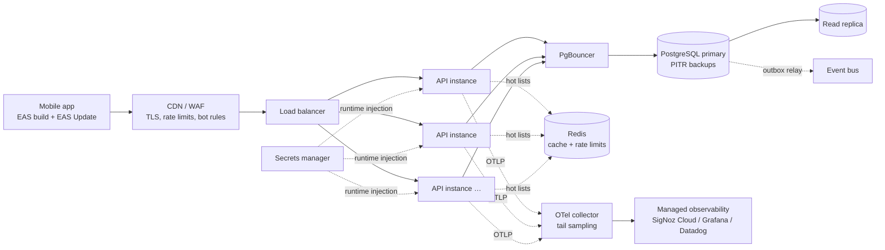

# Production Readiness — what I'd do differently in production

The brief asks: _"What would you do differently in production? Points such as cache, logs, scalability, security."_ This project is built to production standards where it is cheap to do so (clean architecture, validation, owner scoping, optimistic concurrency, idempotency, observability, CI gates) and deliberately stops where the cost only pays off with real traffic, real users or a real deployment target. Each item below states **today → in production → why / when**.

Related: [threat model](../security/threat-model.md#residual-risks) · [observability](observability.md) · [runbook](runbook.md) · ADRs [0006 offset pagination](../architecture/adr/0006-offset-pagination.md), [0013 OpenTelemetry](../architecture/adr/0013-opentelemetry-and-signoz.md), [0016 soft delete](../architecture/adr/0016-soft-delete.md), [0018 Docker Compose](../architecture/adr/0018-docker-compose-one-command-run.md).

## Target architecture (sketch)

## Caching

| Today                                                                      | In production                                                                                                                                                                                                                                             | Why / when                                                                                                        |
| -------------------------------------------------------------------------- | --------------------------------------------------------------------------------------------------------------------------------------------------------------------------------------------------------------------------------------------------------- | ----------------------------------------------------------------------------------------------------------------- |
| `ETag: W/"<version>"` on single resources, used for `If-Match` concurrency | Also honor `If-None-Match` → `304 Not Modified` on `GET /:id` and list endpoints (list ETag = hash of ids+versions+total)                                                                                                                                 | Saves bandwidth on mobile networks; cheap once ETags exist                                                        |
| No `Cache-Control`                                                         | `Cache-Control: private, no-cache` on user data (revalidate with ETag); `public, max-age` only for static/OpenAPI                                                                                                                                         | User data must never be cached by shared proxies; `private` + validation is safe                                  |
| Every list hits PostgreSQL                                                 | **Redis** read-through cache for hot lists (e.g. per-owner team list with `taskCount`, default task page), key `owner:{id}:teams:v{n}`, invalidated by domain events (`TeamDeleted`, `TaskCreated`, `TaskStatusChanged`…) via a per-owner version counter | Only when metrics show DB-bound list latency or high repeated reads; event-driven invalidation avoids stale reads |
| React Query cache + persisted offline cache on device                      | Keep; tune `staleTime` per screen with real usage data                                                                                                                                                                                                    | Client cache is the cheapest cache                                                                                |

## Logging and telemetry

| Today                                                                                                     | In production                                                                                                                                | Why / when                                    |
| --------------------------------------------------------------------------------------------------------- | -------------------------------------------------------------------------------------------------------------------------------------------- | --------------------------------------------- |
| JSON logs to stdout, redacted; optional local SigNoz                                                      | Ship stdout via the platform agent / OTel collector to a managed backend; structured fields indexed (`traceId`, `userId`, `route`, `status`) | Searchable, centrally retained logs           |
| No retention policy                                                                                       | Retention: debug off, info 14 days, error/audit 90 days; cold archive (object storage) 1 year; PII-free by construction (redaction tests)    | Cost control and LGPD/GDPR data minimization  |
| `parentbased_always_on` sampling                                                                          | **Tail sampling** in the collector: keep 100 % of errors and slow traces (> 500 ms), 5–10 % of the rest                                      | Volume/cost without losing interesting traces |
| No audit trail                                                                                            | Append-only audit log for security events (sign-in, sign-out, password change, deletes)                                                      | Repudiation (threat R-01), incident forensics |
| No mobile telemetry                                                                                       | Crash reporting + performance (Sentry / Firebase Crashlytics) with trace propagation (`traceparent`) from the app                            | End-to-end view starting on the device        |
| Alerts documented ([observability](observability.md#alerts-to-define-documented-not-provisioned-locally)) | Alerts provisioned as code, routed to on-call (PagerDuty/Opsgenie), each linked to a runbook entry                                           | Alerts nobody receives don't exist            |

## Scalability

| Today                                              | In production                                                                                                                                                     | Why / when                                                                 |
| -------------------------------------------------- | ----------------------------------------------------------------------------------------------------------------------------------------------------------------- | -------------------------------------------------------------------------- |
| One API container                                  | **Stateless API scaled horizontally** behind a load balancer (sessions live in PostgreSQL, no in-process state other than caches); autoscale on CPU + p95 latency | Throughput and availability; the API is already stateless by design        |
| In-memory rate limiter                             | Throttler storage in **Redis** (shared across instances) + edge limits at the WAF/API gateway                                                                     | Per-instance limits are bypassable with N instances                        |
| Prisma pool per instance                           | **PgBouncer** (transaction pooling) in front of PostgreSQL; Prisma `connection_limit` tuned per instance; `pgbouncer=true` mode                                   | Instances × pool size quickly exceeds `max_connections`                    |
| Single PostgreSQL                                  | **Read replicas** for list/search queries (read-your-writes kept on primary for the issuing user), managed PostgreSQL (RDS/Cloud SQL/Neon)                        | Read-heavy workload; replica lag acceptable for lists                      |
| Offset pagination (ADR-0006)                       | **Cursor (keyset) pagination** on `(created_at, id)` for task lists; keep `total` optional/estimated                                                              | Deep offsets are O(offset); mobile infinite scroll fits cursors            |
| `ILIKE` + trigram index                            | Keep for moderate data; move to PostgreSQL full-text (`tsvector`) or OpenSearch when search features grow (ranking, accents, typos)                               | Relevance and scale of search                                              |
| In-process domain events (`@nestjs/cqrs` EventBus) | **Transactional outbox** table written in the same transaction as the aggregate, relayed to a bus (SNS/SQS, Kafka, or pg-boss) with idempotent consumers          | Reliable event delivery across instances/services; no lost events on crash |
| Idempotency keys in PostgreSQL                     | Keep (durable), with TTL purge job; move to Redis only if write-heavy                                                                                             | Correctness first                                                          |

## Security

| Today                                                                         | In production                                                                                                                                  | Why / when                                        |
| ----------------------------------------------------------------------------- | ---------------------------------------------------------------------------------------------------------------------------------------------- | ------------------------------------------------- |
| Secrets via env, local defaults committed (refused when `APP_ENV=production`) | **Secrets manager** (AWS Secrets Manager / GCP Secret Manager / Vault) injected at runtime; rotation with overlap; no secrets in CI for builds | Leak containment and rotation                     |
| HTTP locally                                                                  | TLS everywhere, HSTS, TLS 1.2+; ATS/`usesCleartextTraffic=false` in release apps                                                               | Transport confidentiality                         |
| Throttler + validation                                                        | **WAF** (managed rules: OWASP core, bot control, IP reputation), API gateway quotas                                                            | Volumetric and automated abuse                    |
| Email + password only                                                         | **Email verification**, password reset flow, **MFA** (TOTP / passkeys via Better Auth plugins), breached-password check, progressive lockout   | Account takeover (threat R-04, R-09)              |
| `helmet` defaults                                                             | Strict **CSP** for Swagger/any web surface (or docs disabled in production), `Referrer-Policy`, `Permissions-Policy`                           | Reduce web attack surface                         |
| `pnpm audit` + Dependabot                                                     | Add **SCA/SAST** (GitHub CodeQL, Snyk/OSV), **container scanning** (Trivy) on images, SBOM (CycloneDX) per build, signed images (cosign)       | Supply-chain visibility                           |
| No external testing                                                           | DAST baseline (OWASP ZAP) in CI against a preview environment; **penetration test** before launch and yearly                                   | Independent verification                          |
| DB user owns schema                                                           | Separate migration role (DDL) and runtime role (DML only), row-level security as defense in depth for `owner_id`                               | Least privilege; second barrier against BOLA bugs |
| Swagger public                                                                | Disabled or behind auth in production                                                                                                          | Reduce inventory exposure (API9)                  |

## Reliability

| Today                                      | In production                                                                                                                                                                                                                                                       | Why / when                                              |
| ------------------------------------------ | ------------------------------------------------------------------------------------------------------------------------------------------------------------------------------------------------------------------------------------------------------------------- | ------------------------------------------------------- |
| Docker volume, no backups                  | Managed PostgreSQL with automated **backups + PITR** (7–35 days), cross-region snapshot copy, **restore drills** quarterly                                                                                                                                          | Backups that were never restored are hopes              |
| `prisma migrate deploy` on container start | Migrations run **once per release as a separate job** before rollout; **expand/contract** pattern (add nullable column → backfill → switch reads → drop later); no destructive migration in the same release as the code change; lock timeouts (`SET lock_timeout`) | Zero-downtime and safe rollback with multiple instances |
| Single instance restart                    | **Zero-downtime deploys**: readiness-gated rolling or blue/green, graceful shutdown (already implemented: stop accepting, drain, flush telemetry), connection draining at the LB                                                                                    | No dropped requests during deploys                      |
| Health probes                              | Same probes wired to the orchestrator (Kubernetes/ECS/Cloud Run); synthetic checks from outside (sign-in + list) every minute                                                                                                                                       | Detect user-visible outages                             |
| No SLOs                                    | **SLOs**: availability 99.9 % monthly (non-5xx / all, excluding 429), task list p95 < 200 ms in production (100 ms locally), status change p99 < 500 ms; **error budgets** with burn-rate alerts (1 h/6 h windows); budget exhaustion freezes feature releases      | Shared language for reliability vs. velocity            |
| Timeouts implicit                          | Explicit timeouts everywhere: HTTP server request timeout, Prisma statement timeout, client retries with backoff + jitter (the app's offline queue already retries idempotently)                                                                                    | Avoid resource exhaustion cascades                      |
| —                                          | Incident process: severity levels, on-call rotation, blameless postmortems, runbook per alert                                                                                                                                                                       | Learning from failures                                  |

## CD pipeline

Out of scope for the test (no deploy), but the CI is built to extend into CD:

| Today                  | In production                                                                                                                                                                                                                               | Why / when                                     |
| ---------------------- | ------------------------------------------------------------------------------------------------------------------------------------------------------------------------------------------------------------------------------------------- | ---------------------------------------------- |
| CI only (verify)       | **Build once, promote**: CI builds the API image, tags by commit SHA, signs it, pushes to a registry; the same image goes dev → staging → production                                                                                        | Reproducible releases                          |
| —                      | **Blue/green** (or canary 5 % → 25 % → 100 %) with automated rollback on SLO burn / error-rate alerts                                                                                                                                       | Limit blast radius                             |
| —                      | Migration job gate before rollout (expand/contract), feature flags for risky behavior                                                                                                                                                       | Decouple deploy from release                   |
| Expo Go for evaluation | **EAS Build** for store binaries (dev, preview, production profiles), **EAS Submit** to stores, **EAS Update** for OTA JS updates per channel with runtime-version policy; staged rollouts; Maestro E2E on EAS/Device farm before promoting | Mobile delivery without Expo Go; fast hotfixes |
| Preview: none          | Ephemeral preview environment per PR (API + DB branch, e.g. Neon branching) used by DAST and Maestro                                                                                                                                        | Test against real infra before merge           |
| Environments: local    | `dev`, `staging` (prod-like data volume, anonymized), `production`; config per environment from the secrets manager                                                                                                                         | Safe promotion                                 |

## Data lifecycle

| Today                                         | In production                                                                                                                                              | Why / when                                         |
| --------------------------------------------- | ---------------------------------------------------------------------------------------------------------------------------------------------------------- | -------------------------------------------------- |
| Soft delete (`deleted_at`), rows kept forever | Scheduled **purge job** hard-deleting rows soft-deleted > 30 days (and their `task_teams`), batched to avoid long locks; "undo/trash" UX within the window | Storage, privacy (data minimization), index health |
| Idempotency keys expire at 24 h, not purged   | Purge job (or partitioning by day + drop partitions)                                                                                                       | Table growth                                       |
| Sessions expire, not purged                   | Periodic purge of expired sessions/verifications                                                                                                           | Table growth, smaller attack surface               |
| Account deletion cascades                     | Self-service **account deletion & data export** (LGPD/GDPR right to erasure/portability), with audit record                                                | Legal compliance                                   |

## Multi-tenancy and collaboration

| Today                                                                | In production                                                                                                                                                                                                                                                                                       | Why / when                                                                                                                                                              |
| -------------------------------------------------------------------- | --------------------------------------------------------------------------------------------------------------------------------------------------------------------------------------------------------------------------------------------------------------------------------------------------- | ----------------------------------------------------------------------------------------------------------------------------------------------------------------------- |
| Single-owner model: every team/task belongs to one user (`owner_id`) | Introduce **workspaces/organizations**: `workspace_id` on teams/tasks, memberships with roles (owner, admin, member, viewer), **sharing teams** and **assigning tasks to people**; authorization moves from "owner = me" to policy checks (e.g. CASL / OPA-style policies in the application layer) | The product vision lists collaboration as out of scope today; the `ownerId` scoping, `TeamDirectory` port and aggregate boundaries are the seams where tenancy plugs in |
| BOLA protection by owner filter                                      | Tenant filter enforced at repository level + PostgreSQL **row-level security** keyed by `workspace_id`                                                                                                                                                                                              | Defense in depth with many users per tenant                                                                                                                             |
| No notifications                                                     | Event-driven notifications (assigned, due soon) via the outbox + push notifications (Expo push / FCM / APNs)                                                                                                                                                                                        | Collaboration needs awareness                                                                                                                                           |
| Last-write-wins detection via 412                                    | Field-level merge or CRDT for collaborative editing if concurrent editing becomes common                                                                                                                                                                                                            | Only with real collaboration                                                                                                                                            |

## Cost and operations notes

- Start with a managed platform (e.g. Cloud Run / ECS Fargate + managed PostgreSQL + SigNoz Cloud) before Kubernetes; the API needs nothing Kubernetes-specific.
- Tag all resources per environment; budgets and alerts on cost.
- Keep the local one-command experience: production parity through the same image and the same configuration schema.
