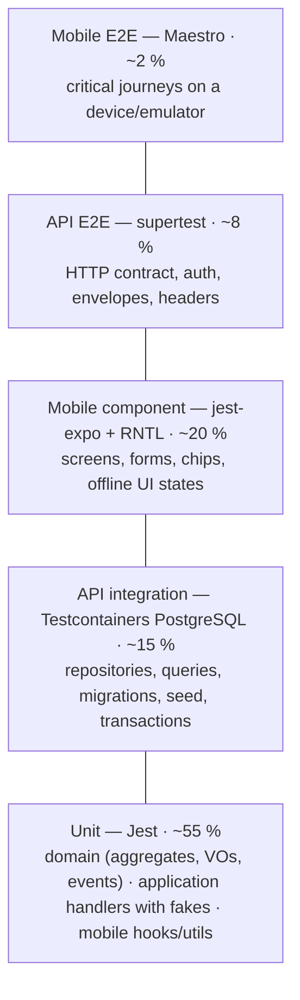

# Test Strategy

- **Principles:** [Constitution V — Quality](../constitution.md#v-quality) (test-first, pyramid, strict TS). Decision record: [ADR-0014 Testing strategy](../architecture/adr/0014-testing-strategy.md).
- **In place today:** API unit, integration and e2e suites, the architecture rules (`pnpm arch`), the CI-script tests and the compose smoke with the Bruno collection. **Planned, described below as the target:** mobile component and Maestro tests (with the mobile app), mutation testing, k6 and the generated-client drift check.
- **Related:** [definition of done](definition-of-done.md) · scenarios in `docs/specs/*/*.feature` · CI in [007 plan](../specs/007-ci-and-dx/plan.md#ci-pipeline-githubworkflowsciyml).

## Goals

1. Every acceptance criterion has at least one scenario, and every scenario at least one automated test (traceable by id).
2. Most confidence comes from fast, deterministic tests of the domain and application layers.
3. Integration tests exercise the **real** PostgreSQL (constraints, partial indexes, trigram search, transactions) — no in-memory fakes for persistence.
4. Tests assert behavior, not implementation; no sleeps; isolated data; zero tolerated flakiness on main.

## Pyramid



| Level                                                                             | Target share of tests | Typical runtime | Runs on                                              |
| --------------------------------------------------------------------------------- | --------------------- | --------------- | ---------------------------------------------------- |
| Unit (API domain + application, mobile logic)                                     | ~55 %                 | < 30 s total    | every commit (pre-push optional), every CI run       |
| API integration (Testcontainers)                                                  | ~15 %                 | 1–3 min         | every CI run                                         |
| Mobile component (RNTL)                                                           | ~20 %                 | < 1 min         | every CI run                                         |
| API E2E (supertest over the real app + Testcontainers DB)                         | ~8 %                  | 1–2 min         | every CI run                                         |
| Mobile E2E (Maestro)                                                              | ~2 %                  | 3–5 min         | locally before merging mobile features; nightly-able |
| Non-functional: mutation (Stryker), load (k6), contract drift, architecture rules | n/a                   | varies          | see [CI order](#ci-execution-order)                  |

Proportions are a guide, reviewed in PRs: a feature PR whose tests are mostly E2E is sent back.

## Levels and tooling

### 1. API unit — Jest (`apps/api`, `*.spec.ts` next to the code)

- **Domain:** entities (`Team`, `Task`), value objects (`TeamName`, `ColorHex`, `TaskTitle`, `TaskStatus`, `DueDate`), `Task.isOverdue`, domain errors. Pure TypeScript, no Nest testing module, no mocks needed.
- **Application:** use cases with **in-memory fakes** of the repositories and read models (`InMemoryTaskRepository`, `InMemoryTeamRepository`, a fixed `Clock`). The in-memory and Prisma repositories run the same contract suite. Asserts outcomes, not calls.
- **Presentation units:** DTO validation (`class-validator` `validate()` on DTO instances — boundaries via `it.each`), the exception filter's kind → status mapping and each domain error's HTTP code and status, `ResponseDto.from(view)`.
- **Infrastructure units:** config schema and production rules, request-id generator, logger configuration, OTel SDK options.
- Covers most `@must` validation and rule scenarios at the cheapest level.

### 2. API integration — Jest + Testcontainers PostgreSQL 17 (`apps/api/test/integration/**/*.int-spec.ts`)

- Real `postgres:17-alpine` container, migrations applied with `prisma migrate deploy`.
- Repositories: owner scoping, soft-delete filtering, `version` increments, `task_teams` replacement, team delete in one transaction (rolled back as a whole when its last statement fails), partial unique index for team names (case-insensitive), trigram search, sort + tie-breaker stability, pagination totals.
- Seed (idempotence, reset), migrations vs `schema.prisma` drift, readiness (stop/restart container) and log redaction (in-memory log stream).

### 3. API E2E — supertest (`apps/api/test/e2e/**/*.e2e-spec.ts`)

- The full Nest app (`AppModule`, real guards, pipes, filters, interceptors, Better Auth) against a Testcontainers DB.
- HTTP contract: status codes, envelopes `{ data, meta }` / `{ error }`, `Location`, `X-Request-Id`, `Retry-After`, CORS/helmet headers.
- Security: route enumeration → `401` without a Bearer token (a session cookie alone is not enough); **another user's resource → `404`**; unknown fields → `400`; rate limits → `429`.
- One "happy journey" per resource (create → list → get → update → delete).

### 4. Mobile component — jest-expo + React Native Testing Library (`apps/mobile/**/*.test.tsx`)

- Screens rendered with providers (React Query client per test, i18n, theme); network mocked with **MSW** handlers generated from the OpenAPI (orval `msw` output) so mocks follow the contract.
- Queries by role/label/text (accessibility-first), `userEvent` interactions; asserts what the user sees: validation messages (title < 3), color chips with readable text, optimistic status change and rollback, offline banners, empty/error states.
- Zustand stores and hooks unit-tested without rendering where possible.

### 5. Mobile E2E — Maestro (`apps/mobile/e2e/*.yaml`)

- Runs against Expo Go / dev build on an emulator with the compose stack and seeded data.
- Critical journeys only: sign in as demo user → teams list → tap team filters tasks → create task with validation error then success → task detail → mark Done → delete; offline toggle → status change queued → back online → synced.
- Local-only in this project (CI would need an emulator — see [production readiness](../operations/production-readiness.md#cd-pipeline)).

### 6. Mutation testing — Stryker (domain only)

- `apps/api/stryker.config.mjs`, mutates `src/modules/*/domain/**`, Jest runner, `perTest` coverage analysis, incremental.
- Gate: **mutation score ≥ 80 %** (`break: 80`). Nightly, manual, or PR label `mutation` ([007 plan](../specs/007-ci-and-dx/plan.md#mutation-testing-githubworkflowsmutationyml)).

### 7. Load and smoke — k6 (`tools/k6/`)

- `smoke.js`: every endpoint once, all checks must pass — runs in CI `compose-smoke`.
- `load.js`: 20 VUs, 2 min; thresholds **task list p95 < 100 ms**, **error rate < 1 %** — run locally (`make load`), results attached to performance-sensitive PRs. See [006 plan](../specs/006-observability/plan.md#k6).

### 8. Static and structural checks

- `tsc --noEmit` (strict, `noUncheckedIndexedAccess`), ESLint (`no-explicit-any` error, `typescript-eslint` strict), Prettier.
- dependency-cruiser architecture rules with their own meta-tests (fixtures per rule).
- Contract drift: OpenAPI export → orval → `git diff --exit-code`.

## What each level covers (by spec)

| Spec              | Unit                                                     | Integration                                                                | API E2E                                                       | Component                                      | Mobile E2E                |
| ----------------- | -------------------------------------------------------- | -------------------------------------------------------------------------- | ------------------------------------------------------------- | ---------------------------------------------- | ------------------------- |
| 001 auth          | password/session config, guard logic                     | session persistence, sign-out revocation                                   | sign-up/in/out, 401 on every protected route, auth rate limit | sign-in form validation, token storage adapter | sign in as demo           |
| 002 teams         | `TeamName`, `ColorHex`, `Team`                           | unique name index, soft delete + unassign, `taskCount`                     | CRUD, 404 for foreign, 409 duplicate, pagination meta         | teams list, color chip contrast                | tap team → filtered tasks |
| 003 tasks         | `Task` transitions, `completedAt`, `isOverdue`, handlers | filters combined, search trigram, sort stability, concurrency, idempotency | filters/sort/pagination contract, 412, 422, envelopes         | form (title ≥ 3), detail quick actions         | create/edit/status/delete |
| 004 mobile        | utils, hooks                                             | —                                                                          | —                                                             | every screen, a11y labels, i18n, theme         | journeys above            |
| 005 offline       | queue reducer, conflict rules                            | idempotent replay                                                          | `Idempotency-Key` replay                                      | optimistic update + rollback, offline banner   | offline → online sync     |
| 006 observability | metric handlers, config, request id                      | spans, logs, readiness, exporter-down                                      | headers, `error.traceId`, probe throttling                    | —                                              | —                         |
| 007 CI & DX       | audit script, commitlint examples, env parity            | seed                                                                       | —                                                             | —                                              | — (compose-smoke in CI)   |

## Test data strategy

- **Builders** (`test/builders/*.ts`): fluent, valid-by-default builders for aggregates and DTOs — `aTask().withTitle('Write notes').inTeams(t1, t2).done().build()`. Tests state only what matters to them.
- **Fixtures / mothers** for common shapes (e.g. `TeamsMother.mobileBackendDesign(ownerId)`), shared between integration and e2e.
- **Isolated DB per test file:** one PostgreSQL container per Jest worker (started in `globalSetup`, reused), and **one fresh database per test file** created from a migrated template (`CREATE DATABASE test_<uuid> TEMPLATE app_template`) — fast and fully isolated; files run in parallel. Within a file, tests either use unique owners (new user per test) or truncate in `beforeEach`.
- **Database cleanup:** every database a test file creates (`useTestDatabase()` / `createTestDatabase()`) is dropped by a root-level `afterAll` from `setupFilesAfterEnv` (`test/support/after-env.ts`), which runs after the file's own `afterAll` hooks, so apps and clients are closed before `DROP DATABASE … WITH (FORCE)`.
- **Users:** each test signs up its own users (`userFactory.create()`), so "another user's resource" tests never depend on global state.
- **Deterministic seed:** the seed used by compose, k6, Bruno and Maestro has fixed ids and values (relative due dates only for overdue/upcoming); tests never depend on seed data except seed tests themselves and the black-box smoke tests.
- **Time and ids:** `FixedClock` and `SequentialIdGenerator` in unit tests; integration tests freeze time via the `Clock` port, never `jest.useFakeTimers()` around I/O.
- **Network (mobile):** MSW handlers generated from the contract; no real API in component tests.

## BDD → test mapping

- Each `.feature` scenario carries tags `@US-0N.n @AC-0N.n.m` and a priority (`@must`/`@should`/`@could`), plus a surface tag (`@api`, `@mobile`, `@ops`, `@docs`).
- Feature files are the **specification**, not executed by a Cucumber runner; tests are plain Jest/RNTL/Maestro tests that **reference the AC id at the start of the test name**:

```ts
describe('Tasks list filters (US-03.4)', () => {
  it('AC-03.4.2 returns only tasks of the given team', async () => {
    /* … */
  });
  it.each(cases)('AC-03.1.3 rejects a title of %s characters', async (len) => {
    /* … */
  });
});
```

- Maestro flows: file name and first comment carry the ids (`# AC-04.2.1 AC-04.3.2`).
- **Traceability check** (`tools/ci/traceability.mjs`, optional: `pnpm traceability:check` locally or the non-required `docs-checks` CI job): parses all `@AC-` tags from feature files and all `AC-\d\d\.\d+\.\d+` ids from test names; fails if a `@must` AC has no test, warns for `@should`/`@could`; output feeds [`traceability-matrix.md`](traceability-matrix.md) (owned by qa-engineer).
- `@docs` scenarios are verified by review (DoD checklist) and a markdown link check, not by code tests.

## Coverage gates

| Scope                                  | Metric           | Gate                                               | Enforced by                         |
| -------------------------------------- | ---------------- | -------------------------------------------------- | ----------------------------------- |
| API domain (`src/modules/*/domain/**`) | lines            | **≥ 90 %**                                         | Jest `coverageThreshold` (unit run) |
| API overall                            | lines            | **≥ 80 %**                                         | Jest `coverageThreshold` (unit run) |
| API domain                             | mutation score   | **≥ 80 %**                                         | Stryker `break: 80`                 |
| Mobile                                 | lines            | ≥ 70 % (target, reported, non-blocking initially)  | jest-expo coverage                  |
| MUST acceptance criteria               | AC with ≥ 1 test | **100 %** (reported, not a CI gate since ADR-0020) | traceability check (optional)       |

The coverage gates run on the unit project and measure domain, application and shared code only (`infrastructure/`, `presentation/`, the generated Prisma client, `main.ts` and `instrumentation.ts` are excluded), because those excluded layers are proven by the integration and e2e projects against a real database and HTTP stack, where line coverage from unit tests would be meaningless.

Coverage is a floor, not a goal: reviewers reject tests without meaningful assertions even if they raise coverage.

## Flakiness policy

- **No sleeps** (`setTimeout` waits); use `findBy*`/`waitFor` in RNTL, Testcontainers wait strategies, polling with timeout for async assertions.
- **No order dependence**: Jest `--randomize` in CI; isolated DB per file; no shared mutable module state.
- **No real clock, network or randomness** in unit tests.
- A test that fails intermittently on main is **quarantined within 24 h**: moved behind `describe.skip` with a linked issue labelled `flaky`, owner assigned, fix or delete within 5 working days. Quarantine never applies to `@must` coverage without a replacement test.
- CI does **not** auto-retry tests. The only allowed retry is re-running a whole job once when the failure is an infrastructure error (image pull, runner outage) — noted in the PR.
- Flaky-test rate tracked from JUnit reports (artifacts); target 0 on main.

## CI execution order

Fast feedback first; all jobs feed the required `ci-success` status ([007 plan](../specs/007-ci-and-dx/plan.md#ci-pipeline-githubworkflowsciyml)).

1. Install (frozen lockfile, caches) → **commitlint** (PR range)
2. **Static** — format check, lint, typecheck, architecture rules (the traceability and doc checks run in the separate, non-required `docs-checks` job)
3. **Unit** — API + mobile (component tests run in the same Jest task per package) with coverage gates
4. **Integration + API E2E** — Testcontainers
5. **Build** → **contract drift**
6. **Audit**
7. **Compose smoke** — fresh images, `docker compose up --wait`, demo checks, Bruno collection, k6 smoke
8. Separate workflow: **mutation** (nightly / manual / `mutation` label)
9. Local only: **Maestro**, **k6 load**

Steps 2–6 run in parallel jobs after install; Turborepo cache skips unchanged packages.

## How to run locally

Prerequisites for test commands: Node 24 (`.nvmrc`), `corepack enable` (pnpm 10), Docker running (Testcontainers). Docker-only users: `make test-docker` (best effort, see [007 OQ-07.1](../specs/007-ci-and-dx/spec.md#open-questions)).

| What                                          | Command                                                                                |
| --------------------------------------------- | -------------------------------------------------------------------------------------- |
| Everything the CI runs (except compose smoke) | `pnpm lint && pnpm typecheck && pnpm arch && pnpm test`                                |
| All unit + component tests                    | `pnpm turbo run test`                                                                  |
| API unit only / watch                         | `pnpm --filter @hitss/api test` · `pnpm --filter @hitss/api test:watch`                |
| One AC                                        | `pnpm --filter @hitss/api test -t "AC-03.4.2"`                                         |
| API integration                               | `pnpm --filter @hitss/api test:integration`                                            |
| API E2E                                       | `pnpm --filter @hitss/api test:e2e`                                                    |
| Coverage report                               | `pnpm --filter @hitss/api test:cov` → `apps/api/coverage/lcov-report/index.html`       |
| Mutation (domain)                             | `pnpm --filter @hitss/api test:mutation` → `apps/api/reports/mutation/index.html`      |
| Mobile component                              | `pnpm --filter @hitss/mobile test`                                                     |
| Mobile E2E                                    | `make up` then `maestro test apps/mobile/e2e/` (emulator with Expo Go running the app) |
| Architecture rules                            | `pnpm arch`                                                                            |
| Contract drift                                | `pnpm api-client:generate && git diff --exit-code packages/api-client`                 |
| Smoke / load                                  | `make smoke` · `make load`                                                             |
| Request collection                            | `npx @usebruno/cli run tools/bruno/teams-tasks --env local`                            |
