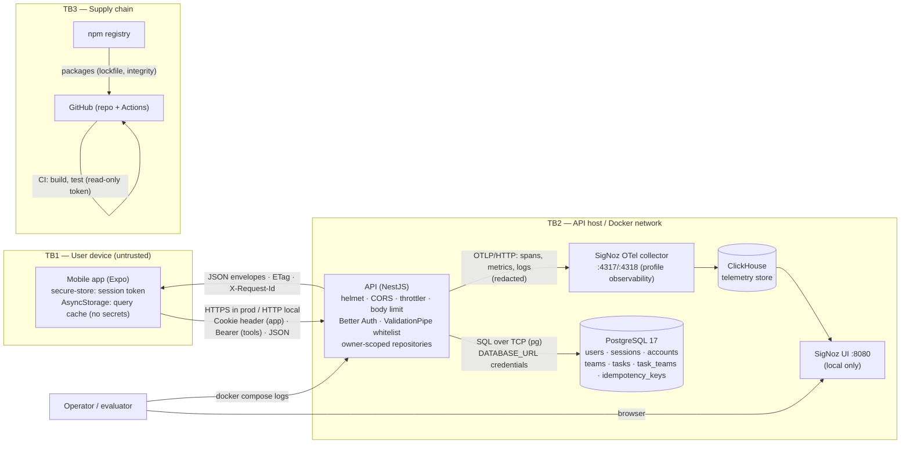

# Threat Model

- **Scope:** Teams & Tasks — mobile app (Expo), REST API (NestJS + Better Auth), PostgreSQL, local telemetry backend (SigNoz), CI pipeline and dependencies.
- **Method:** asset/actor inventory → data-flow diagram with trust boundaries → STRIDE per component → OWASP API Security Top 10 (2023) mapping → residual risks.
- **Status:** all mitigations are **Planned** (documentation phase). Each row names the spec/plan that implements it; the status moves to _Implemented_ when the covering test is merged (see [definition of done](../quality/definition-of-done.md)).
- **Principles:** [Constitution VI — Security by default](../constitution.md#vi-security-by-default). ADRs: [0007 Better Auth](../architecture/adr/0007-better-auth.md), [0005 envelopes](../architecture/adr/0005-rest-openapi-and-response-envelope.md), [0008 DTOs](../architecture/adr/0008-class-validator-dtos-and-generated-client.md), [0013 OpenTelemetry](../architecture/adr/0013-opentelemetry-and-signoz.md), [0015 optimistic concurrency](../architecture/adr/0015-optimistic-concurrency.md), [0016 soft delete](../architecture/adr/0016-soft-delete.md), [0018 Docker Compose](../architecture/adr/0018-docker-compose-one-command-run.md), [0019 idempotency keys](../architecture/adr/0019-idempotency-keys.md).
- **Context:** a local hiring-test deployment. Where the local setup deliberately accepts a risk (no TLS, published DB port, open telemetry UI), it is listed under [residual risks](#residual-risks) with the production fix.

## Assets

| ID  | Asset                                              | Why it matters                                   | Where                                                         |
| --- | -------------------------------------------------- | ------------------------------------------------ | ------------------------------------------------------------- |
| A1  | User credentials (password)                        | Account takeover; password reuse elsewhere       | Sign-up/sign-in request bodies; hash in `accounts`            |
| A2  | Session tokens / cookies                           | Bearer of identity for the session lifetime      | Mobile secure store, `Authorization` header, `sessions` table |
| A3  | User data: teams and tasks                         | Confidentiality and integrity of the user's work | PostgreSQL, app offline cache                                 |
| A4  | Personal data: email, name                         | Privacy (LGPD/GDPR)                              | `users`, auth responses                                       |
| A5  | Auth secret (`BETTER_AUTH_SECRET`), DB credentials | Forging sessions, direct DB access               | Environment of the API container                              |
| A6  | Service availability                               | Users can't work; evaluator can't evaluate       | API, DB                                                       |
| A7  | Telemetry (traces, logs, metrics)                  | May leak A1/A2/A4 if not redacted                | SigNoz / stdout                                               |
| A8  | Source code, CI pipeline, dependencies             | Supply-chain compromise reaches every user       | GitHub, npm registry                                          |
| A9  | API contract / generated client                    | A tampered client could send data elsewhere      | `packages/api-client`                                         |

## Actors

| Actor                                         | Trust                                                      | Capabilities                                                            |
| --------------------------------------------- | ---------------------------------------------------------- | ----------------------------------------------------------------------- |
| Legitimate user (Marina)                      | Authenticated, trusted for **her own** data only           | Uses the app; may tamper with her own device/app                        |
| Other authenticated user                      | Authenticated, **untrusted** with respect to Marina's data | Valid session; can craft any request (BOLA attempts)                    |
| Anonymous Internet attacker                   | Untrusted                                                  | Reaches public endpoints (auth, health, docs); credential stuffing, DoS |
| Network attacker                              | Untrusted                                                  | On the same Wi-Fi / path; sniff or alter traffic without TLS            |
| Device thief / malware on device              | Untrusted                                                  | Reads app storage, backups                                              |
| Malicious dependency / compromised maintainer | Untrusted                                                  | Code execution at install, build or runtime                             |
| Contributor / CI                              | Semi-trusted                                               | Opens PRs; fork PRs are untrusted code                                  |
| Operator / evaluator                          | Trusted                                                    | Runs compose, reads logs and telemetry                                  |

## Data flow and trust boundaries

| Boundary     | Crossing                   | Main controls                                                                                       |
| ------------ | -------------------------- | --------------------------------------------------------------------------------------------------- |
| TB1 → TB2    | App → API over the network | TLS (prod), authentication, input validation, rate limiting, owner scoping                          |
| Inside TB2   | API → DB                   | Least-privilege DB role (prod), parameterized queries (Prisma), network isolation (compose network) |
| Inside TB2   | API → telemetry            | Redaction before export; collector not exposed publicly                                             |
| TB3 → build  | Registry → image           | Frozen lockfile with integrity hashes, audit gate, Dependabot, pnpm 10 lifecycle-script allowlist   |
| Fork PR → CI | Untrusted code → runner    | `pull_request` (not `pull_request_target`), `contents: read`, no secrets                            |

## STRIDE

Status legend: **Planned** — designed and assigned to a spec task, not yet implemented.

### Spoofing

| ID   | Threat                                                  | Component                                  | Mitigation                                                                                                                                                                                                                                                                                                                                                                                                                                                                                                                                                                                                                                                                                                                                                  | Spec     | Status  |
| ---- | ------------------------------------------------------- | ------------------------------------------ | ----------------------------------------------------------------------------------------------------------------------------------------------------------------------------------------------------------------------------------------------------------------------------------------------------------------------------------------------------------------------------------------------------------------------------------------------------------------------------------------------------------------------------------------------------------------------------------------------------------------------------------------------------------------------------------------------------------------------------------------------------------- | -------- | ------- |
| S-01 | Credential stuffing / brute force on sign-in            | API `/api/auth/sign-in/email`              | Better Auth built-in limiter (the Nest throttler cannot see `/api/auth/*`): sign-up/sign-in/sign-out 10 req/min each per IP, `get-session` 100 req/min, native `429` + `X-Retry-After`; Better Auth password hashing (scrypt); generic "invalid credentials" message                                                                                                                                                                                                                                                                                                                                                                                                                                                                                        | 001      | Planned |
| S-02 | Weak passwords                                          | Sign-up                                    | Password 8–128 chars, length only, no trimming (NIST SP 800-63B); mobile form mirrors rule. No Unicode normalization (documented); breached-password screening is a production item (R-10)                                                                                                                                                                                                                                                                                                                                                                                                                                                                                                                                                                  | 001      | Planned |
| S-03 | Forged or replayed session token                        | API auth guard                             | Tokens are random, server-side sessions validated on every request; expiry + sliding refresh; sign-out revokes the session row; `bearer({ requireSignature: true })` so only signed tokens are accepted — a raw `sessions.token` read from the DB is not usable and forged tokens fail without a session lookup                                                                                                                                                                                                                                                                                                                                                                                                                                             | 001      | Planned |
| S-04 | Session token theft from device storage                 | Mobile                                     | Token only in `expo-secure-store` (Keychain / Keystore), never AsyncStorage or logs                                                                                                                                                                                                                                                                                                                                                                                                                                                                                                                                                                                                                                                                         | 001, 004 | Planned |
| S-05 | Token sniffing on the network                           | App ↔ API                                  | TLS in production (HSTS); local HTTP accepted as residual risk R-01                                                                                                                                                                                                                                                                                                                                                                                                                                                                                                                                                                                                                                                                                         | prod     | Planned |
| S-06 | Cross-site request forgery via session cookie           | API (cookie path)                          | Mobile sends the session as a `Cookie` header built from `authClient.getCookie()` — native, no browser cookie jar, no `Origin`, so no ambient credentials; cURL/Bruno use `Authorization: Bearer`. Better Auth origin check on `/api/auth/*`; on `/api/v1/*` a CSRF guard for cookie-authenticated unsafe methods rejects `Sec-Fetch-Site: cross-site` and untrusted `Origin` with `403 CSRF_REJECTED`; `POST`/`PUT`/`PATCH` bodies must be `application/json` (`415 UNSUPPORTED_MEDIA_TYPE`). Cookies `SameSite=Lax`, `HttpOnly`, `Secure` in prod; `exp://` trusted only when `APP_ENV=local` (Better Auth's expo plugin adds it itself under `NODE_ENV=development`, so production never runs with that value); CORS allowlist (no `*` with credentials) | 001      | Planned |
| S-07 | Bypassing or weaponizing the auth limiter via client IP | Better Auth limiter, Nest per-IP throttler | Better Auth sees only headers; without a resolvable IP it falls back to one shared bucket (one attacker throttles everyone). A middleware before Better Auth overwrites `x-tt-client-ip` with `req.ip` (socket address; Express `trust proxy` only for `TRUSTED_PROXIES` CIDRs) and Better Auth reads only that header. Spoofed `X-Forwarded-For` is ignored; independent buckets per address are tested (AC-01.7.6)                                                                                                                                                                                                                                                                                                                                        | 001      | Planned |

### Tampering

| ID   | Threat                                                                              | Component             | Mitigation                                                                                                                                                                                  | Spec                | Status  |
| ---- | ----------------------------------------------------------------------------------- | --------------------- | ------------------------------------------------------------------------------------------------------------------------------------------------------------------------------------------- | ------------------- | ------- |
| T-01 | Mass assignment: client sets `ownerId`, `id`, `version`, `completedAt`, `deletedAt` | DTOs                  | `ValidationPipe({ whitelist: true, forbidNonWhitelisted: true, transform: true })`; DTOs never declare those fields; `ownerId` taken from the session only                                  | 002, 003            | Planned |
| T-02 | SQL injection via `search`, `sort`, filters                                         | Repositories          | Prisma parameterized queries; raw SQL only via tagged `$queryRaw` templates; `sort` validated against a per-endpoint whitelist; `search` length 1–100                                       | 002, 003            | Planned |
| T-03 | Lost update / concurrent overwrite                                                  | `PUT`/`PATCH`         | `version` + `If-Match` → `412 PRECONDITION_FAILED`                                                                                                                                          | 003 (ADR-0015)      | Planned |
| T-04 | Duplicate creation on retries (offline queue)                                       | `POST`                | `Idempotency-Key` stored per owner (PK `(key, owner_id)`), body hash compared, 24 h TTL, `422 IDEMPOTENCY_KEY_REUSED`; concurrent duplicates → `409 IDEMPOTENCY_REQUEST_IN_PROGRESS` (D-09) | 003, 005 (ADR-0019) | Planned |
| T-05 | Tampering with offline cache / queued mutations on device                           | Mobile                | Server re-validates every request; cache holds no secrets; queue items are plain intents, authorization is server-side                                                                      | 005                 | Planned |
| T-06 | Malicious change merged into main                                                   | Repo / CI             | Branch protection (review + required `ci-success`), commitlint, CODEOWNERS for `.github/` and ADRs                                                                                          | 007                 | Planned |
| T-07 | Hand-edited or tampered generated client                                            | `packages/api-client` | Contract drift check regenerates and diffs in CI                                                                                                                                            | 007                 | Planned |

### Repudiation

| ID   | Threat                                                     | Component | Mitigation                                                                                                                                                                                                                                                         | Spec     | Status  |
| ---- | ---------------------------------------------------------- | --------- | ------------------------------------------------------------------------------------------------------------------------------------------------------------------------------------------------------------------------------------------------------------------ | -------- | ------- |
| R-01 | User denies having changed/deleted a task                  | API       | Structured completion log per request with `userId`, route, status, `traceId`; soft delete keeps the row with `deletedAt`; `updatedAt`/`version` history marker                                                                                                    | 006, 003 | Planned |
| R-02 | No correlation between a user complaint and server records | API       | `X-Request-Id` and `error.traceId` returned to the client and shown in the app's error UI ("error id"); an incoming `X-Request-Id` is reused only if it matches `[A-Za-z0-9._-]{1,128}`, otherwise a new one is generated (no log injection or forged correlation) | 006, 004 | Planned |
| R-03 | Unattributed changes to code                               | Repo      | Conventional Commits, PR template, required review; signed commits recommended                                                                                                                                                                                     | 007      | Planned |

### Information disclosure

| ID   | Threat                                                      | Component                          | Mitigation                                                                                                                                                                                                                                                                                                                                                                                                                                                                                                                                                                          | Spec      | Status  |
| ---- | ----------------------------------------------------------- | ---------------------------------- | ----------------------------------------------------------------------------------------------------------------------------------------------------------------------------------------------------------------------------------------------------------------------------------------------------------------------------------------------------------------------------------------------------------------------------------------------------------------------------------------------------------------------------------------------------------------------------------- | --------- | ------- |
| I-01 | BOLA: reading another user's team/task by id                | All `/:id` routes, `teamId` filter | Every query `WHERE owner_id = :sessionUser`; foreign or unknown id → **404** (`TEAM_NOT_FOUND`/`TASK_NOT_FOUND`), never 403; foreign `teamId` filter → empty list; `teamIds` validated through `TeamDirectory` (owner-scoped) → `422 UNKNOWN_TEAMS` without revealing which ids exist for others                                                                                                                                                                                                                                                                                    | 002, 003  | Planned |
| I-02 | Stack traces / SQL in error responses                       | Exception filter                   | Global filter maps to the error envelope; `500 INTERNAL_ERROR` generic message + `traceId`; details only in logs. `/api/auth/*` (outside the filter) uses Better Auth `onAPIError` for a generic `500` without Prisma/SQL text                                                                                                                                                                                                                                                                                                                                                      | 003, 006  | Planned |
| I-03 | Credentials or PII in logs and telemetry                    | pino, OTel                         | pino `redact` (authorization, cookie, set-cookie, set-auth-token, `*.password`, `*.token`, `*.email`…); bodies never logged; pg `enhancedDatabaseReporting: false`; no headers in span attributes; query strings stripped from every URL attribute by the sanitizing span exporter; no ids/emails in metric attributes; `client.address` (IP) and `user_agent.original` stay on server spans by design — personal data, kept only for the telemetry retention period (production: short retention, e.g. 15–30 days, or IP truncation in the collector); automated log-capture tests | 006       | Planned |
| I-04 | Secrets committed or baked into images                      | Repo, Dockerfile                   | Secrets only via env; `.env` git-ignored; `.env.example` holds obviously-local defaults; API refuses the default auth secret when `APP_ENV=production`; `.dockerignore` excludes `.env*`; secret scanning (GitHub push protection) recommended                                                                                                                                                                                                                                                                                                                                      | 007       | Planned |
| I-05 | Enumerating registered emails via sign-up/sign-in responses | Auth                               | Generic sign-in error (same status, code and message for unknown email and wrong password); sign-up reveals "email in use" — **accepted risk R-04**, bounded by the 10 req/min sign-up limit                                                                                                                                                                                                                                                                                                                                                                                        | 001       | Planned |
| I-06 | Over-exposed fields in responses                            | Presenters                         | Explicit response DTOs / mappers (no entity serialization); `ownerId`, `deletedAt` never returned                                                                                                                                                                                                                                                                                                                                                                                                                                                                                   | 002, 003  | Planned |
| I-07 | Swagger UI / OpenAPI reveals internal surface               | `/docs`                            | Documents only public contract; in production served behind auth or disabled (`DOCS_ENABLED=false`)                                                                                                                                                                                                                                                                                                                                                                                                                                                                                 | 003, prod | Planned |
| I-08 | Telemetry UI reachable by others                            | SigNoz `:8080`                     | Local only (bind to localhost in compose), opt-in profile; production: SSO-protected backend                                                                                                                                                                                                                                                                                                                                                                                                                                                                                        | 006       | Planned |
| I-09 | Data left on a lost device                                  | Mobile                             | Token in secure store; query cache cleared on sign-out; no PII beyond the user's own tasks                                                                                                                                                                                                                                                                                                                                                                                                                                                                                          | 004, 005  | Planned |
| I-10 | Existence leak via timing or `ETag` on 404                  | API                                | 404 path identical for "unknown" and "foreign"; ETag only on owned resources                                                                                                                                                                                                                                                                                                                                                                                                                                                                                                        | 003       | Planned |
| I-11 | Known demo credential or unsafe defaults in production      | Seed, config                       | Demo user seeded only when `SEED_DEMO=true`; startup fails when `APP_ENV=production` on `SEED_DEMO=true` or `SEED_ON_START=true`, a placeholder (`local-dev-`/`unit-test-secret-`) or short `BETTER_AUTH_SECRET`, a `DATABASE_URL` with the local placeholder password, non-`https` `BETTER_AUTH_URL`, `CORS_ORIGINS` with `*`/`http://`/`localhost`, or `AUTH_RATE_LIMIT_ENABLED=false` (docs: I-07)                                                                                                                                                                               | 001, 007  | Planned |
| I-12 | Session token readable by browser scripts                   | CORS `exposedHeaders`              | `set-auth-token` is exposed only to the `CORS_ORIGINS` allowlist (development web origins); accepted as R-12                                                                                                                                                                                                                                                                                                                                                                                                                                                                        | 001       | Planned |

### Denial of service

| ID   | Threat                                              | Component               | Mitigation                                                                                                                                                                                                                                                                                 | Spec      | Status  |
| ---- | --------------------------------------------------- | ----------------------- | ------------------------------------------------------------------------------------------------------------------------------------------------------------------------------------------------------------------------------------------------------------------------------------------ | --------- | ------- |
| D-01 | Request flooding                                    | API                     | `/api/v1/*`: per-IP throttler (300 req/min) **before** `AuthGuard`, so anonymous and forged-token floods are bounded, then 100 req/min per user; `429 RATE_LIMITED` + `Retry-After`. `/api/auth/*`: Better Auth limiter (S-01, S-07)                                                       | 001, 003  | Planned |
| D-02 | Huge list pages                                     | List endpoints          | `limit` 1–100 (default 20), `offset ≥ 0`; `search` ≤ 100 chars                                                                                                                                                                                                                             | 002, 003  | Planned |
| D-03 | Large or deeply nested bodies                       | Body parser             | JSON body limit 100 kB on `/api/v1/*`; `/api/auth/*` bodies capped at 16 kB before hashing (`413`); `teamIds` ≤ 10; string length limits on every field                                                                                                                                    | 002, 003  | Planned |
| D-04 | Expensive `ILIKE '%term%'` scans                    | DB                      | `pg_trgm` GIN index; owner-scoped partial indexes; statement timeout (prod)                                                                                                                                                                                                                | 003       | Planned |
| D-05 | Deep offsets degrading DB                           | DB                      | `limit` cap; cursor pagination documented as production improvement                                                                                                                                                                                                                        | 003, prod | Planned |
| D-06 | Idempotency-key table growth                        | DB                      | 24 h `expires_at`, purge job (prod)                                                                                                                                                                                                                                                        | 003       | Planned |
| D-09 | Connection pinning via concurrent same-key requests | Idempotency interceptor | Non-blocking `pg_try_advisory_xact_lock(hashtext(owner_id), hashtext(key))` (ADR-0019): a second in-flight request gets `409 IDEMPOTENCY_REQUEST_IN_PROGRESS` + `Retry-After: 1` immediately instead of holding a connection; the lock is owner-scoped, so another user's key never blocks | 002, 003  | Planned |
| D-07 | Telemetry backend outage slows/crashes API          | OTel                    | Async batch exporters, no readiness dependency, `OTEL_SDK_DISABLED`                                                                                                                                                                                                                        | 006       | Planned |
| D-08 | DB connection exhaustion                            | API ↔ DB                | Prisma pool limit via `connection_limit`; PgBouncer in production                                                                                                                                                                                                                          | prod      | Planned |

### Elevation of privilege

| ID   | Threat                                              | Component    | Mitigation                                                                                                                                               | Spec     | Status  |
| ---- | --------------------------------------------------- | ------------ | -------------------------------------------------------------------------------------------------------------------------------------------------------- | -------- | ------- |
| E-01 | Unauthenticated access to protected routes          | API          | Global auth guard (deny by default); explicit `@Public()` only on health, docs and auth; e2e test enumerates every route and asserts 401 without session | 001      | Planned |
| E-02 | Modifying another user's resource (BFLA/BOLA write) | Write routes | Same owner-scoped `UPDATE … WHERE id AND owner_id AND version`; 404 when foreign                                                                         | 002, 003 | Planned |
| E-03 | Container breakout impact                           | API image    | Non-root user, minimal runtime image, no build tools, `init` process                                                                                     | 007      | Planned |
| E-04 | Malicious dependency executes at install            | Build/CI     | pnpm 10 blocks lifecycle scripts by default; explicit `onlyBuiltDependencies` allowlist; frozen lockfile; audit gate                                     | 007      | Planned |
| E-05 | Fork PR exfiltrates secrets / writes to repo        | CI           | `pull_request` trigger only, `permissions: contents: read`, no secrets needed, SHA-pinned actions                                                        | 007      | Planned |

## OWASP API Security Top 10 (2023) mapping

| OWASP                                                    | Risk in this API                                                                    | Controls                                                                                                                                                                   | Threat ids             | Verified by                                            |
| -------------------------------------------------------- | ----------------------------------------------------------------------------------- | -------------------------------------------------------------------------------------------------------------------------------------------------------------------------- | ---------------------- | ------------------------------------------------------ |
| **API1 Broken Object Level Authorization**               | `GET/PUT/PATCH/DELETE /teams/:id`, `/tasks/:id`, `teamId` filter, `teamIds` in body | Owner scoping in every repository query; foreign id → **404**; `teamIds` validated owner-scoped; UUID params via `ParseUUIDPipe`                                           | I-01, E-02, I-10       | e2e "other user's resource → 404" scenarios in 002/003 |
| **API2 Broken Authentication**                           | Sign-in, sessions, tokens                                                           | Better Auth (vetted library), scrypt hashing, server-side sessions with expiry and revocation, auth rate limit 10/min/IP, secure token storage on device, generic errors   | S-01…S-06              | 001 scenarios                                          |
| **API3 Broken Object Property Level Authorization**      | Mass assignment and over-exposure                                                   | DTO whitelist + `forbidNonWhitelisted`; no `ownerId`/`id`/`version`/`completedAt`/`deletedAt` in request bodies (`version` only via `If-Match`); explicit response mappers | T-01, I-06             | 400 `VALIDATION_FAILED` scenarios for unknown fields   |
| **API4 Unrestricted Resource Consumption**               | Lists, search, bodies, request rate                                                 | `limit` ≤ 100, `search` ≤ 100, body ≤ 100 kB, `teamIds` ≤ 10, throttler per user/IP, trigram index, idempotency TTL                                                        | D-01…D-06              | boundary Scenario Outlines; k6 smoke                   |
| **API5 Broken Function Level Authorization**             | Only one role (user); admin functions absent                                        | Deny-by-default guard; no admin endpoints exposed; health/docs public by explicit decorator                                                                                | E-01                   | route-enumeration e2e test                             |
| **API6 Unrestricted Access to Sensitive Business Flows** | Account creation spam, bulk task creation                                           | Auth rate limits, per-user throttler; email verification and CAPTCHA listed for production                                                                                 | S-01, D-01             | — (residual R-04)                                      |
| **API7 Server Side Request Forgery**                     | No server-side fetch of user-supplied URLs                                          | Not applicable by design; any future webhook/URL feature requires an allowlist (ADR)                                                                                       | —                      | architecture review                                    |
| **API8 Security Misconfiguration**                       | Headers, CORS, errors, defaults                                                     | `helmet`, explicit CORS allowlist, generic 500s, config validated at start, default secret refused in production, docs disabled in production, non-root image              | I-02, I-04, I-07, E-03 | config unit tests, header e2e test                     |
| **API9 Improper Inventory Management**                   | Undocumented or stale endpoints/versions                                            | OpenAPI generated from code, `/api/v1` versioning, contract drift check, Bruno collection run in CI                                                                        | T-07                   | 007 contract job                                       |
| **API10 Unsafe Consumption of APIs**                     | Third-party: Better Auth library, npm packages                                      | Pinned versions, audit gate, Dependabot, no outbound API calls from the server                                                                                             | E-04, SC-01…SC-04      | 007 audit job                                          |

## Mobile-specific

| ID   | Topic                 | Decision                                                                                                                                                                                                                              |
| ---- | --------------------- | ------------------------------------------------------------------------------------------------------------------------------------------------------------------------------------------------------------------------------------- |
| M-01 | Token storage         | Session token stored only in `expo-secure-store` (iOS Keychain, Android Keystore-backed). Never in AsyncStorage, Zustand persisted state, React Query cache, logs or crash reports. Deleted on sign-out and on `401`.                 |
| M-02 | Secrets in the bundle | The JS bundle is public. **`EXPO_PUBLIC_*` variables are inlined into the bundle and readable by anyone** — they contain only non-secret configuration (API base URL). No API keys, no auth secret, no DB URL ever in the app.        |
| M-03 | Offline cache         | React Query persisted cache and mutation queue (AsyncStorage) contain only the user's own teams/tasks — acceptable on a device the user controls; cleared on sign-out (I-09). Encryption at rest of the cache is a production option. |
| M-04 | Transport             | Production: HTTPS only (ATS on iOS, `usesCleartextTraffic=false` on Android release builds). Local: HTTP to a LAN IP accepted (R-01). Certificate pinning listed as production option (trade-off: rotation pain).                     |
| M-05 | Input                 | Client-side zod validation is for UX only; the server validates everything again.                                                                                                                                                     |
| M-06 | Deep links            | Expo Router deep links never carry tokens; routes requiring auth redirect to sign-in.                                                                                                                                                 |
| M-07 | Debug surfaces        | Expo Go/dev menu is dev-only; production builds via EAS with `__DEV__` false, no remote debugging, logs stripped of PII.                                                                                                              |

## Secrets management

| Secret                | Local (this project)                                                                                                     | Production                                                                                                                                     |
| --------------------- | ------------------------------------------------------------------------------------------------------------------------ | ---------------------------------------------------------------------------------------------------------------------------------------------- |
| `BETTER_AUTH_SECRET`  | Obvious default in compose/`.env.example` (`local-dev-secret-change-me-…`); **API refuses it when `APP_ENV=production`** | ≥ 32 random bytes from a secrets manager (AWS Secrets Manager / GCP Secret Manager / Vault), injected at runtime; rotated with dual-key window |
| DB credentials        | `teams/teams` local defaults                                                                                             | Per-service role with least privilege (no DDL at runtime; a separate migration role); managed rotation                                         |
| OTLP endpoint/headers | No auth locally                                                                                                          | Ingestion key from the secrets manager                                                                                                         |

Rules: secrets only from environment (Constitution VI.3); `.env` git-ignored; never logged (config module prints keys, never values); never in images (`.dockerignore`), never in `EXPO_PUBLIC_*`; GitHub secret scanning + push protection enabled on the repository.

## Logging redaction

- pino `redact` paths: `req.headers.authorization`, `req.headers.cookie`, `res.headers["set-cookie"]`, `res.headers["set-auth-token"]`, `*.password`, `*.newPassword`, `*.currentPassword`, `*.token`, `*.secret`, `*.email` → `[REDACTED]`.
- Request and response bodies are never logged; route templates instead of raw URLs (no search terms or ids in completion entries).
- Logs may contain the opaque `userId`; never email or name.
- Telemetry: no header capture, no DB parameters, query strings stripped; metrics without ids. Server spans keep `client.address` and `user_agent.original` (personal data, I-03): retention follows the telemetry backend's retention period.
- Verified by automated log-capture tests ([006 plan](../specs/006-observability/plan.md#security-considerations), AC-06.3.3, AC-06.2.5).

## Supply chain

| ID    | Threat                                     | Control                                                                                           | Status  |
| ----- | ------------------------------------------ | ------------------------------------------------------------------------------------------------- | ------- |
| SC-01 | Dependency with known vulnerability        | `pnpm audit --audit-level high` gate with expiring allowlist (`security/audit-allowlist.json`)    | Planned |
| SC-02 | Unexpected version / tampered tarball      | Committed `pnpm-lock.yaml` with integrity hashes; `--frozen-lockfile` in CI and Docker            | Planned |
| SC-03 | Malicious install scripts                  | pnpm 10 default-deny lifecycle scripts; `onlyBuiltDependencies` allowlist reviewed in PRs         | Planned |
| SC-04 | Stale dependencies / base images / actions | Dependabot weekly (npm, github-actions, docker), grouped; actions pinned by SHA                   | Planned |
| SC-05 | Compromised CI token                       | `permissions: contents: read`; no long-lived secrets in CI; no `pull_request_target`              | Planned |
| SC-06 | Base image vulnerabilities                 | Slim official images, rebuilt weekly via Dependabot; image scanning (Trivy) listed for production | Planned |

## Residual risks

| ID   | Risk                                                                                                                                                                                                                                                                           | Why accepted here                                                                                                     | Production improvement                                                                                                                          |
| ---- | ------------------------------------------------------------------------------------------------------------------------------------------------------------------------------------------------------------------------------------------------------------------------------ | --------------------------------------------------------------------------------------------------------------------- | ----------------------------------------------------------------------------------------------------------------------------------------------- |
| R-01 | HTTP without TLS locally (app ↔ API on LAN); the API is published on `0.0.0.0` by design (`API_BIND`, so a phone on the same Wi-Fi can reach it), which makes it — and, with `SEED_DEMO=true`, the demo account with its public password — reachable by anyone on that network | Local evaluation; no real data; Expo Go on a phone needs a LAN address. Simulator-only users set `API_BIND=127.0.0.1` | TLS everywhere, HSTS, TLS termination at load balancer; no public demo account (`SEED_DEMO` refused in production)                              |
| R-02 | Postgres port published on the host with default credentials                                                                                                                                                                                                                   | Developer tooling convenience                                                                                         | No public DB endpoint; private network; IAM/rotated credentials                                                                                 |
| R-03 | SigNoz UI without authentication                                                                                                                                                                                                                                               | Opt-in, local only                                                                                                    | Managed backend with SSO/RBAC; collector behind auth                                                                                            |
| R-04 | Sign-up reveals that an email is already registered; no email verification, no CAPTCHA                                                                                                                                                                                         | Brief scope; demo accounts; bounded by 10 req/min per IP on sign-up                                                   | Verification-first sign-up (same response whether or not the email exists; the email link completes the account), CAPTCHA / bot protection, MFA |
| R-05 | In-memory rate limiter (per instance)                                                                                                                                                                                                                                          | Single instance locally                                                                                               | Distributed limiter (Redis) + WAF/API gateway limits                                                                                            |
| R-06 | Soft-deleted data retained indefinitely                                                                                                                                                                                                                                        | No purge job in scope                                                                                                 | Scheduled purge after retention period; right-to-erasure flow                                                                                   |
| R-07 | Offline cache unencrypted on device                                                                                                                                                                                                                                            | Device controlled by the user; low sensitivity                                                                        | Encrypted storage (e.g. MMKV with key in secure store)                                                                                          |
| R-08 | No penetration test or DAST                                                                                                                                                                                                                                                    | Hiring-test scope                                                                                                     | OWASP ZAP baseline in CI, external pentest before launch                                                                                        |
| R-09 | No account lockout beyond rate limit                                                                                                                                                                                                                                           | Simplicity                                                                                                            | Progressive delays, lockout with notification, breached-password check                                                                          |
| R-10 | Passwords are not Unicode-normalized and not screened against breach corpora                                                                                                                                                                                                   | Length-only policy is NIST-aligned; screening needs an online service                                                 | NFKC normalization before hashing; k-anonymity breached-password check (e.g. HIBP range API)                                                    |
| R-11 | Sliding sessions have no absolute lifetime (a session used daily never expires)                                                                                                                                                                                                | Simplicity; 7-day idle expiry and sign-out revoke                                                                     | Absolute maximum session age with re-authentication; session list and remote sign-out                                                           |
| R-12 | `set-auth-token` is exposed via CORS to allowed browser origins                                                                                                                                                                                                                | Development-only web origins; native app and tools do not use CORS                                                    | Production allowlist without browser clients of the token, or drop the header from `exposedHeaders`                                             |

See [production readiness](../operations/production-readiness.md#security) for the full production plan.

## Review cadence

- Every PR touching auth, DTOs, repositories, CI or Dockerfiles gets the security checklist from `.claude/agents/security-specialist.md`.
- This document is updated when a new endpoint, data store or external dependency is introduced; a merged PR may not leave a high/critical finding open.
