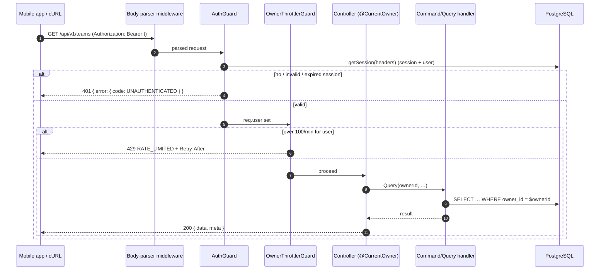
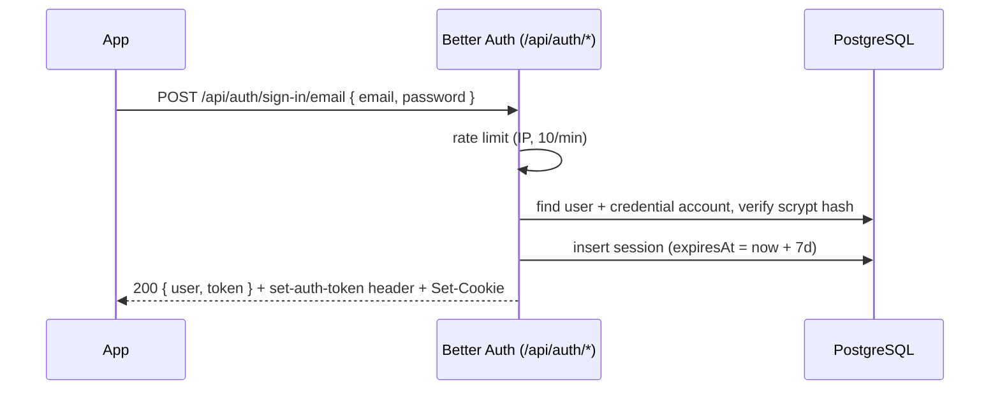

# 001 — Technical plan

## Context & references

- Spec: [spec.md](spec.md) · Scenarios: [auth.feature](auth.feature) · Tasks: [tasks.md](tasks.md)
- Contract: [api-contracts.md](../../architecture/api-contracts.md#identity--apiauth) · Data: [data-model.md](../../architecture/data-model.md) · Domain: [domain-model.md](../../architecture/domain-model.md#bounded-contexts)
- ADRs: [0002](../../architecture/adr/0002-nestjs-clean-architecture-ddd-cqrs.md) (layers), [0004](../../architecture/adr/0004-prisma-migrations-and-seeding.md) (migrations, seed), [0005](../../architecture/adr/0005-rest-openapi-and-response-envelope.md) (envelope), [0007](../../architecture/adr/0007-better-auth.md) (Better Auth), [0013](../../architecture/adr/0013-opentelemetry-and-signoz.md) (telemetry), [0014](../../architecture/adr/0014-testing-strategy.md) (testing), [0018](../../architecture/adr/0018-docker-compose-one-command-run.md) (one-command run)

This spec also delivers the **API foundation** that every later spec builds on: typed config, Prisma module, HTTP conventions (prefix, versioning, validation, envelopes, error filter) and the security baseline. These are the first tasks in [tasks.md](tasks.md) and are labeled as foundation.

## Architecture

### Components and layout

```
apps/api/src/
├── main.ts                         # bootstrap (bodyParser: false, prefix, versioning, helmet, CORS, swagger)
├── app.module.ts                   # composition root; ordered global guards
├── config/                         # FOUNDATION
│   ├── env.schema.ts               # zod schema, fail fast
│   └── app-config.ts               # typed AppConfig provider (no process.env elsewhere)
├── infrastructure/prisma/          # FOUNDATION
│   ├── prisma.module.ts            # @Global
│   └── prisma.service.ts           # lifecycle, driver adapter
├── shared/
│   ├── http/                       # FOUNDATION
│   │   ├── envelope.interceptor.ts # { data, meta? }; skipped with @RawResponse()
│   │   ├── http-exception.filter.ts# → { error: { code, message, details?, traceId } }
│   │   ├── error-codes.ts          # stable codes (single source)
│   │   └── validation.pipe.ts      # whitelist + forbidNonWhitelisted + transform; → VALIDATION_FAILED
│   └── kernel/
│       └── owner.ts                # type Owner = { readonly ownerId: string }  (framework-free)
└── modules/identity/
    ├── auth.factory.ts             # createAuth(config, prisma): betterAuth({...})
    ├── identity.module.ts          # AuthModule.forRootAsync + guards + throttler
    ├── presentation/
    │   ├── current-owner.decorator.ts  # @CurrentOwner(): Owner
    │   └── owner-throttler.guard.ts    # tracker = ownerId ?? client IP
    └── health/ (or modules/health)     # GET /health/live, @AllowAnonymous @SkipThrottle @RawResponse
```

Identity is a **generic subdomain**. It has no `domain/` layer of its own, because Better Auth owns users, sessions and accounts. Other contexts see Identity only through the `Owner` kernel type.

### Bootstrap

```ts
// main.ts (illustrative)
const app = await NestFactory.create(AppModule, {
  bodyParser: false,
  bufferLogs: true,
});
app.setGlobalPrefix('api', { exclude: ['docs', 'docs/(.*)'] });
app.enableVersioning({ type: VersioningType.URI, defaultVersion: '1' }); // → /api/v1/*
app.use(helmet());
app.enableCors({
  origin: config.corsOrigins,
  credentials: true,
  exposedHeaders: [
    'set-auth-token',
    'ETag',
    'Location',
    'X-Request-Id',
    'Retry-After',
  ],
});
```

- `bodyParser: false` is required by `@thallesp/nestjs-better-auth`. Better Auth must read the raw request stream on its own routes. The library then **re-adds the JSON and urlencoded parsers for every other route** with its `SkipBodyParsingMiddleware`, so we **do not** call `app.use(express.json())` ourselves. Doing so would consume the stream before Better Auth reads it. We configure the re-added parsers through the module options instead, which keeps one body-size limit for the whole API:

  ```ts
  AuthModule.forRootAsync({
    imports: [ConfigModule, PrismaModule],
    inject: [AppConfig, PrismaService],
    disableGlobalAuthGuard: true, // we register guards ourselves, in order (below)
    useFactory: (config, prisma) => ({
      auth: createAuth(config, prisma),
      bodyParser: { json: { limit: '100kb' }, urlencoded: { enabled: false } },
    }),
  });
  ```

- The auth routes are mounted by the library at Better Auth's `basePath: '/api/auth'`, outside the URI versioning and outside our envelope and filter. This is the documented exception (spec Q-01.1).

### Better Auth configuration

```ts
// auth.factory.ts (illustrative)
export const createAuth = (config: AppConfig, prisma: PrismaClient) =>
  betterAuth({
    appName: 'Teams & Tasks',
    baseURL: config.betterAuthUrl, // BETTER_AUTH_URL
    secret: config.betterAuthSecret, // BETTER_AUTH_SECRET (≥ 32 chars)
    basePath: '/api/auth',
    database: prismaAdapter(prisma, { provider: 'postgresql' }),
    emailAndPassword: {
      enabled: true,
      minPasswordLength: 8,
      maxPasswordLength: 128,
      autoSignIn: true,
    },
    session: { expiresIn: 60 * 60 * 24 * 7, updateAge: 60 * 60 * 24 }, // BR-01.4
    trustedOrigins: [
      `${config.appScheme}://`,
      ...(config.isDevelopment ? ['exp://'] : []),
      ...config.corsOrigins,
    ],
    plugins: [bearer(), expo()],
    rateLimit: {
      enabled: config.authRateLimit.enabled,
      window: 60,
      max: 100,
      storage: 'memory',
      customRules: {
        '/sign-in/email': { window: 60, max: 10 },
        '/sign-up/email': { window: 60, max: 10 },
        '/sign-out': { window: 60, max: 10 },
      },
    },
    advanced: {
      database: { generateId: 'uuid' }, // ownerId is a UUID everywhere (spec Q-01.5)
      ipAddress: { ipAddressHeaders: config.trustedIpHeaders }, // [] unless behind a trusted proxy
      useSecureCookies: config.isProduction,
      defaultCookieAttributes: { httpOnly: true, sameSite: 'lax' },
    },
    hooks: { before: signUpNameValidation }, // BR-01.3: trim, 1–100 chars → 400
  });
```

| Concern                        | Decision                                                                                                                                                                                                                                                                                                                         |
| ------------------------------ | -------------------------------------------------------------------------------------------------------------------------------------------------------------------------------------------------------------------------------------------------------------------------------------------------------------------------------- |
| Password hashing               | Better Auth default (scrypt, salted). No custom hasher.                                                                                                                                                                                                                                                                          |
| Email normalization            | Better Auth lower-cases emails. A unit test pins this behavior (AC-01.1.6) so an upgrade cannot silently change it.                                                                                                                                                                                                              |
| Name rule                      | `hooks.before` on `/sign-up/email` (`createAuthMiddleware`) trims the name and rejects anything outside 1–100 chars with `APIError('BAD_REQUEST')`.                                                                                                                                                                              |
| `bearer` plugin                | Returns the token in the `set-auth-token` response header and accepts `Authorization: Bearer`. This is used by cURL and Bruno.                                                                                                                                                                                                   |
| `@better-auth/expo` (server)   | Accepts the `expo-origin` header and deep-link callbacks for the app scheme. The client side is in 004.                                                                                                                                                                                                                          |
| Trusted origins                | `teamstasks://` (from `APP_SCHEME`). `exp://` is added **only in development** (Expo Go). Plus the explicit web origins from `CORS_ORIGINS`.                                                                                                                                                                                     |
| Rate limiting on `/api/auth/*` | Better Auth's built-in limiter. The Nest throttler cannot see these routes, because they are served by middleware outside controllers. Memory storage is fine for a single instance. Production would use secondary storage (Redis). `enabled` is set explicitly, because Better Auth disables it outside production by default. |
| Client IP                      | `ipAddressHeaders` is empty by default, so the socket address is used and `X-Forwarded-For` cannot be spoofed (AC-01.7.6). `TRUSTED_IP_HEADERS` is set only when running behind a known proxy.                                                                                                                                   |
| User id                        | `generateId: 'uuid'`. The column stays `text`, matching the Better Auth schema in the data model.                                                                                                                                                                                                                                |

### Guards, in order

Both guards are registered as `APP_GUARD` providers in `IdentityModule`, in this order. Nest runs global guards in registration order:

1. **`AuthGuard`** (from `@thallesp/nestjs-better-auth`). It resolves the session from `Authorization: Bearer` or the cookie, sets `req.session` and `req.user`, and throws `UnauthorizedException` unless the route has `@AllowAnonymous()`.
2. **`OwnerThrottlerGuard`** (`@nestjs/throttler`, `ThrottlerGuard` subclass). `getTracker` returns `req.user?.id ?? req.ip`, so the limit is 100/min per user (AC-01.7.3, AC-01.7.4). Health uses `@SkipThrottle()`.

The global exception filter maps `UnauthorizedException` → `401 UNAUTHENTICATED` and `ThrottlerException` → `429 RATE_LIMITED`. `Retry-After` is set by the throttler. Because the guard runs before routing to handlers and pipes, AC-01.5.5 holds: authentication is checked before `ParseUUIDPipe` or any lookup.

### `CurrentOwner` — the anti-corruption seam

```ts
// shared/kernel/owner.ts — framework-free
export type Owner = Readonly<{ ownerId: string }>;

// modules/identity/presentation/current-owner.decorator.ts
export const CurrentOwner = createParamDecorator((_: unknown, ctx: ExecutionContext): Owner => {
  const req = ctx.switchToHttp().getRequest<{ user?: { id: string } | null }>();
  if (!req.user) throw new UnauthorizedException();   // defensive; the guard already ran
  return { ownerId: req.user.id };
});

// usage in any controller
@Post() create(@CurrentOwner() { ownerId }: Owner, @Body() dto: CreateTeamDto) {
  return this.commandBus.execute(new CreateTeamCommand(ownerId, dto.name, dto.colorHex, dto.description));
}
```

- Application and domain code receive a plain `ownerId: string`. They never import Better Auth types (`UserSession`), which a `dependency-cruiser` rule enforces: only `modules/identity/**` may import `better-auth` or `@thallesp/nestjs-better-auth`.
- E2E tests for teams and tasks can sign in for real. Handler unit tests just pass an `ownerId`.

### Sequence — authenticated business request



### Sign-in (bearer) sequence



### Configuration (validated at startup, constitution VII.3)

| Variable                                         | Rule                                                                     | Local default (`.env.example`) |
| ------------------------------------------------ | ------------------------------------------------------------------------ | ------------------------------ |
| `NODE_ENV`                                       | `development` \| `test` \| `production`                                  | `development`                  |
| `PORT`                                           | int 1–65535                                                              | `3000`                         |
| `DATABASE_URL`                                   | postgres URL                                                             | compose value                  |
| `BETTER_AUTH_SECRET`                             | string, ≥ 32 chars; rejects the example value when `NODE_ENV=production` | dev-only random string         |
| `BETTER_AUTH_URL`                                | absolute URL                                                             | `http://localhost:3000`        |
| `CORS_ORIGINS`                                   | comma-separated URLs                                                     | `http://localhost:8081`        |
| `APP_SCHEME`                                     | `[a-z][a-z0-9+.-]*`                                                      | `teamstasks`                   |
| `TRUSTED_IP_HEADERS`                             | comma-separated header names                                             | empty                          |
| `AUTH_RATE_LIMIT_ENABLED`                        | boolean                                                                  | `true`                         |
| `API_RATE_LIMIT_LIMIT` / `API_RATE_LIMIT_TTL_MS` | positive ints                                                            | `100` / `60000`                |

A zod schema is passed to `ConfigModule.forRoot({ validate })`. On failure the process exits with a single readable message listing every invalid variable, **without echoing secret values**. The rest of the code injects a typed `AppConfig` and never reads `process.env`. A lint rule (`no-restricted-properties`) enforces this outside `config/`.

## Contract

- Auth endpoints: as listed in [api-contracts.md → Identity](../../architecture/api-contracts.md#identity--apiauth). The response format is Better Auth's native one (spec Q-01.1). Codes are relied on by tests: `INVALID_EMAIL_OR_PASSWORD` (401), `PASSWORD_TOO_SHORT` / `PASSWORD_TOO_LONG` (400), `INVALID_EMAIL` (400), user-already-exists (422), throttled (429 + `X-Retry-After`).
- Business endpoints: `401 UNAUTHENTICATED` and `429 RATE_LIMITED` per [error codes](../../architecture/api-contracts.md#error-codes).
- OpenAPI: a global `bearer` security scheme plus a `cookie` scheme. Every operation except health gets `security`. The `/api/auth/*` routes are documented by a hand-written OpenAPI fragment (or Better Auth's `openAPI()` plugin output merged under an "Identity" tag) so the generated client and Bruno stay complete.
- Health: `GET /api/v1/health/live` is created here with `@AllowAnonymous()`, `@SkipThrottle()` and `@RawResponse()`. Readiness and the Terminus checks are added in [006-observability](../006-observability/spec.md).

## Data

Better Auth schema, generated with `pnpm dlx @better-auth/cli generate` (Prisma output) and then mapped to snake_case:

| Model          | Table           | Notes                                                                                                                      |
| -------------- | --------------- | -------------------------------------------------------------------------------------------------------------------------- |
| `User`         | `users`         | `id text PK` (UUID values), `email text UNIQUE` (lower-case), `name`, `email_verified`, `image?`, timestamps               |
| `Session`      | `sessions`      | `token text UNIQUE`, `expires_at`, `ip_address?`, `user_agent?`, `user_id FK → users ON DELETE CASCADE`; index `(user_id)` |
| `Account`      | `accounts`      | `provider_id = 'credential'`, `account_id`, `password` (scrypt hash), `user_id FK CASCADE`; index `(user_id)`              |
| `Verification` | `verifications` | Required by Better Auth (unused flows). Index `(identifier)`.                                                              |

- Migration: `prisma migrate dev --name create_identity_tables`, reviewed as SQL.
- Session cleanup: expired rows are ignored by Better Auth and deleted lazily. A purge job is a production note.
- **Seed — demo user** (`prisma/seed/identity.seed.ts`, deterministic and idempotent):
  - Fixed id `DEMO_USER_ID = '00000000-0000-4000-8000-000000000001'`, email `demo@teams-tasks.dev`, name `Demo User`.
  - `upsert` the user by id. `upsert` the credential account. The password is (re)hashed with Better Auth's `hashPassword` **only if** `verifyPassword('Demo@1234', stored)` fails, so a re-run changes no rows (AC-01.8.2).
  - Exported `DEMO_USER_ID` is reused by the team and task seeds.

## Security considerations

### STRIDE

| Threat                     | Example                                                | Mitigation                                                                                                                                                                                                                 | Verified by                               |
| -------------------------- | ------------------------------------------------------ | -------------------------------------------------------------------------------------------------------------------------------------------------------------------------------------------------------------------------- | ----------------------------------------- |
| **S**poofing               | Credential stuffing / brute force on sign-in           | Better Auth limiter, 10/min/IP on credential routes. Generic invalid-credentials error. Slow hash (scrypt).                                                                                                                | AC-01.7.1, AC-01.2.3                      |
| Spoofing                   | IP spoofing via `X-Forwarded-For` to dodge the limiter | `ipAddressHeaders: []` unless `TRUSTED_IP_HEADERS` is set. `trust proxy` stays off by default.                                                                                                                             | AC-01.7.6                                 |
| Spoofing                   | Forged / replayed token                                | Opaque random session tokens stored server-side. Revoked on sign-out. 7-day expiry.                                                                                                                                        | AC-01.5.2, AC-01.3.1                      |
| **T**ampering              | Client sets `ownerId` (mass assignment)                | DTOs never declare `ownerId`. `forbidNonWhitelisted` rejects it. The owner comes only from `@CurrentOwner()`.                                                                                                              | AC-01.6.4                                 |
| Tampering                  | CSRF on cookie-authenticated mutations from a browser  | `SameSite=Lax`, `HttpOnly`. Better Auth origin check against `trustedOrigins` on auth routes. CORS allowlist with credentials. The app uses the bearer token, not a browser cookie jar.                                    | e2e: cross-origin sign-in rejected        |
| **R**epudiation            | Who changed what                                       | Structured logs carry `ownerId` and `traceId` per request (006). Auth events (sign-in success/failure, sign-up, sign-out) are logged without email or IP in clear text.                                                    | log assertions in e2e                     |
| **I**nformation disclosure | BOLA: reading another user's team by id                | Every repository query includes `owner_id`. Foreign resource → `404` (constitution VI.2).                                                                                                                                  | AC-01.6.2/3, per-resource in 002/003      |
| Information disclosure     | Account enumeration                                    | Same response for wrong password and unknown email. Sign-up enumeration accepted (Q-01.2) and rate limited.                                                                                                                | AC-01.2.3                                 |
| Information disclosure     | Secrets in logs or errors                              | pino redaction of `req.headers.authorization`, `req.headers.cookie`, `res.headers["set-cookie"]`, `res.headers["set-auth-token"]`, `*.password`, `*.token`. The 500 response is generic. Config errors never print values. | unit test of redaction config, e2e on 500 |
| **D**enial of service      | Flooding the API                                       | Throttler 100/min/user. 100 kb body limit. `limit ≤ 100` on lists. Health is exempt but cheap.                                                                                                                             | AC-01.7.3, AC-01.7.5                      |
| **E**levation of privilege | New endpoint shipped without a guard                   | Global guard (deny by default). Route-inventory test: enumerate all routes with `DiscoveryService` and assert only the allowlist (`/api/v1/health/*`) carries `@AllowAnonymous()`.                                         | AC-01.5.4                                 |

### Cookie vs bearer

| Client             | Mechanism                                                                                                                                                                                     | Storage                    |
| ------------------ | --------------------------------------------------------------------------------------------------------------------------------------------------------------------------------------------- | -------------------------- |
| Mobile (Expo)      | Better Auth Expo client. It stores the session in `expo-secure-store`, never AsyncStorage, and sends it on every request. API calls through the generated client add `Authorization: Bearer`. | SecureStore (004)          |
| cURL / Bruno       | `set-auth-token` header → `Authorization: Bearer`                                                                                                                                             | Shell variable / Bruno env |
| Browser (dev only) | Session cookie, `HttpOnly`, `SameSite=Lax`, `Secure` in production                                                                                                                            | Browser                    |

Other baseline controls (foundation tasks): `helmet` defaults, CORS allowlist from config, `x-powered-by` off, request size limit, `ParseUUIDPipe` on ids, `pnpm audit` in CI (007).

## Observability

| Signal          | Detail                                                                                                                                                                                                                                                                                    |
| --------------- | ----------------------------------------------------------------------------------------------------------------------------------------------------------------------------------------------------------------------------------------------------------------------------------------- |
| Span attributes | `enduser.id = ownerId` is set on the active HTTP span by a small interceptor after authentication. No email.                                                                                                                                                                              |
| Metrics         | `auth_sign_in_total{outcome=success\|invalid_credentials\|rate_limited}`, `auth_sign_up_total{outcome}`, `api_rate_limited_total{scope=auth\|api}`. Auth counters come from Better Auth `hooks.after` (status of the returned response). The API counter comes from the exception filter. |
| Logs            | `auth.sign_in.succeeded` / `.failed` (info / warn) with `userId` when known and `traceId`. Never email, password, token or cookie.                                                                                                                                                        |
| Config          | Startup log line `config.loaded` with non-secret keys only.                                                                                                                                                                                                                               |

The OTel SDK setup is in 006. Here we only use the `@opentelemetry/api` (no-op when no SDK is registered, constitution VII.2) and a `Metrics` port.

## Testing approach

| Level                                     | What                                                                                                                                                                                                                                                       | Scenarios                                                                       |
| ----------------------------------------- | ---------------------------------------------------------------------------------------------------------------------------------------------------------------------------------------------------------------------------------------------------------- | ------------------------------------------------------------------------------- |
| Unit                                      | env schema (valid / invalid / missing / secret not echoed); `HttpExceptionFilter` mapping (401, 429, 400 details, 500 generic); `EnvelopeInterceptor`; `CurrentOwner` decorator; `OwnerThrottlerGuard.getTracker`; sign-up name hook; log redaction config | AC-01.1.5 (hook), AC-01.6.4 (pipe)                                              |
| Integration (Testcontainers PG)           | Prisma module connects and migrates; seed idempotency (run twice, compare rows and hash); session expiry and renewal by editing `expires_at`                                                                                                               | AC-01.8.1, AC-01.8.2, AC-01.4.3, AC-01.4.4                                      |
| E2E (supertest on the real Nest app + PG) | sign-up / in / out / get-session over HTTP, bearer and cookie paths, anonymous and invalid tokens, route inventory, rate limits (real defaults, separate app instance per throttling test, fresh limiter storage), spoofed `X-Forwarded-For`               | AC-01.1.1–4, AC-01.1.6, AC-01.2._, AC-01.3._, AC-01.4.1–2, AC-01.5._, AC-01.7._ |
| E2E (002 / 003)                           | Ownership isolation per resource, using a shared helper `twoUsers()` that signs up Marina and Rafael                                                                                                                                                       | AC-01.6.1–3, AC-01.6.5, AC-01.8.3                                               |
| Mobile (004)                              | Secure storage of the session, sign-in screen                                                                                                                                                                                                              | —                                                                               |

Test helpers (`test/support/auth.ts`): `signUpAndSignIn(app, email)` returns `{ token, cookie, ownerId }`. Each test uses unique emails, so there is no shared state and no sleeps. Expiry is simulated through the DB, not the clock.

## Risks & mitigations

| Risk                                                                                  | Mitigation                                                                                                                                                         |
| ------------------------------------------------------------------------------------- | ------------------------------------------------------------------------------------------------------------------------------------------------------------------ |
| `bodyParser: false` breaks JSON parsing on business routes                            | The library re-adds parsers. An e2e test posts JSON to a business route and checks the 100 kb limit (413).                                                         |
| Library or Better Auth upgrades change error codes or the default email normalization | Contract tests pin the codes and behaviors we rely on. Versions are pinned in the lockfile. Renovate PRs run the e2e suite.                                        |
| Global guard order is not what we expect                                              | Guards are registered explicitly (`disableGlobalAuthGuard: true` + ordered `APP_GUARD`s). A test checks that an anonymous over-limit request returns 401, not 429. |
| Better Auth limiter is in-memory                                                      | Acceptable for one instance. Documented production change: Redis secondary storage.                                                                                |
| `exp://` trusted in production by mistake                                             | Added only when `NODE_ENV=development`. Unit test of `trustedOrigins` per environment.                                                                             |
| `generateId: 'uuid'` not honoured by the adapter version                              | Integration test asserts the created user id matches the UUID regex. Fallback: `databaseHooks.user.create.before` sets `crypto.randomUUID()`.                      |
