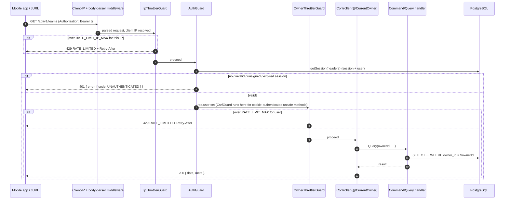

# 001 — Technical plan

## Context & references

- Spec: [spec.md](spec.md) · Scenarios: [auth.feature](auth.feature) · Tasks: [tasks.md](tasks.md)
- Contract: [api-contracts.md](../../architecture/api-contracts.md#identity--apiauth) · Data: [data-model.md](../../architecture/data-model.md) · Domain: [domain-model.md](../../architecture/domain-model.md#bounded-contexts)
- ADRs: [0002](../../architecture/adr/0002-nestjs-clean-architecture-ddd-cqrs.md) (layers), [0004](../../architecture/adr/0004-prisma-migrations-and-seeding.md) (migrations, seed), [0005](../../architecture/adr/0005-rest-openapi-and-response-envelope.md) (envelope), [0007](../../architecture/adr/0007-better-auth.md) (Better Auth), [0013](../../architecture/adr/0013-opentelemetry-and-signoz.md) (telemetry), [0014](../../architecture/adr/0014-testing-strategy.md) (testing), [0018](../../architecture/adr/0018-docker-compose-one-command-run.md) (one-command run)

This spec also delivers the **API foundation** that every later spec builds on: Prisma module, HTTP conventions (prefix, versioning, validation, envelopes, error filter) and the security baseline. These are the first tasks in [tasks.md](tasks.md) and are labeled as foundation. The validated config module itself is owned by **T-007-02** ([007](../007-ci-and-dx/tasks.md)); 001 only **adds** the auth and security variables and their production rules to that schema.

Paths follow [overview §6.2](../../architecture/overview.md#62-api-appsapi), which is authoritative (the dependency-cruiser rules key on them); the Identity module lives in `modules/identity`.

## Architecture

### Components and layout

```
apps/api/src/
├── main.ts                         # bootstrap: NestFactory.create (bodyParser: false) + setupApp() + listen
├── app.setup.ts                    # setupApp(): prefix, versioning, request id, pipe, envelope, filter, helmet, CORS, swagger
├── app.module.ts                   # composition root; ordered global guards
├── config/                         # owned by T-007-02: class-validator env class + ConfigModule validate(), typed config
│   └── auth.env.ts                 # 001 adds: auth/security variables + production rules (class-validator)
├── shared/
│   ├── domain/
│   │   └── owner.ts                # type Owner = { readonly ownerId: string }  (framework-free)
│   ├── infrastructure/prisma/      # FOUNDATION
│   │   ├── prisma.module.ts        # @Global
│   │   └── prisma.service.ts       # lifecycle, driver adapter
│   ├── presentation/               # FOUNDATION
│   │   ├── interceptors/envelope.interceptor.ts   # { data, meta? }; skipped with @RawResponse()
│   │   ├── filters/global-exception.filter.ts     # → { error: { code, message, details?, traceId } }
│   │   ├── filters/error-codes.ts                 # stable codes (single source), incl. CSRF_REJECTED, UNSUPPORTED_MEDIA_TYPE
│   │   ├── decorators/raw-response.decorator.ts
│   │   ├── decorators/current-owner.decorator.ts  # @CurrentOwner(): Owner (CO-1; no Better Auth types)
│   │   ├── dto/                                   # ErrorResponseDto, envelope helpers
│   │   └── validation.pipe.ts                     # whitelist + forbidNonWhitelisted + transform; → VALIDATION_FAILED
│   └── observability/              # request-id middleware, redaction constants (006 completes the module)
└── modules/
    ├── identity/
    │   ├── auth.factory.ts             # createAuth(config, prisma): betterAuth({...})
    │   ├── identity.module.ts          # AuthModule.forRootAsync + middleware + ordered guards + throttler
    │   ├── middleware/
    │   │   ├── client-ip.middleware.ts       # strips incoming x-tt-client-ip, sets it from the trusted IP source
    │   │   └── auth-body-limit.middleware.ts # /api/auth/* body cap 16 kB → 413 before any hashing
    │   └── presentation/                     # guards only; @CurrentOwner() lives in shared/presentation (CO-1)
    │       ├── ip-throttler.guard.ts         # RATE_LIMIT_IP_MAX per client IP, BEFORE AuthGuard
    │       ├── csrf.guard.ts                 # cookie-authenticated unsafe methods: Origin / Sec-Fetch-Site / Content-Type
    │       └── owner-throttler.guard.ts      # RATE_LIMIT_MAX per ownerId (IP fallback), AFTER AuthGuard
    └── health/                     # GET /api/v1/health/live only (@Public @RawResponse; T-001-15 adds @SkipThrottle); T-006-03 extends it with readiness
```

Identity is a **generic subdomain**. It has no `domain/` layer of its own, because Better Auth owns users, sessions and accounts. Other contexts see Identity only through the `Owner` type in `shared/domain` and the `@CurrentOwner()` decorator in `shared/presentation` (decision CO-1). Teams and tasks never import `modules/identity` (rule A5): the guards stay in Identity and are registered globally, and the decorator reads the authenticated request structurally, with no Better Auth types.

### Bootstrap

```ts
// main.ts + app.setup.ts setupApp() (illustrative; app-level wiring lives in setupApp)
const app = await NestFactory.create(AppModule, {
  bodyParser: false,
  bufferLogs: true,
});
app.setGlobalPrefix('api', { exclude: ['docs', 'docs/(.*)'] });
app.enableVersioning({ type: VersioningType.URI, defaultVersion: '1' }); // → /api/v1/*
app.use(helmet());
// shared/presentation/cors-options.ts: exact allowlist + credentials + allowedHeaders
// (Content-Type, Authorization, If-Match, Idempotency-Key, X-Request-Id; never expo-origin) + exposedHeaders
// (set-auth-token, ETag, Location, X-Request-Id, Retry-After, Idempotent-Replayed);
// CORS_ORIGINS=* (local only) → literal '*' WITHOUT credentials, never origin reflection.
app.enableCors(corsOptions(config.corsOrigins));
app.set(
  'trust proxy',
  config.trustedProxies.length ? config.trustedProxies : false,
); // TRUSTED_PROXIES (CIDRs)
```

- **Client IP (security review S-H1).** Better Auth only sees a Web `Request`, so it can read the client IP only from headers. `ClientIpMiddleware` is registered so that it runs **before** the Better Auth handler and every guard. On `/api/auth/*` it goes through the AuthModule `middleware` option (chained after the route allowlist), because the library mounts its handler in `configure()`, ahead of any Nest `consumer` middleware; T-001-15 also applies it to the business routes for the per-IP throttler. It deletes any incoming `x-tt-client-ip` header and sets it from `req.socket.remoteAddress`, or from `req.ip` only when `TRUSTED_PROXIES` is configured (Express `trust proxy` with those CIDRs). Better Auth reads only that header (`ipAddressHeaders: ['x-tt-client-ip']`), and the per-IP Nest throttler uses the same value. Caveat, documented in the runbook: with Docker Desktop or WSL NAT, all host traffic can reach the container from one address, so local clients share one bucket.
- **Auth body cap (S-M9).** `AuthBodyLimitMiddleware` on `/api/auth/*` rejects bodies over **16 kB** with `413` (by `Content-Length` and by counting the streamed bytes) before Better Auth reads the body, so no password is ever hashed for an oversized request.

- `bodyParser: false` (in `main.ts` and the e2e test app; `NestFactory.create` options cannot live in `setupApp()`) is required by `@thallesp/nestjs-better-auth`. Better Auth must read the raw request stream on its own routes. The library then **re-adds the JSON and urlencoded parsers for every other route** with its `SkipBodyParsingMiddleware`, so we **do not** call `app.use(express.json())` ourselves. Doing so would consume the stream before Better Auth reads it. We configure the re-added parsers through the module options instead, which keeps one body-size limit for the whole API:

  ```ts
  AuthModule.forRootAsync({
    imports: [ConfigModule, PrismaModule],
    inject: [AppConfig, PrismaService],
    disableGlobalAuthGuard: true, // we register guards ourselves, in order (below)
    useFactory: (config, prisma) => ({
      auth: createAuth(config, prisma),
      bodyParser: { json: { limit: '100kb' }, urlencoded: { enabled: false } },
    }),
  });
  ```

- Better Auth, `@better-auth/expo` and `@thallesp/nestjs-better-auth` are ESM-only. Node 24 loads them from the CommonJS build with `require(esm)`. Jest needs `NODE_OPTIONS=--experimental-vm-modules` for the same, so the API's Jest scripts set it, through `cross-env` for Windows shells. [ADR-0014](../../architecture/adr/0014-testing-strategy.md#consequences) records why and when to drop it.
- The auth routes are mounted by the library at Better Auth's `basePath: '/api/auth'`, outside the URI versioning and outside our envelope and filter. This is the documented exception (spec Q-01.1).

### Better Auth configuration

```ts
// auth.factory.ts (illustrative)
export const createAuth = (config: AppConfig, prisma: PrismaClient) =>
  betterAuth({
    appName: 'Teams & Tasks',
    baseURL: config.betterAuthUrl, // BETTER_AUTH_URL
    secret: config.betterAuthSecret, // BETTER_AUTH_SECRET (≥ 32 chars)
    basePath: '/api/auth',
    database: prismaAdapter(prisma, { provider: 'postgresql' }),
    emailAndPassword: {
      enabled: true,
      minPasswordLength: 8,
      maxPasswordLength: 128,
      autoSignIn: true,
    },
    session: { expiresIn: 60 * 60 * 24 * 7, updateAge: 60 * 60 * 24 }, // BR-01.4
    trustedOrigins: [
      `${config.appScheme}://`,
      ...(config.appEnv === 'local' ? ['exp://'] : []), // Expo Go, development only
      ...config.corsOrigins,
    ],
    plugins: [bearer({ requireSignature: true }), expo()],
    rateLimit: {
      enabled: config.authRateLimitEnabled, // AUTH_RATE_LIMIT_ENABLED; must be true in production
      window: 60,
      max: 100, // get-session and every other auth route
      storage: 'memory',
      customRules: {
        // each endpoint has its own 10/min bucket per IP (not combined, AC-01.7.1)
        '/sign-in/email': { window: 60, max: 10 },
        '/sign-up/email': { window: 60, max: 10 },
        '/sign-out': { window: 60, max: 10 },
      },
    },
    advanced: {
      database: { generateId: 'uuid' }, // UUID values in a text column; ownerId stays an opaque string in the domain
      ipAddress: { ipAddressHeaders: ['x-tt-client-ip'] }, // set only by ClientIpMiddleware
      useSecureCookies: config.appEnv === 'production',
      defaultCookieAttributes: { httpOnly: true, sameSite: 'lax' },
    },
    onAPIError: { throw: false, onError: logAuthError }, // generic 500, no Prisma/SQL text (S-L7)
    logger: pinoBridge('warn'), // Better Auth logs → pino at warn (S-M8)
    hooks: { before: authInputHooks }, // sign-up name (BR-01.3) + sign-in/up email trim
  });
```

| Concern                        | Decision                                                                                                                                                                                                                                                                                                                                                                                                                                                                                                                                                                                                                                                                                                                               |
| ------------------------------ | -------------------------------------------------------------------------------------------------------------------------------------------------------------------------------------------------------------------------------------------------------------------------------------------------------------------------------------------------------------------------------------------------------------------------------------------------------------------------------------------------------------------------------------------------------------------------------------------------------------------------------------------------------------------------------------------------------------------------------------- |
| Password hashing               | Better Auth default (scrypt, salted). No custom hasher: the factory receives Better Auth's own `hashPassword`/`verifyPassword` through the injectable `PasswordHasher` abstract class (its own DI token, like the ports), so e2e tests can wrap them in spies (AC-01.2.7) without changing production behavior.                                                                                                                                                                                                                                                                                                                                                                                                                        |
| Email normalization            | Better Auth lower-cases emails. A unit test pins this behavior (AC-01.1.6) so an upgrade cannot silently change it.                                                                                                                                                                                                                                                                                                                                                                                                                                                                                                                                                                                                                    |
| Name rule                      | `hooks.before` on `/sign-up/email` (`createAuthMiddleware`) trims the name and rejects anything outside 1–100 code points, or containing a control character (`\p{Cc}`, S-L10), with `APIError('BAD_REQUEST')`.                                                                                                                                                                                                                                                                                                                                                                                                                                                                                                                        |
| Email trimming                 | The same hook trims `email` on `/sign-in/email` and `/sign-up/email` before Better Auth lower-cases it (AC-01.2.6). Passwords are **never** trimmed or normalized.                                                                                                                                                                                                                                                                                                                                                                                                                                                                                                                                                                     |
| Unknown email on sign-in       | Better Auth still computes a password hash when no account exists, so timing does not reveal existence. An e2e test spies on the hasher to pin this (AC-01.2.7, S-L3). The response is identical to a wrong password (AC-01.2.3).                                                                                                                                                                                                                                                                                                                                                                                                                                                                                                      |
| `bearer` plugin                | `bearer({ requireSignature: true })`. Returns the **signed** token in the `set-auth-token` response header and accepts `Authorization: Bearer`. A raw `sessions.token` is rejected (AC-01.5.6, S-M4). When both a bearer token and a cookie are sent, the bearer wins (AC-01.5.7). Used by cURL and Bruno only.                                                                                                                                                                                                                                                                                                                                                                                                                        |
| Errors on `/api/auth/*`        | `onAPIError` returns a generic error for unexpected failures (e.g. the database is down) without Prisma or SQL text. Details go to the logs with the `traceId` (S-L7).                                                                                                                                                                                                                                                                                                                                                                                                                                                                                                                                                                 |
| `@better-auth/expo` (server)   | Accepts the `expo-origin` header and deep-link callbacks for the app scheme. The client side is in 004.                                                                                                                                                                                                                                                                                                                                                                                                                                                                                                                                                                                                                                |
| Served auth routes             | Only `/sign-up/email`, `/sign-in/email`, `/sign-out` and `/get-session` (`modules/identity/auth-routes.ts`). Every other route of this configuration is in `disabledPaths` (404); a unit test compares the list with the instance's endpoints, so an upgrade that adds a route fails CI. `disabledPaths` matches exact paths only, so an allowlist in front of the handler (AuthModule `middleware` option) also answers 404 for routes with parameters (`/callback/:id`, `/reset-password/:token`) and anything a future version adds.                                                                                                                                                                                                |
| Trusted origins                | `teamstasks://` (from `APP_SCHEME`). `exp://` is added **only when `APP_ENV=local`** (Expo Go). Plus the explicit web origins from `CORS_ORIGINS`, **never `*`** (a local `CORS_ORIGINS=*` would otherwise make Better Auth trust every origin). Better Auth's origin check rejects a cross-origin sign-in (AC-01.2.8), also when CORS is `*`; `advanced.disableOriginCheck` and `disableCSRFCheck` are set to `false` explicitly, because Better Auth skips both checks under `NODE_ENV=test` and the e2e suite must run what production runs. The module's own trusted-origins CORS is disabled (`disableTrustedOriginsCors: true`): `/api/auth/*` gets the app's CORS and helmet headers from `setupApp()`, like every other route. |
| Rate limiting on `/api/auth/*` | Better Auth's built-in limiter, per client IP: sign-up, sign-in and sign-out 10/min **each** (per endpoint, not combined); get-session and the rest 100/min (100th ok, 101st → `429`). The Nest throttler cannot see these routes, because they are served by middleware outside controllers. Memory storage is fine for a single instance. Production would use secondary storage (Redis). `enabled` is set explicitly, because Better Auth disables it outside production by default. Answers keep Better Auth's native format (`X-Retry-After`), the documented envelope exception.                                                                                                                                                 |
| Client IP                      | Only `x-tt-client-ip`, written by `ClientIpMiddleware` from the socket address (or `req.ip` when `TRUSTED_PROXIES` is set). A client-sent `x-tt-client-ip` or `X-Forwarded-For` is ignored (AC-01.7.6). Two addresses have independent buckets (AC-01.7.8).                                                                                                                                                                                                                                                                                                                                                                                                                                                                            |
| User id                        | `generateId: 'uuid'`. The column stays `text`, matching the Better Auth schema in the data model. The domain treats `ownerId` as an opaque string and never relies on its format.                                                                                                                                                                                                                                                                                                                                                                                                                                                                                                                                                      |
| Logging                        | Better Auth's `logger` is bridged to pino at `warn`. Bodies are never logged (see [Security](#security-considerations)).                                                                                                                                                                                                                                                                                                                                                                                                                                                                                                                                                                                                               |

### Guards, in order

All guards are registered as `APP_GUARD` providers in `IdentityModule`, in this order. Nest runs global guards in registration order:

1. **`IpThrottlerGuard`** (`ThrottlerGuard` subclass, throttler `ip`). Tracker = the resolved client IP (same source as `x-tt-client-ip`). `RATE_LIMIT_IP_MAX` req/min (default 300). Runs **before** authentication, so anonymous and forged-token floods are bounded without a session lookup (AC-01.7.9, S-M3).
2. **`AuthGuard`** (from `@thallesp/nestjs-better-auth`). It resolves the session from `Authorization: Bearer` (signed tokens only; bearer wins over a cookie) or the cookie, sets `req.session` and `req.user`, and throws `UnauthorizedException` unless the route has `@AllowAnonymous()`.
3. **`CsrfGuard`** (S-M2). Applies only to unsafe methods (`POST`, `PUT`, `PATCH`, `DELETE`) on `/api/v1` with a session that came with no `Authorization: Bearer` header, i.e. by **cookie** (a browser cannot add `Authorization` cross-origin without a CORS preflight the allowlist refuses; anonymous requests to public routes carry no credential and are not checked). If `Origin` (or else `Referer`) is present and not in `trustedOrigins`, or `Sec-Fetch-Site: cross-site` → `403 CSRF_REJECTED` (AC-01.5.8). A body whose `Content-Type` is not `application/json` → `415 UNSUPPORTED_MEDIA_TYPE` (AC-01.5.9). Native clients send no `Origin` and bearer clients skip the guard.
4. **`OwnerThrottlerGuard`** (throttler `user`). `getTracker` returns `req.user?.id ?? clientIp`, so the limit is `RATE_LIMIT_MAX` (default 100/min) per user (AC-01.7.3, AC-01.7.4).

Health uses `@SkipThrottle()` for both throttlers (AC-01.7.5). The global exception filter maps `UnauthorizedException` → `401 UNAUTHENTICATED`, `ThrottlerException` → `429 RATE_LIMITED`, the CSRF errors → `403 CSRF_REJECTED` / `415 UNSUPPORTED_MEDIA_TYPE` (codes in `error-codes.ts`, matching [api-contracts](../../architecture/api-contracts.md#error-codes)). `Retry-After` is set by the throttler. Because the guards run before routing to handlers and pipes, AC-01.5.5 holds: authentication is checked before `ParseUUIDPipe` or any lookup.

### `CurrentOwner` — the anti-corruption seam

```ts
// shared/domain/owner.ts — framework-free
export type Owner = Readonly<{ ownerId: string }>;

// shared/presentation/decorators/current-owner.decorator.ts (CO-1): no Better Auth import;
// the global AuthGuard (modules/identity) has already put the user on the request.
export const CurrentOwner = createParamDecorator((_: unknown, ctx: ExecutionContext): Owner => {
  const req = ctx.switchToHttp().getRequest<{ user?: { id: string } | null }>();
  if (!req.user) throw new UnauthorizedException();   // defensive; the guard already ran
  return { ownerId: req.user.id };
});

// usage in any controller
@Post() create(@CurrentOwner() { ownerId }: Owner, @Body() dto: CreateTeamDto) {
  return this.commandBus.execute(new CreateTeamCommand(ownerId, dto.name, dto.colorHex, dto.description));
}
```

- Application and domain code receive a plain `ownerId: string`. They never import Better Auth types (`UserSession`), which a `dependency-cruiser` rule enforces: only `modules/identity/**` may import `better-auth` or `@thallesp/nestjs-better-auth`.
- E2E tests for teams and tasks can sign in for real. Handler unit tests just pass an `ownerId`.

### Sequence — authenticated business request



### Sign-in (bearer) sequence

```mermaid
sequenceDiagram
  participant App
  participant BA as Better Auth (/api/auth/*)
  participant DB as PostgreSQL
  App->>BA: POST /api/auth/sign-in/email { email, password }
  Note over App,BA: ClientIpMiddleware sets x-tt-client-ip; body > 16 kB → 413 before this point
  BA->>BA: origin check, rate limit (x-tt-client-ip, 10/min for this endpoint), trim email
  BA->>DB: find user + credential account, verify scrypt hash (hash still computed for an unknown email)
  BA->>DB: insert session (expiresAt = now + 7d)
  BA-->>App: 200 { user, token } + set-auth-token header + Set-Cookie
```

### Configuration (validated at startup, constitution VII.3)

The config module, its validation library, `APP_ENV` (`local` \| `test` \| `production`, separate from `NODE_ENV`, which only describes the Node runtime), `PORT`, `DATABASE_URL` and the fail-fast behavior are delivered by **T-007-02**. 001 adds these variables to that schema:

| Variable                  | Rule                                                                                                                                                                                                          | Local default (`.env.example`)                | Extra rule when `APP_ENV=production` (AC-01.8.5, S-M7)        |
| ------------------------- | ------------------------------------------------------------------------------------------------------------------------------------------------------------------------------------------------------------- | --------------------------------------------- | ------------------------------------------------------------- |
| `BETTER_AUTH_SECRET`      | string, ≥ 32 chars                                                                                                                                                                                            | obviously-local value                         | the example value is rejected                                 |
| `BETTER_AUTH_URL`         | absolute http(s) URL, no `user:password@`                                                                                                                                                                     | `http://localhost:3000`                       | must be `https://`; no localhost or loopback host             |
| `CORS_ORIGINS`            | comma-separated canonical origins (`scheme://host[:port]` as browsers send them; no path or credentials) or `*`                                                                                               | `http://localhost:8081`                       | no `*`, no `http://`, no `localhost` or loopback host         |
| `APP_SCHEME`              | `[a-z][a-z0-9+.-]*`, not a reserved scheme (`http`, `https`, `ws`, `wss`, `file`, `ftp`, `data`, `javascript`, `blob`, `about`, `exp`, `exps`) in **any** environment (it is a prefix-matched trusted origin) | `teamstasks`                                  | — (reserved schemes are always refused)                       |
| `TRUSTED_PROXIES`         | comma-separated IPs or CIDRs (Express `trust proxy`); `/0` refused                                                                                                                                            | empty (no proxy trusted; socket address only) | no IPv4 range wider than `/8`, no IPv6 range wider than `/16` |
| `AUTH_RATE_LIMIT_ENABLED` | boolean                                                                                                                                                                                                       | `true`                                        | `false` is rejected                                           |
| `RATE_LIMIT_MAX`          | int 1–10000, req/min per user (IP fallback when anonymous)                                                                                                                                                    | `100`                                         | —                                                             |
| `RATE_LIMIT_IP_MAX`       | int 1–10000, req/min per client IP, checked before auth; must be ≥ `RATE_LIMIT_MAX`                                                                                                                           | `300`                                         | —                                                             |
| `SEED_DEMO`               | boolean; create the demo account when seeding                                                                                                                                                                 | `true` (compose)                              | `true` is rejected; the seed never creates it (AC-01.8.4)     |
| `DOCS_ENABLED`            | boolean; serve `/docs` and `/docs/openapi.json`                                                                                                                                                               | `true`                                        | forced to `false` (AC-01.8.6, S-L8)                           |

`RATE_LIMIT_MAX` may already be declared by T-007-02; 001 only adds it if missing. Every production rule has its own unit test, and error messages name the variable, **never its value**. The rest of the code injects the typed config and never reads `process.env`.

## Contract

- Auth endpoints: as listed in [api-contracts.md → Identity](../../architecture/api-contracts.md#identity--apiauth). The response format is Better Auth's native one (spec Q-01.1). Codes are relied on by tests: `INVALID_EMAIL_OR_PASSWORD` (401), `PASSWORD_TOO_SHORT` / `PASSWORD_TOO_LONG` (400), `INVALID_EMAIL` (400), user-already-exists (422), throttled (429 + `X-Retry-After`).
- `/api/auth/*` extras: `413` for bodies over 16 kB; generic error on unexpected failures (no Prisma/SQL text).
- Business endpoints: `401 UNAUTHENTICATED`, `403 CSRF_REJECTED`, `415 UNSUPPORTED_MEDIA_TYPE` and `429 RATE_LIMITED` per [error codes](../../architecture/api-contracts.md#error-codes).
- OpenAPI: a global `bearer` security scheme plus a `cookie` scheme. Every operation except health gets `security`. The `/api/auth/*` routes are documented by a hand-written OpenAPI fragment (or Better Auth's `openAPI()` plugin output merged under an "Identity" tag) so the generated client and Bruno stay complete. `/docs` and `/docs/openapi.json` are served only when `DOCS_ENABLED` is true, which is never the case with `APP_ENV=production` (the 007 OpenAPI export script builds the document without serving it).
- Public inventory (AC-01.5.4, BR-01.6): health, `/api/auth/*`, and `/docs` only while `DOCS_ENABLED`. Nothing else.
- Health: only `GET /api/v1/health/live` is created here, with `@Public()` (`shared/presentation/decorators`: the `PUBLIC` metadata key the Better Auth guard reads, so no context imports the auth library) and `@RawResponse()`; `@SkipThrottle()` comes with the throttlers (T-001-15). Readiness and the Terminus checks are added by [T-006-03](../006-observability/tasks.md), which extends this controller.

## Data

Better Auth schema, generated with the Better Auth CLI, the `auth` package (`pnpm dlx auth generate --adapter prisma`), and then mapped to snake_case:

| Model          | Table           | Notes                                                                                                                      |
| -------------- | --------------- | -------------------------------------------------------------------------------------------------------------------------- |
| `User`         | `users`         | `id text PK` (UUID values), `email text UNIQUE` (lower-case), `name`, `email_verified`, `image?`, timestamps               |
| `Session`      | `sessions`      | `token text UNIQUE`, `expires_at`, `ip_address?`, `user_agent?`, `user_id FK → users ON DELETE CASCADE`; index `(user_id)` |
| `Account`      | `accounts`      | `provider_id = 'credential'`, `account_id`, `password` (scrypt hash), `user_id FK CASCADE`; index `(user_id)`              |
| `Verification` | `verifications` | Required by Better Auth (unused flows). Index `(identifier)`.                                                              |

- Migration: `prisma migrate dev --name create_identity_tables`, reviewed as SQL.
- Session cleanup: expired rows are ignored by Better Auth and deleted lazily. A purge job is a production note.
- **Seed — demo user** (`prisma/seed/identity.seed.ts`, called by the `prisma/seed.ts` orchestrator of T-007-07; deterministic and idempotent, [ADR-0004](../../architecture/adr/0004-prisma-migrations-and-seeding.md)):
  - Fixed literal fixture (no faker): id `DEMO_USER_ID = '00000000-0000-4000-8000-000000000001'`, email `demo@teams-tasks.dev`, name `Demo User`.
  - Skipped entirely unless `SEED_DEMO=true`, and **never** run when `APP_ENV=production` (checked in the seed as well as by config validation, AC-01.8.4).
  - If no user with that id or email exists, the seed creates it **through Better Auth's server API** (`auth.api.signUpEmail`), so the password hash uses the library's algorithm. The seed's auth instance sets the fixed id with `databaseHooks.user.create.before` for the demo email only. If the user exists, nothing is touched, so a re-run changes no rows and the password stays the same (AC-01.8.2).
  - Exported `DEMO_USER_ID` is reused by the team and task seeds, which upsert by fixed UUIDs.

## Security considerations

### STRIDE

| Threat                     | Example                                                                                                             | Mitigation                                                                                                                                                                                                                                                                                                                                                                                                                                                                                     | Verified by                                                                |
| -------------------------- | ------------------------------------------------------------------------------------------------------------------- | ---------------------------------------------------------------------------------------------------------------------------------------------------------------------------------------------------------------------------------------------------------------------------------------------------------------------------------------------------------------------------------------------------------------------------------------------------------------------------------------------- | -------------------------------------------------------------------------- |
| **S**poofing               | Credential stuffing / brute force on sign-in                                                                        | Better Auth limiter, 10/min/IP per credential endpoint. Generic invalid-credentials error. Slow hash (scrypt).                                                                                                                                                                                                                                                                                                                                                                                 | AC-01.7.1, AC-01.2.3                                                       |
| Spoofing                   | IP spoofing via `X-Forwarded-For` / `x-tt-client-ip` to dodge the limiter, or one shared bucket throttling everyone | `ClientIpMiddleware` strips client-sent `x-tt-client-ip` and writes it from the socket address (`req.ip` only with `TRUSTED_PROXIES`). Better Auth reads only that header.                                                                                                                                                                                                                                                                                                                     | AC-01.7.6, AC-01.7.8                                                       |
| Spoofing                   | Forged / replayed token, raw DB token reused as bearer                                                              | Opaque random session tokens stored server-side. `bearer({ requireSignature: true })`. Revoked on sign-out. 7-day expiry.                                                                                                                                                                                                                                                                                                                                                                      | AC-01.5.2, AC-01.5.6, AC-01.3.1                                            |
| **T**ampering              | Client sets `ownerId` (mass assignment)                                                                             | DTOs never declare owner or lifecycle fields. `forbidNonWhitelisted` rejects them, including `updatedAt`, `deletedAt`, `userId`, `owner_id`, `owner` (object), `__proto__` and `constructor`, on create and update. The owner comes only from `@CurrentOwner()`.                                                                                                                                                                                                                               | AC-01.6.4, AC-01.6.6                                                       |
| Tampering                  | CSRF on cookie-authenticated mutations from a browser                                                               | `SameSite=Lax`, `HttpOnly`. Better Auth origin check on `/api/auth/*`. `CsrfGuard` on cookie-authenticated unsafe `/api/v1` requests (`Origin`/`Referer`, `Sec-Fetch-Site`, JSON `Content-Type`). CORS allowlist with credentials.                                                                                                                                                                                                                                                             | AC-01.2.8, AC-01.5.8, AC-01.5.9                                            |
| **R**epudiation            | Who changed what                                                                                                    | Structured logs carry `ownerId` and `traceId` per request (006). Auth events (sign-in success/failure, sign-up, sign-out) are logged without email or IP in clear text.                                                                                                                                                                                                                                                                                                                        | log assertions in e2e                                                      |
| **I**nformation disclosure | BOLA: reading another user's team by id                                                                             | Every repository query includes `owner_id`. Foreign resource → `404` (constitution VI.2).                                                                                                                                                                                                                                                                                                                                                                                                      | AC-01.6.2/3, per-resource in 002/003                                       |
| Information disclosure     | Account enumeration (response or timing)                                                                            | Same response for wrong password and unknown email; a hash is computed for unknown emails too. Sign-up enumeration accepted (Q-01.2) and rate limited.                                                                                                                                                                                                                                                                                                                                         | AC-01.2.3, AC-01.2.7                                                       |
| Information disclosure     | Secrets in logs or errors                                                                                           | Bodies are never logged. pino redaction of `req.headers.authorization`, `req.headers.cookie`, `res.headers["set-cookie"]`, `res.headers["set-auth-token"]` and, at any depth, `password`, `newPassword`, `currentPassword`, `token`. Query strings stripped from `/api/auth/*` URLs. Better Auth logger at `warn`. Prisma logs query events without params. The 500 response is generic, and `onAPIError` keeps Prisma/SQL text out of `/api/auth/*` errors. Config errors never print values. | unit test of redaction with nested objects, e2e on 500 (business and auth) |
| Information disclosure     | API surface exposed by Swagger in production                                                                        | `DOCS_ENABLED` forced to `false` when `APP_ENV=production`.                                                                                                                                                                                                                                                                                                                                                                                                                                    | AC-01.8.6                                                                  |
| **D**enial of service      | Flooding the API, oversized auth bodies                                                                             | Per-IP throttler (300/min) before auth, then 100/min/user. 100 kb body limit on `/api/v1`, 16 kB on `/api/auth/*` (413 before hashing). `limit ≤ 100` on lists. Health is exempt but cheap.                                                                                                                                                                                                                                                                                                    | AC-01.7.3, AC-01.7.5, AC-01.7.9, AC-01.7.10                                |
| **E**levation of privilege | New endpoint shipped without a guard                                                                                | Global guard (deny by default). Route-inventory test: enumerate all routes with `DiscoveryService` and assert only the allowlist (`/api/v1/health/*`) carries `@AllowAnonymous()`; `/api/auth/*` and `/docs` are mounted outside controllers and asserted separately (`/docs` → 404 when `DOCS_ENABLED=false`).                                                                                                                                                                                | AC-01.5.4                                                                  |

### Cookie vs bearer

| Client             | Mechanism                                                                                                                                                                                                                                                            | Storage                    |
| ------------------ | -------------------------------------------------------------------------------------------------------------------------------------------------------------------------------------------------------------------------------------------------------------------- | -------------------------- |
| Mobile (Expo)      | Better Auth Expo client. It stores the session in `expo-secure-store`, never AsyncStorage. API calls through the generated client send the `Cookie` header from `authClient.getCookie()` (no browser cookie jar, no `Origin`, so the CSRF guard does not interfere). | SecureStore (004)          |
| cURL / Bruno       | `set-auth-token` header (signed token) → `Authorization: Bearer`. Bearer is for these clients only.                                                                                                                                                                  | Shell variable / Bruno env |
| Browser (dev only) | Session cookie, `HttpOnly`, `SameSite=Lax`, `Secure` in production                                                                                                                                                                                                   | Browser                    |

Other baseline controls (foundation tasks): `helmet` defaults, CORS allowlist from config, `x-powered-by` off, request size limit, `ParseUUIDPipe` on ids, `pnpm audit` in CI (007).

## Observability

| Signal          | Detail                                                                                                                                                                                                                                                                                    |
| --------------- | ----------------------------------------------------------------------------------------------------------------------------------------------------------------------------------------------------------------------------------------------------------------------------------------- |
| Span attributes | `enduser.id = ownerId` is set on the active HTTP span by a small interceptor after authentication. No email.                                                                                                                                                                              |
| Metrics         | `auth_sign_in_total{outcome=success\|invalid_credentials\|rate_limited}`, `auth_sign_up_total{outcome}`, `api_rate_limited_total{scope=auth\|api}`. Auth counters come from Better Auth `hooks.after` (status of the returned response). The API counter comes from the exception filter. |
| Logs            | `auth.sign_in.succeeded` / `.failed` (info / warn) with `userId` when known and `traceId`. Never email, password, token or cookie.                                                                                                                                                        |
| Config          | Startup log line `config.loaded` with non-secret keys only.                                                                                                                                                                                                                               |
| Request id      | Incoming `X-Request-Id` is reused only if it matches `^[A-Za-z0-9._-]{1,128}$`; otherwise a new id is generated (no log injection).                                                                                                                                                       |

The OTel SDK setup is in 006. Here we only use the `@opentelemetry/api` (no-op when no SDK is registered, constitution VII.2) and a `Metrics` port.

## Testing approach

| Level                                     | What                                                                                                                                                                                                                                                                                                                                                                                                                                                                                                                                                                                                                                                                                                                            | Scenarios                                                                                  |
| ----------------------------------------- | ------------------------------------------------------------------------------------------------------------------------------------------------------------------------------------------------------------------------------------------------------------------------------------------------------------------------------------------------------------------------------------------------------------------------------------------------------------------------------------------------------------------------------------------------------------------------------------------------------------------------------------------------------------------------------------------------------------------------------- | ------------------------------------------------------------------------------------------ |
| Unit                                      | auth env class (valid / invalid / missing / secret not echoed, **one test per production rule**); `GlobalExceptionFilter` mapping (401, 403, 415, 429, 400 details, 500 generic); `EnvelopeInterceptor`; `X-Request-Id` validation; `CurrentOwner` decorator; `ClientIpMiddleware` (strips client header, socket vs. `TRUSTED_PROXIES`); `CsrfGuard` decision table; throttler trackers; sign-up/sign-in hooks (name, control characters, email trim, password untouched); log redaction with nested objects; `trustedOrigins` per `APP_ENV`                                                                                                                                                                                    | AC-01.1.5, AC-01.2.6 (hook), AC-01.6.4, AC-01.6.6 (pipe), AC-01.8.5                        |
| Integration (Testcontainers PG)           | Prisma module connects and migrates; seed idempotency (run twice, compare rows and hash); seed skips the demo user with `SEED_DEMO=false` or `APP_ENV=production`; session expiry and renewal by editing `expires_at`                                                                                                                                                                                                                                                                                                                                                                                                                                                                                                           | AC-01.8.1, AC-01.8.2, AC-01.8.4, AC-01.4.3, AC-01.4.4                                      |
| E2E (supertest on the real Nest app + PG) | sign-up / in / out / get-session over HTTP, bearer and cookie paths, unsigned / anonymous / invalid tokens, bearer-wins, CSRF (untrusted `Origin`, cross-site, non-JSON), cross-origin sign-in, unknown-email hash spy, 16 kB cap, generic auth 500 with the DB down, route inventory and `/docs` per `DOCS_ENABLED`, rate limits (real defaults, separate app instance per throttling test, fresh limiter storage), spoofed `X-Forwarded-For` / `x-tt-client-ip`. Limiter suites **assert the resolved client IP** (they must not rely on Better Auth's fixed address under `NODE_ENV=test`) and use distinct addresses (loopback `localAddress` 127.0.0.2 / 127.0.0.3, or `TRUSTED_PROXIES=127.0.0.1/32` + `X-Forwarded-For`) | AC-01.1.1–4, AC-01.1.6, AC-01.2._, AC-01.3._, AC-01.4.1–2, AC-01.5._, AC-01.7._, AC-01.8.6 |
| E2E (002 / 003)                           | Ownership isolation per resource, using a shared helper `twoUsers()` that signs up Marina and Rafael                                                                                                                                                                                                                                                                                                                                                                                                                                                                                                                                                                                                                            | AC-01.6.1–3, AC-01.6.5, AC-01.8.3                                                          |
| Mobile (004)                              | Secure storage of the session, sign-in screen                                                                                                                                                                                                                                                                                                                                                                                                                                                                                                                                                                                                                                                                                   | —                                                                                          |

Test helpers (`test/support/auth.ts`): `signUpAndSignIn(app, email)` returns `{ token, cookie, ownerId }`. Each test uses unique emails, so there is no shared state and no sleeps. Expiry is simulated through the DB, not the clock.

## Risks & mitigations

| Risk                                                                                                | Mitigation                                                                                                                                                                                                                                                                                                          |
| --------------------------------------------------------------------------------------------------- | ------------------------------------------------------------------------------------------------------------------------------------------------------------------------------------------------------------------------------------------------------------------------------------------------------------------- |
| `bodyParser: false` breaks JSON parsing on business routes                                          | The library re-adds parsers. An e2e test posts JSON to a business route and checks the 100 kb limit (413).                                                                                                                                                                                                          |
| Library or Better Auth upgrades change error codes or the default email normalization               | Contract tests pin the codes and behaviors we rely on. Versions are pinned in the lockfile. Renovate PRs run the e2e suite.                                                                                                                                                                                         |
| Global guard order is not what we expect                                                            | Guards are registered explicitly (`disableGlobalAuthGuard: true` + ordered `APP_GUARD`s). Tests check both ends: anonymous requests beyond `RATE_LIMIT_IP_MAX` get **429** (IP throttler runs before auth, AC-01.7.9), while an anonymous request under the IP limit gets 401 and never consumes a per-user bucket. |
| `ClientIpMiddleware` runs after the Better Auth handler, or a client-sent `x-tt-client-ip` survives | E2E asserts the IP Better Auth resolved (spy) equals the socket address even when the client sends `x-tt-client-ip` / `X-Forwarded-For`.                                                                                                                                                                            |
| Docker Desktop / WSL NAT makes all host traffic arrive from one address                             | Documented in the runbook: local clients share one limiter bucket. Not an issue on Linux Docker or behind a proxy configured in `TRUSTED_PROXIES`.                                                                                                                                                                  |
| Better Auth limiter is in-memory                                                                    | Acceptable for one instance. Documented production change: Redis secondary storage.                                                                                                                                                                                                                                 |
| `exp://` trusted in production by mistake                                                           | Added only when `APP_ENV=local`; `APP_SCHEME=exp` is rejected in production. Unit test of `trustedOrigins` per environment.                                                                                                                                                                                         |
| `generateId: 'uuid'` not honoured by the adapter version                                            | Integration test asserts the created user id matches the UUID regex. Fallback: `databaseHooks.user.create.before` sets `crypto.randomUUID()`.                                                                                                                                                                       |
