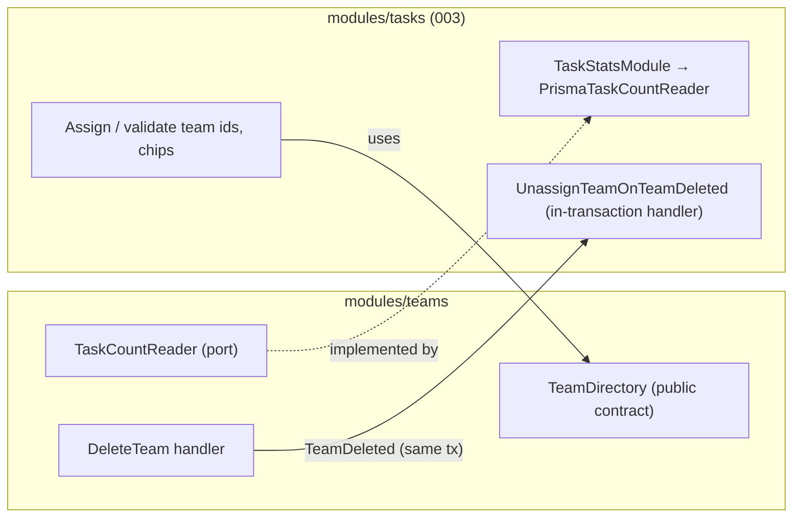
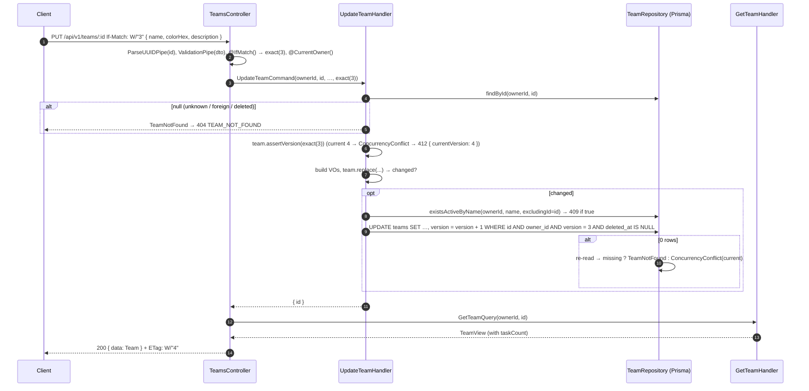

# 002 — Technical plan

## Context & references

- Spec: [spec.md](spec.md) · Scenarios: [teams.feature](teams.feature) · Tasks: [tasks.md](tasks.md)
- Contract: [api-contracts.md → Teams](../../architecture/api-contracts.md#teams--apiv1teams), [pagination](../../architecture/api-contracts.md#pagination-sorting-search), [error codes](../../architecture/api-contracts.md#error-codes)
- Domain: [domain-model.md → Team](../../architecture/domain-model.md#team-aggregate-root) · Data: [data-model.md](../../architecture/data-model.md)
- ADRs: [0002](../../architecture/adr/0002-nestjs-clean-architecture-ddd-cqrs.md) (layers, CQRS, events in the same transaction), [0004](../../architecture/adr/0004-prisma-migrations-and-seeding.md) (migrations, seed), [0005](../../architecture/adr/0005-rest-openapi-and-response-envelope.md) (envelope, OpenAPI), [0006](../../architecture/adr/0006-offset-pagination.md) (offset pagination), [0008](../../architecture/adr/0008-class-validator-dtos-and-generated-client.md) (DTOs as contract), [0013](../../architecture/adr/0013-opentelemetry-and-signoz.md) (telemetry), [0014](../../architecture/adr/0014-testing-strategy.md) (testing), [0015](../../architecture/adr/0015-optimistic-concurrency.md) (version + ETag/If-Match), [0016](../../architecture/adr/0016-soft-delete.md) (soft delete), [0019](../../architecture/adr/0019-idempotency-keys.md) (idempotency keys)
- Builds on the 001 API foundation: config, `PrismaModule`, envelope, exception filter, `ValidationPipe`, global `AuthGuard`, `@CurrentOwner()`.

Teams is the **first vertical slice**. The shared building blocks it introduces (pagination, ETag/If-Match, idempotency, transactional unit of work, domain-event publisher) go into `shared/` with their own tests, so 003-tasks reuses them unchanged.

## Architecture

### Module layout

```
apps/api/src/
├── shared/
│   ├── domain/            aggregate-root.ts (pullEvents), domain-error.ts, domain-event.ts
│   ├── application/       ports: clock.ts, id-generator.ts, unit-of-work.ts, domain-event-publisher.ts
│   │                      pagination.ts (PageRequest, Page<T>), expected-version.ts
│   ├── infrastructure/    system-clock.ts, uuid-generator.ts, cls-unit-of-work.ts, domain-event-publisher.impl.ts
│   └── http/              pagination-query.dto.ts, page-meta.ts, sort.ts, if-match.decorator.ts,
│                          etag.interceptor.ts, location.ts, idempotency/ (interceptor, store, hash)
└── modules/teams/
    ├── domain/
    │   ├── team.ts                     # aggregate root
    │   ├── team-name.vo.ts             # trim, 2–50 code points, case-insensitive equality
    │   ├── color-hex.vo.ts             # #RRGGBB, upper case, contrastingTextColor()
    │   ├── team-description.vo.ts      # trim, ≤ 280, blank → null
    │   ├── events/team-deleted.event.ts
    │   └── errors/                     # InvalidTeamName, InvalidColorHex, InvalidTeamDescription,
    │                                   # TeamNotFound, TeamNameAlreadyExists, ConcurrencyConflict (shared)
    ├── application/
    │   ├── ports/team.repository.ts         # write side (aggregate in/out)
    │   ├── ports/team.read-model.ts         # query side (TeamView pages)
    │   ├── ports/task-count.reader.ts       # implemented by the tasks context (003)
    │   ├── commands/{create-team,update-team,delete-team}/{*.command.ts,*.handler.ts,*.handler.spec.ts}
    │   ├── queries/{list-teams,get-team}/{*.query.ts,*.handler.ts,*.handler.spec.ts}
    │   ├── views/team.view.ts               # TeamView (plain object)
    │   └── public/team-directory.ts         # published contract consumed by the tasks context
    ├── infrastructure/
    │   ├── prisma-team.repository.ts        # + team.persistence-mapper.ts
    │   ├── prisma-team.read-model.ts        # raw SQL for list (sort, ILIKE with escape)
    │   ├── prisma-team-directory.ts
    │   └── zero-task-count.reader.ts        # provisional adapter until 003 binds the real one
    ├── presentation/
    │   ├── teams.controller.ts
    │   ├── dto/{create-team.dto.ts,update-team.dto.ts,list-teams.query.dto.ts,team.response.dto.ts}
    │   ├── team.presenter.ts                # TeamView → TeamResponseDto
    │   └── team-error.mapping.ts            # domain error → HTTP code
    └── teams.module.ts                      # exports TeamDirectory only
```

Dependency rules (`dependency-cruiser`, constitution III.3):

- `modules/teams/domain/**` imports only `shared/domain/**`.
- `application/**` never imports `infrastructure/**`, `presentation/**`, `@prisma/*` or `@nestjs/*`. The one exception is `@nestjs/cqrs` decorators on handlers, allowed per ADR-0002.
- Other modules may import only `modules/teams/application/public/**` and `teams.module.ts`.

### Domain

```ts
// illustrative
export class Team extends AggregateRoot {
  static create(p: {
    id: string;
    ownerId: string;
    name: TeamName;
    color: ColorHex;
    description: TeamDescription;
    now: Date;
  }): Team; // version 1
  replace(p: {
    name: TeamName;
    color: ColorHex;
    description: TeamDescription;
    now: Date;
  }): boolean;
  // calls rename / recolor / describe; returns false (no change, no updatedAt bump) when all equal
  rename(name: TeamName): void;
  recolor(color: ColorHex): void;
  describe(description: TeamDescription): void;
  delete(now: Date): void; // sets deletedAt, raises TeamDeleted { teamId, ownerId }; twice → no-op
  assertVersion(expected: ExpectedVersion): void; // throws ConcurrencyConflict { currentVersion }
}
```

| Element           | Rules                                                                                                                 | Unit tests (examples)                                                                                                                                                |
| ----------------- | --------------------------------------------------------------------------------------------------------------------- | -------------------------------------------------------------------------------------------------------------------------------------------------------------------- |
| `TeamName`        | `trim()`, length in **code points** (`[...s].length`) 2–50, `equals` via `toLowerCase()`; raw inner spaces kept       | `" ab "` ok → `"ab"`; `"a"`, `""`, `"   "`, 51 chars → `InvalidTeamName`; `"Mobile".equals("MOBILE")`; `"Équipe" ≠ "Equipe"`; `"Ωmega".equals("ωmega")`; 50 emoji ok |
| `ColorHex`        | `/^#[0-9A-Fa-f]{6}$/`, stored upper case; `contrastingTextColor()` → `#000000` / `#FFFFFF` by WCAG relative luminance | invalid table from the feature; `#ffffff` → black text, `#000000` → white text, `#7C3AED` → white                                                                    |
| `TeamDescription` | optional, `trim()`, ≤ 280 code points, blank → `null`                                                                 | 280 ok, 281 error, `"  "` → null                                                                                                                                     |
| `Team`            | version bump is done by persistence (see below); `replace` reports change                                             | no-op replace returns false; delete raises exactly one event; delete twice raises none                                                                               |

`TeamDescription` is a small VO not listed in the domain model's VO table. It keeps the "invalid values cannot be constructed" rule (constitution II.4) for the description too.

### Application (CQRS)

| Use case     | Type    | Input                                                        | Behavior                                                                                                                                                                                     | Output           |
| ------------ | ------- | ------------------------------------------------------------ | -------------------------------------------------------------------------------------------------------------------------------------------------------------------------------------------- | ---------------- |
| `CreateTeam` | command | `ownerId, name, colorHex, description?`                      | Build VOs. Check `repo.existsActiveByName(ownerId, name)` (fast path, 409). `repo.insert`. A unique-index violation is also mapped to `TeamNameAlreadyExists` (race, AC-02.1.9).             | `{ id }`         |
| `UpdateTeam` | command | `ownerId, id, name, colorHex, description?, expectedVersion` | Load (404). `assertVersion` (412). If `replace` returns false, no write (AC-02.6.7). Name check excluding self (AC-02.6.5). `repo.update(team, loadedVersion)` with an atomic version guard. | `{ id }`         |
| `DeleteTeam` | command | `ownerId, id, expectedVersion`                               | Inside a unit of work: load (404), `assertVersion`, `team.delete(now)`, `repo.update`, then `publisher.publishInTransaction(events)`. After commit: `publisher.publishAfterCommit(events)`.  | `void`           |
| `GetTeam`    | query   | `ownerId, id`                                                | `readModel.findById` + `taskCounts.countByTeam`                                                                                                                                              | `TeamView`       |
| `ListTeams`  | query   | `ownerId, PageRequest{limit, offset}, search?, sort`         | `readModel.page(...)` returns rows and total. One `countByTeam` call for the page's ids (no N+1).                                                                                            | `Page<TeamView>` |

- **Commands return ids.** The controller then runs `GetTeamQuery` to build the response. Writes and reads stay separate, and every single-team response has the same shape, including `taskCount`.
- `ExpectedVersion` = `{ kind: 'any' }` (no header or `*`) | `{ kind: 'exact', version }` | `{ kind: 'unmatchable' }` (unparseable tag). Handlers check it **after** loading, so 404 wins over 412 (AC-02.9.7).
- Ports are abstract classes used as DI tokens: `TeamRepository`, `TeamReadModel`, `TaskCountReader`, `Clock`, `IdGenerator`, `UnitOfWork`, `DomainEventPublisher`.

### Cross-context seams (Team Management ↔ Task Management)



| Seam                                                                            | Direction                           | 002 delivers                                                                                                                             | 003 delivers                                                                                               |
| ------------------------------------------------------------------------------- | ----------------------------------- | ---------------------------------------------------------------------------------------------------------------------------------------- | ---------------------------------------------------------------------------------------------------------- |
| `TeamDirectory.findActive(ownerId, ids) → TeamSummary[]` (`id, name, colorHex`) | tasks → teams                       | Contract plus a Prisma adapter with integration tests (foreign and deleted ids are excluded)                                             | Usage (validation → `UNKNOWN_TEAMS`)                                                                       |
| `TaskCountReader.countByTeam(ownerId, teamIds) → ReadonlyMap<id, number>`       | teams → tasks (port owned by teams) | Port, plus `ZeroTaskCountReader` bound by default                                                                                        | `TaskStatsModule` (depends only on Prisma, no cycle). `TeamsModule` imports it and binds the real adapter. |
| `TeamDeleted` in-transaction reaction                                           | teams → tasks                       | `DomainEventPublisher` with `@InTransactionHandler(TeamDeleted)` discovery. Atomicity is tested with a failing fake handler (AC-02.7.4). | `UnassignTeamOnTeamDeleted` deletes `task_teams` rows for the team (AC-02.7.2)                             |

ADR-0002 requires the unassignment to run in the same DB transaction. `@nestjs/cqrs`'s `EventBus` handlers are fire-and-forget and run outside the transaction, so the publisher has two phases:

1. **In-transaction handlers** are awaited inside the unit of work. They join the same transaction through CLS.
2. **After commit**, `EventBus.publishAll` sends the same events to side-effect handlers such as metrics and logs.

### Unit of work

`@nestjs-cls/transactional` with `@nestjs-cls/transactional-adapter-prisma`. Repositories always use `txHost.tx`, so they join an active transaction automatically. `UnitOfWork.run(fn)` wraps `txHost.withTransaction(fn)`. It is used by `DeleteTeam` and by the idempotency interceptor. Propagation is `Required`, so nested calls join the outer transaction.

### Sequence — update with `If-Match`



### Presentation

| Route               | Decorators / pipes                                                  | Response                                                                                          |
| ------------------- | ------------------------------------------------------------------- | ------------------------------------------------------------------------------------------------- |
| `GET /teams`        | `@Query() ListTeamsQueryDto`                                        | `200 { data: Team[], meta }`                                                                      |
| `GET /teams/:id`    | `ParseUUIDPipe` → 400 `VALIDATION_FAILED` (`field: "id"`)           | `200 { data }` + `ETag`                                                                           |
| `POST /teams`       | `@Body() CreateTeamDto`, `@UseInterceptors(IdempotencyInterceptor)` | `201 { data }` + `Location: /api/v1/teams/:id` + `ETag` (+ `Idempotent-Replayed: true` on replay) |
| `PUT /teams/:id`    | `ParseUUIDPipe`, `@Body() UpdateTeamDto`, `@IfMatch()`              | `200 { data }` + `ETag`                                                                           |
| `DELETE /teams/:id` | `ParseUUIDPipe`, `@IfMatch()`, `@HttpCode(204)`                     | `204`                                                                                             |

DTOs (class-validator, class-transformer and `@nestjs/swagger`). The global pipe already has `whitelist` and `forbidNonWhitelisted`.

```ts
// illustrative
const trim = ({ value }: TransformFnParams) =>
  typeof value === 'string' ? value.trim() : value;
const blankToUndefined = ({ value }: TransformFnParams) =>
  typeof value === 'string' && value.trim() === ''
    ? undefined
    : typeof value === 'string'
      ? value.trim()
      : value;

export class CreateTeamDto {
  @ApiProperty({ minLength: 2, maxLength: 50, example: 'Mobile' })
  @Transform(trim)
  @IsString()
  @Length(2, 50)
  name!: string;

  @ApiProperty({ pattern: '^#[0-9A-Fa-f]{6}$', example: '#7C3AED' })
  @IsString()
  @Matches(/^#[0-9A-Fa-f]{6}$/)
  colorHex!: string;

  @ApiPropertyOptional({ maxLength: 280, nullable: true })
  @Transform(blankToUndefined)
  @IsOptional()
  @IsString()
  @MaxLength(280)
  description?: string;
}
export class UpdateTeamDto extends CreateTeamDto {} // full replacement

export class ListTeamsQueryDto extends PaginationQueryDto {
  // limit 1–100 = 20, offset ≥ 0 = 0
  @Transform(blankToUndefined)
  @IsOptional()
  @IsString()
  @MaxLength(100)
  search?: string;
  @IsOptional() @IsIn(TEAM_SORTS) sort: TeamSort = '-createdAt'; // name|createdAt|updatedAt, ±
}
```

- `@Length` and `@MaxLength` (validator.js) count surrogate pairs as one character, which matches the domain's code-point rule. The domain re-validates anyway (defense in depth).
- `PaginationQueryDto` uses `@Type(() => Number) @IsInt() @Min/@Max`. Repeated parameters arrive as arrays and fail `@IsInt` (edge case in the spec).
- `TeamResponseDto` documents `id, name, colorHex, description (nullable), taskCount, version, createdAt, updatedAt`. Generic envelope schemas come from `ApiOkEnvelope(TeamResponseDto)` / `ApiPageEnvelope(TeamResponseDto)` helpers (shared, using `getSchemaPath`), so the generated client gets exact types.
- `@ApiHeader` documents `If-Match` and `Idempotency-Key`. `@ApiResponse` covers 400/401/404/409/412/422/429.

### Shared HTTP building blocks

| Block                                         | Behavior                                                                                                        |
| --------------------------------------------- | --------------------------------------------------------------------------------------------------------------- |
| `PageMeta.of(total, limit, offset, returned)` | `hasNextPage = offset + returned < total`                                                                       |
| `@IfMatch()` param decorator                  | Parses `W/"<n>"` or `"<n>"` (n ≥ 1 integer) → `exact(n)`. `*` or absent → `any`. Anything else → `unmatchable`. |
| `EtagInterceptor`                             | On single-resource responses, sets `ETag: W/"<data.version>"`.                                                  |
| `IdempotencyInterceptor`                      | See [Idempotency](#idempotency).                                                                                |

### Idempotency

Table `idempotency_keys` (from the data model). It is applied with `@UseInterceptors(IdempotencyInterceptor)` on `POST /teams`, and on `POST /tasks` in 003.

1. Validate the `Idempotency-Key` header as a UUID, or return `400 VALIDATION_FAILED` with `field: "Idempotency-Key"`. If the header is absent, pass through.
2. `requestHash = sha256(method + routePath + canonicalJson(body))`, where `canonicalJson` sorts keys.
3. In `UnitOfWork.run`: `INSERT … (key, owner_id, request_hash, response_status, response_body, expires_at) VALUES (…, 0, '{}', now() + 24h) ON CONFLICT (key, owner_id) DO UPDATE SET … WHERE idempotency_keys.expires_at < now() RETURNING …`.
   - **Inserted** (new or expired key): run the handler in the same transaction. On a 2xx result, update the row with the status and the enveloped body, then commit. On an error, the transaction rolls back, so the key is **not** remembered (AC-02.10.5).
   - **Not inserted** (live row exists): `SELECT` it. Same hash → replay the stored status and body, rebuild `Location` and `ETag` from `body.data`, and add `Idempotent-Replayed: true`. Different hash → `422 IDEMPOTENCY_KEY_REUSED`.
4. **Concurrency (spec Q-02.1):** a second request with the same key blocks on the uncommitted row's unique key until the first commits or rolls back. Then it replays, or it proceeds. `SET LOCAL lock_timeout = '5s'`. On timeout it fails with `409`, using a proposed `IDEMPOTENCY_KEY_IN_PROGRESS` code (pending approval). This design needs no schema change, because the placeholder row is never visible to other transactions.
5. The key is scoped by `owner_id` (AC-02.10.4). Expired rows are overwritten in place. A purge job is a production note.

### Error mapping

Registered in `team-error.mapping.ts` and consumed by the global exception filter (single table, unit-tested):

| Domain / application error                                                                     | HTTP | `code`                     | `details`                  |
| ---------------------------------------------------------------------------------------------- | ---- | -------------------------- | -------------------------- |
| `InvalidTeamName` / `InvalidColorHex` / `InvalidTeamDescription` (normally pre-empted by DTOs) | 400  | `VALIDATION_FAILED`        | `[{ field, message }]`     |
| `TeamNotFound`                                                                                 | 404  | `TEAM_NOT_FOUND`           | —                          |
| `TeamNameAlreadyExists`                                                                        | 409  | `TEAM_NAME_ALREADY_EXISTS` | — (no echo of other teams) |
| `ConcurrencyConflict`                                                                          | 412  | `PRECONDITION_FAILED`      | `{ currentVersion }`       |
| `IdempotencyKeyReused`                                                                         | 422  | `IDEMPOTENCY_KEY_REUSED`   | —                          |

Unique-violation detection in the repository uses the PostgreSQL SQLSTATE `23505` and the constraint name `teams_owner_id_lower_name_key`, not Prisma's message text. It works whether the error is surfaced as `P2002` or as a driver-adapter error.

## Contract

As specified in [api-contracts.md → Teams](../../architecture/api-contracts.md#teams--apiv1teams). It is not duplicated here. Clarifications this plan relies on, which should be added to the contract doc:

- `ETag` also on `POST` and `PUT` responses (spec Q-02.2).
- `Idempotent-Replayed: true` header on replays.
- `sort` for teams also accepts `-name`, `-updatedAt` and so on (the general `-field` rule). Name sorting is case-insensitive and ties are broken by `id`.
- `search` blank after trim → ignored. `%` and `_` are literal.

## Data

Prisma model (table `teams`):

```prisma
model Team {
  id          String    @id @db.Uuid
  ownerId     String    @map("owner_id")
  name        String    @db.VarChar(50)
  colorHex    String    @map("color_hex") @db.Char(7)
  description String?   @db.VarChar(280)
  version     Int       @default(1)
  createdAt   DateTime  @map("created_at") @db.Timestamptz(3)
  updatedAt   DateTime  @map("updated_at") @db.Timestamptz(3)   // set by the domain clock, not @updatedAt
  deletedAt   DateTime? @map("deleted_at") @db.Timestamptz(3)
  owner       User      @relation(fields: [ownerId], references: [id], onDelete: Cascade)

  @@map("teams")
}
```

Migration `create_teams` (Prisma-generated, plus raw SQL appended and reviewed):

```sql
CREATE UNIQUE INDEX teams_owner_id_lower_name_key
  ON teams (owner_id, lower(name)) WHERE deleted_at IS NULL;          -- BR-02.2; also serves ORDER BY lower(name)
CREATE INDEX teams_owner_id_created_at_idx
  ON teams (owner_id, created_at DESC) WHERE deleted_at IS NULL;      -- default listing
ALTER TABLE teams ADD CONSTRAINT teams_color_hex_format CHECK (color_hex ~ '^#[0-9A-F]{6}$');
ALTER TABLE teams ADD CONSTRAINT teams_version_positive CHECK (version >= 1);
```

- **Why no trigram index for team search:** teams per owner are few (tens). The owner-scoped partial index narrows to the owner's rows and the `ILIKE` filter runs on that small set. This is verified with `EXPLAIN ANALYZE` on 1,000 teams for one owner (target < 5 ms). Tasks get the trigram index in 003.
- **No index on `updated_at`:** same reasoning. Added only if `EXPLAIN` shows a need.
- **Check constraints** protect integrity only (normalized color, version ≥ 1). Length and trim rules stay in the domain, plus the `varchar` limits.
- **List query:** raw SQL through `Prisma.sql` fragments from a **whitelisted** sort map, never interpolated strings:

  ```sql
  SELECT id, name, color_hex, description, version, created_at, updated_at
  FROM teams
  WHERE owner_id = $1 AND deleted_at IS NULL
    AND ($2::text IS NULL OR name ILIKE '%' || $2 || '%' ESCAPE '\')   -- $2 has \, %, _ escaped
  ORDER BY lower(name) ASC, id ASC                                     -- from the sort whitelist
  LIMIT $3 OFFSET $4;
  -- plus SELECT count(*) with the same WHERE, in the same read transaction (REPEATABLE READ)
  ```

  `count(*) OVER ()` is not used, because it cannot report `total` when the page is empty (AC-02.2.4).

- Migration `create_idempotency_keys` (T-002-05): the table from the data model, PK `(key, owner_id)`, FK `owner_id → users ON DELETE CASCADE`, index `(expires_at)` for the future purge.
- **Seed** (`prisma/seed/teams.seed.ts`): 3 teams for `DEMO_USER_ID` with fixed UUIDs, upserted by id. Mobile `#7C3AED` "iOS & Android squad", Backend `#2563EB` "APIs and data", Design `#F59E0B` "UX & visual design". Fixed `created_at` values give a deterministic order.

## Security considerations

| Concern               | Control                                                                                                                                                                                                                                                                                                                          |
| --------------------- | -------------------------------------------------------------------------------------------------------------------------------------------------------------------------------------------------------------------------------------------------------------------------------------------------------------------------------- |
| BOLA                  | Every repository and read-model method takes `ownerId` as its **first, mandatory** parameter and includes `owner_id = $ownerId` in every `WHERE`. An integration test suite for every method uses two owners. E2E outlines cover unknown, foreign and deleted teams on get, update and delete (AC-02.5.3, AC-02.6.6, AC-02.7.3). |
| Existence leak        | Foreign and deleted teams take the same code path as unknown ones: the same error class, message and status. The 409 never reveals another team's id.                                                                                                                                                                            |
| Mass assignment       | DTOs expose only `name`, `colorHex` and `description`. `forbidNonWhitelisted` rejects `id`, `ownerId`, `version` and `taskCount` (AC-02.1.8).                                                                                                                                                                                    |
| Injection             | The list query uses parameter binding. Sort comes from an enum map to SQL fragments. The search term is escaped for `LIKE` (AC-02.3.3).                                                                                                                                                                                          |
| Input bounds          | `ParseUUIDPipe` on `:id`, `limit ≤ 100`, `search ≤ 100`, body limit 100 kb (001).                                                                                                                                                                                                                                                |
| Idempotency key abuse | Scoped per owner, 24 h TTL. The stored body contains only the caller's own data. Rate limiting (001) bounds table growth.                                                                                                                                                                                                        |
| Logs                  | No user content (names, descriptions, search terms) in logs or span attributes. Only ids, versions and counts.                                                                                                                                                                                                                   |

## Observability

| Signal          | Detail                                                                                                                                                                                                                                                                                                                          |
| --------------- | ------------------------------------------------------------------------------------------------------------------------------------------------------------------------------------------------------------------------------------------------------------------------------------------------------------------------------- |
| Span attributes | On the HTTP span: `team.id` (single-resource routes). On list: `teams.list.limit`, `teams.list.offset`, `teams.list.sort`, `teams.list.has_search` (boolean, never the term), `teams.list.total`. Handler spans `CreateTeam` / `UpdateTeam` / `DeleteTeam` / `ListTeams` / `GetTeam` come from a shared CQRS tracing decorator. |
| Metrics         | `teams_created_total`, `teams_updated_total`, `teams_deleted_total` (after-commit event handlers); `teams_name_conflicts_total`; `http_precondition_failed_total{resource="team"}`; `idempotency_replays_total{route}`, `idempotency_key_reused_total{route}`.                                                                  |
| Logs            | `team.created` / `team.updated` / `team.deleted` at info with `teamId`, `ownerId`, `version`, `traceId`. Conflicts and preconditions at info, not warn (client errors).                                                                                                                                                         |

All of these go through the `Metrics` port and `@opentelemetry/api`. They are no-ops without a collector (constitution VII.2). The SDK is wired in 006.

## Testing approach

| Level                               | Scope                                                                                                                                                                                                                                                                                                                                                     | Scenarios                                                                                                                                                                                                                                                                     |
| ----------------------------------- | --------------------------------------------------------------------------------------------------------------------------------------------------------------------------------------------------------------------------------------------------------------------------------------------------------------------------------------------------------- | ----------------------------------------------------------------------------------------------------------------------------------------------------------------------------------------------------------------------------------------------------------------------------- |
| **Unit — domain**                   | `TeamName`, `ColorHex` (incl. `contrastingTextColor`), `TeamDescription`, `Team` (create, replace no-op, delete event, assertVersion). Stryker target ≥ 80 %.                                                                                                                                                                                             | Boundaries of AC-02.1.2, AC-02.1.3, AC-02.1.4, AC-02.6.7, AC-02.9.2 (logic), AC-02.9.6 (`unmatchable`)                                                                                                                                                                        |
| **Unit — application**              | Handlers with in-memory fakes (`InMemoryTeamRepository`, `FixedClock`, `SequentialIdGenerator`, `FakeTaskCountReader`, `RecordingEventPublisher`)                                                                                                                                                                                                         | AC-02.1.5, AC-02.1.6, AC-02.1.7 (logic), AC-02.6.4, AC-02.6.5, AC-02.6.7, AC-02.7.1 (event raised), AC-02.9.4, AC-02.9.7                                                                                                                                                      |
| **Unit — presentation and shared**  | DTO validation tables (class-validator on instances), `@IfMatch` parsing, `PageMeta`, error mapping table, sort map, LIKE escaping, canonical JSON hash                                                                                                                                                                                                   | AC-02.1.8, AC-02.2.5, AC-02.3.2, AC-02.4.3, AC-02.5.5, AC-02.9.6, AC-02.10.3                                                                                                                                                                                                  |
| **Integration (Testcontainers PG)** | `PrismaTeamRepository` (insert, update with version guard, soft delete, unique violation → domain error, accents, case), `PrismaTeamReadModel` (paging, ties, sort by `lower(name)`, ILIKE escape, empty page total), `PrismaTeamDirectory`, idempotency store (concurrent same key, expiry), unit-of-work rollback with a failing in-transaction handler | AC-02.1.9, AC-02.2.4, AC-02.2.7, AC-02.2.8, AC-02.3.3, AC-02.4.1, AC-02.4.2, AC-02.7.4, AC-02.9.5, AC-02.10.6                                                                                                                                                                 |
| **E2E (supertest, real app + PG)**  | One happy path per endpoint. Envelopes, headers (`Location`, `ETag`, `Idempotent-Replayed`). Ownership outlines with `twoUsers()`. 401 per operation. Validation outlines through HTTP (one row per field rule; the full tables are already unit-tested).                                                                                                 | AC-02.1.1, AC-02.1.5, AC-02.2.1–3, AC-02.2.6, AC-02.2.9, AC-02.3.1, AC-02.3.5, AC-02.4.4, AC-02.5.1–4, AC-02.6.1–3, AC-02.6.6, AC-02.7.1, AC-02.7.3, AC-02.9.1–3, AC-02.10.1, AC-02.10.2, AC-02.10.4, AC-02.10.5, AC-02.10.7, AC-01.5.1 (teams rows), AC-01.6.1–4 (team rows) |
| **E2E in 003**                      | Need tasks                                                                                                                                                                                                                                                                                                                                                | AC-02.7.2, AC-02.8.1, AC-02.8.2 (AC-02.8.3 is in 002)                                                                                                                                                                                                                         |

Concurrency tests (AC-02.1.9, AC-02.9.5, idempotency) fire two requests with `Promise.all` against separate connections and assert on outcomes, not timing. There are no sleeps. Fixed `Clock` instances and DB-level `expires_at` edits replace waiting.

## Risks & mitigations

| Risk                                                                                                                 | Mitigation                                                                                                                                                                             |
| -------------------------------------------------------------------------------------------------------------------- | -------------------------------------------------------------------------------------------------------------------------------------------------------------------------------------- |
| Case-insensitive comparison differs between JS `toLowerCase()` and PostgreSQL `lower()` (collation) for some scripts | The DB index is authoritative, and the race path maps `23505` to the same 409. Integration tests cover Latin accents and Greek. Accepted residual risk for exotic scripts, documented. |
| Idempotency interceptor holds a transaction open across the handler                                                  | Handlers are short. `lock_timeout` 5 s. Only `POST`s with a key take this path.                                                                                                        |
| Raw SQL for listing drifts from the Prisma schema                                                                    | Integration tests run against the migrated schema. Column list is a constant. Prisma TypedSQL can be adopted later.                                                                    |
| Provisional `ZeroTaskCountReader` reaches a release with wrong counts                                                | `taskCount` ACs are tagged as verified in 003. The 003 task that binds the real reader deletes the provisional adapter, and the traceability matrix flags AC-02.8.1 until then.        |
| Teams endpoints accidentally public or unscoped                                                                      | Covered by the 001 route-inventory test and the two-owner integration suite.                                                                                                           |
