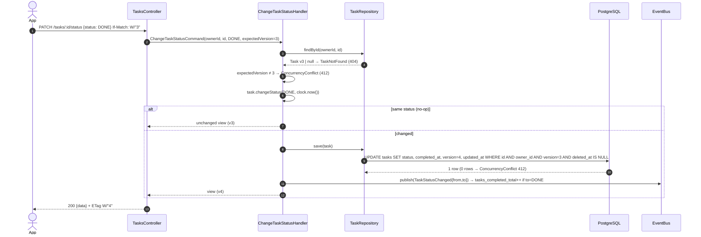

# 003 — Technical plan

- **Spec:** [spec.md](spec.md) · **Behavior:** [tasks.feature](tasks.feature) · **Tasks:** [tasks.md](tasks.md) · **Status:** Draft

## Context & references

| Reference                                                                                                                                                                                | Used for                                                                            |
| ---------------------------------------------------------------------------------------------------------------------------------------------------------------------------------------- | ----------------------------------------------------------------------------------- |
| [Domain model](../../architecture/domain-model.md)                                                                                                                                       | `Task` aggregate, VOs, events, errors, `TeamDirectory` / `TeamDeleted` relationship |
| [Data model](../../architecture/data-model.md)                                                                                                                                           | `tasks`, `task_teams`, `task_status`, indexes, soft delete, `version`               |
| [API contracts](../../architecture/api-contracts.md#tasks--apiv1tasks)                                                                                                                   | Endpoints, resource shape, list params, error codes — **not duplicated here**       |
| [ADR-0002](../../architecture/adr/0002-nestjs-clean-architecture-ddd-cqrs.md)                                                                                                            | Layers, CQRS (commands vs queries), in-process events                               |
| [ADR-0003](../../architecture/adr/0003-postgresql.md) · [ADR-0004](../../architecture/adr/0004-prisma-migrations-and-seeding.md)                                                         | PostgreSQL, Prisma migrations with raw SQL, deterministic seed                      |
| [ADR-0005](../../architecture/adr/0005-rest-openapi-and-response-envelope.md) · [ADR-0008](../../architecture/adr/0008-class-validator-dtos-and-generated-client.md)                     | Envelope, error filter, DTOs as contract source, generated client                   |
| [ADR-0006](../../architecture/adr/0006-offset-pagination.md)                                                                                                                             | Offset pagination, `meta`, drift trade-off                                          |
| [ADR-0013](../../architecture/adr/0013-opentelemetry-and-signoz.md)                                                                                                                      | Spans, metrics, logs                                                                |
| [ADR-0014](../../architecture/adr/0014-testing-strategy.md)                                                                                                                              | Test levels and tooling                                                             |
| [ADR-0015](../../architecture/adr/0015-optimistic-concurrency.md) · [ADR-0016](../../architecture/adr/0016-soft-delete.md) · [ADR-0019](../../architecture/adr/0019-idempotency-keys.md) | `version` + ETag/If-Match, `deleted_at`, `Idempotency-Key`                          |
| [002-teams plan](../002-teams/plan.md)                                                                                                                                                   | Supplier of `TeamDirectory` and publisher of `TeamDeleted`                          |

## Architecture

### Module layout — `apps/api/src/modules/tasks`

Paths follow [overview §6.2](../../architecture/overview.md#62-api-appsapi) (authoritative; dependency-cruiser keys on them).

```text
tasks/
├── contracts/                      # PUBLIC: count-tasks-by-team.query.ts (CountTasksByTeamQuery) + result type
├── domain/                         # framework-free TypeScript
│   ├── task.ts                     # aggregate root
│   ├── task.errors.ts              # InvalidTaskTitle, InvalidTaskDescription, InvalidTaskStatus, InvalidDueDate,
│   │                               # TooManyTeams, UnknownTeams, TaskNotFound (ConcurrencyConflict is shared)
│   ├── task.events.ts              # TaskCreated, TaskStatusChanged, TaskDeleted
│   ├── overdue.policy.ts           # isOverdue(status, dueDate, today) — pure, reused by the read side
│   └── value-objects/  task-title.ts · task-description.ts · task-status.ts · due-date.ts · task-team-ids.ts
├── application/
│   ├── ports/   task.repository.ts · task.read-model.ts · team-directory.ts   (abstract classes = DI tokens)
│   ├── commands/ create-task · replace-task · change-task-status · delete-task   (*.command.ts + *.handler.ts)
│   ├── queries/  list-tasks · get-task · count-tasks-by-team                    (*.query.ts + *.handler.ts)
│   ├── events/   on-team-deleted.handler.ts (in-transaction) · task-metrics.handler.ts (after commit)
│   └── views/    task.view.ts · task-view.assembler.ts     # row + team summaries + today → TaskView
├── infrastructure/
│   ├── prisma-task.repository.ts        # write side: aggregate ⇄ tasks + task_teams
│   ├── prisma-task.read-model.ts        # read side: parameterized SQL for list/get/count
│   ├── task.mapper.ts
│   └── adapters/team-directory.adapter.ts  # sends GetTeamSummariesQuery (teams/contracts) on the QueryBus
├── presentation/
│   ├── tasks.controller.ts
│   ├── dto/  create-task.dto.ts · replace-task.dto.ts · change-task-status.dto.ts
│   │         list-tasks.query.dto.ts · task.response.dto.ts · team-chip.dto.ts
│   └── task-error.mapper.ts             # domain error → { status, code }
└── tasks.module.ts                      # composition root; imports no other context module, exports no providers
```

Shared building blocks from `apps/api/src/shared` (delivered by 001/002, reused here): `Clock`, `IdGenerator` (`shared/application`), transaction host and `UnitOfWork` (`shared/infrastructure/prisma`), the in-transaction `DomainEventPublisher`, envelope / ETag / idempotency interceptors (`shared/presentation/interceptors`), global exception filter (`shared/presentation/filters`), `@IfMatch()` (`shared/presentation/decorators`).

### Domain

| Element           | Responsibility                                                                                                                                                                                                                                                                                                          |
| ----------------- | ----------------------------------------------------------------------------------------------------------------------------------------------------------------------------------------------------------------------------------------------------------------------------------------------------------------------- |
| `TaskTitle`       | trim, 3–120 → else `InvalidTaskTitle`                                                                                                                                                                                                                                                                                   |
| `TaskDescription` | trim, ≤ 2000, no `\p{Cc}` except line breaks, blank → `null` → else `InvalidTaskDescription`                                                                                                                                                                                                                            |
| `TaskStatus`      | `PENDING \| IN_PROGRESS \| DONE`; lifecycle order used by sort; `isTaskStatus` / `parseTaskStatus` → else `InvalidTaskStatus`                                                                                                                                                                                           |
| `DueDate`         | strict `YYYY-MM-DD` that round-trips through a UTC calendar (rejects `2026-02-30`); `isBefore(today)`                                                                                                                                                                                                                   |
| `TaskTeamIds`     | set of 0–10 distinct ids; `equals()` ignores order; > 10 → `TooManyTeams`                                                                                                                                                                                                                                               |
| `Task`            | `create`, `edit`, `assignTo`, `changeStatus(to, now)`, `unassignTeam(id, now)`, `delete(now)`; owns `completedAt` (BR-03.5) and no-op detection: each change method returns `changed` and touches `updatedAt`, and persistence increments `version` (BR-03.12); records events, pulled by the handler after persistence |

```ts
// domain/task.ts — illustrative
changeStatus(to: TaskStatus, now: Date): boolean {
  if (this.status === to) return false;                 // BR-03.4: no event, no write
  const from = this.status;
  this.status = to;
  this.completedAt = to === TaskStatus.DONE ? now : null; // BR-03.5
  this.touch(now);                                      // updatedAt = now only
  this.raise(new TaskStatusChanged(this.id, from, to, now));
  return true;                                          // the handler saves only when true
}
```

**Version convention** (same as Teams, [ADR-0015](../../architecture/adr/0015-optimistic-concurrency.md)): the aggregate never changes `version`. When a change method returns `true`, the repository writes it with `UPDATE … SET …, version = version + 1 WHERE id = $1 AND owner_id = $2 AND version = $expected AND deleted_at IS NULL`; 0 rows → re-check → `TaskNotFound` or `ConcurrencyConflict`. `Task.touch(now)` only sets `updatedAt`.

### Application (CQRS)

| Use case           | Type                         | Handler steps                                                                                                                                                                                                                |
| ------------------ | ---------------------------- | ---------------------------------------------------------------------------------------------------------------------------------------------------------------------------------------------------------------------------- |
| `CreateTask`       | command                      | build VOs (`TaskTeamIds` count check first, BR-03.8) → `TeamDirectory.findMissing(ownerId, ids)` → `UNKNOWN_TEAMS` if any → `Task.create` → `repo.save` → publish events → `GetTask` view                                    |
| `ReplaceTask`      | command                      | `repo.findById(ownerId, id)` → `TASK_NOT_FOUND` → expected version check (If-Match) → same team checks → `edit` / `assignTo` / `changeStatus` → `repo.save` (optimistic) unless no-op → events → view                        |
| `ChangeTaskStatus` | command                      | load → expected version check → `changeStatus` → save unless no-op → events → view                                                                                                                                           |
| `DeleteTask`       | command                      | load → expected version check → `delete(now)` → save → `TaskDeleted`                                                                                                                                                         |
| `GetTask`          | query                        | `readModel.findById` → `TeamDirectory.summaries` → assemble                                                                                                                                                                  |
| `ListTasks`        | query                        | `teamId` given and not live-owned → empty page (AC-03.3.2) · `readModel.list(criteria)` → one batched `TeamDirectory.summaries(allTeamIdsOfPage)` → assemble                                                                 |
| `CountTasksByTeam` | query                        | `readModel.countByTeams(ownerId, teamIds)` (live tasks only). Public in `tasks/contracts/`; sent by 002's `TeamTaskCounts` adapter through the `QueryBus` (no module import, no cycle)                                       |
| `OnTeamDeleted`    | in-transaction event handler | `repo.findByTeam(ownerId, teamId)` → `task.unassignTeam(teamId, now)` each (bumps `version` and `updatedAt`) → `repo.saveAll` (deletes the `task_teams` rows) inside 002's delete transaction; idempotent (no tasks → no-op) |

**Why a separate read side.** Commands load and save the `Task` aggregate through `TaskRepository` (invariants, version, events). Queries never hydrate aggregates: `TaskReadModel` returns flat rows straight from SQL, and the handler maps them to `TaskView` DTOs. This keeps listing cheap (no domain object per row), lets us hand-tune the hot SQL (ordering expressions, `NULLS LAST`, `ILIKE … ESCAPE`) and is the textbook CQRS split of ADR-0002. Domain rules still apply on reads through pure functions (`isOverdue`).

**Context boundary.** Team names/colors come from the `TeamDirectory` port, never from SQL joins on `teams` (constitution II.2). One batched call per page keeps round-trips constant:

| Port (declared by Tasks, in its language)                                                           | Implemented by                                                                                                                                          |
| --------------------------------------------------------------------------------------------------- | ------------------------------------------------------------------------------------------------------------------------------------------------------- |
| `summaries(ownerId, ids): Promise<TeamSummary[]>` — `{ id, name, colorHex }` of **live** teams only | `TeamDirectoryAdapter` (`tasks/infrastructure`) sends `GetTeamSummariesQuery` from `teams/contracts/` on the `QueryBus`. No Teams provider is imported. |
| `findMissing(ownerId, ids): Promise<string[]>` — ids not live-owned by the owner                    | same adapter: `ids` minus the ids returned by `GetTeamSummariesQuery` (one query)                                                                       |

`summaries` drops deleted teams, so the read side never embeds a deleted team even as defense in depth (AC-03.2.5, AC-03.13.1). Foreign and never-existing team ids take the same path and produce byte-identical `422 UNKNOWN_TEAMS` bodies (apart from `traceId`), so existence does not leak.

**Team deletion transaction** ([ADR-0002](../../architecture/adr/0002-nestjs-clean-architecture-ddd-cqrs.md#teamdeleted-consistency), decided). `OnTeamDeletedHandler` is registered with 002's `@InTransactionHandler(TeamDeleted)` (not an `@EventsHandler`), importing `TeamDeleted` from `teams/contracts/`. 002's `DeleteTeamHandler` opens the unit of work and the publisher awaits our handler before commit; our repositories use the ambient transaction (`@nestjs-cls/transactional` with the Prisma adapter), so the soft delete and the unassignment commit or roll back together. A failure in our handler fails the whole delete; there is no after-commit retry path. Each affected task gets `version + 1` and a new `updatedAt`. `task_teams` rows are deleted **only** by Tasks, never by the Teams repository.

### Sequence — create a task with teams

```mermaid
sequenceDiagram
  autonumber
  actor App
  participant C as TasksController
  participant V as ValidationPipe (DTO)
  participant H as CreateTaskHandler
  participant D as TeamDirectory (port → QueryBus → Teams)
  participant R as TaskRepository (Prisma)
  participant DB as PostgreSQL
  participant E as EventBus
  App->>C: POST /api/v1/tasks {title, teamIds[2]} (+Idempotency-Key)
  C->>V: whitelist, trim, formats, ArrayUnique
  V-->>C: CreateTaskDto | 400 VALIDATION_FAILED
  C->>H: CreateTaskCommand(ownerId, dto)
  H->>H: TaskTeamIds.of(ids) — >10 → TooManyTeams (422)
  H->>D: findMissing(ownerId, ids)
  D-->>H: [] (or ids → UnknownTeams 422)
  H->>H: Task.create(id, ownerId, …, now) records TaskCreated
  H->>R: save(task)
  R->>DB: BEGIN; INSERT tasks; INSERT task_teams ×2; COMMIT
  H->>E: publish(TaskCreated) → tasks_created_total++
  H->>D: summaries(ownerId, ids)
  H-->>C: TaskView
  C-->>App: 201 {data} + Location + ETag W/"1"
```

### Sequence — quick status change



### Presentation

- `TasksController` (`@Controller({ path: 'tasks', version: '1' })`), `@ApiTags('tasks')`, every route `@ApiOkResponse`/`@ApiCreatedResponse` with the enveloped DTO and `@ApiResponse` for each error code; owner id from the session decorator of 001.
- Path `:id` → `ParseUUIDPipe` whose `exceptionFactory` yields `VALIDATION_FAILED` on field `id` (spec Q5).
- DTO highlights (global `ValidationPipe({ whitelist, forbidNonWhitelisted, transform })`):

| DTO                   | Notes                                                                                                                                                                                                                                                                                                                                                                                                                                                                                                                                                        |
| --------------------- | ------------------------------------------------------------------------------------------------------------------------------------------------------------------------------------------------------------------------------------------------------------------------------------------------------------------------------------------------------------------------------------------------------------------------------------------------------------------------------------------------------------------------------------------------------------ |
| `CreateTaskDto`       | `title`: `@Transform(trim) @IsString @Length(3,120)` + no control characters (`/^\P{Cc}*$/u`) · `description?`: trim, `@MaxLength(2000)`, no control characters other than `\n` / `\r` · `status?`: `@IsEnum(TaskStatus)` · `dueDate?`: `@Matches(/^\d{4}-\d{2}-\d{2}$/)` + `@IsCalendarDate()` (delegates to `DueDate`) · `teamIds?`: `@IsArray @ArrayMaxSize(100) @IsUUID('all',{each:true}) @ArrayUnique` — more than 100 → `400 VALIDATION_FAILED` (hard cap); 11–100 distinct ids pass the DTO and the domain returns `422 TOO_MANY_TEAMS` per contract |
| `ReplaceTaskDto`      | same, `title`, `status`, `teamIds` required; omitted `description`/`dueDate` → `null`                                                                                                                                                                                                                                                                                                                                                                                                                                                                        |
| `ChangeTaskStatusDto` | `status` required, nothing else (`version`, `completedAt` etc. → 400)                                                                                                                                                                                                                                                                                                                                                                                                                                                                                        |
| `ListTasksQueryDto`   | see below                                                                                                                                                                                                                                                                                                                                                                                                                                                                                                                                                    |
| `TaskResponseDto`     | contract shape incl. `isOverdue`, `teams: TeamChipDto[]`, `version`                                                                                                                                                                                                                                                                                                                                                                                                                                                                                          |

Mass assignment (AC-03.1.7, AC-03.12.6, security review S-L1): `forbidNonWhitelisted` rejects `id`, `ownerId`, `owner_id`, `userId`, `owner` (object), `version`, `completedAt`, `createdAt`, `updatedAt`, `deletedAt`, `teams`, `isOverdue`, `__proto__` and `constructor` on `CreateTaskDto`, `ReplaceTaskDto` **and** `ChangeTaskStatusDto`. Check order ([ADR-0015](../../architecture/adr/0015-optimistic-concurrency.md)): validation `400` → not found `404` (wins over any `If-Match`, AC-03.15.5) → `412` (mismatch or malformed `If-Match`) → no-op detection.

```ts
// presentation/dto/list-tasks.query.dto.ts — illustrative
export const TASK_SORTS = [
  'createdAt',
  '-createdAt',
  'updatedAt',
  '-updatedAt',
  'dueDate',
  '-dueDate',
  'title',
  '-title',
  'status',
  '-status',
] as const;

export class ListTasksQueryDto extends PaginationQueryDto {
  // limit 1–100 (20), offset ≥0 (0)
  @IsOptional() @IsUUID('all') teamId?: string;

  @IsOptional()
  @Transform(({ value }) =>
    (Array.isArray(value) ? value.join(',') : String(value)).split(','),
  )
  @ArrayNotEmpty()
  @IsEnum(TaskStatus, { each: true }) // "PENDING," → ["PENDING",""] → 400
  @ApiProperty({ required: false, example: 'PENDING,IN_PROGRESS' })
  status?: TaskStatus[];

  @IsOptional() @Transform(trim) @IsString() @Length(1, 100) search?: string;

  @IsOptional() @IsIn(TASK_SORTS) sort: (typeof TASK_SORTS)[number] =
    '-createdAt'; // enum in OpenAPI → typed client
}
```

### Error mapping (`task-error.mapper.ts` + global filter)

| Domain / application error                                                                                     | HTTP | `code`                            | `details`               |
| -------------------------------------------------------------------------------------------------------------- | ---- | --------------------------------- | ----------------------- |
| DTO / pipe failure                                                                                             | 400  | `VALIDATION_FAILED`               | `[{ field, message }]`  |
| `InvalidTaskTitle`, `InvalidTaskDescription`, `InvalidTaskStatus`, `InvalidDueDate` (defensive; DTO pre-empts) | 400  | `VALIDATION_FAILED`               | field                   |
| `TaskNotFound` (unknown, deleted, foreign)                                                                     | 404  | `TASK_NOT_FOUND`                  | —                       |
| `ConcurrencyConflict` (If-Match mismatch / malformed, or lost race on save)                                    | 412  | `PRECONDITION_FAILED`             | `{ currentVersion }`    |
| `TooManyTeams` (11–100 distinct ids; > 100 is a DTO 400)                                                       | 422  | `TOO_MANY_TEAMS`                  | `{ max: 10, received }` |
| `UnknownTeams`                                                                                                 | 422  | `UNKNOWN_TEAMS`                   | `{ teamIds }`           |
| idempotency key in flight (shared interceptor, advisory lock not acquired)                                     | 409  | `IDEMPOTENCY_REQUEST_IN_PROGRESS` | — (`Retry-After: 1`)    |
| idempotency reuse (shared interceptor; also a key first used on another route)                                 | 422  | `IDEMPOTENCY_KEY_REUSED`          | —                       |

A lost race on save **without** `If-Match` is retried once by the handler (reload + reapply) — the client asked for last-write-wins (AC-03.15.4); with `If-Match` it surfaces as 412.

## Contract

As in [api-contracts.md § Tasks](../../architecture/api-contracts.md#tasks--apiv1tasks). Clarifications this spec adds (to be reflected in the DTO decorators, hence OpenAPI):

- `teams` ordered by name (case-insensitive); `title` sort is case-insensitive; `status` sort follows lifecycle order; ties by `id` in the sort direction.
- `search` escapes `%`, `_`, `\`; `status` also accepts repeated params (`status=A&status=B`).
- Same-status `PATCH` → `200` with the unchanged resource and unchanged `ETag`.
- `ETag` on `GET /tasks/:id` 200, `POST` 201, `PUT` 200, `PATCH` 200 (including idempotent replays, which also carry `Idempotent-Replayed: true`); `If-Match` accepts `W/"n"` and `"n"`, anything else → 412.
- `Idempotency-Key` is honored on `POST /tasks` only ([ADR-0019](../../architecture/adr/0019-idempotency-keys.md)).

## Data

### Prisma schema (excerpt, `apps/api/prisma/schema.prisma`)

```prisma
enum TaskStatus {
  PENDING
  IN_PROGRESS
  DONE
  @@map("task_status")
}

model Task {
  id          String     @id @db.Uuid
  ownerId     String     @map("owner_id")
  title       String     @db.VarChar(120)
  description String?    @db.VarChar(2000)
  status      TaskStatus @default(PENDING)
  dueDate     DateTime?  @map("due_date") @db.Date
  completedAt DateTime?  @map("completed_at") @db.Timestamptz(3)
  version     Int        @default(1)
  createdAt   DateTime   @default(now()) @map("created_at") @db.Timestamptz(3)
  updatedAt   DateTime   @updatedAt @map("updated_at") @db.Timestamptz(3)
  deletedAt   DateTime?  @map("deleted_at") @db.Timestamptz(3)
  owner       User       @relation(fields: [ownerId], references: [id], onDelete: Cascade)
  teams       TaskTeam[]
  @@map("tasks")
}

model TaskTeam {
  taskId    String   @map("task_id") @db.Uuid
  teamId    String   @map("team_id") @db.Uuid
  createdAt DateTime @default(now()) @map("created_at") @db.Timestamptz(3)
  task      Task     @relation(fields: [taskId], references: [id], onDelete: Cascade)
  team      Team     @relation(fields: [teamId], references: [id], onDelete: Cascade)
  @@id([taskId, teamId])
  @@index([teamId, taskId])
  @@map("task_teams")
}
```

`Team` (002) and `User` (001) need the back-relation fields `taskTeams TaskTeam[]` / `tasks Task[]` — a one-line change each, coordinated in T-003-01. `updatedAt`/`version` are set explicitly by the repository from the aggregate (the clock is the domain's, not the DB's).

### Migration `create_tasks` — raw SQL appended to the generated file

```sql
CREATE EXTENSION IF NOT EXISTS pg_trgm;

-- integrity guards (domain owns behavior; DB refuses impossible rows)
ALTER TABLE tasks
  ADD CONSTRAINT tasks_title_len      CHECK (char_length(title) BETWEEN 3 AND 120),
  ADD CONSTRAINT tasks_version_pos    CHECK (version >= 1),
  ADD CONSTRAINT tasks_completed_done CHECK ((status = 'DONE') = (completed_at IS NOT NULL));

CREATE INDEX tasks_owner_status_created_idx ON tasks (owner_id, status, created_at DESC, id DESC) WHERE deleted_at IS NULL;
CREATE INDEX tasks_owner_created_idx        ON tasks (owner_id, created_at DESC, id DESC)         WHERE deleted_at IS NULL;  -- see note
CREATE INDEX tasks_owner_due_idx            ON tasks (owner_id, due_date, id)                     WHERE deleted_at IS NULL;
CREATE INDEX tasks_search_trgm_idx          ON tasks USING GIN (title gin_trgm_ops, description gin_trgm_ops);
```

| Index                            | Serves                                                                 | Note                                                                                                                                            |
| -------------------------------- | ---------------------------------------------------------------------- | ----------------------------------------------------------------------------------------------------------------------------------------------- |
| `tasks_owner_status_created_idx` | status filter + default sort (data-model "hottest query")              | `id` appended for the tie-break so the index yields the final order                                                                             |
| `tasks_owner_created_idx`        | **global** default listing (no status filter) and `count(*)` per owner | **Proposed addition** to data-model.md: without it the unfiltered default list cannot use an ordered index scan on PostgreSQL 17 (no skip scan) |
| `tasks_owner_due_idx`            | `sort=dueDate` (nulls last = B-tree default for ASC)                   | DESC NULLS LAST is a backward scan + nulls reorder; acceptable at per-owner cardinality                                                         |
| `tasks_search_trgm_idx`          | `ILIKE '%term%'` on title OR description (BitmapOr)                    | trigram index helps from 3 chars; 1–2 char terms fall back to the owner-scoped rows                                                             |
| `task_teams (team_id, task_id)`  | `teamId` filter (`EXISTS`), per-team counts                            | PK `(task_id, team_id)` serves the per-task team lookup                                                                                         |

`title`/`updatedAt`/`status` sorts sort the owner's filtered rows in memory (top-N heapsort): bounded by a single user's tasks, so no dedicated indexes (each would slow every write).

**Prisma drift guard.** Partial indexes and CHECKs are invisible to the Prisma schema; every later `migrate dev` output is reviewed and any generated `DROP INDEX`/`DROP CONSTRAINT` of these objects is removed (database-specialist checklist; CI runs `prisma migrate diff` against a migrated DB).

### Read model SQL (hot path)

```ts
// infrastructure/prisma-task.read-model.ts — illustrative; ORDER BY comes only from a constant map
const ORDER: Record<SortField, (dir: 'ASC'|'DESC') => Prisma.Sql> = {
  createdAt: d => Prisma.raw(`t.created_at ${d}, t.id ${d}`),
  updatedAt: d => Prisma.raw(`t.updated_at ${d}, t.id ${d}`),
  dueDate:   d => Prisma.raw(`t.due_date ${d} NULLS LAST, t.id ${d}`),
  title:     d => Prisma.raw(`lower(t.title) ${d}, t.id ${d}`),
  status:    d => Prisma.raw(`t.status ${d}, t.id ${d}`),          // enum order = lifecycle order
};
const where = Prisma.sql`t.owner_id = ${ownerId} AND t.deleted_at IS NULL
  ${teamId ? Prisma.sql`AND EXISTS (SELECT 1 FROM task_teams f WHERE f.task_id = t.id AND f.team_id = ${teamId}::uuid)` : Prisma.empty}
  ${statuses ? Prisma.sql`AND t.status = ANY(${statuses}::task_status[])` : Prisma.empty}
  ${pattern ? Prisma.sql`AND (t.title ILIKE ${pattern} ESCAPE '\\' OR t.description ILIKE ${pattern} ESCAPE '\\')` : Prisma.empty}`;

// page: one query, team ids aggregated per page row (PK lookups), no join to teams
SELECT t.*, ARRAY(SELECT tt.team_id FROM task_teams tt WHERE tt.task_id = t.id) AS team_ids
FROM tasks t WHERE ${where} ORDER BY ${ORDER[field](dir)} LIMIT ${limit} OFFSET ${offset};
// total: SELECT count(*) FROM tasks t WHERE ${where};
```

Round-trips per list request: `findMissing` (only with `teamId`) + page + count + `summaries` = **≤ 4, independent of page size**. Page and count run in one `$transaction([...])` batch.

**Query plan acceptance (T-003-09).** On a synthetic owner with 10 000 tasks (and 50 other owners), `EXPLAIN (ANALYZE, BUFFERS)` is captured in the PR for:

| Query                                       | Expected plan                                               | Budget  |
| ------------------------------------------- | ----------------------------------------------------------- | ------- |
| default list (`-createdAt`, limit 20)       | Index Scan on `tasks_owner_created_idx`, Limit, no Sort     | < 2 ms  |
| `status=PENDING` + default sort             | Index Scan on `tasks_owner_status_created_idx`, no Sort     | < 2 ms  |
| `status=PENDING,IN_PROGRESS` + default sort | Bitmap/Index Scan on status index + top-N heapsort          | < 10 ms |
| `search=login`                              | BitmapOr on `tasks_search_trgm_idx` + owner recheck         | < 10 ms |
| `teamId=…`                                  | Nested Loop / Semi Join via `task_teams (team_id, task_id)` | < 10 ms |

No `Seq Scan on tasks` in any of them.

### Seed (`prisma/seed/tasks.seed.ts`, called by the `prisma/seed.ts` orchestrator of T-007-07)

| #   | Title                    | Status      | Teams                   | Due date      | Purpose                           |
| --- | ------------------------ | ----------- | ----------------------- | ------------- | --------------------------------- |
| 1   | Implement login screen   | IN_PROGRESS | Mobile                  | seed day + 7  | chip, due soon                    |
| 2   | Session endpoint         | DONE        | Backend                 | seed day − 3  | Done with past date → not overdue |
| 3   | Release 1.0 checklist    | PENDING     | Mobile, Backend, Design | seed day + 14 | multi-team (3)                    |
| 4   | Design color tokens      | DONE        | Design                  | —             | completed, no due date            |
| 5   | Push notifications spike | PENDING     | Mobile                  | seed day − 2  | **overdue**                       |
| 6   | Rate limiting            | IN_PROGRESS | Backend                 | —             |                                   |
| 7   | Onboarding illustrations | PENDING     | Design, Mobile          | seed day + 21 | multi-team (2)                    |
| 8   | Renew domain certificate | PENDING     | —                       | seed day + 30 | **no team**                       |
| 9   | API error catalogue      | DONE        | Backend                 | seed day − 10 |                                   |
| 10  | Accessibility audit      | IN_PROGRESS | Design                  | seed day + 3  |                                   |

Fixed literal fixtures (no faker). Statuses 4 / 3 / 3; due dates relative to the seed day so the demo always shows overdue and due-soon tasks; tasks upserted by fixed UUIDs (`deleted_at` reset, `task_teams` rewritten) keep reruns idempotent. Skipped with the demo user (`SEED_DEMO=false` or `APP_ENV=production`).

## Security considerations

- Every repository and read-model statement includes `owner_id = $owner` and `deleted_at IS NULL`; there is no method without `ownerId` (enforced by port signatures). Foreign/deleted → `TASK_NOT_FOUND`, foreign teams → `UNKNOWN_TEAMS` (no existence leak beyond what the caller sent).
- SQL is parameterized via `Prisma.sql`; the only raw fragments are constant ORDER BY strings selected from a whitelist map, and the direction comes only from the `-` prefix of a whitelisted `sort` value. A unit test asserts every generated ORDER BY is one of the constant fragments (F6). `search` wildcards are escaped.
- `forbidNonWhitelisted` rejects the mass-assignment fields listed under Presentation on create, replace and status change.
- Rate limit (contract) applies; bodies limited by the global size limit; `teamIds` hard-capped at 100 by the DTO and at 10 by the domain.
- Logs/spans never contain title, description or search terms (user content).

## Observability

| Kind                                       | Name                                                                                                                                                                                          | Details                                                                   |
| ------------------------------------------ | --------------------------------------------------------------------------------------------------------------------------------------------------------------------------------------------- | ------------------------------------------------------------------------- |
| Span attributes (on the HTTP/handler span) | `task.id`, `task.status`, `task.status.from`, `task.status.to`, `task.team_count`, `task.noop`                                                                                                | command handlers                                                          |
|                                            | `tasks.query.sort`, `tasks.query.status`, `tasks.query.has_team_filter`, `tasks.query.has_search`, `tasks.query.limit`, `tasks.query.offset`, `tasks.query.result_count`, `tasks.query.total` | `ListTasks`                                                               |
| Child spans                                | `TaskRepository.save`, `TaskReadModel.list`, `TeamDirectory.summaries`                                                                                                                        | + Prisma auto-instrumentation                                             |
| Counter                                    | `tasks_created_total`                                                                                                                                                                         | `TaskCreated` handler                                                     |
| Counter                                    | `tasks_completed_total`                                                                                                                                                                       | `TaskStatusChanged` to `DONE`, and `TaskCreated` whose `status` is `DONE` |
| Counter                                    | `tasks_deleted_total`                                                                                                                                                                         | `TaskDeleted` handler                                                     |
| Logs (pino, trace-correlated)              | `info task.status_changed {taskId, from, to}` · `warn task.concurrency_conflict {taskId, expected, current}`                                                                                  | no user content                                                           |

These three are the only domain metrics (Maestro decision X3); everything else is HTTP RED metrics from 006.

Metrics are emitted from after-commit event handlers (`task-metrics.handler.ts`), keeping the domain free of I/O.

## Testing approach

| Scenario group (Rule in `tasks.feature`)                                  | Domain unit               | Handler unit (fakes)                                            | Integration (Testcontainers PG)                                         | API e2e (supertest)                                                                                  |
| ------------------------------------------------------------------------- | ------------------------- | --------------------------------------------------------------- | ----------------------------------------------------------------------- | ---------------------------------------------------------------------------------------------------- |
| Create defaults & field boundaries (title, description, status, due date) | ✔ VOs                     | ✔                                                               | —                                                                       | ✔ outline rows (contract 400s)                                                                       |
| Team count / duplicates / unknown teams                                   | ✔ `TaskTeamIds`           | ✔ fake `TeamDirectory`                                          | ✔ adapter via `QueryBus`                                                | ✔ incl. 101 ids → 400, 11 → 422; foreign vs never-existing id → identical `422 UNKNOWN_TEAMS` bodies |
| Listing, filters, combined filters                                        | —                         | ✔ empty page for foreign `teamId`                               | ✔ read model (all outline rows)                                         | ✔ smoke per filter                                                                                   |
| Search literal characters                                                 | —                         | —                                                               | ✔                                                                       | ✔ `100%`                                                                                             |
| Sort + tie-break + page walk                                              | —                         | —                                                               | ✔ (deterministic ids)                                                   | ✔ default sort                                                                                       |
| Pagination meta & invalid params                                          | —                         | ✔ meta math                                                     | ✔                                                                       | ✔ 400 rows                                                                                           |
| View / not found / malformed id                                           | —                         | ✔                                                               | —                                                                       | ✔                                                                                                    |
| Edit, no-op, required fields                                              | ✔ `edit`/no-op            | ✔                                                               | ✔ `task_teams` replace                                                  | ✔                                                                                                    |
| Status transition matrix (9) + updatedAt                                  | ✔ all 9                   | ✔ no save on no-op                                              | —                                                                       | ✔ all 9                                                                                              |
| Delete                                                                    | ✔                         | ✔                                                               | ✔ invisible to read model                                               | ✔                                                                                                    |
| Ownership (all operations)                                                | —                         | —                                                               | ✔ queries scoped                                                        | ✔ two users                                                                                          |
| Team deletion effect                                                      | ✔ `unassignTeam`          | ✔ idempotent                                                    | ✔ in-transaction handler + versions; failure rolls back the team delete | ✔ via `DELETE /teams/:id`                                                                            |
| Overdue                                                                   | ✔ policy with fixed today | —                                                               | —                                                                       | ✔ fixed `Clock`                                                                                      |
| Concurrency (If-Match, race)                                              | —                         | ✔                                                               | ✔ two concurrent saves → one 0-row update                               | ✔                                                                                                    |
| Idempotency                                                               | —                         | —                                                               | ✔ key store, concurrent pair, other owner                               | ✔ incl. team key reused on `POST /tasks` → 422                                                       |
| Mass assignment / control characters                                      | ✔ `TaskTitle`             | —                                                               | —                                                                       | ✔ every field on create, replace and status change                                                   |
| ORDER BY whitelist                                                        | —                         | ✔ unit: only constant fragments, direction from `-` prefix only | —                                                                       | —                                                                                                    |

- Time is controlled through the `Clock` port (`FixedClock` in tests; e2e overrides the provider) — no sleeps.
- **N+1 guard:** integration test counts Prisma queries (`$on('query')`) for a 100-task page with 3 teams each → ≤ 4.
- e2e test names carry the scenario tags (`@AC-03.10.2`) so the traceability matrix is generated from test output (ADR-0014).
- Mutation testing (Stryker) on `domain/` (≥ 80 %).

## Risks & mitigations

| Risk                                                                                                                            | Mitigation                                                                                                                                                                               |
| ------------------------------------------------------------------------------------------------------------------------------- | ---------------------------------------------------------------------------------------------------------------------------------------------------------------------------------------- |
| **N+1** when embedding teams                                                                                                    | Team ids aggregated in the page query; one batched `summaries` call; query-count test.                                                                                                   |
| **Search performance** (`%term%` cannot use B-tree)                                                                             | `pg_trgm` GIN, 100-char cap, owner-scoped recheck; EXPLAIN captured; k6 scenario (EP-06). Full-text search is a documented production improvement.                                       |
| **Offset pagination drift** (inserts/deletes between pages → duplicates/skips)                                                  | Accepted for a personal list (ADR-0006); deterministic `id` tie-break; app refetches from page 1 after mutations; cursor pagination listed as production improvement.                    |
| count + page not snapshot-consistent under READ COMMITTED                                                                       | Accepted (cosmetic); can switch the batch to `REPEATABLE READ` if observed.                                                                                                              |
| Prisma migration drift drops raw-SQL indexes/CHECKs                                                                             | Review generated SQL; `migrate diff` in CI; data-model.md is the checklist.                                                                                                              |
| Unassignment diverges from the team delete                                                                                      | `OnTeamDeletedHandler` runs in the same transaction (ADR-0002); a failure rolls back both. Read side also hides deleted teams. Outbox is the production evolution if contexts are split. |
| Lost updates between load and save                                                                                              | `UPDATE … WHERE version = $loaded`; retry once without If-Match, 412 with If-Match.                                                                                                      |
| `taskCount` on teams needs task data (002)                                                                                      | `CountTasksByTeamQuery` (`tasks/contracts/`) via `QueryBus` behind 002's `TeamTaskCounts` port — no import cycle, no cross-context table access.                                         |
| Trigram GIN index is not owner-scoped (noisy neighbour: another owner's many rows matching a common trigram inflate the bitmap) | Acceptable at demo scale; EXPLAIN captured. Production fix: `btree_gin` composite index including `owner_id`, or a per-statement `statement_timeout` on search queries.                  |
| `lower(title)` sort unindexed                                                                                                   | Bounded per owner; revisit with an expression index only if EXPLAIN shows a need.                                                                                                        |
