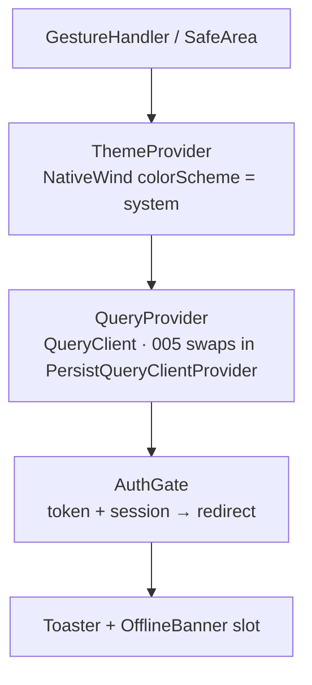

# 004 — Technical plan

## Context & references

- **Spec:** [spec.md](spec.md) · **Behavior:** [mobile-app.feature](mobile-app.feature) · **Design:** [design-spec.md](../../design/design-spec.md) · **Contract:** [api-contracts.md](../../architecture/api-contracts.md)
- **ADRs:** [0001 monorepo](../../architecture/adr/0001-monorepo-pnpm-turborepo.md) · [0005 envelope](../../architecture/adr/0005-rest-openapi-and-response-envelope.md) · [0006 offset pagination](../../architecture/adr/0006-offset-pagination.md) · [0007 Better Auth](../../architecture/adr/0007-better-auth.md) · [0014 testing](../../architecture/adr/0014-testing-strategy.md) · [0020 simplification](../../architecture/adr/0020-simplify-architecture-for-the-hiring-test.md) (Bearer only, last write wins). Archived rationale: [0008 DTOs + orval](../../architecture/adr/archive/0008-class-validator-dtos-and-generated-client.md) · [0009 Expo Router](../../architecture/adr/archive/0009-expo-and-expo-router.md) · [0010 React Query + Zustand/immer](../../architecture/adr/archive/0010-react-query-and-zustand-immer.md) · [0011 NativeWind @apply](../../architecture/adr/archive/0011-nativewind-with-apply.md).
- Offline persistence, optimistic updates and the mutation queue are planned in [005 plan](../005-offline-sync/plan.md). This plan leaves the seams for them (mutation keys, query key factory, storage adapter, toast store).

## Architecture

### Stack (runs in Expo Go — no custom native modules, no dev build)

| Concern      | Choice                                                                                                                                                                                                    |
| ------------ | --------------------------------------------------------------------------------------------------------------------------------------------------------------------------------------------------------- |
| Runtime      | Expo managed workflow, latest stable SDK (pinned at scaffold time), TypeScript strict                                                                                                                     |
| Navigation   | Expo Router with typed routes, auth gate in layouts, team filter as URL state (`/tasks?teamId=`)                                                                                                          |
| Styling      | NativeWind v4 on Tailwind CSS v3; design-spec tokens as CSS variables in `global.css` (`:root` light, `.dark` dark); semantic `@apply` classes; theme follows the system; dynamic team colors via `style` |
| Server state | TanStack Query v5 with hooks generated by orval into `packages/api-client`                                                                                                                                |
| Local state  | Zustand + `immer` (filters and toasts, session only)                                                                                                                                                      |
| Forms        | react-hook-form + `@hookform/resolvers/zod`; zod schemas generated by orval, refined with pt-BR messages                                                                                                  |
| Auth         | `better-auth/react` `createAuthClient` + `@better-auth/expo` `expoClient` with `expo-secure-store`; API calls use `Authorization: Bearer`                                                                 |
| Copy         | pt-BR literals from design spec §9 (pt-BR column); no i18n library; dates via `Intl.DateTimeFormat('pt-BR')`                                                                                              |
| UI deps      | `@expo/vector-icons`, `@react-native-community/datetimepicker`, `react-native-safe-area-context`, `expo-crypto` (`randomUUID` for request ids and 005 temporary ids)                                      |
| Tests        | jest-expo + React Native Testing Library + MSW (`msw/node`); Maestro flows run locally, outside the CI gate                                                                                               |

### Folder structure

```
apps/mobile/
├── app/                      # Expo Router routes only (thin files rendering feature screens)
│   ├── _layout.tsx           # providers + auth gate + splash
│   ├── (auth)/sign-in.tsx    # sign-up.tsx with T-004-21 (COULD)
│   ├── (tabs)/_layout.tsx, tasks.tsx (`?teamId=`), teams.tsx, settings.tsx
│   ├── tasks/new.tsx, tasks/[id].tsx, tasks/[id]/edit.tsx
│   └── teams/new.tsx, teams/[id]/edit.tsx
├── src/
│   ├── features/
│   │   ├── auth/             # auth-client.ts, token store, AuthGate, SignInScreen, SettingsScreen, useSignOut
│   │   ├── teams/            # hooks (orval wrappers), components, team-form schema
│   │   └── tasks/            # hooks, components, task-form schema, filters store
│   ├── offline/              # spec 005: persister, network status, mutation queue, temp ids
│   ├── ui/                   # primitives (Button, Input, Chip, Badge…) + feedback (Skeleton, Empty, Error, Toast)
│   ├── theme/                # global.css (@apply catalog), tokens.ts, contrast.ts
│   └── lib/                  # api mutator setup (Bearer), query client + keys, storage adapter, env, error messages
├── tests/                    # setup, MSW handlers, renderWithProviders, *.test.tsx; maestro/ flows
├── tailwind.config.js · app.config.ts · babel.config.js · metro.config.js
packages/api-client/          # orval output (hooks + zod + types), mutator, ApiError; `generate` script
```

Dependency rules (dependency-cruiser): `app → features → offline | ui | theme | lib`; `ui`, `theme` and `lib` never import `features` or `app`; features import each other only through `features/<x>/index.ts`; storage libraries are imported only in `src/lib/storage.ts` and `features/auth` (secure store). Screens receive route params from `app/` files, so they are testable without the router.

### Providers (root layout)



### Sequence — quick status change (online, 004 baseline)

```mermaid
sequenceDiagram
  actor M as Marina
  participant D as TaskDetailScreen
  participant H as useChangeTaskStatus
  participant F as customFetch
  participant API as API /api/v1
  M->>D: tap "Concluída"
  D->>H: mutate({ taskId, status: DONE })
  H->>F: PATCH /tasks/:id/status
  F->>API: Authorization: Bearer <token from SecureStore>
  API-->>F: 200 { data: Task }
  F-->>H: { data: Task }
  H->>H: setQueryData(detail), invalidate tasks.lists
  H-->>D: toast "Marcada como Concluída"
  Note over D,H: 005 adds onMutate (optimistic) + rollback; same mutationKey
```

### API client (`packages/api-client`)

- **Generation:** `orval.config.ts` reads `packages/api-client/openapi.json`, exported from the API without a database (T-007-10), so generation never needs a running server. Outputs: `src/generated/endpoints/*.ts` (`client: 'react-query'`, `httpClient: 'fetch'`, `mode: 'tags-split'`, mutator `customFetch`, infinite queries on list operations with `offset` as page param) and `src/generated/zod/*.ts` (request bodies and params). Generated code is not committed; CI checks drift.
- **Mutator `customFetch<T>(url, init)`**, configured once by the app with `configureApiClient({ baseUrl, getToken, onUnauthenticated })`:
  1. Resolve the URL against `baseUrl` (`EXPO_PUBLIC_API_URL`); a foreign absolute URL is rejected (`ApiError('FOREIGN_URL')`, never sent), so the token only reaches the API origin.
  2. Headers: `Authorization: Bearer <await getToken()>` when a token exists, `Accept`/`Content-Type: application/json`, `X-Request-Id` = `randomUUID()`.
  3. Timeout 15 s → `ApiError('TIMEOUT')`; network failure → `ApiError('NETWORK', status 0)`.
  4. `204` → `undefined`; `2xx` → the `{ data, meta? }` envelope as typed; single-resource screens unwrap with `select`.
  5. Non-2xx → `ApiError { status, code, details, traceId, retryAfter }` (`Retry-After` clamped to 1–60 s); `401` also calls `onUnauthenticated()`.
- `ApiError`, `isApiError` and `fieldErrors(err)` (`VALIDATION_FAILED.details[]` → `{ field: message }`) live in `packages/api-client/src/errors.ts`; the code → pt-BR message map lives in `apps/mobile/src/lib/error-messages.ts` (design spec §9.6, unknown → generic).
- The app never hand-writes request/response types (constitution IV).

### Server state rules

- **QueryClient defaults** (`src/lib/query-client.ts`): `staleTime: 30s`, `gcTime: 24h` (005 persistence), `networkMode: 'offlineFirst'`, retry up to 3 with backoff for network/timeout/5xx only, `focusManager` wired to `AppState`.
- **Query key factory** (`src/lib/query-keys.ts`), passed to generated hooks via `query: { queryKey }` so invalidation is prefix-based:

```ts
export const qk = {
  teams: {
    all: ['teams'] as const,
    lists: () => [...qk.teams.all, 'list'] as const,
    list: (p: TeamListParams) => [...qk.teams.lists(), p] as const,
    detail: (id: string) => [...qk.teams.all, 'detail', id] as const,
  },
  tasks: {
    all: ['tasks'] as const,
    lists: () => [...qk.tasks.all, 'list'] as const,
    list: (p: TaskListParams) => [...qk.tasks.lists(), p] as const,
    detail: (id: string) => [...qk.tasks.all, 'detail', id] as const,
  },
};
```

- **Mutation keys** (stable, used by 005 `setMutationDefaults`): `['tasks','create' | 'update' | 'changeStatus' | 'delete']`, `['teams','create' | 'update' | 'delete']`. Variables are plain serializable objects `{ id?, body? }`.
- **Invalidation rules:**

| Mutation      | Cache effect on success                                                                     |
| ------------- | ------------------------------------------------------------------------------------------- |
| Create task   | `invalidate(tasks.lists)`, `invalidate(teams.lists)` (counts); `setQueryData(tasks.detail)` |
| Update task   | `setQueryData(tasks.detail)`, `invalidate(tasks.lists)`, `invalidate(teams.lists)`          |
| Change status | `setQueryData(tasks.detail)`, `invalidate(tasks.lists)`                                     |
| Delete task   | `removeQueries(tasks.detail)`, `invalidate(tasks.lists)`, `invalidate(teams.lists)`         |
| Create team   | `invalidate(teams.lists)`                                                                   |
| Update team   | `setQueryData(teams.detail)`, `invalidate(teams.lists)`, `invalidate(tasks.all)` (chips)    |
| Delete team   | `removeQueries(teams.detail)`, `invalidate(teams.lists)`, `invalidate(tasks.all)`           |
| Sign out      | see [Auth](#auth)                                                                           |

- **Detail from list:** `useTaskDetail(id)` seeds `initialData` from any cached list page containing the task.
- **Infinite lists:** `limit: 20`, `getNextPageParam` from `meta.hasNextPage`, `FlatList` `onEndReached`, `RefreshControl` → `refetch()`.

### Local state (Zustand + immer)

| Store                             | Shape                                                                                | Persisted | Notes                                                                                               |
| --------------------------------- | ------------------------------------------------------------------------------------ | --------- | --------------------------------------------------------------------------------------------------- |
| `features/tasks/filters.store.ts` | `{ byScope: Record<'all' \| TeamId, { status; search; sort? }>; set; clear; reset }` | no        | Scope = `'all'` or the route's `teamId` (BR-04.8). Status single-select, `'ALL'` sends no `status`. |
| `ui/toast.store.ts`               | `{ current?: Toast; show(t); hide() }`                                               | no        | Callable outside React (005 mutation defaults and replay warnings).                                 |

Never mirror server data (teams, tasks, session) in Zustand.

### Forms

- Task form: `taskFormSchema` extends the generated `createTaskBody` with `title.trim().min(3, 'O título deve ter pelo menos 3 caracteres').max(120, …)`, description ≤ 2000, `dueDate` `YYYY-MM-DD` nullable, `teamIds` ≤ 10. `mode: 'onTouched'`, `reValidateMode: 'onChange'` (AC-04.7.2).
- Team form: name trimmed 2–50, `colorHex` `#RRGGBB` uppercased, description ≤ 280.
- Server errors: `fieldErrors(err)` → `setError`; `UNKNOWN_TEAMS.details.teamIds` → remove those ids and set the teams-field error; `TEAM_NAME_ALREADY_EXISTS` → name-field error. No conflict dialog: updates are last write wins (ADR-0020).
- Dirty-cancel guard via `usePreventRemove` → confirm dialog. Double submit: the handler returns early while `isSubmitting` / `mutation.isPending` and the button is disabled (AC-04.9.6).

### Auth

- `src/features/auth/auth-client.ts`: `createAuthClient({ baseURL: env.apiUrl, plugins: [expoClient({ scheme: 'teamstasks', storagePrefix: 'teamstasks', storage: SecureStore })], fetchOptions: { auth: { type: 'Bearer', token: getToken }, onSuccess: captureToken } })`. `captureToken` reads the `set-auth-token` response header after sign-in and stores it with `SecureStore.setItemAsync`; `getToken` reads it back. The scheme equals the API's `APP_SCHEME` (Better Auth `expo()` plugin and `trustedOrigins` are already on the server).
- The token lives only in `expo-secure-store`: never in AsyncStorage, the query cache, Zustand or logs.
- `app/_layout.tsx` calls `configureApiClient({ baseUrl, getToken, onUnauthenticated })`. Gate: no token or no session → `(auth)`; session restored from the token on launch behind the splash screen.
- `onUnauthenticated` (any `401`): delete the token, clear the query cache, show "Sua sessão expirou. Entre novamente." on Sign in (AC-04.1.6).
- Sign out (US-04.16): `await` `authClient.signOut()`, token deletion, `queryClient.clear()`, filter store reset and (005) persisted cache + queue removal, **then** navigate to Sign in.
- Sign-in errors: `INVALID_EMAIL_OR_PASSWORD` → "E-mail ou senha incorretos"; `429` → rate-limit message with seconds from `X-Retry-After`.

### Theme and copy

- Every color role is a CSS variable `--color-<role>` (R G B channels) in `global.css` under `:root` and `.dark`; `tailwind.config.js` maps it (`rgb(var(--color-surface) / <alpha-value>)`). Catalog classes and names are owned by design spec §1.6/§2; `dark:` only for its documented exceptions.
- `src/theme/ThemeProvider.tsx` follows the system color scheme; COULD (T-004-23) adds an explicit choice. `src/theme/tokens.ts` mirrors the hex values for non-`className` consumers (navigation theme, icons, `StatusBar`), with a parity test against `global.css`.
- `contrastingText(hex)` and `needsOutline(hex, surfaceHex)` in `src/theme/contrast.ts` implement design spec §3.
- Copy is pt-BR from design spec §9. Due dates are parsed as local calendar dates (`YYYY-MM-DD` → `new Date(y, m - 1, d)`), never via `Date.parse` (BR-04.10).

### Environment & running on a device

- `EXPO_PUBLIC_API_URL`, validated with zod in `src/lib/env.ts` (fail fast); outside `__DEV__` it must be `https://`.
- A phone in Expo Go cannot reach the dev machine's `localhost`: same Wi-Fi → `http://<LAN-IP>:3000` (WSL2 needs port forwarding or mirrored networking); Android emulator → `http://10.0.2.2:3000`; iOS simulator → `http://localhost:3000`. Documented in `apps/mobile/README.md` (T-004-20).

## Contract

Screens → endpoints (see [api-contracts.md](../../architecture/api-contracts.md)):

| Screen                           | Endpoints                                                                               | Errors handled specifically                                       |
| -------------------------------- | --------------------------------------------------------------------------------------- | ----------------------------------------------------------------- |
| Sign in                          | `POST /api/auth/sign-in/email` (token in `set-auth-token`), `GET /api/auth/get-session` | invalid credentials, `429`                                        |
| Settings (sign-out)              | `POST /api/auth/sign-out`                                                               | —                                                                 |
| Teams list                       | `GET /teams?limit=20&offset&search&sort=name`                                           | `NETWORK`, `INTERNAL_ERROR`, `RATE_LIMITED`                       |
| Team form                        | `GET /teams/:id`, `POST /teams`, `PUT /teams/:id`, `DELETE /teams/:id`                  | `TEAM_NAME_ALREADY_EXISTS`, `VALIDATION_FAILED`, `TEAM_NOT_FOUND` |
| Tasks list (global / `?teamId=`) | `GET /tasks?teamId&status&search&sort&limit=20&offset`; `GET /teams/:id` for the header | as Teams list; deleted team → `TEAM_NOT_FOUND` state              |
| Task detail                      | `GET /tasks/:id`, `PATCH /tasks/:id/status`, `DELETE /tasks/:id`                        | `TASK_NOT_FOUND`                                                  |
| Task form                        | `GET /tasks/:id`, `GET /teams` (picker), `POST /tasks`, `PUT /tasks/:id`                | `VALIDATION_FAILED`, `UNKNOWN_TEAMS`, `TOO_MANY_TEAMS`            |

Every `/api/v1` request carries `Authorization: Bearer`. Writes are last write wins: no conditional or idempotency headers.

## Data

No server schema changes. Device-side: token in `expo-secure-store` (Keychain/Keystore); filters in memory; query cache persistence is added in 005.

## Security considerations

- Token only in `expo-secure-store`; never in AsyncStorage, the persisted cache, logs or error reports. The mutator attaches it only to `baseUrl`.
- Sign-out wipes token, query cache, persisted cache and queue (005) and local stores before navigating; `401` deletes the token and clears the query cache.
- No secrets in the bundle: `EXPO_PUBLIC_*` holds only the API URL. Release builds require HTTPS.
- Users see mapped pt-BR copy, never server `message` or stack text (BR-04.9).
- Another user's id → `404` → shown as not found (no existence leak).

## Observability

- Every request carries `X-Request-Id`; `ApiError.traceId` is logged in development only by `src/lib/logger.ts`, which never logs bodies or headers.

## Testing approach

| Level     | Tool                                               | What                                                                                                                                                                                          | Scenarios                                                      |
| --------- | -------------------------------------------------- | --------------------------------------------------------------------------------------------------------------------------------------------------------------------------------------------- | -------------------------------------------------------------- |
| Unit      | Jest                                               | contrast rules, error mapping, mutator (Bearer, foreign URL, errors), query keys, filter store, zod schemas (boundaries 2/3/120/121; 1/2/50/51), dates                                        | @AC-04.8.2, @AC-04.7.2/3, @AC-04.3.1/5, @AC-04.9.5, @AC-04.1.7 |
| Component | jest-expo + RNTL + MSW                             | every screen × every state of the design-spec state matrix; interactions (team tap, filters, debounced search with fake timers, infinite scroll, refresh, status change, delete, form errors) | all @must of 004                                               |
| E2E       | Maestro (`apps/mobile/tests/maestro/`), local only | sign in/out, filter by team, task CRUD, validation, against the seeded API in Expo Go                                                                                                         | @AC-04.1.2, @AC-04.2.2, @AC-04.6.2, @AC-04.6.4, @AC-04.7.1/2   |

- `tests/renderWithProviders.tsx`: fresh `QueryClient` (`retry: false`), light theme, toast host, `expo-router/testing-library` for navigation.
- Test titles carry the AC id (`it('[AC-04.2.2] shows only the team tasks', …)`). No sleeps: fake timers and `findBy*`.
- Commands: `pnpm --filter @hitss/mobile lint typecheck test`; `maestro test apps/mobile/tests/maestro`.

## Risks & mitigations

| Risk                                                         | Mitigation                                                                                          |
| ------------------------------------------------------------ | --------------------------------------------------------------------------------------------------- |
| NativeWind v4 nested `@apply` unsupported for some utilities | Catalog is normative; inline utilities where nesting fails; a smoke test renders each class         |
| Better Auth client token capture differs by version          | Wrapped in `features/auth/auth-client.ts`; MSW test asserts `set-auth-token` → SecureStore → Bearer |
| Device cannot reach the API                                  | README section, clear network error state, `env.ts` validation                                      |
| Flaky E2E                                                    | Seeded deterministic data, `testID`s, Maestro built-in waits; local only, outside the CI gate       |
