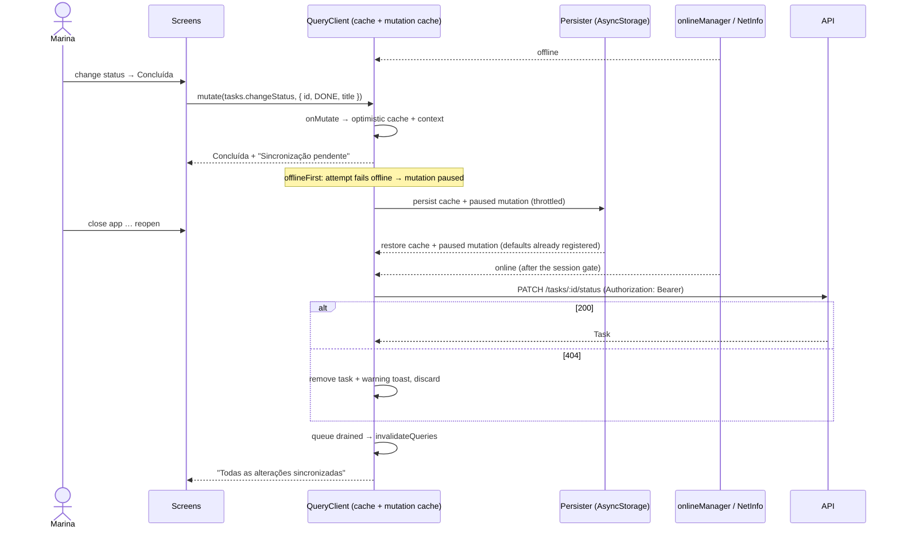

# 005 — Technical plan

## Context & references

- **Spec:** [spec.md](spec.md) · **Behavior:** [offline-sync.feature](offline-sync.feature) · **Design:** [design-spec §5–§6](../../design/design-spec.md#6-interaction-details) · **Base plan:** [004 plan](../004-mobile-app/plan.md)
- **ADRs:** [0020 simplification](../../architecture/adr/0020-simplify-architecture-for-the-hiring-test.md) (last write wins, no idempotency keys) · [0014 testing](../../architecture/adr/0014-testing-strategy.md). Archived rationale: [0010 React Query + Zustand/immer](../../architecture/adr/archive/0010-react-query-and-zustand-immer.md) · [0012 offline-first & optimistic updates](../../architecture/adr/archive/0012-offline-first-and-optimistic-updates.md) · [0016 soft delete](../../architecture/adr/archive/0016-soft-delete.md).
- **Contract facts relied upon** ([api-contracts.md](../../architecture/api-contracts.md#conventions)): writes are last write wins (`version` is data only); deleted or foreign ids → `404`; unknown teams → `422 UNKNOWN_TEAMS`; `429` with `Retry-After`; `PATCH` with the current status is a no-op `200`.
- Runs in Expo Go: AsyncStorage, NetInfo and AppState only; no native module that needs a dev build.

## Architecture

The offline layer is **TanStack Query itself** — no custom sync engine:

| Need                         | Mechanism                                                                                                                                                                      |
| ---------------------------- | ------------------------------------------------------------------------------------------------------------------------------------------------------------------------------ |
| Read offline / after restart | `PersistQueryClientProvider` + `createAsyncStoragePersister` over the `StorageAdapter` (`src/lib/storage.ts`, AsyncStorage)                                                    |
| Connectivity                 | `onlineManager` ↔ `@react-native-community/netinfo`; `focusManager` ↔ `AppState`                                                                                               |
| Queue                        | Paused mutations (`networkMode: 'offlineFirst'`) are dehydrated with the cache and resumed after restore / on reconnect                                                        |
| Durable mutation logic       | `queryClient.setMutationDefaults(mutationKey, { mutationFn, onMutate, onError, onSuccess, retry })` registered **before** restore (hydrated mutations lose closures)           |
| Ordering                     | every offline-capable mutation uses `scope: { id: 'sync' }`: mutations of one scope run serially in the user's order (BR-05.2), so a task can reference a team created offline |
| Optimistic UI                | `onMutate` writes caches and returns a serializable rollback context; `onError` restores it                                                                                    |
| Pending markers              | derived from the mutation cache (`useMutationState`), never copied into Zustand                                                                                                |
| Offline metadata             | Zustand + immer + persist `sync.store`: `ownerId`, `idMap` (temp → real ids), `failedTmpIds`, `lastSyncSummary`                                                                |

### Components

```
apps/mobile/src/offline/
├── persister.ts          # createAsyncStoragePersister({ storage, key: `rq:${ownerId}`, throttleTime: 1000 })
├── network.ts            # onlineManager ↔ NetInfo, focusManager ↔ AppState, useIsOnline(), forced offline until the session gate passes
├── session-gate.ts       # createSessionGate({ getSessionUserId }): user id === ownerId → resume, else discard
├── durable-mutation.ts   # defineDurableMutation(queryClient, key, spec): common options (scope 'sync', retry…) + setMutationDefaults
├── optimistic.ts         # generic list-page helpers: update, remove, insert, replaceId, snapshot/restore
├── temp-ids.ts           # tmp-<uuid> creation and resolveId(tmpOrReal)
├── replay-errors.ts      # classifyReplayError(err, kind) → 'success' | 'discard' | 'retry'
├── use-pending-sync.ts   # pending entity ids + count (badges, tab dot, Settings)
└── sync.store.ts         # Zustand + immer + persist
apps/mobile/src/features/tasks/mutations.ts   # registerTaskMutationDefaults: tasks.* mutationFn, optimistic transforms, rollback
apps/mobile/src/features/teams/mutations.ts   # registerTeamMutationDefaults: teams.* (incl. chips embedded in cached tasks)
apps/mobile/src/ui/OfflineBanner.tsx          # from 004; wired to connectivity + sync summary
```

`src/offline` never imports `features`; each feature registers its own defaults and `app/_layout.tsx` calls both right after creating the `QueryClient`.

### Persistence configuration

```tsx
<PersistQueryClientProvider
  client={queryClient}
  persistOptions={{
    persister,                                   // keyed per ownerId
    maxAge: 24 * 60 * 60 * 1000,                 // BR-05.1 / AC-05.1.4
    buster: `${appVersion}:${API_CONTRACT_HASH}:${CACHE_SCHEMA_VERSION}`,
    dehydrateOptions: {
      shouldDehydrateQuery: (q) => q.state.status === 'success',
      shouldDehydrateMutation: (m) => m.state.isPaused || m.state.status === 'pending',
    },
  }}
  onSuccess={() => sessionGate.whenVerified().then(() => queryClient.resumePausedMutations()).then(() => queryClient.invalidateQueries())}
>
```

- `gcTime` 24 h (≥ `maxAge`); infinite lists keep `maxPages: 10`. `API_CONTRACT_HASH` is the hash of `packages/api-client/openapi.json`, emitted at generation time.
- **Session gate before replay:** at startup `onlineManager.setOnline(false)` is forced until `GET /api/auth/get-session` (Bearer) confirms a user whose id equals `syncStore.ownerId`; only then is NetInfo trusted and the queue resumed. No session or a different user → queue (`mutationCache.clear()`) and cache (`persister.removeClient()`, `queryClient.clear()`) are discarded **before** anything is rendered or sent, and `ownerId` becomes the new user (AC-05.1.5, AC-05.6.5). Invariant: a queued change of user A is never sent with user B's token.
- **401:** `onUnauthenticated` deletes the token, clears **queries only** and forces `onlineManager` offline; paused mutations stay persisted under `rq:<ownerId>` and the gate runs again at the next sign-in.
- **Sign-out:** after the pending-changes warning (AC-05.6.6), **await** `authClient.signOut()`, token deletion, `persister.removeClient()`, then `queryClient.clear()`, `mutationCache.clear()`, `syncStore.reset()`, filter reset, then navigate.
- The token stays in `expo-secure-store` (004); it is never part of the persisted cache or mutation variables.

### Connectivity

```ts
onlineManager.setEventListener((setOnline) =>
  NetInfo.addEventListener((s) =>
    setOnline(!!s.isConnected && s.isInternetReachable !== false),
  ),
);
```

- `useIsOnline()` = `useSyncExternalStore(onlineManager.subscribe, onlineManager.isOnline)`; the banner debounces flaps to ≥ 1 s; `isInternetReachable: null` counts as online.
- Queries use `refetchOnReconnect: false`; on reconnect `resumePausedMutations().then(invalidateQueries)` refreshes only **after** the queue drains (BR-05.10).

### Durable mutations

Every offline-capable mutation is called with **variables only**, e.g. `useMutation({ mutationKey: mk.tasks.changeStatus })` + `mutate({ id, status, title })`. Variables are serializable and carry `title` for the warning toasts.

| Key                  | mutationFn (ids resolved at execution time) | onMutate (optimistic)                                                                                           | Success                                                                                      | Replay error                                                        |
| -------------------- | ------------------------------------------- | --------------------------------------------------------------------------------------------------------------- | -------------------------------------------------------------------------------------------- | ------------------------------------------------------------------- |
| `tasks.changeStatus` | `PATCH /tasks/:id/status`                   | set status (+ `completedAt`) in detail and every cached list page; drop from non-matching status-filtered lists | write server task to detail                                                                  | `404` → remove + warning, discard                                   |
| `tasks.delete`       | `DELETE /tasks/:id`                         | remove from all lists and detail, decrement team `taskCount`                                                    | —                                                                                            | `404` → success, no toast (BR-05.6)                                 |
| `tasks.create`       | `POST /tasks`, `teamIds` via `resolveId`    | insert `tmp-<uuid>` task at the top of the global list and each team list in `teamIds`                          | `idMap[tmp] = real`; replace the temp id in all caches; `router.setParams` on an open detail | `422`/`400` → rollback + warning, discard                           |
| `tasks.update`       | `PUT /tasks/:id`                            | merge fields into detail and rows; move between team lists when `teamIds` change                                | write server task to detail                                                                  | `404` → remove + warning; `422`/`400` → rollback + warning; discard |
| `teams.create`       | `POST /teams`                               | insert temp team                                                                                                | `idMap`; replace the temp id in team lists and in `teams[]` of cached tasks                  | `409`/`400` → rollback + warning, discard                           |
| `teams.update`       | `PUT /teams/:id`                            | patch team lists and chips embedded in cached tasks                                                             | write server team                                                                            | as `tasks.update`                                                   |
| `teams.delete`       | `DELETE /teams/:id`                         | remove team, strip its chip from cached tasks, remove its team-task lists                                       | —                                                                                            | `404` → success                                                     |

Common options: `scope: { id: 'sync' }`, `networkMode: 'offlineFirst'`, `retry: (n, e) => isTransient(e) && n < 5` (network, timeout, 5xx, `429`), `retryDelay: (n, e) => e.retryAfter ?? Math.min(1000 * 2 ** n, 30_000)`. Any other 4xx is permanent: rollback, a pt-BR warning toast (`"“<title>” foi excluída em outro lugar."` for `404`, `"Não foi possível salvar “<title>”: <reason>"` otherwise), the mutation is discarded and the queue continues (BR-05.7). `onSettled` invalidates per the [004 invalidation table](../004-mobile-app/plan.md#server-state-rules) **only when the sync scope is idle**, so server data never overwrites optimistic state of later queued changes.

### Temporary ids and resend safety

- `resolveId(id)`: `tmp-` ids map through `syncStore.idMap`. Because the scope is serial, a creation finishes (or fails) before its dependants run; a missing entry means the creation failed: `failedTmpIds` records it and every later mutation that references it (own id or a `teamIds` entry) fails **without being sent**, rolls back, and shows no extra toast. The queue continues with unrelated changes.
- Temp ids never reach the server; the server assigns ids on `POST`.
- Resending is safe for `PATCH` (same status → no-op), `PUT` (same body → same state) and `DELETE` (`404` → success). A `POST` whose answer was lost may create a duplicate: accepted (OQ-05.1, ADR-0020).
- Maps are pruned when the queue is empty and on sign-out.

### Sequence — offline status change, restart, reconnect



### UI wiring (from 004 slots)

- `OfflineBanner`: offline → "Você está offline. As alterações serão sincronizadas ao reconectar."; reconnect with pending → "De volta online — sincronizando N alterações…"; drained → "Todas as alterações sincronizadas" for 2 s.
- Row / detail badge "Sincronização pendente": `usePendingSync().has(entityId)` (temp ids included). Tasks tab dot when `count > 0`; Settings shows the count and warns on sign-out when `count > 0`.
- Forms: offline submit closes immediately with "Salvo. Será sincronizado quando você estiver online."; online, close on optimistic apply and show the 004 success toast on confirmation.
- Toasts from mutation defaults go through `ui/toast.store.ts` (callable outside React).

## Contract

No API changes. Relies on last-write-wins writes, `404` for deleted or foreign ids, `422` for unknown teams and `Retry-After` on `429`. OQ-05.1/05.2 (creation dedupe) are non-blocking proposals.

## Data

Device storage only (AsyncStorage through `src/lib/storage.ts`):

| Key            | Content                                                                       |
| -------------- | ----------------------------------------------------------------------------- |
| `rq:<ownerId>` | dehydrated successful queries + paused/pending mutations, `buster`, timestamp |
| `sync.store`   | `ownerId`, `idMap`, `failedTmpIds`, `lastSyncSummary`                         |

`CACHE_SCHEMA_VERSION` is bumped whenever the shape of cached data or mutation variables changes.

## Security considerations

- The persisted cache is user data in the app sandbox (AsyncStorage is not encrypted at rest); no token or credential is ever stored there or in mutation variables. Encrypting the cache is a documented production improvement.
- Per-user isolation: cache key per `ownerId`, purge on sign-out and user switch, queue discarded for a different user (AC-05.1.5, AC-05.6.5).
- A `401` during replay pauses the queue (not discarded); after sign-in the session gate compares the user id with `ownerId` before resuming.
- Sign-out wipes token, persisted cache, mutation queue and `sync.store` before navigating.
- Replays cannot escalate: every request is still authorized and owner-scoped by the API.

## Observability

- Every attempt carries a new `X-Request-Id`. Dev-only logger events: `sync.paused`, `sync.resumed {count}`, `sync.discarded {code}`, `sync.drained {durationMs}`; never bodies, headers or tokens.

## Testing approach

| Level       | Tool                                                                                     | What                                                                                                                                                                                                                                                       | Scenarios                                                            |
| ----------- | ---------------------------------------------------------------------------------------- | ---------------------------------------------------------------------------------------------------------------------------------------------------------------------------------------------------------------------------------------------------------- | -------------------------------------------------------------------- |
| Unit        | Jest                                                                                     | optimistic transforms (status, remove, insert, replaceId across pages and filters), `resolveId` incl. failed dependencies, `classifyReplayError` table (200/404/400/409/422/429/5xx/network), sync store, banner state machine                             | @AC-05.3.4/5, @AC-05.4.3, @AC-05.5.3, @AC-05.7.*                     |
| Integration | Jest + real `QueryClient` + memory `StorageAdapter` + MSW + controllable `onlineManager` | offline mutate → paused → persist → **new QueryClient** hydrates with defaults registered → online → MSW receives requests in order; `404`/`422` on replay → warning + discard, queue continues; `401` keeps the queue; user switch purge (zero MSW calls) | @AC-05.1.1, @AC-05.1.5, @AC-05.6.1–5, @AC-05.7.*                     |
| Component   | RNTL                                                                                     | status shown before a delayed MSW response, rollback on rejection, pending badges, tab dot, Settings count, sign-out warning, banner copy                                                                                                                  | @AC-05.2.*, @AC-05.3.1–3, @AC-05.4.1/2/4, @AC-05.5.1/2/5, @AC-05.6.6 |
| E2E (local) | Maestro `apps/mobile/tests/maestro/offline.yaml`, airplane mode on an Android emulator   | create + status change + delete offline → restart → online → verify via API                                                                                                                                                                                | @AC-05.6.1, @AC-05.6.2, @AC-05.2.3                                   |

- Fake timers for retries and backoff; no real sleeps. Test titles carry AC ids.

## Risks & mitigations

| Risk                                                       | Mitigation                                                                                                      |
| ---------------------------------------------------------- | --------------------------------------------------------------------------------------------------------------- |
| Queue replayed under another user's token                  | Session gate: offline until the `get-session` user id equals `ownerId`; otherwise discard queue and cache first |
| Hydrated mutations need defaults registered before restore | Register in `app/_layout.tsx` before mounting the provider; integration test restarts with a new client         |
| One stuck mutation blocks the serial queue                 | Bounded retries for transient errors; permanent 4xx → rollback, warning, discard; dependants fail unsent        |
| Refetch on reconnect overwrites optimistic state           | `refetchOnReconnect: false` + invalidate after drain; invalidation deferred while the scope is busy             |
| Creation resent after a lost answer duplicates             | Accepted (OQ-05.1); the window is one request; documented in the README                                         |
| AsyncStorage size and speed on large caches                | Persist only successful queries, `maxPages: 10`, throttled writes                                               |
| Temp-id navigation while the creation confirms             | `router.setParams` swap + detail seeded under the real id before removing the temp key                          |
