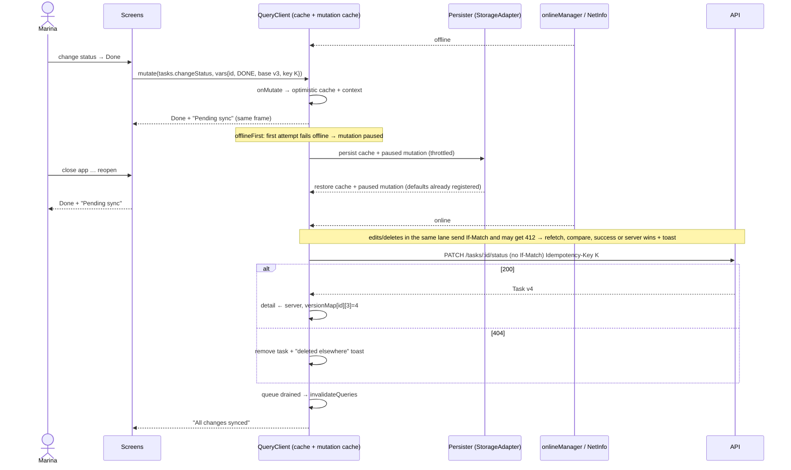

# 005 — Technical plan

## Context & references

- **Spec:** [spec.md](spec.md) · **Behavior:** [offline-sync.feature](offline-sync.feature) · **Design:** [design-spec §5–§6](../../design/design-spec.md#6-interaction-details) · **Base plan:** [004 plan](../004-mobile-app/plan.md)
- **ADRs:** [0010 React Query + Zustand/immer](../../architecture/adr/0010-react-query-and-zustand-immer.md) · [0012 offline-first & optimistic updates](../../architecture/adr/0012-offline-first-and-optimistic-updates.md) · [0015 optimistic concurrency](../../architecture/adr/0015-optimistic-concurrency.md) · [0016 soft delete](../../architecture/adr/0016-soft-delete.md) · [0019 idempotency keys](../../architecture/adr/0019-idempotency-keys.md) · [0009 Expo Go](../../architecture/adr/0009-expo-and-expo-router.md) · [0014 testing](../../architecture/adr/0014-testing-strategy.md)
- **Contract facts relied upon** ([api-contracts.md](../../architecture/api-contracts.md#conventions)): `version` in every resource; `If-Match` on `PUT`/`PATCH`/`DELETE` → `412 PRECONDITION_FAILED` with `details.currentVersion`; `Idempotency-Key` on `POST` (24 h replay); soft-deleted ids → `404`.

## Architecture

The offline layer is **TanStack Query itself** — no custom sync engine:

| Need                         | Mechanism                                                                                                                                                                                                                                                                                                                                                                                                                     |
| ---------------------------- | ----------------------------------------------------------------------------------------------------------------------------------------------------------------------------------------------------------------------------------------------------------------------------------------------------------------------------------------------------------------------------------------------------------------------------- |
| Read offline / after restart | `PersistQueryClientProvider` + `createAsyncStoragePersister` over a `StorageAdapter`                                                                                                                                                                                                                                                                                                                                          |
| Connectivity                 | `onlineManager.setEventListener` ↔ `@react-native-community/netinfo`; `focusManager` ↔ `AppState`                                                                                                                                                                                                                                                                                                                             |
| Queue                        | Paused mutations (`networkMode: 'offlineFirst'`, ADR-0010/0012) are dehydrated with the cache and **resumed** after restore / on reconnect                                                                                                                                                                                                                                                                                    |
| Durable mutation logic       | `queryClient.setMutationDefaults(mutationKey, { mutationFn, onMutate, onError, onSuccess, onSettled, retry })` registered **before** restore, so hydrated mutations (which lose closures) know how to run                                                                                                                                                                                                                     |
| Ordering                     | every offline-capable mutation uses `scope: { id: 'sync' }` → TanStack Query v5 runs mutations of a scope serially, in creation order (BR-05.2). **Refines ADR-0012**, which proposes one scope per entity (`task:<id>`): a single lane is needed because a task may reference a team created offline (AC-05.5.6) and because the spec requires global order; throughput is irrelevant at this scale. Proposed ADR amendment. |
| Optimistic UI                | `onMutate` writes caches, returns a serializable rollback context; `onError` restores it                                                                                                                                                                                                                                                                                                                                      |
| Pending markers              | derived from the mutation cache (`useMutationState({ filters: { status: 'pending' } })`) — never copied into Zustand                                                                                                                                                                                                                                                                                                          |
| Offline metadata             | Zustand + immer + persist `offline-store`: `idMap` (temp → real ids), `versionMap` (own version chain), `ownerId`, `lastSyncSummary`                                                                                                                                                                                                                                                                                          |

### Components

```
apps/mobile/src/lib/storage/          # only place importing storage libraries (ADR-0012 "shared/storage")
├── storage-adapter.ts       # interface StorageAdapter + asyncStorageAdapter (+ memoryAdapter for tests)
apps/mobile/src/lib/offline/
├── persister.ts             # createAsyncStoragePersister({ storage, key: `rq:${ownerId}`, throttleTime: 1000 })
├── connectivity.ts          # onlineManager ↔ NetInfo, focusManager ↔ AppState, useIsOnline()
├── mutation-defaults.ts     # registerMutationDefaults(queryClient): one entry per mutation key
├── optimistic/              # pure cache transforms: tasks.ts, teams.ts (applyStatus, removeTask, insertTask, replaceId…)
├── resolve.ts               # resolveId(tmpOrReal), resolveVersion(id, baseVersion)
├── conflicts.ts             # handleReplayError(err, variables, ctx) → 'success' | 'conflict' | 'gone' | 'rejected' | 'retry'
├── offline-store.ts         # Zustand + immer + persist (idMap, versionMap, ownerId, summary)
└── usePendingSync.ts        # pending ids set, count; drives badges, tab dot, Settings count
apps/mobile/src/components/ui/OfflineBanner.tsx   # from 004 T-004-09; now wired to connectivity + sync summary
```

### StorageAdapter

```ts
export interface StorageAdapter {
  getItem(key: string): Promise<string | null>;
  setItem(key: string, value: string): Promise<void>;
  removeItem(key: string): Promise<void>;
}
export const asyncStorageAdapter: StorageAdapter = AsyncStorage; // @react-native-async-storage/async-storage
```

- **Default: AsyncStorage** — bundled in Expo Go, so the project runs with zero native build (constitution VII, ADR-0009).
- **MMKV pluggable, not default:** `react-native-mmkv` is faster and synchronous but needs a native module that **Expo Go does not ship**; using it would force every evaluator to produce a development build. An `mmkvAdapter` (same interface) can be selected via `EXPO_PUBLIC_STORAGE=mmkv` in a dev build only (COULD, T-005-12). Zustand `persist` and the query persister both receive the same adapter.

### Persistence configuration

```tsx
<PersistQueryClientProvider
  client={queryClient}
  persistOptions={{
    persister,                                   // keyed per ownerId
    maxAge: 24 * 60 * 60 * 1000,                 // ADR-0012, BR-05.1 / AC-05.1.4
    buster: `${appVersion}:${API_CONTRACT_HASH}:${CACHE_SCHEMA_VERSION}`, // contract hash per ADR-0012
    dehydrateOptions: {
      shouldDehydrateQuery: (q) => q.state.status === 'success' && q.meta?.persist !== false,
      shouldDehydrateMutation: (m) => m.state.isPaused || m.state.status === 'pending',
    },
  }}
  onSuccess={() => queryClient.resumePausedMutations().then(() => queryClient.invalidateQueries())}
>
```

- `gcTime` 24 h (ADR-0010; must be ≥ `maxAge`); infinite lists keep `maxPages: 10`. `API_CONTRACT_HASH` is the hash of `packages/api-client/openapi.json`, emitted at generation time.
- Persisted cache key includes the `ownerId`; on sign-out: `persister.removeClient()`, `queryClient.clear()`, `mutationCache.clear()`, `offlineStore.reset()`. On sign-in of a **different** user than `offlineStore.ownerId`: discard queue + cache before rendering (AC-05.1.5, AC-05.6.5).
- The session itself stays in SecureStore (004); it is never part of the persisted cache.

### Connectivity

```ts
onlineManager.setEventListener((setOnline) =>
  NetInfo.addEventListener((s) =>
    setOnline(!!s.isConnected && s.isInternetReachable !== false),
  ),
);
```

- `useIsOnline()` = `useSyncExternalStore(onlineManager.subscribe, onlineManager.isOnline)`; the banner debounces flaps to ≥ 1 s.
- On reconnect TanStack Query resumes paused mutations; our `onlineManager.subscribe` hook additionally sequences `resumePausedMutations().then(invalidateQueries)` so refetches happen **after** the queue drains (BR-05.10). Queries use `refetchOnReconnect: false` to avoid racing the queue; invalidation after drain refreshes them.

### Mutation defaults (durable mutations)

Every offline-capable mutation is called with **variables only** (no inline callbacks for cache logic), e.g. `useMutation({ mutationKey: mk.tasks.changeStatus })` and `mutate({ taskId, status, baseVersion, idempotencyKey: randomUUID(), title })`. The variables are serializable and include what conflict messages need (`title`).

| Key                  | mutationFn (ids/versions resolved at execution time)                                  | onMutate (optimistic)                                                                                                                  | Success                                                                                                                                                             | Replay error handling                                                                                                |
| -------------------- | ------------------------------------------------------------------------------------- | -------------------------------------------------------------------------------------------------------------------------------------- | ------------------------------------------------------------------------------------------------------------------------------------------------------------------- | -------------------------------------------------------------------------------------------------------------------- |
| `tasks.changeStatus` | `PATCH /tasks/:id/status` **without** `If-Match` (toggle = last write wins, ADR-0015) | set status (+ `completedAt`) in detail & every cached list page; remove from lists whose `status` filter no longer matches (AC-05.3.5) | write server task to detail; if `server.version == cachedVersion + 1` record `versionMap[id][cachedVersion] = server.version` (keeps later own edits conflict-free) | replay after a lost answer simply re-applies (same status → no-op `200`, AC-05.7.3); 404 → gone                      |
| `tasks.delete`       | `DELETE /tasks/:id` with `If-Match`                                                   | remove from all lists, remove detail, decrement team `taskCount`                                                                       | —                                                                                                                                                                   | **404 → success** (BR-05.6); 412 → refetch, conflict toast, restore                                                  |
| `tasks.create`       | `POST /tasks` with `Idempotency-Key`, `teamIds` mapped through `resolveId`            | insert temp task `tmp-<uuid>` (ADR-0012) at top of matching lists (global + each team list in `teamIds`), set detail                   | `idMap[tmp] = real`; replace temp id in all caches; if the detail route shows the temp id → `router.setParams({ taskId: real })` (AC-05.5.4)                        | 422 `UNKNOWN_TEAMS`/400 → rollback + `sync.rejected` toast; `IDEMPOTENCY_KEY_REUSED` → rollback + toast              |
| `tasks.update`       | `PUT /tasks/:id` with `If-Match`                                                      | merge fields into detail & list rows; move between team lists if `teamIds` changed                                                     | as changeStatus                                                                                                                                                     | 412 → refetch; if server fields == intended → success, else **server wins** + conflict toast (AC-05.7.1); 404 → gone |
| `teams.create`       | `POST /teams` with `Idempotency-Key`                                                  | insert temp team                                                                                                                       | `idMap`; replace temp id in team lists and in `teams[]` of cached tasks                                                                                             | 409 name exists → rollback + toast                                                                                   |
| `teams.update`       | `PUT /teams/:id` with `If-Match`                                                      | patch team lists + embedded chips in cached tasks                                                                                      | `versionMap`                                                                                                                                                        | as tasks.update                                                                                                      |
| `teams.delete`       | `DELETE /teams/:id` with `If-Match`                                                   | remove team, strip its chip from cached tasks, remove its team-task lists                                                              | —                                                                                                                                                                   | 404 → success; 412 → refetch + toast                                                                                 |

Common options: `scope: { id: 'sync' }`, `networkMode: 'offlineFirst'`, `retry: (n, e) => isTransient(e) && n < 5` (network, timeout, 5xx, `409 IDEMPOTENCY_REQUEST_IN_PROGRESS`), `retryDelay: (n, e) => e.retryAfter ?? Math.min(1000 * 2 ** n, 30_000)` (BR-05.7; `RATE_LIMITED` and `IDEMPOTENCY_REQUEST_IN_PROGRESS` honor `Retry-After`). `onSettled` invalidates per the [004 invalidation table](../004-mobile-app/plan.md#server-state-rules) **only when the sync scope is idle** (otherwise invalidation is deferred to queue drain — avoids overwriting optimistic state with server data that doesn't yet include later queued changes).

### Temp ids and the version chain (`resolve.ts`)

- `resolveId(id)`: `id.startsWith('tmp-') ? offlineStore.idMap[id] ?? throw NotYetCreated : id`. Because the scope is serial, a creation always finishes (or fails) before dependent mutations run; if it **failed**, dependents of that temp id are cancelled (rollback + no toast spam: one toast for the failed creation).
- `resolveVersion(id, base)`: follows `versionMap[id]` (`base → newVersion` recorded after each own success) to the latest version produced **by this device**. So an offline edit followed by an offline deletion of the same task (base v3) send `If-Match: 3` then `If-Match: 4` — no self-conflict (AC-05.7.4) — while a change made elsewhere (server v4 not produced by us) still yields `412` (AC-05.7.1). Status changes send no `If-Match` but still extend the chain (table above).
- Temp ids are never sent to the server; `teamIds` of a task are resolved the same way (AC-05.5.6).
- Maps are pruned when the queue is empty and on sign-out.

### Idempotency

- `idempotencyKey` is created with `expo-crypto` `randomUUID()` when the user acts and stored in the mutation variables, so it survives persistence and every retry/replay of that change reuses it (BR-05.3).
- Sent as `Idempotency-Key` on **every** mutation request. The API honors it on `POST` (creation replay returns the original `201` body with `Idempotent-Replayed: true` → no duplicate, AC-05.6.3; a concurrent duplicate gets `409 IDEMPOTENCY_REQUEST_IN_PROGRESS` + `Retry-After: 1` and is retried, ADR-0019). For `PUT`/`DELETE` safety comes from `If-Match` + the effect-already-present check (BR-05.6); the status `PATCH` is naturally idempotent (same status → no-op) — see open question OQ-05.1.

### Sequence — offline status change, restart, reconnect



### UI wiring (from 004 slots)

- `OfflineBanner`: offline → `offline.banner`; reconnect with pending → `offline.syncing {count}`; drained → `offline.synced` for 2 s.
- Row / detail badge: `usePendingSync().has(entityId)` (entity ids extracted from pending mutation variables, temp ids included).
- Tabs: dot on Tasks when `count > 0`. Settings: `sync.queueCount`; sign-out confirmation when `count > 0` (AC-05.6.6).
- Forms: on submit while offline, close immediately with `toast.queued`; online, close on optimistic apply and show the normal success toast on confirmation (004 copy).
- Toasts from mutation defaults go through `toast-store` (callable outside React), with i18n `t()` from the i18n instance.

## Contract

No API changes required. Relies on `Idempotency-Key` (POST), `If-Match`/`412` with `details.currentVersion`, `404` for deleted/foreign ids, `Retry-After` on `429`. Proposed (non-blocking) improvements are recorded in spec open questions OQ-05.1/OQ-05.2.

## Data

Device storage only:

| Key             | Content                                                                            | Engine                                |
| --------------- | ---------------------------------------------------------------------------------- | ------------------------------------- |
| `rq:<ownerId>`  | dehydrated queries (success) + paused/pending mutations, `buster`, timestamp       | StorageAdapter (AsyncStorage)         |
| `offline-store` | `ownerId`, `idMap`, `versionMap`, `lastSyncSummary` (ADR-0010's `sync.store` role) | Zustand persist over the same adapter |
| `preferences`   | from 004 (filters are session-only)                                                | same                                  |

`CACHE_SCHEMA_VERSION` is bumped whenever the shape of cached data or mutation variables changes (part of the PR checklist for API-client regeneration).

## Security considerations

- Persisted data is user data in the app sandbox (not encrypted at rest by AsyncStorage); no credentials or tokens are ever stored there — session remains in SecureStore. Encrypting the cache (e.g. MMKV with encryption key in SecureStore, dev build) is a documented production improvement.
- Strict per-user isolation: cache key per `ownerId`, purge on sign-out / user switch, queue discarded for a different user (AC-05.1.5, AC-05.6.5).
- A `401` during replay pauses the queue (not discarded): `onUnauthenticated` keeps the persisted mutations, sends the user to sign in; after sign-in, `ownerId` is compared before resuming.
- Replays cannot escalate: every request is still authorized and owner-scoped by the API.

## Observability

- Each replayed request carries the same `Idempotency-Key` and a new `X-Request-Id`, so server logs show retries of one logical change.
- Dev-only logger events: `sync.paused`, `sync.resumed {count}`, `sync.conflict {kind, entity}`, `sync.rejected {code}`, `sync.drained {durationMs}`.
- Out of scope: shipping client telemetry (production improvement).

## Testing approach

| Level                   | Tool                                                                                                                                                                                    | What                                                                                                                                                                                                                                                                                                                              | Scenarios                                                            |
| ----------------------- | --------------------------------------------------------------------------------------------------------------------------------------------------------------------------------------- | --------------------------------------------------------------------------------------------------------------------------------------------------------------------------------------------------------------------------------------------------------------------------------------------------------------------------------- | -------------------------------------------------------------------- |
| Unit                    | Jest                                                                                                                                                                                    | optimistic cache transforms (`applyStatus`, `removeTask`, `insertTask`, `replaceId` across list pages and filters), `resolveId`, `resolveVersion` chains, `handleReplayError` decision table (200/412-applied/412-diff/404/400/422/429/5xx/network), offline-store reducers, banner state machine                                 | @AC-05.3.4/5, @AC-05.4.3, @AC-05.5.3, @AC-05.7.1–4                   |
| Integration (app logic) | Jest + real `QueryClient` + `memoryAdapter` + MSW + controllable `onlineManager.setOnline`                                                                                              | offline mutate → paused → persist → **new QueryClient** hydrates from the same adapter with defaults registered → go online → assert MSW received requests in order, once each; idempotent creation replay (MSW returns stored response on same key); conflicts (MSW state changed between); 401 during replay; user switch purge | @AC-05.1.1, @AC-05.1.5, @AC-05.6.1–5, @AC-05.7.*                     |
| Component               | RNTL                                                                                                                                                                                    | status appears before MSW responds (delayed handler), rollback on 500, pending badges, tab dot, Settings count, sign-out warning, banner texts                                                                                                                                                                                    | @AC-05.2.*, @AC-05.3.1–3, @AC-05.4.1/2/4, @AC-05.5.1/2/5, @AC-05.6.6 |
| E2E                     | Maestro (`.maestro/offline.yaml`) on Android emulator/iOS simulator with airplane-mode toggling (`setAirplaneMode` on Android; network link conditioner/manual step documented for iOS) | create + status change + delete offline → `stopApp`/`launchApp` → online → verify via API (seeded DB reset before)                                                                                                                                                                                                                | @AC-05.6.1, @AC-05.6.2, @AC-05.2.3                                   |

- Fake timers for retries/backoff; no real sleeps. Tests named with AC ids.

## Risks & mitigations

| Risk                                                         | Mitigation                                                                                                                                                       |
| ------------------------------------------------------------ | ---------------------------------------------------------------------------------------------------------------------------------------------------------------- |
| Hydrated mutations need defaults registered before restore   | `registerMutationDefaults(queryClient)` executed at module init of `query-client.ts`; integration test restarts with a new client                                |
| Serial scope means one stuck mutation blocks the queue       | Bounded retries for transient errors then mark as failed (rollback + toast) only for non-network causes; network errors keep pausing (expected offline behavior) |
| Refetch on reconnect overwrites optimistic state             | `refetchOnReconnect: false` + invalidate after drain (BR-05.10); invalidation deferred while scope busy                                                          |
| Replayed PUT/PATCH whose first attempt succeeded returns 412 | Effect-already-present comparison (BR-05.6); OQ-05.1 proposes server-side idempotency for all mutations                                                          |
| AsyncStorage size / speed on large caches                    | Persist only successful queries, `maxPages: 10`, throttled writes; MMKV adapter for dev builds                                                                   |
| Temp-id navigation (detail open while creation confirms)     | `router.setParams` swap + detail query seeded under the real id before removing the temp key                                                                     |
| Clock skew affecting `maxAge`                                | Uses device clock only for local expiry; data freshness from server on reconnect                                                                                 |
| NetInfo `isInternetReachable` null at startup                | Treat `null` as online (requests decide); banner only on definite offline                                                                                        |
