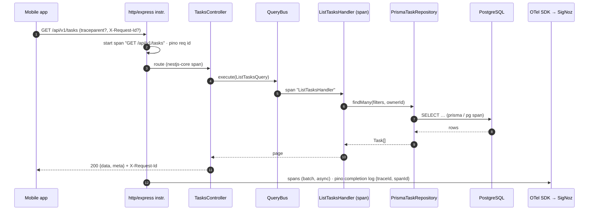

# 006 — Technical plan

## Context & references

- Spec: [spec.md](spec.md) · Scenarios: [observability.feature](observability.feature)
- ADRs: [0013 OpenTelemetry + SigNoz](../../architecture/adr/0013-opentelemetry-and-signoz.md), [0018 Docker Compose one-command run](../../architecture/adr/0018-docker-compose-one-command-run.md), [0002 Clean Architecture / CQRS](../../architecture/adr/0002-nestjs-clean-architecture-ddd-cqrs.md), [0005 envelopes](../../architecture/adr/0005-rest-openapi-and-response-envelope.md), [0014 testing](../../architecture/adr/0014-testing-strategy.md), [0019 idempotency keys](../../architecture/adr/0019-idempotency-keys.md)
- Operations docs: [observability.md](../../operations/observability.md), [runbook.md](../../operations/runbook.md), [production-readiness.md](../../operations/production-readiness.md)
- Security: [threat model](../../security/threat-model.md) (logging redaction, information disclosure)

## Architecture

### Components

| Component        | Location                                                          | Layer                          | Responsibility                                                                                                                                                                                                                 |
| ---------------- | ----------------------------------------------------------------- | ------------------------------ | ------------------------------------------------------------------------------------------------------------------------------------------------------------------------------------------------------------------------------ |
| OTel bootstrap   | `apps/api/src/instrumentation.ts`                                 | infrastructure (process level) | Starts the OpenTelemetry Node SDK **before** Nest is loaded (`node --import ./dist/instrumentation.js dist/main.js`). Registers resource, exporters, instrumentations, shutdown.                                               |
| Telemetry config | `apps/api/src/infrastructure/config/telemetry.config.ts`          | infrastructure                 | Validated env (zod or class-validator schema shared with the app config; fail fast, AC-06.5.5). Read by both bootstrap and Nest.                                                                                               |
| Logger module    | `apps/api/src/infrastructure/logging/logging.module.ts`           | infrastructure                 | `nestjs-pino` `LoggerModule.forRootAsync` with redaction, request id, trace mixin, probe filtering.                                                                                                                            |
| Request id       | `apps/api/src/infrastructure/logging/request-id.ts`               | infrastructure                 | `genReqId` validates/echoes `X-Request-Id` (`^[A-Za-z0-9._-]{1,128}$`), else `randomUUID()`; sets the response header.                                                                                                         |
| Health module    | `apps/api/src/modules/health/` (presentation + infrastructure)    | presentation                   | `@nestjs/terminus` controller `/api/v1/health/live` and `/ready`; `PrismaHealthIndicator.pingCheck('database', prisma, { timeout: 1500 })`. Marked public (auth bypass) and `@SkipThrottle()`.                                 |
| Metrics          | `apps/api/src/infrastructure/metrics/`                            | infrastructure                 | `DomainMetrics` (OTel `Meter` `teams-tasks-api`): counters `tasks_created_total`, `tasks_completed_total`, `tasks_deleted_total`. CQRS `@EventsHandler`s for `TaskCreated`, `TaskStatusChanged`, `TaskDeleted` increment them. |
| Use-case spans   | `apps/api/src/infrastructure/tracing/traced-handler.decorator.ts` | infrastructure                 | A small decorator / CQRS bus interceptor wrapping each command/query handler `execute()` in `tracer.startActiveSpan('<HandlerName>')` — the "handler" span between HTTP and Prisma. Domain stays untouched.                    |
| Error envelope   | global exception filter (owned by 003/ADR-0005)                   | presentation                   | Reads `trace.getActiveSpan()?.spanContext().traceId` into `error.traceId`; logs unexpected errors with stack.                                                                                                                  |
| SigNoz           | `infra/signoz/` + `docker-compose.yml` `include`                  | ops                            | Services under profile `observability`.                                                                                                                                                                                        |
| k6               | `tools/k6/`                                                       | tooling                        | `smoke.js`, `load.js`, shared `lib/` (auth, checks, cleanup).                                                                                                                                                                  |

The domain layer imports nothing from OpenTelemetry (dependency-cruiser rule from 007). Metrics are produced by **infrastructure event handlers** reacting to domain events, which keeps counting "after persistence" (BR-06.6) because events are published after the repository commit (domain-model.md).

### Bootstrap (`instrumentation.ts`)

```ts
// sketch — final code in T-006-01
const sdk = new NodeSDK({
  resource: resourceFromAttributes({
    [ATTR_SERVICE_NAME]: 'teams-tasks-api',          // overridable by OTEL_SERVICE_NAME
    [ATTR_SERVICE_VERSION]: pkg.version,
    'deployment.environment.name': env.APP_ENV,        // local | test | production
  }),
  traceExporter: new OTLPTraceExporter(),             // OTLP/HTTP, reads OTEL_EXPORTER_OTLP_ENDPOINT
  metricReader: new PeriodicExportingMetricReader({ exporter: new OTLPMetricExporter(), exportIntervalMillis: 15_000 }),
  logRecordProcessors: [new BatchLogRecordProcessor(new OTLPLogExporter())],
  instrumentations: [
    getNodeAutoInstrumentations({
      '@opentelemetry/instrumentation-http': { ignoreIncomingRequestHook: isProbe },
      '@opentelemetry/instrumentation-express': { enabled: true },
      '@opentelemetry/instrumentation-nestjs-core': { enabled: true },
      '@opentelemetry/instrumentation-pg': { enhancedDatabaseReporting: false }, // no parameter values (AC-06.2.5)
      '@opentelemetry/instrumentation-pino': { enabled: true },                 // trace ids + log sending
      '@opentelemetry/instrumentation-fs': { enabled: false },
      '@opentelemetry/instrumentation-dns': { enabled: false },
      '@opentelemetry/instrumentation-net': { enabled: false },
    }),
    new PrismaInstrumentation(),
  ],
});
sdk.start();
process.once('SIGTERM', () => sdk.shutdown().finally(...));   // coordinated with Nest enableShutdownHooks
```

Rules:

- **Never crash on telemetry** (BR-06.1): exporters are batch/async; export errors go to the OTel `diag` logger, bridged to pino at `warn` with a 60 s de-duplication window (AC-06.5.2). No `await` on exporter connectivity at start.
- `OTEL_SDK_DISABLED=true` → `NodeSDK` is not started; `@opentelemetry/api` returns no-op tracer/meter, so `DomainMetrics` and the handler decorator keep working with zero cost (AC-06.5.3).
- Shutdown: Nest `app.enableShutdownHooks()`; on `SIGTERM` the HTTP server closes first, then `sdk.shutdown()` with a 5 s timeout race (AC-06.5.4). Compose sets `init: true` and `stop_grace_period: 15s`.
- The entrypoint runs `exec node --import ./dist/instrumentation.js dist/main.js` so instrumentation patches `http`, `express`, `pg` before they are required. The build stays CommonJS; if the API is ever moved to ESM, add `--import @opentelemetry/instrumentation/hook.mjs` (documented in ADR-0013).
- Prisma spans: `@prisma/instrumentation` emits `prisma:client:operation` → `prisma:engine:db_query` (or, with the `pg` driver adapter, the `pg` instrumentation emits the DB span). Either way at least one DB span is a child of the handler span (AC-06.2.1). Keep the one that does not duplicate; decided in T-006-01 by inspecting a trace.

### Configuration (env)

| Variable                      | Default (`.env.example` / compose)  | Notes                                                                                            |
| ----------------------------- | ----------------------------------- | ------------------------------------------------------------------------------------------------ |
| `OTEL_SDK_DISABLED`           | `false`                             | `true` disables all telemetry. Validated as boolean.                                             |
| `OTEL_SERVICE_NAME`           | `teams-tasks-api`                   |                                                                                                  |
| `OTEL_EXPORTER_OTLP_ENDPOINT` | `http://signoz-otel-collector:4318` | OTLP/HTTP. Unreachable when the profile is off → silently dropped (by design). Validated as URL. |
| `OTEL_EXPORTER_OTLP_PROTOCOL` | `http/protobuf`                     |                                                                                                  |
| `OTEL_RESOURCE_ATTRIBUTES`    | `deployment.environment.name=local` |                                                                                                  |
| `OTEL_TRACES_SAMPLER`         | `parentbased_always_on`             | Production: `parentbased_traceidratio` (see production-readiness).                               |
| `LOG_LEVEL`                   | `info`                              | `fatal                                                                                           | error | warn | info | debug | trace | silent`; validated. |
| `LOG_PRETTY`                  | `false`                             | `true` → `pino-pretty` transport (dev only).                                                     |

### Logging

```ts
// sketch — LoggerModule options
pinoHttp: {
  level: env.LOG_LEVEL,
  genReqId: requestId,                                      // validates / echoes X-Request-Id
  customProps: (req) => ({ userId: req.user?.id }),         // opaque id only (AC-06.3.6)
  autoLogging: { ignore: isProbe },                         // AC-06.1.5
  mixin: () => traceFields(),                               // { traceId, spanId } from the active span
  serializers: { req: minimalReq, res: minimalRes },        // method, url template, status; no body
  redact: {
    paths: [
      'req.headers.authorization', 'req.headers.cookie',
      'res.headers["set-cookie"]', 'res.headers["set-auth-token"]',
      '*.password', '*.newPassword', '*.currentPassword', '*.token', '*.secret', '*.email',
    ],
    censor: '[REDACTED]',
  },
}
```

- Request/response **bodies are never logged** (pino-http default; serializers enforce it). That is also why the user's name never appears: there is no `*.name` redaction path, because it would also censor `err.name`.
- Unexpected errors: the exception filter logs `logger.error({ err }, 'Unhandled error')` once; known domain errors (4xx) log at `info`/`warn` without stack.
- The route template (`/api/v1/tasks/:id`) is used instead of the raw URL in completion entries to avoid leaking ids/search terms and to keep logs groupable.

### Request flow



## Contract

- Health endpoints and headers (`X-Request-Id`, `traceparent`, `error.traceId`) are defined in [api-contracts.md](../../architecture/api-contracts.md#health--apiv1health) — no duplication here.
- Readiness response (Terminus native): `200 {status:"ok", info:{database:{status:"up"}}}` / `503 {status:"error", error:{database:{status:"down", message}}}`.

## Data

No schema change. Readiness runs `SELECT 1` through Prisma (`$queryRaw`).

## Security considerations

- Redaction list above; **test**: a log-capture test signs up/in and asserts the password, token and cookie never appear (AC-06.3.3, threat model I-03).
- Span hygiene: `instrumentation-pg` with `enhancedDatabaseReporting: false`; Prisma spans include the statement text but not parameters; HTTP instrumentation does not capture headers (`headersToSpanAttributes` left empty); a custom `requestHook` drops `http.url` query strings (search terms) — keep `http.route`.
- Probes are public and unauthenticated by design; they expose only `up/down` per check, never versions, hostnames or error stacks.
- SigNoz UI on `localhost` only; no auth in local mode — documented as local-only, never exposed.
- No PII in metric attributes (AC-06.4.4); the `userId` log field is an opaque id.

## Observability

This spec _is_ the observability. Signals and their names are catalogued in [observability.md](../../operations/observability.md).

| Signal                    | Name                                                         | Attributes                                                                                      |
| ------------------------- | ------------------------------------------------------------ | ----------------------------------------------------------------------------------------------- |
| Histogram (auto, semconv) | `http.server.request.duration` (s)                           | `http.request.method`, `http.route`, `http.response.status_code`                                |
| Counter                   | `tasks_created_total`                                        | —                                                                                               |
| Counter                   | `tasks_completed_total`                                      | —                                                                                               |
| Counter                   | `tasks_deleted_total`                                        | —                                                                                               |
| Span                      | `<METHOD> <route>`, `<HandlerName>`, `prisma:*` / `pg.query` | standard semconv                                                                                |
| Log                       | completion entry                                             | `reqId`, `traceId`, `spanId`, `userId`, `req.method`, `route`, `res.statusCode`, `responseTime` |

## Testing approach

| Scenario(s)              | Level                                                                                                                             | How                                                                                                                                                                                                                                                      |
| ------------------------ | --------------------------------------------------------------------------------------------------------------------------------- | -------------------------------------------------------------------------------------------------------------------------------------------------------------------------------------------------------------------------------------------------------- |
| AC-06.1.1–1.5            | integration (Testcontainers) + e2e (supertest)                                                                                    | Boot app against a Postgres container; stop the container (`container.stop()`) to assert 503 within 2 s and recovery after `restart()`; 200 probe calls → no 429, captured log stream has no entries.                                                    |
| AC-06.2.1, 2.2, 2.5, 2.6 | integration                                                                                                                       | Register an `InMemorySpanExporter` + `SimpleSpanProcessor` in a test-only `instrumentation.test.ts` loaded via Jest `setupFiles`; assert parent/child structure by `parentSpanId`, trace id continuation, and scan all attributes for forbidden strings. |
| AC-06.2.3, 2.4           | e2e                                                                                                                               | Examples table → `it.each`; envelope `traceId` matches the `traceparent` sent.                                                                                                                                                                           |
| AC-06.3.1–3.6            | integration                                                                                                                       | Pino destination replaced by an in-memory stream (`pino.destination` → `sonic-boom` stub / `pino-test`); assertions on parsed JSON lines; redaction examples → `it.each`.                                                                                |
| AC-06.4.1–4.5            | unit (event handlers with a fake meter) + integration (`InMemoryMetricExporter` + `PeriodicExportingMetricReader` `forceFlush()`) | Idempotent replay uses the real idempotency interceptor.                                                                                                                                                                                                 |
| AC-06.5.1–5.3            | integration                                                                                                                       | Exporter endpoint `http://127.0.0.1:1` (closed port) → app ready, requests 2xx, warning count ≤ 1 per minute (fake timers on the de-dup). `OTEL_SDK_DISABLED=true` → exporter spy never called.                                                          |
| AC-06.5.4                | e2e (child process)                                                                                                               | Spawn `node --import dist/instrumentation.js dist/main.js` with an in-process OTLP receiver stub; send `SIGTERM`; assert exit 0 < 10 s and spans received.                                                                                               |
| AC-06.5.5                | unit                                                                                                                              | Config schema `it.each` over invalid values.                                                                                                                                                                                                             |
| AC-06.6.x                | manual check documented in observability.md (script `tools/k6/smoke.js` + SigNoz query); verified in PR description of T-006-05   | Heavy stack; not run in CI.                                                                                                                                                                                                                              |
| AC-06.7.x                | k6 thresholds themselves are the test; smoke runs in the CI `compose-smoke` job (007)                                             | `load.js` run manually / documented; threshold examples are k6 semantics (`p(95)<100`, `rate<0.01`).                                                                                                                                                     |
| AC-06.8.x                | review checklist (DoD) + markdown link check                                                                                      |                                                                                                                                                                                                                                                          |

All test names start with the AC id, e.g. `it('AC-06.1.3 readiness fails fast when the database is down', …)`.

## k6

- `tools/k6/lib/auth.js` — `setup()` signs in as the demo user once and returns the bearer token (respects the auth limit of 10/min/IP).
- `smoke.js` — 1 VU, 1 iteration per endpoint group: health, teams CRUD, tasks CRUD + status + filters; created entities titled `[k6] …` and deleted in `teardown()` (AC-06.7.4). Thresholds: `checks: ['rate==1']`, `http_req_failed: ['rate==0']`.
- `load.js` — `ramping-vus` 0→20 over 30 s, hold 20 for 2 min, 70 % `GET /tasks` with filter mixes, 20 % `GET /teams`, 10 % create+complete+delete `[k6]` tasks. Thresholds: `'http_req_duration{name:list-tasks}': ['p(95)<100']`, `http_req_failed: ['rate<0.01']`. Exits non-zero on breach (k6 default).
- Run (Docker only): `docker compose --profile load run --rm k6 run /scripts/smoke.js` (service `k6`, image `grafana/k6` pinned, scripts mounted read-only, `BASE_URL=http://api:3000`). Make targets `smoke` / `load` (007).
- Rate limit (OQ-06.1): load run sets `RATE_LIMIT_MAX` (name to be confirmed with 001/003) to a high value: `RATE_LIMIT_MAX=100000 docker compose up -d api` documented in runbook.

## SigNoz profile

- `infra/signoz/docker-compose.signoz.yml`, pulled in by root `docker-compose.yml` via `include:`; every service has `profiles: [observability]`: `signoz-clickhouse`, `signoz-zookeeper`, `signoz-schema-migrator` (one-shot), `signoz` (query service + UI, port `8080`), `signoz-otel-collector` (ports `4317`, `4318`). Images pinned to exact versions; collector config `infra/signoz/otel-collector-config.yaml` from upstream, trimmed (no host metrics receiver).
- Volumes `signoz-clickhouse-data`, `signoz-data`; `make observability-down` → `docker compose --profile observability down -v` reclaims storage.
- Memory: ~4 GB (ClickHouse dominant). Documented in README + observability.md (AC-06.6.4).
- Dashboards: exported JSON in `infra/signoz/dashboards/teams-tasks-api.json` (import steps in observability.md). Alerts documented, not provisioned.

## Risks & mitigations

| Risk                                                 | Mitigation                                                                                   |
| ---------------------------------------------------- | -------------------------------------------------------------------------------------------- |
| Instrumentation loaded after modules → missing spans | `--import` in entrypoint and `start` script; integration test asserts HTTP + DB spans exist. |
| SigNoz versions change compose layout/ports          | Pin image tags; copy a known-good compose into `infra/signoz/`; note upgrade steps.          |
| Exporter error spam when collector absent            | diag → pino bridge with 60 s de-dup; or `OTEL_SDK_DISABLED=true`.                            |
| Duplicate DB spans (Prisma + pg)                     | Pick one in T-006-01; disable the other instrumentation.                                     |
| Load test throttled (429)                            | Configurable limit (OQ-06.1).                                                                |
| Laptop RAM (SigNoz ~4 GB)                            | Opt-in profile; default run stays light.                                                     |
| p95 budget depends on host                           | Budget stated as "local, seeded"; CI runs smoke only, not load thresholds.                   |
