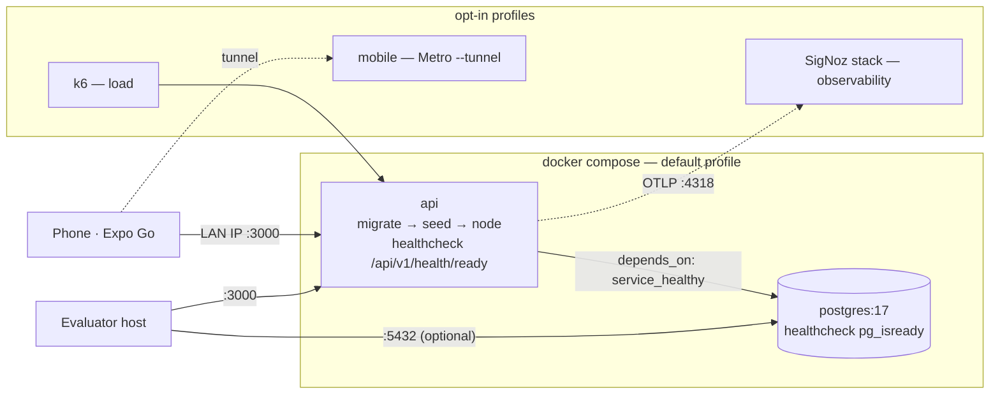
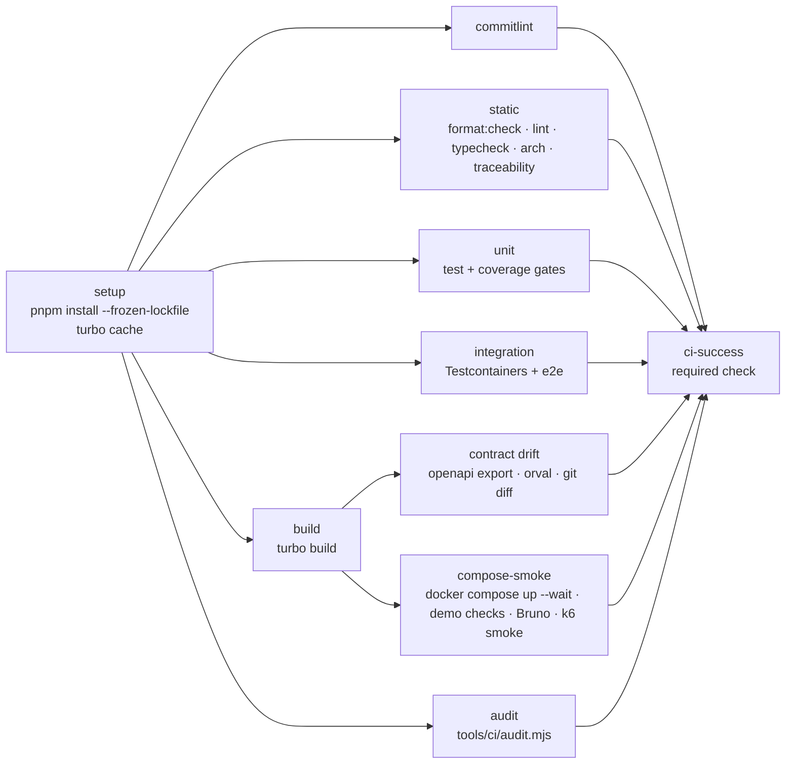

# 007 — Technical plan

## Context & references

- Spec: [spec.md](spec.md) · Scenarios: [ci-and-dx.feature](ci-and-dx.feature)
- ADRs: [0001 monorepo pnpm + Turborepo](../../architecture/adr/0001-monorepo-pnpm-turborepo.md), [0004 Prisma migrations and seeding](../../architecture/adr/0004-prisma-migrations-and-seeding.md), [0008 DTOs + generated client](../../architecture/adr/0008-class-validator-dtos-and-generated-client.md), [0014 testing strategy](../../architecture/adr/0014-testing-strategy.md), [0017 Conventional Commits and atomic PRs](../../architecture/adr/0017-conventional-commits-and-atomic-prs.md), [0018 Docker Compose one-command run](../../architecture/adr/0018-docker-compose-one-command-run.md), [0013 OpenTelemetry + SigNoz](../../architecture/adr/0013-opentelemetry-and-signoz.md), [0007 Better Auth](../../architecture/adr/0007-better-auth.md), [0009 Expo](../../architecture/adr/0009-expo-and-expo-router.md)
- Quality: [test strategy](../../quality/test-strategy.md), [definition of done](../../quality/definition-of-done.md) · Security: [threat model](../../security/threat-model.md) · Ops: [runbook](../../operations/runbook.md)
- Existing tooling (keep): `commitlint.config.mjs` (scopes api, mobile, api-client, docs, adr, spec, ci, infra, deps, agents), husky (`commit-msg`, `pre-commit` → lint-staged), `.github/pull_request_template.md`, `turbo.json`, `.nvmrc` (24), `packageManager: pnpm@10.34.7`. Workspace package names: `@hitss/api`, `@hitss/mobile`, `@hitss/api-client`, `@hitss/tsconfig`.

## Architecture

### Repository layout added by this spec

```text
docker-compose.yml                 # postgres + api (default), mobile (profile), signoz (include, profile), k6 (profile)
.env.example                       # every setting, local defaults, comments
.dockerignore  .gitattributes      # *.sh eol=lf
Makefile
apps/api/Dockerfile                # multi-stage, turbo prune
apps/api/docker-entrypoint.sh      # migrate deploy → seed → exec node
apps/api/.dependency-cruiser.cjs
apps/mobile/.dependency-cruiser.cjs
apps/api/stryker.config.mjs
apps/mobile/Dockerfile.dev         # Metro for Expo Go (profile mobile)
.github/workflows/ci.yml
.github/workflows/mutation.yml
.github/actions/setup/action.yml   # composite: pnpm + node + install + turbo cache
.github/dependabot.yml
tools/ci/compose-smoke.sh  tools/ci/audit.mjs  security/audit-allowlist.json
tools/bruno/teams-tasks/**  tools/http/*.http
```

### Run topology (default `docker compose up`)



### docker-compose.yml (sketch)

```yaml
name: teams-tasks
include:
  - infra/signoz/docker-compose.signoz.yml # all services under profile "observability" (006)
services:
  postgres:
    image: postgres:17-alpine
    environment:
      POSTGRES_USER: ${POSTGRES_USER:-teams}
      POSTGRES_PASSWORD: ${POSTGRES_PASSWORD:-teams}
      POSTGRES_DB: ${POSTGRES_DB:-teams_tasks}
    ports: ['${POSTGRES_PORT:-5432}:5432']
    volumes: [pgdata:/var/lib/postgresql/data]
    healthcheck:
      test: ['CMD-SHELL', 'pg_isready -U $${POSTGRES_USER} -d $${POSTGRES_DB}']
      interval: 3s
      timeout: 3s
      retries: 20
  api:
    build: { context: ., dockerfile: apps/api/Dockerfile }
    init: true
    stop_grace_period: 15s
    depends_on: { postgres: { condition: service_healthy } }
    environment:
      APP_ENV: ${APP_ENV:-local} # local | test | production (NODE_ENV stays 'production' from the image)
      PORT: 3000
      DATABASE_URL: postgresql://${POSTGRES_USER:-teams}:${POSTGRES_PASSWORD:-teams}@postgres:5432/${POSTGRES_DB:-teams_tasks}
      BETTER_AUTH_SECRET: ${BETTER_AUTH_SECRET:-local-dev-secret-change-me-0123456789abcdef}
      BETTER_AUTH_URL: ${BETTER_AUTH_URL:-http://localhost:3000}
      SEED_ON_START: ${SEED_ON_START:-true} # run the seed step at all
      SEED_DEMO: ${SEED_DEMO:-true} # create the demo account + data (refused when APP_ENV=production)
      DOCS_ENABLED: ${DOCS_ENABLED:-true} # forced off when APP_ENV=production
      CORS_ORIGINS: ${CORS_ORIGINS:-http://localhost:8081}
      APP_SCHEME: ${APP_SCHEME:-teamstasks}
      TRUSTED_PROXIES: ${TRUSTED_PROXIES:-}
      AUTH_RATE_LIMIT_ENABLED: ${AUTH_RATE_LIMIT_ENABLED:-true}
      LOG_LEVEL: ${LOG_LEVEL:-info}
      OTEL_SDK_DISABLED: ${OTEL_SDK_DISABLED:-false}
      OTEL_EXPORTER_OTLP_ENDPOINT: ${OTEL_EXPORTER_OTLP_ENDPOINT:-http://signoz-otel-collector:4318}
      RATE_LIMIT_MAX: ${RATE_LIMIT_MAX:-100}
      RATE_LIMIT_IP_MAX: ${RATE_LIMIT_IP_MAX:-300}
    ports: ['${API_PORT:-3000}:3000']
    healthcheck:
      test:
        [
          'CMD',
          'node',
          '-e',
          "fetch('http://127.0.0.1:3000/api/v1/health/ready').then(r=>process.exit(r.ok?0:1)).catch(()=>process.exit(1))",
        ]
      interval: 5s
      timeout: 3s
      retries: 30
      start_period: 20s
  mobile:
    profiles: [mobile]
    build: { context: ., dockerfile: apps/mobile/Dockerfile.dev }
    tty: true
    stdin_open: true
    environment:
      EXPO_PUBLIC_API_URL: ${EXPO_PUBLIC_API_URL:-http://localhost:3000}
      EXPO_NO_TELEMETRY: '1'
    ports: ['8081:8081']
    command:
      ['pnpm', '--filter', '@hitss/mobile', 'exec', 'expo', 'start', '--tunnel']
  k6:
    profiles: [load]
    image: grafana/k6:<pinned>
    environment: { BASE_URL: http://api:3000 }
    volumes: ['./tools/k6:/scripts:ro']
volumes: { pgdata: {} }
```

- Compose interpolation `${VAR:-default}` means **no `.env` is needed** (AC-07.1.4); if a `.env` exists, compose reads it automatically. `.env.example` lists the same variables with the same defaults and a comment each; a unit test (`tools/ci/env-example.test.mjs`) asserts that every `${VAR:-…}` in `docker-compose.yml` and every key of the API config schema appears in `.env.example` with the same default.
- `BETTER_AUTH_SECRET` default is obviously local; the API config schema **rejects that value when `APP_ENV=production`** (BR-07.2, threat model). The full production rule set lives in [Configuration validation](#configuration-validation-t-007-02) below.
- Postgres port is published for developer tooling; bind can be restricted with `POSTGRES_PORT=127.0.0.1:5432`.
- Images are multi-arch (amd64/arm64) — `postgres:17-alpine`, `node:24-alpine`, SigNoz and k6 images all publish both.

### API Dockerfile (sketch)

```dockerfile
# syntax=docker/dockerfile:1.7
FROM node:24-alpine AS base
ENV PNPM_HOME=/pnpm PATH=/pnpm:$PATH
RUN apk add --no-cache openssl && corepack enable
WORKDIR /repo

FROM base AS pruner
COPY . .
RUN pnpm dlx turbo@<pinned> prune @hitss/api --docker

FROM base AS deps
COPY --from=pruner /repo/out/json/ .
COPY --from=pruner /repo/out/pnpm-lock.yaml ./pnpm-lock.yaml
RUN --mount=type=cache,id=pnpm,target=/pnpm/store pnpm fetch --frozen-lockfile
RUN --mount=type=cache,id=pnpm,target=/pnpm/store pnpm install --frozen-lockfile --offline

FROM deps AS build
COPY --from=pruner /repo/out/full/ .
RUN pnpm --filter @hitss/api exec prisma generate \
 && pnpm turbo run build --filter=@hitss/api \
 && pnpm --filter @hitss/api deploy --prod --legacy /out   # pnpm 10: --legacy unless inject-workspace-packages

FROM node:24-alpine AS runtime
RUN apk add --no-cache openssl
ENV NODE_ENV=production
WORKDIR /app
COPY --from=build --chown=node:node /out ./
COPY --chown=node:node apps/api/docker-entrypoint.sh ./
USER node
EXPOSE 3000
ENTRYPOINT ["./docker-entrypoint.sh"]
```

```sh
#!/bin/sh
# apps/api/docker-entrypoint.sh
set -eu
./node_modules/.bin/prisma migrate deploy            # non-zero exit stops the container (AC-07.1.7)
if [ "${SEED_ON_START:-true}" = "true" ]; then node dist/prisma/seed.js; fi
exec node --import ./dist/instrumentation.js dist/main.js
```

- `prisma` CLI must be a **production dependency** of `@hitss/api` (needed for `migrate deploy` in the runtime image). Trade-off accepted (~15 MB) over copying the CLI ad hoc.
- The seed is compiled to `dist/prisma/seed.js` (separate `tsconfig.seed.json` or included in `tsconfig.build.json`), so the runtime image needs no `tsx`/`ts-node`.
- `.dockerignore`: `**/node_modules`, `**/dist`, `**/.turbo`, `**/coverage`, `.git`, `.env*` (except `.env.example`), `apps/mobile/.expo`, `docs/brief`.
- `NODE_ENV` in the runtime image is `production` for the Node runtime; the _application_ environment used for the secret check is `APP_ENV` (default `local`) so the compose run with the default secret is valid. Naming confirmed in T-007-02.

### Configuration validation (T-007-02)

Decision X2: validation uses **class-validator** (a `ConfigModule.forRoot({ validate })` function that runs `plainToInstance` + `validateSync` on an env class), not zod — one validation idiom across DTOs and config ([ADR-0008](../../architecture/adr/0008-class-validator-dtos-and-generated-client.md)). Layout (overview §6.2): `apps/api/src/config/{env.validation.ts, env.schema.ts, app-config.ts, config.module.ts, production-rules.ts}`.

- `env.schema.ts` — one `EnvironmentVariables` class; decorators per variable (`@IsIn`, `@IsInt @Min`, `@IsUrl({ require_tld: false })`, `@IsBoolean` with an explicit string→boolean `@Transform`, `@Matches`). Defaults are applied before validation so a missing optional variable yields the documented local default.
- `production-rules.ts` — a list of small, individually tested rules `(config) => Violation[]`, applied **only when `APP_ENV=production`** and **after** the decorator pass. `validate()` collects every violation and throws one error that names each variable and the rule broken, **never the value** (secrets). Adding a variable later (spec 001) means adding one decorated property plus, if needed, one rule — no change to `validate()`.
- `app-config.ts` — typed `AppConfig` built from the validated class (camelCase, `string[]` for CSV values); the rest of the code injects it and never reads `process.env` (enforced by ESLint `no-restricted-properties` on `process.env` outside `src/config/` and `src/instrumentation.ts`).
- `APP_ENV` (`local` | `test` | `production`, default `local`) is the application environment used by every rule; `NODE_ENV` only describes the Node runtime (`production` in the image, `test` under Jest). Rules never key on `NODE_ENV`. Documented in `.env.example`, because ADR-0007/threat model wording mentions `NODE_ENV`: a rule keyed on `NODE_ENV=production` would misfire in the compose image, where `NODE_ENV` is always `production` and `APP_ENV=local`.

Variables owned by T-007-02 and by 001 (T-001-xx adds its own rows to the same schema; the table is the single list `env-example.test.mjs` checks against):

| Variable                   | Owner   | Rule                                          | Local default (`.env.example`) | Extra rule when `APP_ENV=production`      |
| -------------------------- | ------- | --------------------------------------------- | ------------------------------ | ----------------------------------------- |
| `APP_ENV`                  | 007     | `local \| test \| production`                 | `local`                        | —                                         |
| `PORT`                     | 007     | int 1–65535                                   | `3000`                         | —                                         |
| `DATABASE_URL`             | 007     | `postgresql://…`                              | compose-provided               | —                                         |
| `LOG_LEVEL` / `LOG_PRETTY` | 007/006 | enum / boolean                                | `info` / `false`               | —                                         |
| `OTEL_*`                   | 007/006 | per 006                                       | per 006                        | —                                         |
| `SEED_ON_START`            | 007     | boolean; run the seed step                    | `true`                         | —                                         |
| `SEED_DEMO`                | 001     | boolean; create demo account and data         | `true` (compose)               | `true` rejected (never in production)     |
| `DOCS_ENABLED`             | 001     | boolean                                       | `true`                         | forced `false` (documentation not served) |
| `BETTER_AUTH_SECRET`       | 001     | string ≥ 32                                   | obviously-local value          | the example value is rejected             |
| `BETTER_AUTH_URL`          | 001     | absolute URL                                  | `http://localhost:3000`        | must be `https://`                        |
| `CORS_ORIGINS`             | 001     | CSV of origins                                | `http://localhost:8081`        | no `*`, no `http://`, no `localhost`      |
| `APP_SCHEME`               | 001     | `[a-z][a-z0-9+.-]*`                           | `teamstasks`                   | must not be `exp`                         |
| `TRUSTED_PROXIES`          | 001     | CSV of CIDRs                                  | empty (socket address only)    | —                                         |
| `AUTH_RATE_LIMIT_ENABLED`  | 001     | boolean                                       | `true`                         | `false` is rejected                       |
| `RATE_LIMIT_MAX`           | 007     | positive int, req/min per user                | `100`                          | —                                         |
| `RATE_LIMIT_IP_MAX`        | 001     | positive int, req/min per client IP, pre-auth | `300`                          | —                                         |

007 ships the schema with its own rows **and the extension seam** (rule list + the production rule for the secret); 001's task adds its rows and rules and the unit test per rule. A unit test fails if a property exists in the class without a row in `.env.example` (env parity, above).

### Rate limits behind Docker Desktop / WSL2 NAT

Docker Desktop (macOS, Windows, WSL2) publishes ports through a userland proxy/NAT, so the API often sees **one client IP for every request from the host** (the gateway address, e.g. `172.x.0.1` or `192.168.65.1`), including a phone on the LAN that hits the published port. Consequences, all local-only:

- The per-IP limits (`RATE_LIMIT_IP_MAX`, the 10 req/min credential limit) behave as a **single shared bucket for the whole host**: Bruno, the app and a `curl` loop compete for the same quota, and a burst from one tool can produce `429` for the others.
- `x-tt-client-ip` is derived from the socket address (`TRUSTED_PROXIES` empty), so the gateway IP is the tracker; this is correct and secure, just coarse.
- Not an issue on native Linux Docker (the real client address is visible) nor behind a real proxy with `TRUSTED_PROXIES` set.

Mitigations: `make load` raises `RATE_LIMIT_MAX` and `RATE_LIMIT_IP_MAX` for the run; Bruno requests keep their volume under the limits and sign in once; the compose smoke runs on a Linux runner. Never "fix" this by trusting `X-Forwarded-For` from clients. Documented in the [runbook](../../operations/runbook.md#requests-return-429).

### Seed design (`apps/api/prisma/seed.ts`)

- Fixed UUIDs for 3 teams and 10 tasks, `upsert` by id with full seeded values (AC-07.2.3/2.4); `deletedAt` reset to `null`; `task_teams` for seeded tasks rewritten.
- The seed runs only when `SEED_ON_START=true`; inside it, the demo account and all demo data are created only when `SEED_DEMO=true` (config rejects `SEED_DEMO=true` with `APP_ENV=production`).
- Demo user: owned by 001's `prisma/seed/identity.seed.ts` (the 007 orchestrator `prisma/seed.ts` calls it first). Fixed id `DEMO_USER_ID` (`00000000-0000-4000-8000-000000000001`); created through Better Auth's server API (`auth.api.signUpEmail`) so the password hash is the library's own, with the seed's auth instance setting the fixed id via `databaseHooks.user.create.before` (demo email only). It is **not** found by email alone: the seed checks for the user by `DEMO_USER_ID`; if present nothing is touched (no row changes, password unchanged), if absent it signs up with the fixed id. Team and task seeds reference `DEMO_USER_ID` and upsert by their own fixed UUIDs.
- **Gate (ADR-0004):** when `SEED_DEMO=false` **or** `APP_ENV=production`, the orchestrator skips _all_ demo data — user, teams, tasks, `task_teams` — and the seed exits 0 having written nothing. The check is in the seed itself as well as in config validation (defence in depth).
- Teams: **Mobile** `#7C3AED`, **Backend** `#0EA5E9`, **Design** `#F59E0B`.
- Tasks: statuses 4 Pending / 3 In progress / 3 Done; 2 tasks in two teams, 1 in three, 1 without team; one due 7 days **before** the seeding day (overdue), others relative (+1…+21 days) or none (BR-07.6). Faker not needed (fixed English titles) — keeps the seed readable and deterministic.
- Reset: `prisma migrate reset --force` (drops, migrates, runs seed) — `make reset` does `docker compose down -v && docker compose up -d --build --wait` (Docker only).

### Scripts and Makefile

Root `package.json` (brief: `start`, `test`, `seed`):

| Script                | Command                                                                      | Needs                                    |
| --------------------- | ---------------------------------------------------------------------------- | ---------------------------------------- |
| `start`               | `docker compose up -d --build --wait`                                        | Docker                                   |
| `stop`                | `docker compose down`                                                        | Docker                                   |
| `test`                | `turbo run test test:integration` (existing `test` extended)                 | Node 24 + pnpm + Docker (Testcontainers) |
| `seed`                | `pnpm --filter @hitss/api db:seed` (host, `DATABASE_URL` → `localhost:5432`) | Node + running Postgres                  |
| `db:reset`            | `pnpm --filter @hitss/api db:reset`                                          | Node + running Postgres                  |
| `arch`                | `turbo run arch` (dependency-cruiser)                                        | Node                                     |
| `api-client:generate` | `turbo run generate --filter=@hitss/api-client`                              | Node                                     |

`Makefile` (Docker-only paths; each target prints the raw `docker compose` command for Windows users without make):

```make
up:            ; docker compose up -d --build --wait
down:          ; docker compose down
logs:          ; docker compose logs -f api
seed:          ; docker compose exec api node dist/prisma/seed.js
reset:         ; docker compose down -v && docker compose up -d --build --wait
test:          ; pnpm test                       # host toolchain (OQ-07.1); test-docker = best effort
observability: ; docker compose --profile observability up -d --build --wait
observability-down: ; docker compose --profile observability down -v
mobile:        ; docker compose --profile mobile up mobile
smoke:         ; docker compose --profile load run --rm k6 run /scripts/smoke.js
load:          ; RATE_LIMIT_MAX=100000 RATE_LIMIT_IP_MAX=100000 docker compose up -d --wait api && docker compose --profile load run --rm k6 run /scripts/load.js
```

`test-docker` (best effort, OQ-07.1): `docker run --rm -v "$PWD":/repo -w /repo -v /var/run/docker.sock:/var/run/docker.sock -e TESTCONTAINERS_HOST_OVERRIDE=host.docker.internal --add-host host.docker.internal:host-gateway node:24 sh -c "corepack enable && pnpm install --frozen-lockfile && pnpm test"`.

### Turborepo tasks (`turbo.json` additions)

| Task                             | dependsOn          | outputs                            | cache                                          |
| -------------------------------- | ------------------ | ---------------------------------- | ---------------------------------------------- |
| `build`                          | `^build`           | `dist/**`                          | yes (exists)                                   |
| `lint`, `typecheck`              | `^build`           | —                                  | yes (exists)                                   |
| `test`                           | `^build`           | `coverage/**`                      | yes (exists) — unit only                       |
| `test:integration`               | `^build`           | `coverage-integration/**`          | yes (inputs: `src/**`, `test/**`, `prisma/**`) |
| `arch`                           | —                  | —                                  | yes                                            |
| `generate` (`@hitss/api-client`) | `@hitss/api#build` | `openapi.json`, `src/generated/**` | yes                                            |
| `test:mutation`                  | `^build`           | `reports/mutation/**`              | no                                             |

CI uses the local cache directory persisted with `actions/cache` (key: OS + lockfile hash + `github.sha`, restore-keys by prefix). No remote cache (would need a secret, unavailable to fork PRs — AC-07.6.7).

### CI pipeline (`.github/workflows/ci.yml`)



```yaml
# sketch
name: CI
on:
  pull_request:
  push: { branches: [main] }
permissions: { contents: read }
concurrency:
  group: ci-${{ github.workflow }}-${{ github.event.pull_request.number || github.ref }}
  cancel-in-progress: ${{ github.event_name == 'pull_request' }}
jobs:
  commitlint:
    if: github.event_name == 'pull_request'
    runs-on: ubuntu-24.04
    steps:
      - uses: actions/checkout@<sha> # pinned by SHA
        with: { fetch-depth: 0 }
      - uses: ./.github/actions/setup
      - run: pnpm exec commitlint --from ${{ github.event.pull_request.base.sha }} --to ${{ github.event.pull_request.head.sha }} --verbose
  # Each job below: runs-on ubuntu-24.04, timeout-minutes 15, steps = checkout + ./.github/actions/setup + the commands listed.
  static:
    steps:
      - run: pnpm format:check
      - run: pnpm turbo run lint typecheck arch
      - run: node tools/ci/traceability.mjs # regenerates the matrix; fails on gaps or drift
  unit:
    steps:
      - run: pnpm turbo run test -- --coverage
  integration: # Docker is preinstalled on ubuntu runners (Testcontainers)
    steps:
      - run: pnpm turbo run test:integration test:e2e
  build:
    steps:
      - run: pnpm turbo run build
  contract:
    needs: build
    steps:
      - run: pnpm turbo run generate --filter=@hitss/api-client
      - run: git diff --exit-code -- packages/api-client && test -z "$(git status --porcelain packages/api-client)"
  audit:
    steps:
      - run: node tools/ci/audit.mjs
  compose-smoke:
    needs: build
    timeout-minutes: 20
    steps:
      - run: docker compose up -d --build --wait
      - run: tools/ci/compose-smoke.sh
      - run: npx @usebruno/cli@<pinned> run tools/bruno/teams-tasks --env local
      - run: docker compose --profile load run --rm k6 run /scripts/smoke.js
      - if: failure()
        run: docker compose logs api
      - if: always()
        run: docker compose down -v
  ci-success:
    if: always()
    needs:
      [
        commitlint,
        static,
        unit,
        integration,
        build,
        contract,
        audit,
        compose-smoke,
      ]
    runs-on: ubuntu-24.04
    steps:
      - run: |
          echo '${{ toJSON(needs) }}' | jq -e 'to_entries | all(.value.result == "success" or .value.result == "skipped")'
```

- Actions pinned by commit SHA (Dependabot updates them). `timeout-minutes` on every job (15; compose-smoke 20).
- `tools/ci/compose-smoke.sh`: asserts `/api/v1/health/ready` 200, `/docs` 200, signs in as the demo user, checks `meta.total` = 3 teams and 10 tasks (AC-07.6.8, AC-07.2.1/2.2). A second step runs the built image with an unreachable `DATABASE_URL` and expects a non-zero exit within 60 s (AC-07.1.7). A third checks `docker compose exec api id -u` ≠ 0 and the image has no `src/`, `test/`, `.env`, `.git` (AC-07.1.6).
- `tools/ci/doc-check.mjs` (T-007-16) runs in `static` (`pnpm doc-check`): required README sections from `tools/ci/readme-required-sections.json` (AC-07.4.5–4.8) and relative-link check (AC-07.4.9).
- `tools/ci/traceability.mjs` (T-007-06) runs in `static`: regenerates `docs/quality/traceability-matrix.md` and fails on a MUST AC without scenario or task, or on a stale matrix (BR-07.3: `pnpm traceability` locally).
- Coverage gates in `apps/api/jest.config.ts`: `coverageThreshold: { global: { lines: 80 }, './src/modules/*/domain/': { lines: 90 } }` (AC-07.6.5). Integration coverage merged with unit via `nyc merge` only for reporting; gates run on unit for domain, on merged for overall.
- Mobile in CI: lint, typecheck and jest-expo component tests via the same turbo tasks; Maestro is local-only.

### Mutation testing (`.github/workflows/mutation.yml`)

- Triggers: `schedule: cron '0 3 * * *'`, `workflow_dispatch`, `pull_request: types [labeled, synchronize]` with `if: contains(github.event.pull_request.labels.*.name, 'mutation')`.
- `apps/api/stryker.config.mjs`: `mutate: ['src/modules/*/domain/**/*.ts', '!**/*.spec.ts']`, `testRunner: 'jest'`, `coverageAnalysis: 'perTest'`, `thresholds: { high: 90, low: 80, break: 80 }`, `incremental: true` (incremental file cached with `actions/cache`). HTML report uploaded as artifact.

### Architecture rules (dependency-cruiser)

Single source: [overview §6 (folders) and §7 (rules A1–A9, M1–M6)](../../architecture/overview.md). Every rule below uses the **exact planned paths**; the rules key on them, so a folder rename is an architecture change (amend overview §6 first). API paths: `src/modules/{identity,health,teams,tasks}/{contracts,domain,application,infrastructure,presentation}`, `src/shared/{domain,application,infrastructure,presentation,observability}`, `src/config`. Mobile paths: `app/**`, `src/features/<f>/{…,index.ts}`, `src/shared/**`.

Rule ↔ overview mapping (the rule `name` is what the check prints and what the meta-tests assert):

| Overview | dependency-cruiser rule name            | Fails when …                                                                                                                                                                  |
| -------- | --------------------------------------- | ----------------------------------------------------------------------------------------------------------------------------------------------------------------------------- |
| A1       | `domain-is-pure`                        | a `domain/` file imports `application/`, `infrastructure/` or `presentation/` (own module or shared)                                                                          |
| A1       | `domain-no-third-party`                 | a `domain/` file imports any npm package (`@nestjs/*`, `@prisma/*`, `better-auth`, `class-validator`, `class-transformer`, …) or a Node core module (I/O); allowlist is empty |
| A2       | `application-not-to-adapters`           | an `application/` file imports `infrastructure/`, `presentation/`, `@prisma/*` or `express` (`@nestjs/cqrs` and `@nestjs/common` stay allowed)                                |
| A3       | `infrastructure-not-to-presentation`    | an `infrastructure/` file imports `presentation/`                                                                                                                             |
| A4       | `presentation-not-to-infra`             | a `presentation/` file imports `infrastructure/` or `@prisma/*` (no exceptions: controllers use buses)                                                                        |
| A5       | `contexts-isolated`                     | **any** file (every layer, including `application/` and `presentation/`) of `modules/<a>` imports `modules/<b>/**` unless the target is under `modules/<b>/contracts/`        |
| A6       | `contracts-are-thin`                    | a `contracts/` file imports anything but another `contracts/`, its own `domain/events/`, `shared/domain/` or `@nestjs/cqrs` (query/event marker types)                        |
| A7       | `shared-not-to-features`                | `src/shared/**` or `src/config/**` imports `src/modules/**`                                                                                                                   |
| A8       | `no-circular`                           | any import cycle                                                                                                                                                              |
| A9       | `no-tests-in-production`                | a non-spec `src/**` file imports `*.spec.ts` or anything under `test/`                                                                                                        |
| —        | `not-to-dev-dep`, `not-to-unresolvable` | production code imports a dev dependency / an unresolvable module                                                                                                             |
| —        | `no-orphans` (warn)                     | unreferenced module (reported, never fails)                                                                                                                                   |
| M1       | `shared-is-leaf`                        | `src/shared/**` imports `src/features/**` or `app/**`                                                                                                                         |
| M2       | `features-isolated`                     | `src/features/<a>/**` imports `src/features/<b>/**` other than `src/features/<b>/index.ts`                                                                                    |
| M3       | `routes-not-imported`                   | anything outside `app/` imports `app/**`                                                                                                                                      |
| M4       | `http-via-api-client` (+ ESLint, below) | `app/**` or `src/**` imports an HTTP library (`axios`, `ky`, `got`, `node-fetch`, `cross-fetch`, `superagent`)                                                                |
| M5       | `storage-behind-adapter`                | anything outside `src/shared/storage/**` imports `@react-native-async-storage/*` or `react-native-mmkv`                                                                       |
| M6       | `no-circular`                           | any import cycle                                                                                                                                                              |
| monorepo | `mobile-not-to-api`                     | the mobile app imports `apps/api/**` or `@hitss/api` (`@hitss/api-client` is allowed)                                                                                         |

`apps/api/.dependency-cruiser.cjs` (invoked from `apps/api` as `depcruise src --config .dependency-cruiser.cjs`):

```js
// sketch — paths are the planned overview §6.2 paths
const NON_SPEC = { pathNot: '\\.spec\\.ts$' }; // layer rules apply to production files only
const LAYER = '^src/(modules/[^/]+|shared)'; // a module or the shared kernel
const NPM = [
  'npm',
  'npm-dev',
  'npm-peer',
  'npm-optional',
  'npm-bundled',
  'npm-no-pkg',
  'npm-unknown',
];

module.exports = {
  forbidden: [
    {
      name: 'domain-is-pure',
      severity: 'error', // A1
      from: { path: `${LAYER}/domain/`, ...NON_SPEC },
      to: { path: `${LAYER}/(application|infrastructure|presentation)/` },
    },
    {
      name: 'domain-no-third-party',
      severity: 'error', // A1
      from: { path: `${LAYER}/domain/`, ...NON_SPEC },
      to: {
        dependencyTypes: [...NPM, 'core'],
        pathNot: [] /* allowlist, empty; additions need an ADR */,
      },
    },
    {
      name: 'application-not-to-adapters',
      severity: 'error', // A2
      from: { path: `${LAYER}/application/`, ...NON_SPEC },
      to: {
        path: `${LAYER}/(infrastructure|presentation)/|node_modules/(@prisma|express)/`,
      },
    },
    {
      name: 'infrastructure-not-to-presentation',
      severity: 'error', // A3
      from: { path: `${LAYER}/infrastructure/`, ...NON_SPEC },
      to: { path: `${LAYER}/presentation/` },
    },
    {
      name: 'presentation-not-to-infra',
      severity: 'error', // A4
      from: { path: `${LAYER}/presentation/`, ...NON_SPEC },
      to: { path: `${LAYER}/infrastructure/|node_modules/@prisma/` },
    },
    {
      name: 'contexts-isolated',
      severity: 'error', // A5 — every layer
      from: { path: '^src/modules/([^/]+)/', ...NON_SPEC },
      to: {
        path: '^src/modules/[^/]+/',
        pathNot: ['^src/modules/$1/', '^src/modules/[^/]+/contracts/'],
      },
    },
    {
      name: 'contracts-are-thin',
      severity: 'error', // A6
      from: { path: '^src/modules/([^/]+)/contracts/', ...NON_SPEC },
      to: {
        path: '^src/',
        pathNot: [
          '^src/modules/[^/]+/contracts/',
          '^src/modules/$1/domain/events/',
          '^src/shared/domain/',
        ],
      },
    },
    {
      name: 'contracts-are-thin',
      severity: 'error', // A6 (libraries)
      from: { path: '^src/modules/[^/]+/contracts/', ...NON_SPEC },
      to: {
        dependencyTypes: [...NPM, 'core'],
        pathNot: 'node_modules/@nestjs/cqrs/',
      },
    },
    {
      name: 'shared-not-to-features',
      severity: 'error', // A7
      from: { path: '^src/(shared|config)/', ...NON_SPEC },
      to: { path: '^src/modules/' },
    },
    {
      name: 'no-circular',
      severity: 'error',
      from: {},
      to: { circular: true },
    }, // A8
    {
      name: 'no-tests-in-production',
      severity: 'error', // A9
      from: { path: '^src/', pathNot: ['\\.spec\\.ts$', '^src/testing/'] },
      to: { path: '\\.spec\\.ts$|^test/' },
    },
    {
      name: 'not-to-dev-dep',
      severity: 'error',
      from: { path: '^src/', ...NON_SPEC },
      to: { dependencyTypes: ['npm-dev'] },
    },
    {
      name: 'not-to-unresolvable',
      severity: 'error',
      from: {},
      to: { couldNotResolve: true },
    },
    {
      name: 'no-orphans',
      severity: 'warn',
      from: {
        orphan: true,
        pathNot: '\\.(spec|d)\\.ts$|(^|/)main\\.ts$|(^|/)instrumentation\\.ts$',
      },
      to: {},
    },
  ],
  options: {
    tsConfig: { fileName: 'tsconfig.json' },
    tsPreCompilationDeps: true, // `import type` counts: type-only imports also break the architecture
    doNotFollow: { path: 'node_modules' },
    // spec files are NOT excluded from the graph: A9 and no-circular need them; layer rules skip them via NON_SPEC
  },
};
```

Notes:

- **Why "any file of a module" for A5.** The old sketch only forbade a sibling's `domain`/`infrastructure`, so `modules/tasks/application` importing `modules/teams/application/...` passed. A5 now forbids every import into another module except its `contracts/`; a test fixture exists for the application and presentation layers explicitly. Composition roots (`*.module.ts`) sit at the module root, import only their own module, and wire collaborators through `QueryBus` + ports — no DI provider is exported or imported between context modules.
- `$1` in `pathNot` refers to the capture group of `from.path` (dependency-cruiser group matching), so `modules/teams/**` → `modules/teams/**` is allowed and `modules/teams/**` → `modules/tasks/contracts/**` is the only cross-module edge.
- The `domain-no-third-party` allowlist is empty (domain value objects and aggregates are plain TypeScript); adding a pure library (e.g. `uuid`) requires an ADR and one `pathNot` entry.
- Specs may import their subject, fakes and `src/testing/` helpers; production files may not import specs or `test/` (A9). `src/testing/` is an optional test-support folder excluded from A9's `from`.
- `apps/api/src/shared/application` (ports like `Clock`, `IdGenerator`) is plain TypeScript and falls under A2 as a normal `application/` folder.

`apps/mobile/.dependency-cruiser.cjs` (invoked from `apps/mobile` as `depcruise app src --config .dependency-cruiser.cjs`):

```js
// sketch — overview §6.3 paths
module.exports = {
  forbidden: [
    {
      name: 'shared-is-leaf',
      severity: 'error', // M1
      from: { path: '^src/shared/' },
      to: { path: '^(src/features|app)/' },
    },
    {
      name: 'features-isolated',
      severity: 'error', // M2
      from: { path: '^src/features/([^/]+)/' },
      to: {
        path: '^src/features/[^/]+/',
        pathNot: ['^src/features/$1/', '^src/features/[^/]+/index\\.tsx?$'],
      },
    },
    {
      name: 'routes-not-imported',
      severity: 'error', // M3
      from: { pathNot: '^app/' },
      to: { path: '^app/' },
    },
    {
      name: 'http-via-api-client',
      severity: 'error', // M4 (libraries)
      from: { path: '^(app|src)/' },
      to: {
        path: 'node_modules/(axios|ky|got|node-fetch|cross-fetch|superagent)/',
      },
    },
    {
      name: 'storage-behind-adapter',
      severity: 'error', // M5
      from: { path: '^(app|src)/', pathNot: '^src/shared/storage/' },
      to: {
        path: 'node_modules/(@react-native-async-storage|react-native-mmkv)/',
      },
    },
    {
      name: 'no-circular',
      severity: 'error',
      from: {},
      to: { circular: true },
    }, // M6
    {
      name: 'mobile-not-to-api',
      severity: 'error', // monorepo rule
      from: {},
      to: { path: '^(\\.\\./)+api/|node_modules/@hitss/api(/|$)' },
    },
    {
      name: 'not-to-unresolvable',
      severity: 'error',
      from: {},
      to: { couldNotResolve: true },
    },
  ],
  options: {
    tsConfig: { fileName: 'tsconfig.json' },
    tsPreCompilationDeps: true,
    doNotFollow: { path: 'node_modules' },
  },
};
```

- **M4 has two enforcement layers** because the global `fetch` is not an import: (1) the depcruise rule above for HTTP libraries; (2) ESLint in `apps/mobile/eslint.config.mjs`: `no-restricted-imports` (same libraries) and `no-restricted-globals: ['fetch']` for `app/**` and `src/**`. The single allowed HTTP path is the generated client's mutator in `packages/api-client` (not under `app`/`src`, so it is out of scope of the rule), plus Better Auth's own client (`src/features/auth/auth-client.ts`, which uses the library's fetch internally and is not a direct `fetch` call).
- Both configs are invoked by the same command locally and in CI: root `pnpm arch` → `turbo run arch` → per-app `depcruise …` (BR-07.3, AC-07.7.3). Output uses `--output-type err` so each violation prints rule name, file and import.

**Meta-tests (AC-07.7.1, 7.7.4–7.7.9).** `apps/api/test/architecture/rules.spec.ts` and `apps/mobile/test/architecture/rules.spec.ts` run dependency-cruiser's `cruise()` API with `baseDir` set to a fixture project under `test/architecture/fixtures/<rule-name>/<case>/` (each case is a miniature tree with the real folder names and one violating file, plus a `ok/` case with a compliant file, including the allowed `contracts/` edge) and assert the reported rule name, file and import. Three structural tests keep the rules honest:

1. **Coverage of the rules:** every `forbidden[].name` of the config (except `no-orphans`) has at least one fixture directory — adding a rule without a fixture fails the suite.
2. **Real tree:** `cruise()` over the actual `src/` reports zero errors (same as `pnpm arch`).
3. **Layer matrix:** a parameterised test generates, for A5, one violating import per source layer (`domain`, `application`, `infrastructure`, `presentation`) into another module's `application/`, and asserts the compliant `contracts/` edge passes.

The ESLint half of M4 is covered by `ESLint.lintText()` in the mobile meta-test (a file calling `fetch(` and one importing `axios` both fail).

### Contract drift

1. `apps/api/src/openapi/export.ts`: `NestFactory.create(AppModule, { logger: false })`, build the Swagger document, write `packages/api-client/openapi.json` with **sorted keys** and a trailing newline (stable diff). No DB: `PrismaService` does not call `$connect()` eagerly (Prisma connects lazily on first query), Better Auth instance is created without touching the DB (AC-07.8.3). `OTEL_SDK_DISABLED=true` during export.
2. `@hitss/api-client` `generate`: `orval --config orval.config.ts` → `src/generated/**` with header `// Code generated by orval. DO NOT EDIT.`; orval version pinned exactly; `src/generated/` and `openapi.json` listed in `.prettierignore` and ESLint `ignores` (AC-07.8.4).
3. CI: `git diff --exit-code` + `git status --porcelain` on `packages/api-client` (AC-07.8.1/8.2). On failure the job prints `git diff --stat` and the first 200 lines of the diff.

### Supply chain

- `pnpm install --frozen-lockfile` everywhere (CI, Dockerfile) → fails on an outdated lockfile (AC-07.9.2).
- `tools/ci/audit.mjs`: runs `pnpm audit --json --audit-level high`, loads `security/audit-allowlist.json` (`[{ "id": "GHSA-…", "reason": "…", "expires": "YYYY-MM-DD" }]`), fails on any high/critical advisory not allowlisted **or** whose entry has expired (AC-07.9.1). Moderate/low are reported, not failing.
- `.github/dependabot.yml`:

```yaml
version: 2
updates:
  - package-ecosystem: npm
    directory: /
    schedule: { interval: weekly, day: monday }
    open-pull-requests-limit: 5
    commit-message: { prefix: 'build(deps)' } # NOT include: scope → would yield "deps-dev", rejected by commitlint
    groups:
      nestjs: { patterns: ['@nestjs/*'] }
      opentelemetry:
        { patterns: ['@opentelemetry/*', '@prisma/instrumentation'] }
      prisma: { patterns: ['prisma', '@prisma/*'] }
      expo:
        {
          patterns: ['expo', 'expo-*', '@expo/*', 'react-native*'],
          update-types: [patch],
        }
      types: { patterns: ['@types/*'] }
      dev-tooling:
        { dependency-type: development, update-types: [minor, patch] }
    ignore:
      - dependency-name: 'expo' # SDK upgrades are manual (Expo Go compatibility)
        update-types:
          ['version-update:semver-major', 'version-update:semver-minor']
  - package-ecosystem: github-actions
    directory: /
    schedule: { interval: weekly }
    commit-message: { prefix: 'ci' }
  - package-ecosystem: docker
    directories: ['/apps/api', '/apps/mobile']
    schedule: { interval: weekly }
    commit-message: { prefix: 'build(infra)' }
```

### Conventions & branch protection

- Already in place: husky `commit-msg` (commitlint) and `pre-commit` (lint-staged → prettier) (AC-07.10.2), PR template (AC-07.10.3). CI adds commitlint on the PR range (AC-07.10.1).
- Recommended protection for `main` (documented in README "Contributing"; applied manually by the repo owner — AC-07.10.4): require PR before merge; 1 approval; dismiss stale approvals; require status `ci-success`; require branch up to date; require conversation resolution; linear history (squash or rebase merge only); block force pushes and deletion; optional signed commits; `CODEOWNERS` for `docs/architecture/adr/` and `.github/`.

### Mobile dev server (profile `mobile`)

- `apps/mobile/Dockerfile.dev`: `turbo prune @hitss/mobile --docker`, install, `@expo/ngrok` as dev dependency (tunnel), `EXPOSE 8081`.
- Expo tunnel exposes **Metro only**. A physical phone must reach the API via the host's LAN IP: `EXPO_PUBLIC_API_URL=http://192.168.x.y:3000 make mobile` (documented in runbook; OQ-07.2). Emulator defaults: Android `http://10.0.2.2:3000`, iOS simulator `http://localhost:3000` (default resolution owned by spec 004).
- `EXPO_PUBLIC_*` values are public (bundled) — only URLs, never secrets (threat model M-02).

### Request examples

- README cURL block = [api-contracts.md § Request examples](../../architecture/api-contracts.md#request-examples-curl) (single source; README links + copies the block in T-007-15).
- Bruno: `tools/bruno/teams-tasks/{bruno.json, collection.bru, environments/local.bru, 00-health/, 01-auth/sign-in.bru, 02-teams/*.bru, 03-tasks/*.bru}`; `sign-in.bru` post-response script `bru.setVar('token', res.headers['set-auth-token'])`; collection-level auth `Bearer {{token}}`; every request has `tests {}` assertions (status, envelope shape); requests that create data clean up after themselves (`[bruno]` prefix) (AC-07.4.2/4.4).
- `tools/http/{health,auth,teams,tasks}.http` in VS Code REST Client syntax (`# @name signIn`, `@token = {{signIn.response.headers.set-auth-token}}`), with `http-client.env.json` for JetBrains (AC-07.4.3). A CI script compares request names between Bruno and `.http` (simple parity check).

## Contract

No API change. Consumes health endpoints and the auth/tasks/teams contract in [api-contracts.md](../../architecture/api-contracts.md).

## Data

No schema change. Seed design above; reset via `prisma migrate reset --force`.

## Security considerations

- Least-privilege CI (`permissions: contents: read`), SHA-pinned actions, no `pull_request_target`, no secrets required; Dependabot for actions.
- Non-root runtime image, no build tooling or sources in it; `init: true` for signal handling.
- Committed defaults are local only; production refuses the default auth secret (config schema).
- `pnpm audit` gate + expiring allowlist; lockfile frozen; `pnpm` `onlyBuiltDependencies` allowlist for install scripts (pnpm 10 blocks lifecycle scripts by default — list `prisma`, `@prisma/engines`, `esbuild` explicitly).
- Postgres is published on the host for convenience; documented as local-only (bind to `127.0.0.1` via `POSTGRES_PORT`).
- See [threat model](../../security/threat-model.md) — supply chain (SC-01…SC-06), secrets (I-04), CI (E-04, E-05).

## Observability

- Compose healthchecks consume `/api/v1/health/ready` (006). `docker compose logs api` shows JSON logs (`LOG_PRETTY=true` for humans).
- CI uploads `docker compose logs` and test reports (JUnit via `jest-junit`) as artifacts on failure.

## Testing approach

| Scenarios                          | Verified by                                                                                                                                                                          |
| ---------------------------------- | ------------------------------------------------------------------------------------------------------------------------------------------------------------------------------------ |
| AC-07.1.1, 1.2, 1.8, 2.1, 2.2, 6.8 | CI `compose-smoke` job (fresh checkout, cold build on runner; duration recorded as job metric)                                                                                       |
| AC-07.1.3, 2.3, 2.4, 2.5, 2.6      | Seed integration test (Testcontainers): seed twice → deep-equal snapshot of seeded rows; mutate + re-seed; reset; `SEED_ON_START=false` covered by entrypoint check in compose-smoke |
| AC-07.1.4, 1.5                     | `env-example.test.mjs` (parity) + compose-smoke variant with `API_PORT=3100`                                                                                                         |
| AC-07.1.6, 1.7                     | compose-smoke steps (uid ≠ 0, file absence; unreachable DB → non-zero exit)                                                                                                          |
| AC-07.3.x                          | README review (DoD) + `make -n` dry-run step in CI                                                                                                                                   |
| AC-07.4.5–4.9                      | `doc-check.mjs` unit tests (fixture READMEs) + the check itself in `static`                                                                                                          |
| AC-07.4.1–4.4                      | Bruno CLI run in compose-smoke; `.http` parity script; README review                                                                                                                 |
| AC-07.5.x                          | Manual check documented in PR of T-007-13 (Expo Go on a device)                                                                                                                      |
| AC-07.6.1–6.7                      | The workflow itself; verified once per gate with a throwaway "red" PR per Examples row (evidence in T-007-03/05/06/09/10/11 PRs)                                                     |
| AC-07.7.x                          | dependency-cruiser meta-test with fixtures                                                                                                                                           |
| AC-07.8.x                          | contract job; a fixture PR adding a DTO field without regeneration                                                                                                                   |
| AC-07.9.x                          | `audit.mjs` unit tests (fixtures of `pnpm audit --json` output, expired/valid allowlist)                                                                                             |
| AC-07.10.x                         | commitlint `it.each` over the Examples messages (`@commitlint/lint` API) + existing husky hooks                                                                                      |

## Risks & mitigations

| Risk                                                                                   | Mitigation                                                                                                                                              |
| -------------------------------------------------------------------------------------- | ------------------------------------------------------------------------------------------------------------------------------------------------------- |
| `pnpm deploy` behavior in pnpm 10 (requires `inject-workspace-packages` or `--legacy`) | Decide in T-007-04; image content verified by compose-smoke.                                                                                            |
| Prisma engines / OpenSSL mismatch on musl images                                       | `node:24-alpine` + `openssl` (needed by the schema engine); the pg driver adapter ships no query engine, so no `binaryTargets`.                         |
| CRLF breaks `docker-entrypoint.sh` on Windows clones                                   | `.gitattributes`: `*.sh text eol=lf`.                                                                                                                   |
| Cold build > 5 min on slow networks                                                    | BuildKit cache mounts, `pnpm fetch` layer from lockfile only, pruned context.                                                                           |
| Testcontainers flakiness on CI                                                         | Reuse one container per test file, `wait-for` strategies on log + port, Ryuk enabled; retry the job once only through flakiness policy (test strategy). |
| Dependabot commits rejected by commitlint                                              | `prefix: "build(deps)"` without scope inclusion; header ≤ 100 chars.                                                                                    |
| Mobile `--tunnel` depends on a third-party tunnel service                              | Optional profile; LAN mode documented as fallback (`expo start --lan`).                                                                                 |
| OpenAPI export needs DB by accident                                                    | Export test in CI runs without any DB service; failure is immediate.                                                                                    |
